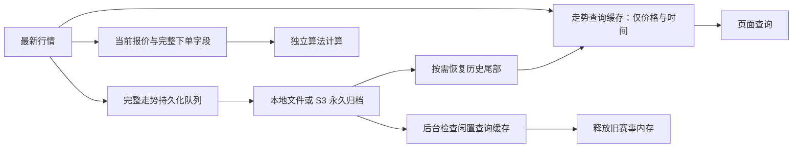

# TASK-39：浏览器 signal timed out 与长期运行内存累积

## 问题与证据

证据级别 A：生产 Nginx 日志、只读 HTTP 探测、Linux `/proc`、py-spy 栈采样、仓库代码。
时间：2026-10-11 UTC。原部署基线：`4f3861b`（TASK-38）。

`workbench.js` 的 GET 使用 `AbortSignal.timeout(8000)`，请求或响应体读取超过
8 秒会产生浏览器原生 `TimeoutError`。多处页面直接显示其英文 message。

故障发生在服务端：本机直连 `localhost:8000/health` 和容器 IP 也超过 12 秒；
Nginx 同时记录账户和推荐接口 499，等待约 8 秒，以及连接 API 超过 5 秒后的
upstream timeout。正常窗口内这些接口曾在 26–209 ms 返回，说明是间歇性全进程停顿。

| 测量项目 | 修复前实测 | 含义 |
| --- | ---: | --- |
| API 运行时间 | 约 8 小时 | 缓存累积随运行时长增长 |
| 历史赔率选项 `_last_price` | 451,651 | 与当前报价数量相差一个数量级 |
| 内存走势盘口 | 102,892 | 仅限制每盘口 400 点，没有赛事生命周期 |
| 当前报价表 | 19,640 行、85 场 | 已有清理机制的报价表与走势缓存脱节 |
| 主进程 RSS + Swap | 约 4.7 GiB | 历史对象占用物理内存和交换区 |
| `vmstat` 每秒换入 | 约 48–68 MiB/s | 当前正在换页，并非仅有历史 Swap 占用 |
| 主机内存压力 full avg10 | 18.41% | 同时存在内存等待 |
| 35 秒 GIL 样本 | 699/699 同一个展示函数栈 | 其他 Python 线程无法正常推进 |

栈停留在推荐标签格式化 `_is_zero_line`，数据库线值最大长度仅 7 字符。
**没有证据说明这段短字符串转换本身需要 35 秒**。巨量长期存活对象、持续换页
与垃圾回收引发的执行锁停顿相符；此次未直接测量 GC 回调耗时，因此不把具体
GC 阶段写成已证实结论。可证实的根因是行情查询缓存没有释放路径，导致内存
随旧赛事累积并出现换页、服务整体停顿。原生超时文字与缺少退避放大了页面故障体验。

## 修复后的数据流

1. 后台每 30 秒清理行情查询窗口。已结束或移除赛事没有新报价 30 秒后可释放；
   其他赛事沿用 900 秒报价新鲜度窗口。不限制仍在更新的订阅赛事数量。
2. 清理只影响 `_trends`、`_last_price`、盘口元数据和报价缓存。完整本地/S3
   归档、比分、终场证据和持久化投注身份不受影响。失败写入批次和正在恢复历史
   的赛事受到保护；查询已释放的走势会走原恢复路径。
3. 走势点去除每个历史点重复持有的完整下单字段，并使用带 slots 的可序列化
   数据类。最新报价和实际执行回调继续保留完整下单字段。
4. 决策回放按批次截取队列，避免把整个积压队列复制后再截断；淘汰决策缓存时
   同步移除其推荐缓存。
5. GET 在 fetch 和 JSON 读取阶段统一处理超时。账户和推荐保留上一份数据；
   推荐遇到超时、网络失败和 502/503/504 后退避 30 秒，手动刷新立即重试。
   设置保存超时提示重新读取确认结果，不自动重复提交。
6. `/api/v1/realtime` 新增 `price_cache`：赛事、盘口、走势点、累计释放赛事数量，
   用于区分永久数据量与当前内存窗口。

## 验证与边界

回归覆盖：300 场结束赛事连续进入/退出、活跃赛事保护、持久化失败保护、并发
恢复保护、释放后完整历史字节不变、恢复尾部、比分与终场证据保留、完整下单
字段保留、进程间序列化、回放写入失败重试、浏览器 fetch/body 超时、退避和
缓存保留、手动恢复。

生产核验只使用只读接口；不手动提交投注。部署后请求耗时和缓存变化记录在
`data/TASK-39-timeout-observation.json`。短期核验不能证明运行数小时以后永远
没有超时，仍需观察缓存是否在赛事结束后回落。TASK-38 的全链路 2 秒目标
不由本次页面响应验证替代。

### 部署后的实际结果

新版镜像 `0124e767f0d3`，API、控制台、Redis、独立模型服务健康；运行期 CPU
不限额。5 分钟只读采样，每 10 秒并行读取 6 个本机接口，共 186 次，全部
HTTP 200。真实浏览器通过 Cloudflare 域名读取账户与推荐接口 26 次，也全部
HTTP 200，P95 121 ms、最大 127 ms。5 分钟内 Nginx 未记录新的
499/502/503/504 或 upstream timeout。

| 本机接口（每项 31 次） | P95（ms） | 最大（ms） | 错误 |
| --- | ---: | ---: | ---: |
| 健康检查 | 261.138 | 1018.683 | 0 |
| 账户 | 135.928 | 195.025 | 0 |
| 工作台 | 133.640 | 170.833 | 0 |
| 推荐 | 146.118 | 266.276 | 0 |
| 数据与模型 | 129.358 | 233.213 | 0 |
| 投注状态 | 148.212 | 303.143 | 0 |

观察结束时主进程 RSS 约 292 MiB、Swap 约 26 MiB，内存窗口 4,484 个盘口，
已自动释放 13 场旧赛事缓存；新增归档 63,905 个走势点，归档删除/丢弃计数均
为 0。重启本身也会降低内存，因此释放计数和 300 场连续进入/退出回归是
判断修复生效的额外证据；5 分钟窗口不等于已验证数小时稳定性。

Python `urllib` 直连 CF 域名得到 403，原始结果保留在数据文件内。该探针
没有真实浏览器会话，结果从后端超时结论中排除；域名可用性使用实际浏览器
验证，未更改 Cloudflare 设置。

旧容器退出等待超过 180 秒，最终退出码为 **137**。终止前已观察到工作线程
和计算/历史子进程退出；三个最新 gzip 日志的最后压缩成员校验完整。该检查
仅证明已落盘记录末尾完整，**未独立证实旧内存队列已全部清空**。

### 检查命令与退出码

| 命令 / 检查 | 结果 | 退出码 |
| --- | --- | ---: |
| `./scripts/cpu-limited.sh run -- python3 -m unittest discover -s tests -q` | 1,347 项，跳过 11；56.587 秒 | 0 |
| `docker run --rm --cpus=2 --memory=768m -e PYTHONPATH=/w -v /root/ai_football:/w:ro -w /w ai_football-analytics-api:latest python -m unittest discover -s tests -q` | Python 3.12，1,347 项，跳过 11；88.937 秒 | 0 |
| 同上容器执行 `python -m unittest tests.test_history tests.test_live_workers tests.test_live_expert -q` | 最终镜像，75 项；8.161 秒 | 0 |
| 容器内 `python -m mypy --cache-dir=/tmp/mypy` | 84 个文件无错误 | 0 |
| 容器内 `python -m ruff check --no-cache .` | 全部通过 | 0 |
| 容器内 `python -c 'import api.app,collector.leyu_realtime,redis,boto3,orjson'` | 生产依赖导入 | 0 |
| `node --check web/console/workbench.js`、Python `py_compile` | 语法校验 | 0 |
| Playwright 执行 `tests/browser/timeout_flows.js` | 请求/响应体超时、缓存、退避、手动恢复 | 0 |
| Markdown → HTML、Playwright 在线/离线 Mermaid 核验 | 1 个 SVG；离线保留可读图源 | 0 |

Host Python 缺少 mypy/ruff，仓库已无旧 `requirements.txt`，因此依赖与静态
检查按现有 `docker/requirements-storage.txt` 和运行依赖在临时容器内执行。
没有在宿主机安装包。测试日志存在既有 SQLite ResourceWarning，未隐藏。
