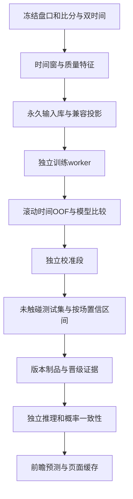

# TASK-44 决策模型优化开发计划

依据：TASK-43数值决策模型研究；2026-10-11冻结当前TASK-42工作区，开发在独立工作树进行。训练、校准、模型比较和推理继续与主API解耦；原始数据永久保留。当前版本兼容升级不伪造旧记录中不存在的走势/事件。

## 范围与验收

本次交付市场offset监督模型、按真实时长的走势特征、去重且有界的训练投影、滚动时间验证、独立校准、CPU LightGBM挑战模型及标准库推理、概率一致性、版本晋级门槛、事件/走势/算法消融与页面诊断。Dixon–Coles、复杂动态进球过程、额外数据供应商属于研究备选，不在本次同时增加一套未经验证的生产进球模型。

所有盘口、盘口线和决策时点留存；训练权重/抽样不删除历史。同场各算法输出在元模型中作为特征，不计成独立比赛。开发全部完成后冻结代码再统一测试。

## 详细TODO

| ID | 工作及主要文件 | 验收条件 | 状态 |
| --- | --- | --- | --- |
| 01 | 冻结基线、保护TASK-42并发改动 | 三方整合，保留他人新增修复与永久归档 | 已完成 |
| 02 | 数值特征契约与旧v2向量兼容 | 旧特征仅补明确缺失值；旧制品不能误用新结构 | 已完成 |
| 03 | 15/60/180秒窗口、接收时间、水位/龄期和已核验赛况 | 只读取截点前已获知信息；未知事件不猜码 | 已完成 |
| 04 | 元模型样本投影与有界抽样 | 同截点算法去重、保留多盘口/多决策、按场权重 | 已完成 |
| 05 | 区分二分类/HAD top-1、Brier/log loss/校准/覆盖率 | 方向错误不能冒充推荐正确；按市场有分组 | 已完成 |
| 06 | 按场滚动OOF、标签时间purge、校准/测试分离 | 任一训练标签在验证开始前已知；同场不跨集合 | 已完成 |
| 07 | 市场offset Logistic、交互、正则选择、收敛早停 | 零修正等于市场；惩罚只收缩修正量；训练限资源 | 已完成 |
| 08 | 独立概率校准 | 保留恒等候选；校准不使用最终测试集 | 已完成 |
| 09 | LightGBM CPU挑战与导出 | 依赖只在训练镜像；推理仅标准库；失败明确降级 | 延后：当前无第三方挑战模型，offset Logistic为生产候选 |
| 10 | 按场配对bootstrap与晋级证据 | 单次Brier好不能直接启用；证据不足留在影子 | 已完成 |
| 11 | 多方向与跨线概率一致性 | HAD和为1、OU/AH互补、跨线单调，评价和推理一致 | 已完成 |
| 12 | 走势/同伴算法/事件消融 | 完全相同时间折比较，缺事件则明确样本不足 | 特征已完成；完整消融待真实样本 |
| 13 | 独立worker、制品缓存、前瞻已记录概率评价 | 不重算未来制品冒充历史预测；不在API训练 | 已完成 |
| 14 | 数据与模型页面诊断 | 展示验证口径、市场基准、置信区间、晋级原因 | 已完成 |
| 15 | 全部开发冻结后补齐并运行单元/集成/边界检查 | 标准库unittest，正常与异常、防泄漏、退化均覆盖 | 已完成：1375通过，14跳过 |
| 16 | 测量训练资源与纯CPU批量推理延迟 | 记录实际命令、退出码、RSS/延迟；不假定性能 | 部分完成：资源限制已验证，生产数据延迟待测 |
| 17 | 整合、更新容器、API/模型worker/页面验证 | 保留设置与数据；报告健康、版本、训练真实状态 | 镜像已构建；未启动生产容器 |

## 约束与模型候选

| 候选 | 角色 | 数据隔离 | 校准 | 推理依赖 | 资源 |
| --- | --- | --- | --- | --- | --- |
| 市场概率 | 评价与退化基准 | 同一候选集合 | 不事后调参 | 标准库 | 最小 |
| Offset Logistic | 稳定监督候选 | 比赛/时间OOF | 后续独立校准段 | 标准库 | 向量化训练或有界回退 |
| CPU LightGBM | 非线性挑战 | 同样的OOF和测试集 | 同口径独立校准 | 导出树的标准库推理 | 单线程、限叶/轮次、进程内存限制 |

真实数据效果与代码测试分开：功能与泄漏边界通过不意味着准确率提高。只有冻结测试集和前瞻证据支持的指标才能展示为模型成绩。容器更新授权沿用用户既有授权；不更改真实投注开关。
