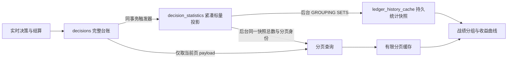

# PostgreSQL 战绩读取与统计

战绩页读取 `/api/v1/ledger/history`。PostgreSQL 不支持 SQLite 的布尔值隐式求和；所有本金计数均使用数值 `CASE`，数据库 `Decimal` 在统计边界转为原生数值，HTTP 编码层也兼容 `Decimal`。



| 数据 | 读取口径 | 更新时间 |
| --- | --- | --- |
| 逐条决策与赛果 | 原始台账，精确分页；过滤项、每页条数与页码独立缓存 | 后台刷新，30 秒后允许重读 |
| 记录总数 | 紧凑投影，精确计数，与该页使用同一 REPEATABLE READ 快照 | 与对应页面一起刷新 |
| 算法、联赛、置信度与时间分组 | 同一数据库快照 | 后台刷新，60 秒后允许重算 |
| 算法权重证据 | 按场聚合的既有口径 | 缓存最长 15 秒 |

`statistics_at` 标记统计快照开始时间，`entries_at` 标记分页快照时间；当新决策继续到达时，分页总数可以大于分组快照的总量。前端根据 `statistics_refreshing`、`statistics_stale`、`statistics_error` 与对应 `entries_*` 字段展示状态。

PostgreSQL 战绩 HTTP 请求只读取内存缓存，不建立数据库连接，不进入日志导入锁，不执行 COUNT、性能证据扫描或共享写连接上的健康查询。首次缺少页面时 `entries_status=loading`，`entries_total` 与 `entries_shown` 为 `null`；首次缺少统计时 `statistics_status=loading`，`overall`、`settled` 与 `portfolio_summary` 为 `null`。这些值表示未知，不能当成零或无记录。各过滤页独立读取，绝不返回另一个页码或过滤条件的旧内容。后台成功读取空结果后才返回准确的零。SQLite 读取行为保留。

分页和分组各使用一个串行后台线程，最多16个待处理键；两份 LRU 内存缓存各限制16项与16MB，防止大量过滤条件或巨大 JSON 占满内存。单次读取设置60秒总预算、3秒锁等待、禁止并行扫描；错误15秒后允许重新入队，已有准确缓存会保留并标记陈旧。战绩算法权重读取实时服务已发布的证据快照，不触发新的数据库扫描。数据库维护拥堵只延迟后台更新，不占据前台 HTTP 线程。

现场只读 EXPLAIN 显示：默认前瞻页使用 `idx_statistics_page` 读取限定身份，再通过 `decisions_pkey` 获取100条 payload；记录总数仍需遍历该过滤范围的索引项。远程大表核验产生大量临时文件时，即使分页索引正确，同步总数、证据查询及共享连接等待仍可把整个 HTTP 响应拖至28–57秒，因此不能只延长浏览器8秒超时。

本金、正确率和收益口径保持不变：每条被选中的已结算建议为一单位本金，走水计入本金、剔除正确率；赢半和输半在正确率中各计半单位。同场不同盘口、不同决策仍保留为各自记录。训练输入与时间截止契约继续读取原始 PostgreSQL 表，不依赖展示缓存。

## 初始化与恢复

首次部署前在独立维护容器执行：

```bash
docker compose -f docker/docker-compose.yml run --rm --no-deps \
  --entrypoint python analytics-api -m tools.prepare_ledger_statistics
```

若生产镜像尚未包含该工具，可以挂载项目目录并设置工作目录后执行模块。维护流程先提交触发器，再回填历史投影，最后写入迁移完成标记；服务启动和浏览器读取不执行历史回填。会话级咨询锁避免并发维护，重复运行只维护索引与触发器。历史 JSONL 导入检查点使用规范路径，并识别宿主机与容器的 `output/ledger` 挂载别名，避免相同文件因路径表达不同而重新导入。
