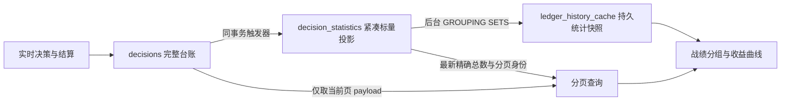

# PostgreSQL 战绩读取与统计

战绩页读取 `/api/v1/ledger/history`。PostgreSQL 不支持 SQLite 的布尔值隐式求和；所有本金计数均使用数值 `CASE`，数据库 `Decimal` 在统计边界转为原生数值，HTTP 编码层也兼容 `Decimal`。



| 数据 | 读取口径 | 更新时间 |
| --- | --- | --- |
| 逐条决策与赛果 | 原始台账，精确分页 | 每次请求 |
| 记录总数 | 紧凑投影，精确计数 | 每次请求 |
| 算法、联赛、置信度与时间分组 | 同一数据库快照 | 后台刷新，60 秒后允许重算 |
| 算法权重证据 | 按场聚合的既有口径 | 缓存最长 15 秒 |

`statistics_at` 标记统计快照开始时间；当新决策继续到达时，分页总数可以大于该快照的总量。前端根据 `statistics_refreshing`、`statistics_stale` 与 `statistics_error` 展示状态。首次缺少快照时，页面返回准确总体统计和逐条记录，分组与曲线明确处于计算中，不提供虚构数值。

本金、正确率和收益口径保持不变：每条被选中的已结算建议为一单位本金，走水计入本金、剔除正确率；赢半和输半在正确率中各计半单位。同场不同盘口、不同决策仍保留为各自记录。训练输入与时间截止契约继续读取原始 PostgreSQL 表，不依赖展示缓存。

## 初始化与恢复

首次部署前在独立维护容器执行：

```bash
docker compose -f docker/docker-compose.yml run --rm --no-deps \
  --entrypoint python analytics-api -m tools.prepare_ledger_statistics
```

若生产镜像尚未包含该工具，可以挂载项目目录并设置工作目录后执行模块。维护流程先提交触发器，再回填历史投影，最后写入迁移完成标记；服务启动和浏览器读取不执行历史回填。会话级咨询锁避免并发维护，重复运行只维护索引与触发器。历史 JSONL 导入检查点使用规范路径，并识别宿主机与容器的 `output/ledger` 挂载别名，避免相同文件因路径表达不同而重新导入。
