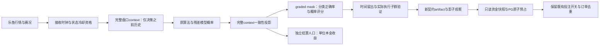
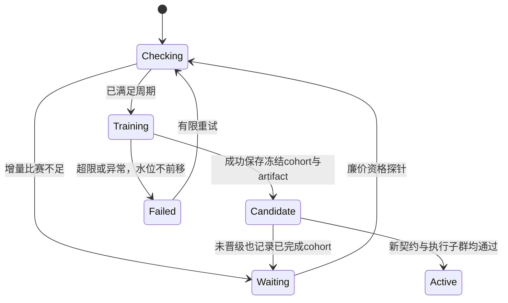

# TASK-55：单一乐鱼数据源重大偏差修复

日期：2026-10-14。基线：`9e9da2e`（整合 main `f2d1aa6`、#60、#61）。实现继续交付 PR #62；保留根工作区尚未提交的账户、页面与设置功能。

## 调研结论与边界

现有审计已核验算法66篇、直接足球预测51篇独立论文，阅读深度为元数据/摘要，不是全文实验复现。证据与逐篇代码映射见 `reports/decision-algorithm-model-audit/`。单一来源仍能解决时序污染、结算口径、执行一致性及评价偏差；增加算法个数不产生新的信息源。不要求引入外部赔率，也不承诺实现盈利。

| 路线 | 来源要求 | 当前输入适配 | 时间泄漏控制 | 可核验市场基准 | CPU/内存 | 短期落地 | 主要限制 |
|---|---|---|---|---|---|---|---|
| 去水概率＋正则化残差 Logistic | 同一乐鱼完整盘口 | 高 | 截点、接收时钟、标签可见性 | 同时点同合约概率 | 低 | 保留当前七坐标 stack | 同源算法相关，增益需样本外认证 |
| Dixon–Coles/双变量 Poisson | 乐鱼历史赛果、可核验球队身份 | 中 | 仅使用赛前/决策前赛果 | 同一时点盘口 | 中 | 作为后续挑战者 | 现有历史身份和覆盖率尚未认证 |
| 校准与概率一致性投影 | 乐鱼双向/三向、跨线盘口 | 高 | 在完整预测 context 上投影 | 同组市场向量 | 低 | 本次修复 | 不能先按事后结算删掉走盘方向 |
| 多庄家外部价格比较 | 至少第二个来源 | 当前不具备 | 外部接收时钟也需留存 | 独立价格 | 中 | 本次不依赖 | 没有数据，不能把缺失当系统无解 |

方法依据：proper scoring/校准与配对比赛聚类证据属于B类学术证据；当前代码、PG测量与抓包属于A类可核验一手证据；旧价事故回放属于限定样本测量。前述16分钟是一次全量取样墙钟，不是P95或完整训练耗时。30/60秒后价格如果跨越进球、红牌或盘口暂停，不属于可直接比较的CLV。

## 实施顺序与验收

| 步骤 | TODO与完成条件 | 验证 |
|---|---|---|
| 1 数据与评价 | 保留完整预测context；push/ungraded的y=None，分类mask后计分；半赢半输按非走盘部分权重；金融人口独立，走盘本金1净0；补全赔率持久化 | 冻结模型OU2.5/OU3反例与live概率逐向一致；全走盘、半输赢、缺赔率、缺标签 |
| 2 模型契约 | 独立validation版本；load、shadow、promotion、rollback一致；旧artifact保留而不沿用旧approved | 旧契约拒绝、新契约接受、回滚不绕过；实际ensemble独立门槛 |
| 3 训练调度 | 最近完成cohort独立于active；仅成功保存candidate推进水位；训练中新增标签不消费；check-only只查indexed资格cohort | 未晋级不重复fit、训练中新增10场留给下一轮；廉价探针实测；关闭决策/投注仍可训练 |
| 4 现金风险 | 乐鱼只读余额/注单形成资金快照；PG账户锁＋订单原子预占；全局和单场限额；unknown保留，权威settled/rejected才释放；请求固定金额也受风险预算限制 | 并发超额拒绝、重试去重、重启保留、未知不释放、逐订单号对账；全部用隔离fixture，零真实下注 |
| 5 历史污染 | 新资格代际隔离旧虚拟赛/进球前旧价历史；缺状态证据不伪造修复；原始记录保留，权重与训练只取可认证代际 | 旧版本不进入权重/训练；短时虚拟赛识别与进球冷却测试；统计解释历史排除原因 |
| 6 存储迁移 | 独立空PG schema完整含双接收时钟、赔率；不依赖生产预建表 | 隔离空PG从SQLite复制完整prediction |
| 7 冻结验证与上线 | 所有Agent停止写后CPU受限Docker unittest、mypy、ruff、compile；核对生产源，更新容器、验证设置不变、页面与worker | 真实命令/退出码、源哈希、健康与日志；新契约训练按真实结果报告，不自动强制晋级 |

## 上线与数据保留

所有原始盘口、决策、标签、旧模型保留。隔离是资格版本控制，不删除历史。PG设置为权威配置，升级不覆盖用户开关。训练与影子运行独立于实时API。部署从冻结集成树构建，使用原项目的.env/client/output挂载；不部署旧root源码，不读取或发布凭据。

最终验收区分工程修复与统计证据：没有通过新验证的模型可以继续作为候选观察，但不会因旧approved标记进入真实执行。没有足够新资格数据时明确显示等待；不得用旧污染数据充数量或用假标签凑训练。

## 2026-10-14 执行契约细化

分析与规划已分别通过本机 pi（deepseek-v4.1-flash）讨论，首轮分歧和修订见 `pi-consensus-TASK-55.md`。保留固定金额/置信度乘数策略，不强制使用未经认证的Kelly。新增现金全账户10%、单场2%默认权益上限，用户可在设置修改；研究同场 `max_total_exposure` 不改语义。资金快照仅认可乐鱼体育钱包CNY与完整分页未结注单，最长30秒；PG账户锁+订单claim同事务预占，未知无TTL释放，权威匹配订单号结算才释放。此原子性涵盖本系统并发claim，场馆外部账户变化仍以最新可读快照为边界。

新代 `live-poisson-market-v3` 与 `remaining-ah-signed-lines-bernoulli-v5-offset-windows-asof-quote-qualified` 保留旧文件并隔离旧输入/权重。首次比分观察单独存 `score_state_boundary_ms`，不冒充进球时间，冷却后的报价事件与接收时钟都需要在当前cutoff前。历史重算不能凭终场标签重建这项证明。

影子分类只评分won/lost/half_won/half_lost；push y=None且上下文保留。每时点同市场线选最大概率方向、单位本金1：赢o−1、输−1、半赢(o−1)/2、半输−0.5、走盘0。首次合约去重与逐时点口径分别报告，void为不可核验而非自动退款，缺赔率/不完整合约逐原因统计。
