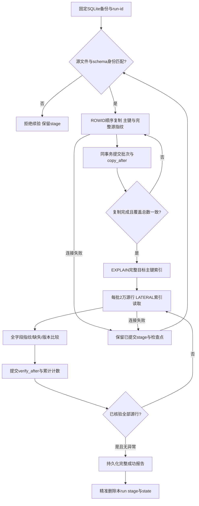

# 可恢复的完整迁移核验

大表核验使用 `tools/verify_sqlite_postgres.py --resumable`。默认旧模式继续用于小表。两种方式均核验每一条源记录的完整比较字段 SHA256、主键覆盖和允许的版本关系，不以抽样或单纯数量核对代替内容验证。

当前大表默认模式将宽目标行带入全表哈希连接，4MB work_mem 下会产生大量临时分批；TEMP stage 在进程断线时也消失。可恢复模式使用持久 UNLOGGED stage 与检查点，目标通过完整主键按批查找，每行进入比较聚合前已变成32字节指纹。



| 方案 | 完整内容核验 | 断线恢复 | 目标扫描 | 临时文件风险 | 内存预算 | 实施范围 |
| --- | --- | --- | --- | --- | --- | --- |
| 旧TEMP全表连接 | 是 | TEMP丢失，需重复制 | 全目标宽表 | 高，宽元组反复分批 | 默认PG预算 | 保留用于小表 |
| UNLOGGED全目标物化指纹 | 是 | 可恢复stage | 全目标一次SHA扫描 | 指纹更窄但仍有全表物化 | 需按全表规模评估 | 未采用 |
| UNLOGGED有界主键查找 | 是 | COPY与核验检查点可恢复 | 每批仅查对应唯一主键 | 无巨大全目标hash，EXPLAIN拒绝全表计划 | 会话256MB、parallel=0 | `--resumable` |

## 源身份与事务

默认 run-id 由规范源路径与目标名生成，也可以显式提供 `--run-id`。SQL 标识符仅使用该身份的SHA256截断值，不包含路径、用户文字或凭据；同一run使用会话 advisory lock防并发。

元数据固定源路径、主文件和WAL的设备/inode/大小/mtime/ctime、表结构指纹、源行总数与核验格式版本。源打开只读事务；复制前、每批提交前、核验推进前及完成前重新检查文件身份。文件或schema变化拒绝续验，不自动丢弃旧stage。该方式使用本机文件与结构签名而非再全扫30GB文件SHA；适合已停写、固定的迁移备份。读取中的WAL或数据库文件变动也会拒绝，避免把不同快照拼接。

每批最多10万源行，通过SQLite真实 `_rowid_` 排序前进，允许负值与间隔。UNLOGGED stage存储源ROWID主键、业务完整主键、32字节SHA与决策版本。批次COPY与 `copy_after`、复制计数在同一PG事务提交，失败一起回滚。NULL主键、遮蔽ROWID或WITHOUT ROWID表拒绝该模式；可使用旧核验方式。

stage和元数据都为UNLOGGED，客户端断线保留，PG崩溃恢复可能同时清空。这不是永久业务存储；它只保存可重建的核验指纹。恢复时若已提交尾行缺失则拒绝跳过复制，不可把丢失stage作为成功。成功业务数据始终位于原目标表。

## 有界目标核验

每批默认2万stage行，`batch AS MATERIALIZED`按源ROWID读取，`LEFT JOIN LATERAL (... WHERE 全部主键相等 OFFSET 0)`获取目标行。OFFSET 0阻止优化器把相关查询改成全宽目标哈希连接。目标查询内部生成完整字段SHA256二进制值后才进入聚合；每批只回传数量、最大ROWID和异常计数，不把目标payload传回客户端。

先执行 `EXPLAIN (FORMAT JSON)`，不执行目标扫描。非空源要求目标 relation使用 Index Scan/Index Only Scan，Index Cond含全部主键。拒绝Seq Scan、无索引条件或缺键计划，保留stage。空源不要求索引计划。索引查找性能仍取决于远程磁盘和目标索引缓存，不能把有界批次视为固定完成时间保证。

只对核验会话设置work_mem=256MB、parallel=0、statement_timeout=60秒、lock_timeout=3秒；不改服务或全局PG配置。单语句超时最多重试两次；断线交给新连接按检查点继续。每个核验批次的结果与 `verify_after`、累计数量原子保存；未保存的批次可重复计算，不会双计数。

所有源行都被核验，最终累计必须等于源总数、复制总数，缺失/内容不一致/落后版本都必须为0。`decisions`允许目标较新版本，`imports`允许检查点增长，`files.cleaned`单调删除标志不进入比较，与旧模式相同。各批次在各自已提交目标快照上验证，不构建长时间持有的全表一致快照；迁移窗口应保留目标原有历史行，允许追加与所声明的单调变化。

完整报告先写临时文件、fsync、原子替换并fsync目录，再精准DROP本run的stage与state。失败报告 `verified=false`，保留stage便于续验或复核。内容不一致不是瞬时超时，修复数据后应选新的run-id重新核验，而不是沿用已累计的异常计数。

## 使用

生产全量核验使用以下命令，沿用固定 run-id 以便断线续验：

```bash
./scripts/cpu-limited.sh run -- docker run --rm \
  --cpus=1 --memory=1g --env-file .env \
  -e DATABASE_BACKEND=postgres -e PYTHONPATH=/w \
  -v "$PWD:/w" -w /w --entrypoint python ai_football-analytics-api \
  tools/verify_sqlite_postgres.py --root output --table model_inputs \
  --resumable --run-id model-inputs-cutover-20261012 \
  --copy-batch 100000 --verify-batch 20000 --query-retries 2 \
  --report output/pg-cleanup/verify-model-inputs-resumable.json
```

源保持相同路径和文件身份，使用相同run-id续验。不要在原TEMP核验仍运行时另开大表核验。UNLOGGEDstage占用远程PG硬盘，失败时保留是恢复契约；完成后由命令按精确身份清理，不扫描或删除其他run。

## 验证

证据等级A：18项标准库单元测试覆盖正常完整比较、负值/间隔ROWID、COPY/检查点回滚、复制中断恢复、核验断线恢复、源文件与schema变化、内容不一致/缺失、超时有限重试、索引计划拒绝、PG恢复导致stage丢失、空源、NULL主键及报告原子持久化。定向测试命令见 `tests/test_verify_sqlite_postgres.py`。

小规模真实PG smoke仅使用项目目录临时SQLite与独立会话TEMP目标，测试run拥有的UNLOGGEDstage成功后精准清理；不会读取或写入业务model_inputs。实际生产规模的执行计划、完成时长及核验结果需要另行运行才能声明。
