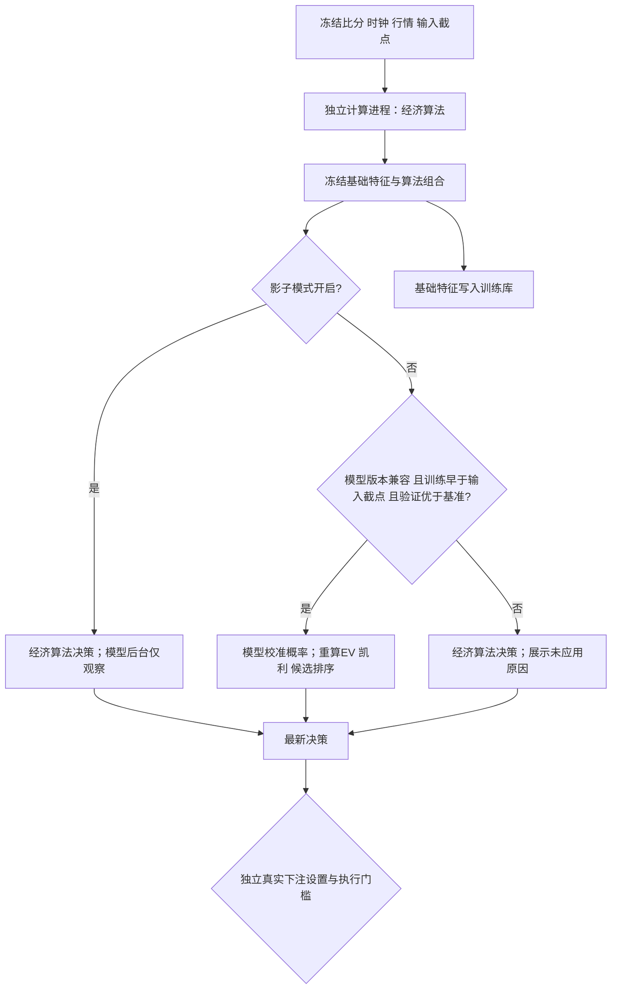
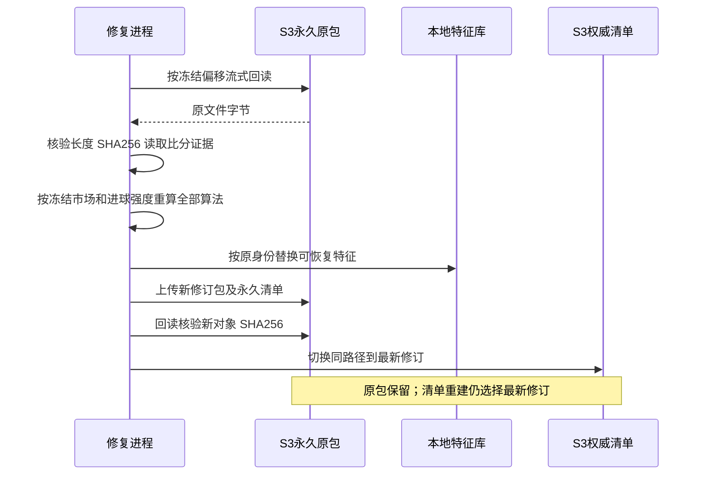

# 模型模式切换与历史数据修订

日期：2026-10-11。证据 A：仓库代码、冻结 SQLite 索引、S3 回读校验和实际运行日志。
最终数量以 `output/_archive/repairs/task42/status.json`、`progress.sqlite3` 为准，
修复进程开始执行不等于任务已完成。

## 影子模式开关

设置 → 数据与模型 → 模型训练 → 决策模式提供 `model_shadow_enabled`。
默认开启。训练开关、影子开关和真实下注开关独立；改变影子开关不会启动真实下注。

模型推理发生于已有独立实时计算进程，API 不导入训练模块、不运行优化器。
每次推理使用同一冻结快照的所有 peer 概率；校准后的输出不回流到训练基础特征。
模型原子替换通过文件 inode、mtime 和大小更新缓存。模型失效、未来版本、
验证 Brier 未优于市场基准时使用经济算法并记录原因，不阻断采集。
首判身份和结算证据同时区分 `decision_model_version`。
模型实际模式不能借用基础经济算法或其它训练版本的命中次数、独立比赛数及 ROI；
展示和执行都查询同一校准版本，缺同版本证据时执行门槛拒绝下注。

全部可恢复输入保留在训练库。自动训练采用只按原记录身份计算的 SHA256 最小哈希抽样，
每场最多 64 条（命名常量 `TRAINING_MAX_ROWS_PER_MATCH`），以遵守现有 512 MiB 内存
与 600 秒 CPU 时间限制。标签不参与抽样排序；比赛仍等权，半注按非走盘本金加权，
训练/验证按比赛和时间分离。状态和模型文件记录抽样规则及抽样前有效记录数。
抽样上限改变会改变有限样本方差和训练时间，不能把抽样验证指标当作全部回放的重评分。

| 设置 | 开启 | 关闭 | 默认 |
|---|---|---|---|
| 自动更新训练模型 | 满足新增比赛和资源门槛后训练 | 停止自动训练；已有模型仍可推理 | 开启 |
| 模型影子模式 | 仅记录预测和评估 | 合格模型进入实际概率和候选决策 | 开启 |
| 真实投注 | 满足独立门槛后提交；生产容器启动时由 `AUTO_ENABLE_BETTING=1` 自动打开 | 不提交真实订单 | 代码默认关闭，生产启动按环境变量开启 |

## 修复契约

原始比分、价格和接收事件是事实，不能因为算法错误就改造它们。
原 S3 pack 永久保留，冻结索引记录原对象、偏移、长度、SHA256。
修订文件逐条引用源对象、源文件 SHA256 和行号，可恢复原始全量内容。
修订回放保留全部支持盘口，RAW 盘口完整原文仍可从原对象获取。

污染的历史算法权重不复用。修订采用明确标注的中性先验组合；
不会用以后才知道的比赛结果重构当时权重。保存的当前/衰减进球强度、
完整市场价格和输入截点用于重算 AH、负分盘、风控 Bernoulli 概率及 peer 特征。
不存在冻结进球分布时，AH 原概率移入 `original_p_model` 审计字段；
存在终场依据时仍修复结算。缺半场、终场或输入时点证明的记录逐项标记，
排除训练，不补造比分、时钟或走势。

| 处理方式 | 原始证据 | 标签修复 | 概率特征 | 时间隔离 | S3恢复后行为 | 可审计性 |
|---|---|---|---|---|---|---|
| 仅重标旧标签 | 保留 | 可修复 | 仍污染 | 部分 | 旧特征可能复活 | 不足 |
| 全部隔离旧记录 | 保留 | 不恢复 | 不使用 | 保守 | 必须另设版本门槛 | 可审计但损失可恢复样本 |
| 冻结输入重建并发布修订 | 原包永久保留 | 有证据则修复 | 有冻结依据则重建 | 保留原截点和结果可知时间 | 最新永久清单选择修订 | 源对象 SHA256 行号与逐文件统计 |

## 核验

有界流式回读覆盖多 GB 压缩文件，避免一次读入内存。
逐文件提交特征和 S3 清单之后记录完成状态，重启幂等恢复。
本地采集仍追加的文件先保留待合并修订，在停止写入后合并冻结边界之后的尾部。
原训练数据库、预测库和台账数据库先作 SQLite 一致备份。
测试覆盖真实开关效果、未来模型拒绝、特征防回流、负让球重判、
缺证据隔离、原包恢复、最新修订清单重建以及校验失败。

## 运行审计结果（2026-10-11）

本次审计直接读取 `output/models/inputs.sqlite3`、`output/ledger/ledger.sqlite3`
并调用训练集构造器，使用确定性每场最多 64 条的限制复核，不把旧预测库当作训练来源：

| 项目 | 数量 / 结果 | 解释 |
|---|---:|---|
| 输入总量 | 2,064,796 | 修复期间的当前本地投影 |
| 版本不兼容而隔离 | 1,926,802 | 旧 `data_version`、`model_version` 或 `feature_version`，不能训练 |
| 结算证据不足而跳过 | 4,403 | 无完整终场/半场或不满足盘口结算依据 |
| 当前版本可用原始决策 | 100,658 | 125 场；达到样本数量门槛，但仍需通过独立验证 |
| 旧台账模型记录隔离 | 147,039 | 旧版本只保留审计，不作为新模型样本 |

滚动时间验证的第三折（21 场独立验证）中，校准模型 Brier 为 0.23117，市场基线为
0.23097；配对比赛 bootstrap 的 `delta_brier=0.00020`，95% 区间为
`[-0.00588, 0.00594]`，区间跨过零。三折未形成稳定优势：第一折模型略优
（0.23189 对 0.23467），第二折和第三折分别劣于市场（0.22706 对 0.22529；
0.23117 对 0.23097）。这说明旧错误数据已被排除，但当前模型尚未证明能够稳定降低
下注损失；训练保持关闭，影子模式保持开启，需继续积累独立样本并重新验证后才允许
重新评估。

台账与执行链路的损失归因也要分开看：截至本次快照，`live-poisson-market-v1`
已有 137,735 条结算 pick，命中（含半赢）69,787 条、输（含半输）58,531 条、走盘
9,417 条，记录净 PnL 为 `-7889.85`；`live-poisson-market-v2` 的 9,983 条结算 pick
记录净 PnL 为 `-352.80`。这些数字是历史决策台账的结算结果，不是当前模型的实盘收益。
当前自动下注仍按容器启动配置运行；最近 20 次提交的发出延迟只有 11 次落在 2 秒目标内，
p95 发出延迟约 7.98 秒、p95 回执延迟约 8.33 秒。报价在提交前发生漂移时，即使概率和标签
正确，成交价格也会抹掉预期优势，所以这部分风险不能通过重新训练解决。
