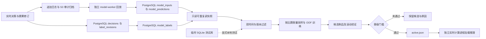
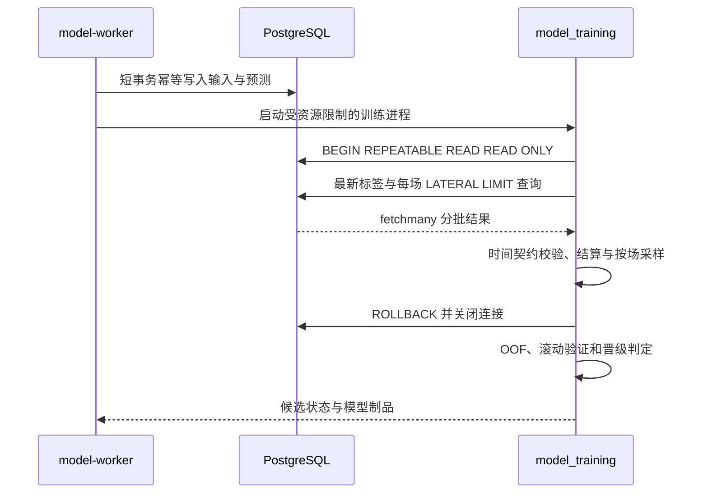

# 决策模型训练存储边界

生产数据库已切换为远程 PostgreSQL。`analytics-api`、`model-worker` 和 `archive-worker` 均由 Compose 显式设置 `DATABASE_BACKEND=postgres`，训练输入、标签修订、预测记录和归档索引写入配置的远程数据库。SQLite 仅保留为测试或显式选择的本地后备实现；生产连接失败、依赖缺失或查询超时不得自动回退到 SQLite。

切换、完整性核验、备份清理和页面交付进度统一记录于 [PostgreSQL 收尾与决策设置](postgres-cutover-and-console.md)。本文描述当前代码边界，不将尚未完成的全量核验或清理描述为已完成。

## 当前读写链路

`service/model_training.py` 仍向 `dataset()` 与 `prospective_metrics()` 传入历史文件路径，保持本地测试接口兼容；这些路径不意味着生产使用 SQLite。`store/training_data.py` 先调用 `projection_target_from_env()`，生产环境将其解析为 PostgreSQL 并进入远程查询分支。

[`store/training_projection.py`](../../store/training_projection.py) 支持显式 `TRAINING_PROJECTION_DSN`；未提供该变量而 `DATABASE_BACKEND=postgres` 时，从 `PG_BASE_URL`、`PG_BASE_PORT`、`PG_DATASET`、`PG_USER`、`PG_PASSWORD` 构造连接。缺少必需配置直接报错。生产不得将 DSN 指向 SQLite，或通过移除后端标志绕过远程数据库故障。

训练写入使用独立 writer connection，仅执行幂等输入/预测投影写入及 schema 初始化。训练读取使用只读连接和 statement timeout；`readonly_snapshot()` 开启 `REPEATABLE READ READ ONLY`。训练集与前瞻指标各自使用一致性快照，并非跨两次计算共享一条长事务；游标、事务和连接在结束或异常时释放。

## 存储选项边界

| 维度 | PostgreSQL 主库（当前生产） | PostgreSQL 只读副本（可选扩展） | SQLite（测试/显式本地后备） |
| --- | --- | --- | --- |
| 使用状态 | 三个服务统一远程读写 | 尚未用于当前生产部署 | 保留兼容实现 |
| 写入一致性 | 输入、台账和标签各自短事务持久化 | 写入仍须走主库 | 单文件 WAL 与写锁 |
| 训练读取 | 只读可重复读事务 | 同类快照，额外检查复制水位 | mode=ro 加读事务 |
| 查询资源 | 按比赛索引查找及有界结果集 | 可隔离主库查询负载 | 受本地文件 I/O 与锁影响 |
| schema 初始化 | advisory lock 串行化 | 由主库复制 schema | 临时库独立初始化 |
| 故障行为 | 报错并保留上次有效制品，无自动后备 | 复制延迟或失败须明确报错 | 仅显式测试/本地配置选择 |
| 凭据与依赖 | 环境注入 PG 配置及容器内 psycopg | 独立只读账号和 DSN | 无远程凭据 |
| 备份职责 | PG 服务器数据库备份另行管理 | 复制不能替代备份 | 迁移源核验后远程备份 |

## 数据与性能契约

- 输入主键包含比赛、决策时间、算法、盘口、盘口线和方向；一场比赛保留多盘口及多个时间点的决策，不能折成一条比赛记录。
- 输入必须满足当前数据、模型和特征版本。决策接收时间与报价接收时间均不得晚于 cutoff_ms；走势特征仅由决策截点前可见数据生成。
- 标签通过 label_revisions / model_labels 保留赛果首次可见时间与修订顺序；标签须晚于对应决策。模型生成后的盘口或赛果修订不能提前作为已知特征。
- 生产训练由已标注比赛集合驱动，按比赛使用 LATERAL 查询与 LIMIT。当前每场训练上限为 40，随后按比赛等权训练与评价，避免对约 2,300 万输入全局排序。该数据量是迁移时量级，最新值以核验报告为准。
- 索引覆盖数据版本、模型版本、特征版本、比赛与时间，结果通过 fetchmany() 分批读取；schema 初始化复用迁移索引，advisory lock 避免多个 worker 同时扫描建索引。
- 聚合返回的 Decimal 在统计/模型边界转为 Python 数值；整数标志与布尔输入按兼容层契约处理，避免适配差异阻断训练或 JSON 返回。
- 全量输入数量、已核验抽样有效/无效数量与尚未统计数量必须分开显示。每场 40 条的训练抽样统计不能代表全量输入资格，PG 统计估计值不能标为精确计数。
- CPU 与内存配置约束独立训练进程；失败写入状态并保留已有可用制品。纯模型和混合模式没有有效模型时明确不可用，不自动改用算法模式。

## 核验与清理

[`tools/migrate_sqlite_to_postgres.py`](../../tools/migrate_sqlite_to_postgres.py) 迁移历史表；[`tools/verify_sqlite_postgres.py`](../../tools/verify_sqlite_postgres.py) 以源主键和内容指纹验证目标覆盖，允许生产目标增加新数据，不以简单“目标行数大于源”代替内容核验。

SQLite 源库及 WAL/SHM 只有在源快照、PG 主键与内容核验、远程备份 SHA256 和可读性验证完成后才可清理。任一核验不一致时不得删除对应源文件。执行记录与验收状态见 [切换交付文档](postgres-cutover-and-console.md)。

训练正确性还需比较冻结水位下的有效输入、时间资格、可结算样本、按比赛样本数量与折边界。迁移成功不等于模型已优于市场；候选是否晋级由独立验证证据决定。
