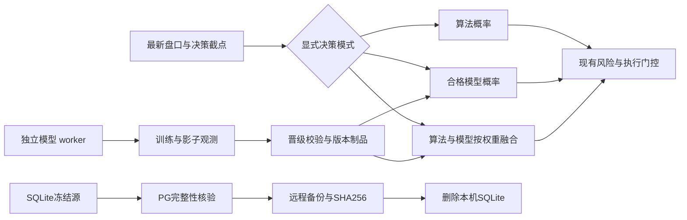
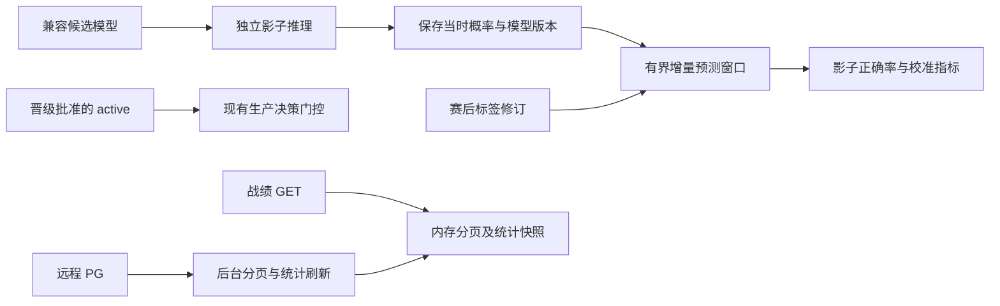

# PostgreSQL 收尾与决策设置交付计划

本次范围是完成已授权的数据库切换与页面修复，并统一决策来源。所有操作产物保存在项目 `output/`，凭据不入库。用户已授权容器更新、远程 issue/PR 收尾和备份后清理 SQLite。

| 项目 | 验收条件 | 状态 |
| --- | --- | --- |
| 设置说明 | 所有设置、算法复选项、清密钥项都有可点击问号；公式与代码一致；键盘和移动端可用 | 已实现；定向与全量回归通过 |
| 决策来源 | algorithm / model / hybrid 热更新；无合格模型时显式不可用；版本/权重/截点留痕 | 已实现；定向与全量回归通过 |
| 战绩 | 修复 PG 布尔聚合、Decimal JSON；紧凑统计投影避免大 JSON 堆扫描；实际页面端点验证 | 已实现；定向与全量回归通过 |
| PostgreSQL 完整性 | 全源主键覆盖及内容指纹比对；可更新行验证目标修订不落后 | 核验进行中，清理与远程合并尚未完成 |
| SQLite 清理 | 远程备份 SHA256/可读检查通过；所有服务 PG；仅删除核验过的数据库与 WAL/SHM | 核验进行中，清理与远程合并尚未完成 |
| 远程仓库 | 当前版本通过完整测试；整合依赖链 PR；只关闭已验收 issue；未完成 #52 保留 | 核验进行中，清理与远程合并尚未完成 |

纯模型指项目现有数值 offset Logistic 模型的推理结果，模型特征仍包含已冻结的盘口与算法特征；这不是重新训练一个禁止算法特征的新模型。混合公式 `p_final=(1-w)*p_algorithm+w*p_model`，随后统一做盘口概率一致性和支付/风控计算。训练、影子观察与生产决策模式分别配置，选择算法不会因为没有模型而永久阻断。

远程 #52 的挑战模型真实数据验证与完整前瞻窗口必须保留为未完成；候选模型没有通过晋级时不能描述为生产模型已胜过市场。

## 冻结与发布验证（2026-10-12）

完整测试在项目内 `output/validation-code/` 可写副本执行，源码清单 445 个文件的 SHA256 与工作区一致。验证容器 Python 3.12，数据库显式使用 SQLite 临时测试模式，不连接场馆或调用真实投注。

| 检查 | 实际命令与结果 |
| --- | --- |
| 语法 | 容器 `python -m compileall -q core store service api collector tests tools scripts reports`，退出 0 |
| 全量测试 | CPU wrapper + 容器 `python -m unittest discover -s tests -q`，1495 tests，88.039 秒，14 skipped，退出 0 |
| 类型 | 同一容器 `python -m mypy --cache-dir=/validation/mypy`，112 source files，无错误，退出 0 |
| lint | 同一容器 `python -m ruff check --no-cache .`，All checks passed，退出 0 |
| 配置与差异 | `docker compose -f docker/docker-compose.yml config --quiet`、`git diff --check`，退出 0 |
| 构建 | `./scripts/cpu-limited.sh build analytics-api model-worker archive-worker`，退出 0 |
| 发布 | `docker compose -f docker/docker-compose.yml up -d --no-build analytics-api model-worker archive-worker web-console`，并重载 nginx；新镜像及三个 PG 后端均已核对 |
| 线上接口 | 域名首页、health、settings、recommendations、data-model 均 200；完整战绩请求 200（100 条分页） |

归档与训练输入全量核验正在使用远程磁盘，因此上述战绩请求维护期间耗时 57.314 秒；不得将隔离读测的 2.8–4.7 秒包装为维护期间实际延迟。清理后需要在无全量核验争用时复测。

新状态显示训练候选已产出，抽样合格比赛 803 场、拟合记录 30330 条，新比赛 13 / 100；这些是该次状态快照而非全库资格总数。候选未晋级，纯模型/混合模式没有合格 active 时显式不可用。当前纯算法配置可独立生成结论。

核验原始记录在 `output/pg-cleanup/`，浏览器证据在 `output/playwright/`。完整日志包含第一次环境诊断失败与后续冻结全绿记录，两者不能混用。

## 后续验收边界

源 orders、decisions、label_revisions、imports、packs、model_predictions 已逐主键及内容核验通过；model_inputs 的 23050041 条仍在核验。files 的 2461111 条主键覆盖已核验，73 条运行时版本差异的旧/新 S3 range 均已通过解压、size、SHA256 和类别语义检查；最终依据为 `output/pg-cleanup/catalog-differences-verified.json`，不能单独用首次差异报告判定迁移失败。

远程备份存放于 PG 服务器项目目录 `output/backups/sqlite-source-20261012.tar.gz`，SHA256、gzip 完整性及 tar 成员可读检查通过；数据表恢复检查与本机清理尚未验收。

#10/#30/#32 在最终合并验证后可关闭；#25/#41/#52 保留真实前瞻和实验验证缺口。完整前瞻晋级、挑战模型比较尚未验收，不能称模型已提高准确率。决策 writer 在异常与新事件同时到达时的 occurrence 合并仍需持久事件身份去重审计，禁止直接累加可能已提交的次数。

## 补充修复验收（2026-10-12）

| 需求 | 根因与修复方向 | 验收状态 |
| --- | --- | --- |
| 影子模型输出 | 只读 active 导致未晋级 candidate 不推理；影子单独选择兼容 candidate，保留当时实际预测概率，worker 增量结算 | 已发布；当前候选实际写入影子预测，待赛果形成前瞻表现 |
| 正确率直观显示 | 区分候选滚动验证、当前版本影子前瞻、市场基准；无样本和待结算不冒充 0% | 7 组浏览器定向验证通过；生产新接口返回候选、窗口和待结数量 |
| 统计字段缺失 | worker 状态整对象覆盖归档统计；改为字段合并，显示全量/估计/抽样口径及缺失原因 | 全量回归通过；全库资格仍未审查，不伪报总量 |
| 战绩读取超时 | HTTP 同步统计、计数及共享连接排队；请求只读有界内存页，分页与统计独立后台刷新 | 已发布；域名 cold 200 / 0.101090s，ready 200 / 0.230011s |
| 论文参数优化 | 论文只能支持方法和范围，项目阈值仍须按比赛分组的时间外验证 | 报告完成；保留生产参数，设置帮助增加推荐范围与适用条件 |

影子输出不写入 active，不改变生产投注的晋级条件。前瞻评估须满足模型可用时间早于输入截点及实际预测；历史数据不得由当前模型重新预测后冒充前瞻。页面必须公开版本、窗口大小、有效结算、待结算和指标口径。

最新冻结验证使用项目内 `output/validation-current/` 的 461 文件副本，全部 SHA256 与工作区一致。CPU 受限容器运行 `output/pg-cleanup/run-frozen-validation.sh`：1515 tests / 14 skipped（86.937 秒）、mypy 113 source files、ruff、业务及脚本语法检查均退出 0；额外 `python -m compileall -q .` 全仓语法退出 0。实际日志为 `output/pg-cleanup/current-frozen-validation.log` 与 `current-all-syntax.log`。容器构建 `./scripts/cpu-limited.sh build analytics-api model-worker archive-worker` 退出 0。

影子标签使用首次有效终态结果的实际可用时间防泄漏，最新有效修订用于支付结算；首次时间不依赖源 revision_order。已结回放在写预测前过滤，避免挤出当前窗口。PG 16.15 真实只读子集和非单调修订、非法日期、无时区/非终态标签 SQL 验证退出 0。

最新 API、模型和归档 worker 镜像已发布，三个服务仍使用 `DATABASE_BACKEND=postgres`；API/model-worker/web/Redis healthy。线上当前候选版本 `20261012T060805554349Z`、60 个参数、未晋级；新影子窗口从 312 条待结增至 8312 条（观测快照），无有效已结时正确率为 null。存储汇总已返回 S3 文件、逻辑字节和对象字节，worker 阶段字段没有再覆盖这些数字。账户、推荐、设置接口均实测 HTTP 200 / <0.34 秒。这些是该次测量，不是延迟保证或模型获利证据。
