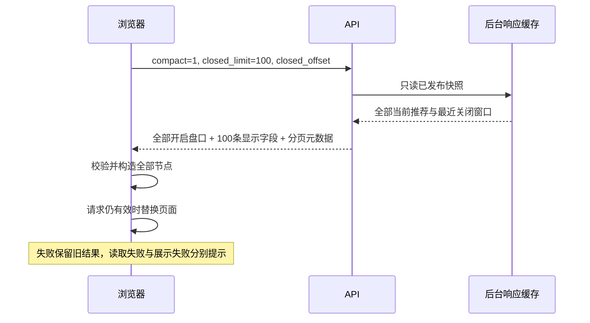
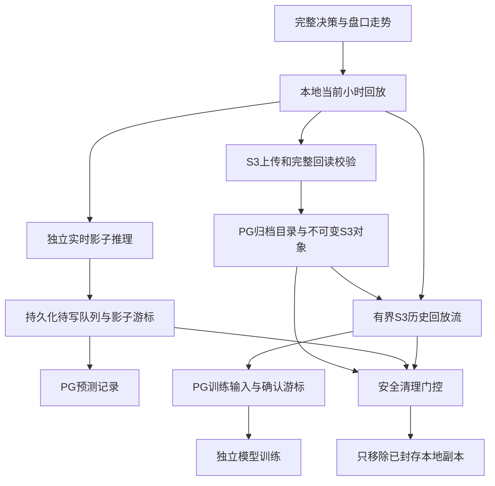

# TASK-52：推荐页面读取与回放归档解耦

## 已核实的问题与证据边界

2026-10-14 的只读采样中，推荐接口返回 HTTP 200，原始响应为
2,438,428 字节，包含 76 个开启盘口和最近 1,000 条关闭盘口。关闭记录携带
大量页面不读取的训练及诊断字段。Nginx 已开启 gzip，样本压缩后为 234,218
字节；服务端本地读取约 50–70 ms。用户链路耗时不能由服务端访问域名的耗时代替。

浏览器的 8 秒期限覆盖响应体读取；旧页面将读取、解析、渲染放在同一个错误处理
分支，可能将渲染 TypeError 显示成后端不可用。真实慢响应实验在 HTTP 200
之后以 48 KiB/s 分段传输：旧页面在约 8 秒中断，实际文案是 AbortError，
并未复现用户所报的原文。**没有据此认定用户故障的唯一原因或捕获对应 502/503。**

另一项只读调查发现，本地 47 个回放 gzip 文件合计 77,715,308,439 字节。
其中 42 个、69,223,856,053 字节已在 PG 归档目录中具备匹配的大小、修改时间、
对象与哈希记录；目录记录仅在上传与回读校验之后发布。这次目录查询本身不等于
再次下载 S3 校验。47 个历史训练游标均未到文件尾，独立影子游标有 46 个已到尾。

原因是归档清理依赖历史训练本地游标，而历史训练又只枚举本地文件。已上传文件
因此仍需留在本机。最新文件优先且每轮立即返回，进一步拖慢旧文件处理。归档
日志也出现过 `SlowDownRead`，但历史成功归档与当前进度说明不能将全部积压归因
于上传失败。上述是可核验代码与测量证据（A级），没有使用主观评分。

## 推荐 API 与页面

| 参数或字段 | 契约 |
| --- | --- |
| 默认请求 / `compact=0` | 保留原始响应，现有 API 调用兼容 |
| `compact=1` | 只精简显示响应，不改变决策、盘口、结算或缓存 |
| `closed_limit` | 默认 100，整数范围 1–100 |
| `closed_offset` | 非负整数；窗口缩减后夹到最后有效页 |
| `closed_page.total_available` | 当前最近窗口的条数，现有构建器最多 1,000 条 |
| `closed_page.summary_total` | 独立汇总窗口的条数，现有汇总最多 3,000 条 |
| `window_truncated` | 汇总条数超过展示窗口；均不能冒充全库历史总数 |
| 开启盘口 | 全部返回，显示赔率、概率、决策次数与投注状态保持原值 |

翻页跟随实时窗口，不保证跨页固定快照。轮询保留用户页码；迟到请求及隐藏视图
响应不能覆盖当前页面。完整历史仍从战绩页读取。

读取阶段区分连接失败、期限超时、HTTP 502/503/504 与 JSON 格式错误；仅真实
网关响应使用“后端服务暂不可用”。响应结构或渲染失败分别提示，构造失败不会
先清空旧内容。期限导致的响应体 AbortError 按原生 signal.reason 识别。

## PG、S3 与模型回放的职责

PG 保存结构化业务记录、训练输入、预测、配置和归档目录；S3 保存完整文件与
清单。本地当前小时、上传等待及尚未持久化的实时影子输入是工作数据，不属于
重新启用 SQLite。`ledger.jsonl` 仍为活跃追加文件，不能作为旧文件直接删除。

历史回放使用相同文件名和源文件字节游标枚举本地与远端。S3 pack 外层 gzip
的解码结果才是原始 `.jsonl.gz` 文件，源游标不能直接作为 pack 的 Range 偏移。
流式读取采用两个缓存读流、最多 128 KiB 的解码块和 64 KiB 回退缓冲，不恢复
整个多 GB 文件。源大小、SHA256 与外层 gzip 校验在 EOF 完成；逐批读取不冒充
完整文件哈希验证。重启可流式跳过已确认前缀，持续批次复用读流。

输入批次确认写入 PG 后才推进历史游标。历史调度为至多四个最新批次对应一个
最旧待处理批次；训练落后不再强制所有已上传文件留在本机。当前盘口的影子
推理仍从本地读取，保持独立线程与持久化队列。

## 本地副本清理与回滚

| 情况 | 清理规则 |
| --- | --- |
| 当前小时、上传未确认、文件发生变化 | 保留 |
| 旧训练游标已到文件尾 | 保留原有校验后清理路径 |
| 训练未消费完、影子已持久化到尾 | 仅在新鲜模型心跳声明协议 1、实际远端完整 gzip 成员读取成功后允许清理 |
| 影子待处理、能力未验证、心跳过期或远端校验失败 | 保留 |

远端 pack 按 UUID 发布，应用不覆盖已发布对象。清理前校验当前远端完整对象及
本地源哈希；远端下载不占用回放排他锁。在排他锁内重新检查清理门控、inode、
大小和修改时间，只有一致才 unlink。本地副本移除后，远端对象和清单保留。
SDK 与应用重试有上限；原文件在上传、校验或暂时限流失败时保留。

部署先停止归档清理，部署具有 S3 凭据只读挂载的模型进程，确认真实远端成员
读取与能力心跳，再启用新版归档。回滚到不支持 S3 回放的模型前，必须先停止
归档清理。不得伪造游标、跳过训练数据或通过删除业务数据制造释放空间的结果。

## 验证记录

推荐样本投影保持 76 个开启盘口及汇总原值，响应降至 130,679 字节，减少
94.64%；gzip 为 15,808 字节。慢速 HTTP fixture 使用紧凑 JSON 编码，完整响应
体为 120,567 字节，约 2.45 秒读完，约 2.59 秒显示首屏。完整原响应仍可触发
真实 body 超时，并正确识别为读取超时。分页、竞态、错误保留及手动恢复浏览器
测试退出 0；本轮页面冻结版本全量 unittest 为 1,731 项、14 项跳过、退出 0。

存储集成使用另一个冻结副本 `freeze-v2`，517 个源文件在测试后逐项比对 SHA256。
受限容器命令 `python -B -m unittest discover -s tests -q` 实际运行 1,776 项，
14 项跳过，退出 0；`python -B -m mypy` 检查 122 个文件，退出 0；
`python -B -m ruff check . --no-cache`、190 个 Python 文件字节码编译和
16 个 JavaScript 文件语法检查均退出 0。远端读取失败、大小与版本变化、PG
提交失败、调度公平性、删除门控、锁内身份变化和限流重试有行为测试。

验证镜像包含当前运行依赖 redis、boto3、psycopg，容器导入退出 0。
最初按旧项目说明尝试导入 requests/bs4，验证镜像缺 requests，退出 1；
随后旧说明中的 `requirements.txt` 安装命令也退出 1，因为当前基线已没有该
文件。没有安装宿主机依赖或伪称这两个命令通过。当前三个业务镜像以
`docker/requirements-storage.txt` 和 analytics Dockerfile 声明运行依赖，
core/store/collector/service/api 使用标准库 HTTP 客户端，无 requests/bs4 导入。

这些测量是录制样本与受控慢链路结果，不是生产 P95，也不证明任意网络故障都
已消除。存储部署和真实磁盘释放另行验收，不能用单元测试代替生产 S3 回读。
执行原始命令、退出码、Pi 指定模型两阶段共识、只读目录调查及哈希保存在项目
`output/backend-availability-20261014/`，不提交含实际业务数据的响应或凭据。
