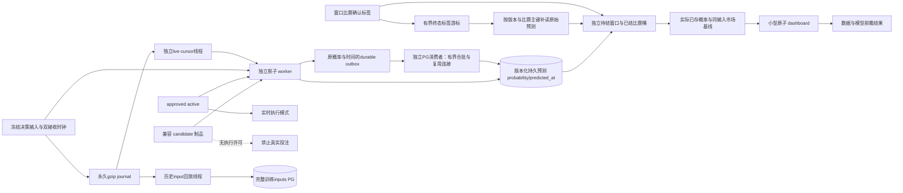

# 候选模型前瞻影子观察

2026-10-12。修复前独立 worker 只读取 `active.json`，兼容但未晋级的候选无法输出影子预测；评价由训练完成触发，并用当前参数重新预测历史输入，无法代表当时真正输出的概率。页面还把 S3 后台阶段状态覆盖到存储汇总，导致已存在的文件统计消失。

2026-10-12 生产延迟排查：原 `prospective.latency.p95_ms` 达到 572,005 ms，后续升至 867,877 ms；该值实际是 `predicted_at - computed_at`，包含日志排队，不能叫纯推理耗时。独立 worker 的同一个循环先回放最多 128 个 gzip 成员，对约 23,000,000 条训练 input 进行同步 PG 写入，每到 1,000 条还要持有 schema advisory transaction lock，然后才做影子校验/预测持久/窗口评价。当前日志的新决策因此排在旧输入、PG 事务与旧小时归档后，即使模型只有 60 个参数也会出现数分钟延迟。测量证据保存于 `output/pg-cleanup/shadow-latency-before.json` 和 `shadow-pre-lane-status.json`；这些运行证据不入 Git。

| 方案 | 计算与历史IO隔离 | 持久恢复 | 额外服务依赖 | 变更范围 | 新决策优先级 | 前瞻资格与审计 |
| --- | --- | --- | --- | --- | --- | --- |
| 串行 journal 回放 | 无，同步输入写堵住推理 | 原journal可恢复 | 无 | 小 | 受历史积压影响 | 易把历史排队称实时推理 |
| Redis/pubsub 独立热通道 | 可隔离 | Pubsub需另做stream/outbox确认 | Redis与双通道协议 | 中到大 | 可直接推送 | 需对齐日志与stream的双时钟、去重 |
| 共享永久 journal + 独立游标线程（采用） | 历史input与实时shadow线程、事务独立 | live cursor + 原概率outbox，inputs原游标 | 无新增依赖 | 中 | 最新日志优先，旧suffix有界公平排空 | 原始决策/预测时间保存，恢复明确标记 |

live 初启通过最多 4 MiB 的尾部扫描找到完整 gzip 成员边界，只跟随之后新增的真实决策；明确披露跳过的既有日志数量/字节，不能对几小时前的决定补写并伪称实时观察。历史 lane 仍从原输入游标继续保存所有训练数据，没有删除原始日志或输入。已存在的 live cursor 跨重启恢复；待确认预测先写本地原子 durable outbox，包含原概率、原生成时间与目标游标，先确认本机 durable outbox（文件fsync、rename后队列目录fsync；新建队列同时fsync父目录）后推进读取游标，PG消费者独立合批提交成功后才删除对应 outbox；重复提交按预测主键幂等。失败或停机保留 outbox；重启恢复使用已存概率，不拿新参数/新时钟重算。恢复记录不进入实时计算、排队和生成延迟样本；PG 确认延迟仍包含恢复等待。

实时字节游标与文件 device/inode 签名在同一个版本化 checkpoint 原子保存。读取边界/解码时和历史维护工具使用相同 `models/replay.lock` 共享锁，维护工具在独占锁内 `os.replace` 修复 gzip，避免读取旧 inode 却提交新文件偏移。标签/PG 提交在共享锁外，不能让网络IO阻塞维护。发现文件 inode 替换后，原字节偏移不再可信；live 明确增加 `repair_tail_resets` 并从新文件安全尾部跟随，历史修复游标继续完整保存训练输入；不能重算修复的旧决策并冒称实时预测。旧简单游标格式仍兼容读取，legacy 不带 hour 的文件不参与小时字符串最大值，避免把所有新小时误判为历史。

outbox 同时保存解码批次的源 device/inode。PG 失败后维护替换 gzip、再重启恢复这一组合场景中，原概率仍可按原生成时间幂等保存，但旧 inode 的偏移只有在当前源签名匹配时才提交。签名不同则保持新文件安全尾部并披露 `outbox_cursor_inode_mismatches`，避免旧 outbox 覆盖已重置游标、造成从新 gzip 中部解压的永久失败；源已归档离开本机时披露 `detached_outbox_cursors`，不提交无源偏移。旧无签名 outbox 在发现维护重置后同样不能覆盖安全边界。

实时线程每 50 ms 跟随新 journal，正常单轮最多16个成员及约100ms计算/解码预算；存在恢复积压时最多64成员/.25s预算，省去50ms空闲等待并保留stop检查；历史线程每轮最多 16 个成员及约 250 ms 解码预算。二者复用一个 gzip 解析器，完整 CRC/成员边界成功才推进，未写完成员在原游标重试；解压 `max_length` 在分配前限制最多 64 MiB，避免只在分配大块内存后检查。整点新日志优先，存在新旧同时积压时按4个最新批次/1个旧批次轮转；最新已追上则持续有界排空旧日志的剩余suffix，不能遗弃旧小时最后成员。已有游标重启或 PG 重试期间出现多个新小时文件时，晚于已知最大 hour 的未知文件均从0登记并公平恢复，较早补入的历史文件保持tail隔离语义。历史写入使用自己的 PG 事务、inputs 队列与游标；live 推理不写 inputs，只先保存小批预测。schema DDL 单独初始化/提交并按进程DSN缓存，正常大批 input 事务不再持有 schema advisory lock。live 和管理线程共享小型元数据锁与串行原子 dashboard 写锁，锁内不做 PG IO；live 线程每秒可独立刷新 heartbeat，即使历史事务仍在等待。主进程同时监测管理、live和PG消费者线程存活，任一意外退出触发进程失败供容器恢复；正常停机要求三个线程退出，未确认 outbox 与游标继续保留。

`shadow.performance` 来自本进程 live lane 最近 512 条决策/提交批次；`compute_ms` 包括该决策特征提取、模型与校准，`queue_ms` 从决策 `computed_at` 到开始计算，`decision_to_prediction_ms` 从决策生成到真实影子概率生成，`prediction_persist_ms` 从合批赛果校验到 PG 提交完成，只要合批包含实时生成条目就采样，可能同时包含恢复条目，不是逐条实时延迟；`decision_to_durable_ms` 从决策生成到原概率outbox及游标本机落盘；`decision_to_pg_confirmed_ms` 从决策生成到PG事务实际确认（包含排队），不能用推理快速掩盖PG积压。每项返回 `p50/p95/p99`，单位由字段名标明。纯计算使用 `perf_counter`，排队/总时长使用事件墙钟；outbox恢复与旧suffix排空不纳入实时排队/计算/生成样本，PG确认总时长包含恢复队列。已有 `prospective.latency` 保留历史观察窗口的决策到预测生成延迟，不能拿新的实时计算几毫秒替换旧数分钟排队。性能目标不会成为新的 2 秒业务拒单条件，真实执行许可没有变化。

2026-10-12 第二轮生产实测发现，live虽然与历史隔离，仍同步等待远程PG确认。会话临时表分段测量：建连约901ms、单往返233ms、标签查询189ms、128行executemany466ms、多VALUES351ms、事务提交4467ms（单次实测，不能当长期分位数，证据为 `output/pg-cleanup/shadow-pg-segments.json`）。因此运行时live producer仅计算与durable入队，消费者独立执行标签校验与PG写入；不删除或跳过已有积压，不用新参数重算失败批次。

消费者每批最多64文件、8192预测、8MiB读取及100ms组装预算；单一完整源成员作为不可拆原子批可能超过软合批预算，源解压仍受64MiB硬上限。SQL按最多256行多VALUES提交；消费者使用线程独占PG连接，标签查询与预测写入在同一会话事务，确认失败关闭连接并重连。没有关闭 `synchronous_commit` 或服务端持久保证。积压磁盘预算1GiB，达到预算时公开报错并停止解码，永久源journal与全部已有预测保留，PG恢复后继续；这是显式背压，不能称满足2秒。

`shadow.live`公开 `outbox_batches/outbox_predictions/outbox_bytes/outbox_oldest_at/outbox_oldest_wait_ms` 与 `persist_state/persist_error/last_persist_batch_files/last_persist_predictions`。旧单文件outbox转换为队列，首次恢复只推进超出已有checkpoint的批偏移，不能因较旧未确认批使游标倒退。启动先恢复队列游标再允许消费者清理；模型变化、PG错误及重启均复用原概率/原时间。历史_inputs失败先flush已有批再解码，防止同一未确认日志每轮重复append导致内存无界。

PG设置为权威来源，model worker启动前读取，并以独立5秒周期按版本reload模型配置；PG读取失败保留已应用配置并报告settings_error，不用旧本地JSON覆盖远程参数。本地文件仅在未配置PG时继续兼容。

候选由训练状态指向的候选版本优先选择，兼容候选存在时不要求 `promotion.approved=true`；影子观察从不修改 `active.json`。真实模型模式仍只接受独立批准的 active 制品。候选更新时间、数据/特征版本、参数有限性与向量大小必须有效，输入截止时间不能早于制品可用时间。候选在截止时间后才形成的历史决策不补写为前瞻预测。

| 信息 | 契约 |
| --- | --- |
| `shadow` | 是否可观察、是否启用、版本、candidate/active、批准状态、参数量、更新时间、最后预测/决策时间、不可用原因；`shadow.model` 是离线制品摘要 |
| `prospective.windows.pending` | 本版本最近最多 20,000 条待结预测，仅用于展示近期待结样本和延迟，不能称全库待结数量 |
| `prospective.windows.settled` | 独立维护最近最多 64 场已结比赛，不受待结 20,000 条滑窗淘汰影响 |
| `prospective.sampling` | 每场最多读最近 387 条原始预测，在其中保留最多 128 个完整盘口/时点/算法合约；披露 raw 限制、抽样比赛数和 `full_population=false` |
| `prospective.counts` | 窗口预测、已结、待结、走盘/口径无法结算、时序/版本隔离、有效已结比赛数 |
| `prospective.model/baseline` | 使用已保存的实际预测概率与同输入市场概率；Brier/log loss、二元正确率、HAD top-1、亚洲支付正确率 |
| `prospective.latency` | 决策生成到影子预测生成时间的 p50/p95/p99；不含数据库提交耗时，不冒称盘口到真实提交延迟 |
| `prospective.cursor` | 本轮读取数与是否存在下一批，允许前端说明观察结果仍在加载 |
| `prospective.labels` | 当前有效已结比赛所用修订版本、首次有效赛果可用时间、当前结算版本可用时间，供结果修订审计 |
| `shadow.skipped_settled_replay` | 本进程在持久预测写入前排除的已知赛果回放条数，原始训练输入保留 |
| `prospective.counts.excluded_replay_predictions` | 本版本游标历史累计移出窗口的已结事后预测；scope 明示为历史累计，不能与窗口样本数混算 |
| `storage.summary_*` | 存储汇总更新时间、就绪/陈旧/错误/未知与原因；S3 阶段状态与存储总量合并，字段不会因状态文件缺项而丢失 |

HAD 只对完整三方向同盘口、同截点、同算法组，以一致概率 argmax 选择一个方向报告 top-1 命中。同场多个盘口和多个截点均保留，随后按比赛等权，不能压成每场一个决策。

亚洲 OU/AH 对完整二向合约选最高概率方向，全赢/全输按一单位输赢本金，半赢/半输按 0.5 本金加权；走盘不进入有效输赢正确率分母，并在无可评分记录数量中披露。该指标不是真实投注收益，也没有替代推荐阈值、现金风险预算或订单结算。

另保留的 `binary_accuracy` 是各候选概率是否至少 0.5 与方向支付标签的比较，不是推荐下注胜率。`accuracy_basis` 明示这一口径。没有已结且有效样本时，正确率、Brier、log loss 返回 `null`，不能显示 0% 或拿离线 validation 值填充前瞻。

PG 预测增量每轮最多 2,000 条，以 `predicted_at` 加完整身份键作稳定游标；同时间戳批边界不漏行，较早决策截点但新到达的预测也能入窗口。该近期待结窗口不能承担足球赛果统计：生产约 5 分钟出现 13,442 条预测，20,000 条可在比赛结束前被耗尽。因此增加独立终态标签游标，首次从 `max(候选实际可用时间,该版本首个实际持久预测时间)` 开始；首预测通过 observation 版本索引 `LIMIT 1` 获取，还没有实际预测时不扫全局标签。避免候选创建数小时后才开始观察时，把早已揭晓的无关比赛灌入补查队列。游标按实际 available epoch 与 revision_id 读取每源最多 64 条，合并去重后最多 64 条；每轮最多补查 4 场。游标只推进已处理事件，超过预算的下一场留在下一轮，不漏过新标签。

标签源增加 PostgreSQL 16 安全 epoch 函数：显式 ISO 日期与时区正则、`pg_input_is_valid`、无效返回 null，函数固定 UTC 与 ISO DateStyle，实际 epoch 不依赖会话时区。部分索引覆盖有效终态比分和 `(epoch,revision_id,match_id)`，标签查询只合并两路有界索引读取，不对全库排序。每场预测补读使用现有 `(version,match_id,at,algorithm,market,line,outcome)` 主键索引，最多 387 条，排除特征 JSON 读取；在该有限原始范围内选最近最多 128 个完整合约。方向必须完整（HAD 三向，OU/AH 二向），保留同场多个盘口、时点与算法；抽样指标明确不是全量正确率。

最近已结桶按首次有效赛果时间保留最多 64 场；新赛果即使对应预测已经被待结窗口淘汰，也可从永久 PG 原始预测重新取回。标签修订覆盖该场桶，并用最新有效标签重新结算，不能重复增加场次。已结桶与无预测重试队列轮转补查，用于修正与迟写预测；独立队列最多 64 场、每场最长重试 2 小时，不占已结成绩桶。容量满时移出最早无预测条目，继续处理新标签；到期与容量移出条数单独披露，不能让无关比赛饿死当前真实赛果。该补查队列是有界辅助观察，不承诺包含所有迟到记录；原始 PG 预测永久保存，独立预测游标若后来发现早于首次赛果生成、但迟到数据库的预测，也直接入已结桶。合约方向跨批暂未完整时保留有界空桶供下一轮补查。标签/补读失败不提交任何新游标，失败后可以重试。

独立 JSON 派生状态保留预测游标、标签游标、待结行、已结桶与重试队列，可跨 worker 重启恢复；升级旧窗口时保留原预测游标，标签游标按首次实际预测与候选可用时间重新构建。版本变更清空所有派生状态，原始永久预测不删除。每 30 秒重查窗口标签，任一游标有积压时每 5 秒继续读批；API 不负责推理、结算或训练。

旧预测缺少双接收时钟，不能由迁移凭空证明其当时可见，仍隔离；新预测写入 clocks，兼容迁移为可空列。评价使用首次有效终态赛果的实际可用时间，只有该时间晚于实际 `predicted_at` 才能成为前瞻样本。最新有效修订仍用于支付结算，但修订稍晚不能使早已揭晓的结果重新变成未知。PG 16 的 `pg_input_is_valid` 和 CASE 转换隔离无效时区/日期，首次可用按实际 timestamptz 排序，结算修订按源 revision_order 排序；两者不假设单调。SQLite 按 Python UTC 时间校验，排除无效比分、无时区时间和非终态标签。

影子批写入前只查询本批比赛标签；已结回放仍保存训练输入，但不写入预测。标签读取失败时批次留在待写队列重试，不默认为未知赛果。评价也在截取最近 20,000 条窗口前移除已结事后预测，避免持续回放老日志挤出实时待结样本。训练进程不再写 `prospective.json`，避免训练结束覆盖独立观察窗口。

验证覆盖：未批准候选可观察但无真实执行能力；缺 active；版本切换；制品未来可用；迟到预测；缺时钟；0样本/待结；HAD top-1；半注支付；实际已存 probability 不随参数重算；有效赛果修正与已知赛果后修订隔离；源顺序与实际时间不一致；非法标签；写前过滤及读取失败重试；已结回放不挤出待结窗口；已淘汰待结预测在赛果到来后被找回；跨重启保留已结结果；预算超限不推进遗漏比赛的标签游标；赛果先到、预测迟写后独立重试恢复；修订不重复累计；完整多方向合约抽样；重试容量回压；失败游标不推进；PG 有界稳定游标；S3状态合并。真实下注接口没有被测试调用。

2026-10-12恢复调度证据（只读，`output/pg-cleanup/shadow-recovery-cycles.json`/`shadow-recovery-delta-result.json`）：原预算包含特征与推理，不只是decode。实际62.46s观察最新消费0.921MB/s、到达0.560MB/s、旧消费0.860MB/s，说明正在净消积压，但最新约273MB仍需十余分钟。最新优先80%、积压期间取消固定idle、.25s/64成员单批预算可以加快追赶；不跳过偏移、不清除旧预测、不更改算法。旧决策仍不计实时计算样本，PG确认时长公开包含恢复。
