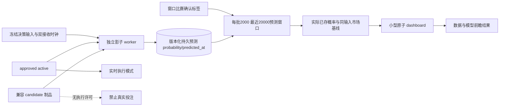

# 候选模型前瞻影子观察

2026-10-12。修复前独立 worker 只读取 `active.json`，兼容但未晋级的候选无法输出影子预测；评价由训练完成触发，并用当前参数重新预测历史输入，无法代表当时真正输出的概率。页面还把 S3 后台阶段状态覆盖到存储汇总，导致已存在的文件统计消失。

候选由训练状态指向的候选版本优先选择，兼容候选存在时不要求 `promotion.approved=true`；影子观察从不修改 `active.json`。真实模型模式仍只接受独立批准的 active 制品。候选更新时间、数据/特征版本、参数有限性与向量大小必须有效，输入截止时间不能早于制品可用时间。候选在截止时间后才形成的历史决策不补写为前瞻预测。

| 信息 | 契约 |
| --- | --- |
| `shadow` | 是否可观察、是否启用、版本、candidate/active、批准状态、参数量、更新时间、最后预测/决策时间、不可用原因；`shadow.model` 是离线制品摘要 |
| `prospective.window` | 本版本最近最多 20,000 条预测窗口的起止时间与 scope，不是全库准确率 |
| `prospective.counts` | 窗口预测、已结、待结、走盘/口径无法结算、时序/版本隔离、有效已结比赛数 |
| `prospective.model/baseline` | 使用已保存的实际预测概率与同输入市场概率；Brier/log loss、二元正确率、HAD top-1、亚洲支付正确率 |
| `prospective.latency` | 决策生成到影子预测生成时间的 p50/p95/p99；不含数据库提交耗时，不冒称盘口到真实提交延迟 |
| `prospective.cursor` | 本轮读取数与是否存在下一批，允许前端说明观察结果仍在加载 |
| `prospective.labels` | 当前有效已结比赛所用修订版本、首次有效赛果可用时间、当前结算版本可用时间，供结果修订审计 |
| `shadow.skipped_settled_replay` | 本进程在持久预测写入前排除的已知赛果回放条数，原始训练输入保留 |
| `prospective.counts.excluded_replay_predictions` | 本版本游标历史累计移出窗口的已结事后预测；scope 明示为历史累计，不能与窗口样本数混算 |
| `storage.summary_*` | 存储汇总更新时间、就绪/陈旧/错误/未知与原因；S3 阶段状态与存储总量合并，字段不会因状态文件缺项而丢失 |

HAD 只对完整三方向同盘口、同截点、同算法组，以一致概率 argmax 选择一个方向报告 top-1 命中。同场多个盘口和多个截点均保留，随后按比赛等权，不能压成每场一个决策。

亚洲 OU/AH 对完整二向合约选最高概率方向，全赢/全输按一单位输赢本金，半赢/半输按 0.5 本金加权；走盘不进入有效输赢正确率分母，并在无可评分记录数量中披露。该指标不是真实投注收益，也没有替代推荐阈值、现金风险预算或订单结算。

另保留的 `binary_accuracy` 是各候选概率是否至少 0.5 与方向支付标签的比较，不是推荐下注胜率。`accuracy_basis` 明示这一口径。没有已结且有效样本时，正确率、Brier、log loss 返回 `null`，不能显示 0% 或拿离线 validation 值填充前瞻。

PG 增量只读取 `model_predictions` 本版本最多 2,000 条，以 `predicted_at` 加完整身份键作稳定游标；同时间戳批边界不漏行，较早决策截点但新到达的预测也能入窗口。索引覆盖版本与游标顺序；标签查询仅针对窗口比赛集合，不扫描 `model_inputs`。独立 JSON 派生窗口可重建，版本变更清空窗口，原始永久预测不删除。每 30 秒重查窗口标签，积压时每 5 秒继续读批；API 不负责推理、结算或训练。

旧预测缺少双接收时钟，不能由迁移凭空证明其当时可见，仍隔离；新预测写入 clocks，兼容迁移为可空列。评价使用首次有效终态赛果的实际可用时间，只有该时间晚于实际 `predicted_at` 才能成为前瞻样本。最新有效修订仍用于支付结算，但修订稍晚不能使早已揭晓的结果重新变成未知。PG 16 的 `pg_input_is_valid` 和 CASE 转换隔离无效时区/日期，首次可用按实际 timestamptz 排序，结算修订按源 revision_order 排序；两者不假设单调。SQLite 按 Python UTC 时间校验，排除无效比分、无时区时间和非终态标签。

影子批写入前只查询本批比赛标签；已结回放仍保存训练输入，但不写入预测。标签读取失败时批次留在待写队列重试，不默认为未知赛果。评价也在截取最近 20,000 条窗口前移除已结事后预测，避免持续回放老日志挤出实时待结样本。训练进程不再写 `prospective.json`，避免训练结束覆盖独立观察窗口。

验证覆盖：未批准候选可观察但无真实执行能力；缺 active；版本切换；制品未来可用；迟到预测；缺时钟；0样本/待结；HAD top-1；半注支付；实际已存 probability 不随参数重算；有效赛果修正与已知赛果后修订隔离；源顺序与实际时间不一致；非法标签；写前过滤及读取失败重试；已结回放不挤出待结窗口；PG 有界稳定游标；S3状态合并。真实下注接口没有被测试调用。
