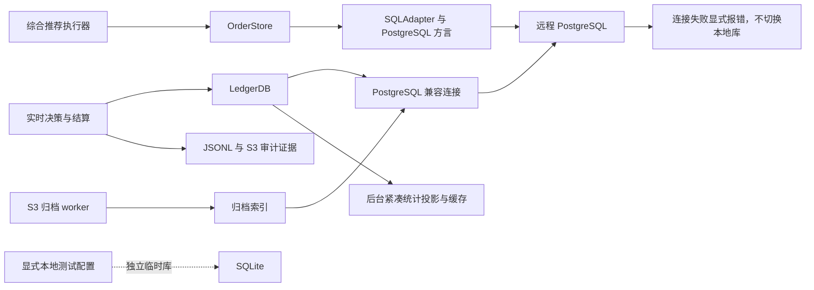
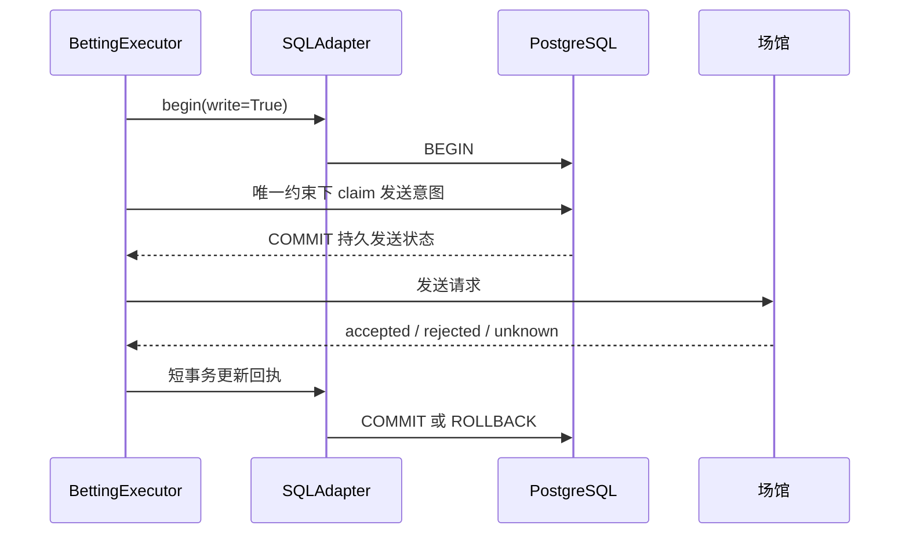

# Ledger 与订单 SQL 存储适配层

生产已统一使用远程 PostgreSQL，Compose 为 analytics-api、model-worker 和 archive-worker 显式设置 `DATABASE_BACKEND=postgres`。台账、订单发送意图、训练投影和 S3 归档索引均走远程数据库；SQLite 仅用于临时测试库或显式选择的本地后备模式。生产遇到 PG 连接、驱动或 schema 错误时必须报告失败，不得自动创建另一套 SQLite 库继续写入。

切换与清理验收记录见 [PostgreSQL 收尾与决策设置](postgres-cutover-and-console.md)。本文描述现有存储适配职责与事务契约，不将尚待核验的源库清理视为完成。

## 当前模块边界

[`store/postgres.py`](../../store/postgres.py) 是生产运行时兼容连接层，提供兼容行对象、参数转换、游标管理及旧查询需要的 JSON 文本表达式。LedgerDB、OrderStore 和归档目录索引依据生产后端配置选择远程连接。

[`store/sql_backend.py`](../../store/sql_backend.py) 提供显式方言和订单存储使用的 SQLAdapter：事务起始、占位符、冲突忽略及 JSON 文本取值。训练读写边界位于 [`store/training_projection.py`](../../store/training_projection.py)，不与订单网络调用共用连接。

追加 JSONL 及 S3 对象保留采集、走势和决策审计证据；PostgreSQL 是当前生产查询与事务状态的统一数据库。decisions 和标签修订支持结算与回放，orders 保存幂等发送意图及场馆回执；订单状态不能仅靠日志重建后直接重发。

## 后端对照

| 维度 | PostgreSQL（当前生产） | SQLite WAL（测试/显式本地） | Redis/内存缓存 |
| --- | --- | --- | --- |
| 持久化职责 | 台账、订单、模型投影及归档索引 | 测试数据库兼容行为 | 热视图及临时状态 |
| 写入并发 | MVCC、唯一约束和短事务 | 单写事务与写锁 | 原子命令，非 SQL 事务 |
| 读取一致性 | MVCC；训练显式可重复读 | WAL reader 快照 | 取决于更新和缓存时点 |
| 参数占位符 | psycopg 参数绑定 | 问号及命名参数 | 命令参数 |
| 幂等冲突 | ON CONFLICT DO NOTHING | INSERT OR IGNORE / ON CONFLICT | 不承担权威订单 claim |
| JSON 与聚合 | jsonb 取值、显式类型转换 | SQLite JSON 函数 | 预计算展示结果 |
| 大数据统计 | 紧凑 decision_statistics 投影及后台缓存 | 本地测试小数据 | 避免请求内全量扫描 |
| 故障行为 | 显式错误；保留可用旧视图 | 仅由显式本地配置启用 | 可显示旧视图及刷新状态 |
| 运维边界 | 远程数据库备份与连接管理 | 测试结束关闭临时库 | 不能替代账本或数据库备份 |

## 事务与锁契约

SQLite 的 BEGIN IMMEDIATE 在本地测试中保护写入锁；PostgreSQL 的 BEGIN 不模拟该语句，而由唯一约束、冲突处理和操作需要的锁保证并发发送意图唯一。事务不得跨场馆网络请求保持。请求结果未知时保留 unknown 并核对场馆订单，不自动重发。

占位符转换必须跳过 SQL 字符串和注释，避免破坏 JSON 文本中的问号；冲突忽略、JSON 取值及类型转换由兼容层或方言表达式处理，不能用无上下文全局替换。PG 数值聚合在服务边界转换为可序列化 Python 数值；布尔条件统计使用显式 CASE，不能直接套用 SQLite 的布尔求和。

连接与游标在成功及异常路径均须关闭，未提交事务须回滚。生产启用 PG 后，配置、驱动或连接失败均不得进入本地创建文件分支。保留 SQLite 实现不等于允许故障时自动切换。

## 战绩统计

PostgreSQL 以 decision_statistics 保存统计所需的紧凑字段，并通过触发器跟随 decisions 插入、更新或删除。初始化串行执行，避免多个容器同时扫描大表；ledger_history_cache 保存后台汇总快照。

战绩请求读取分页明细与已有统计快照，后台刷新汇总，避免浏览器每次刷新重新扫描大 JSON 台账。statistics_refreshing、statistics_stale 和 statistics_at 分别表示后台汇总、旧缓存与统计时点；页面明确显示状态，不将尚未生成的汇总误报为有效零样本。

## 迁移核验与源文件清理

1. [`tools/migrate_sqlite_to_postgres.py`](../../tools/migrate_sqlite_to_postgres.py) 导入历史台账、标签修订、订单、模型输入/预测与归档索引，并补充模型标签。
2. [`tools/verify_sqlite_postgres.py`](../../tools/verify_sqlite_postgres.py) 以源主键和规范化内容指纹逐表核验覆盖。生产目标可能包含切换后的新增或更新数据；可更新行还须验证目标修订未落后，不能只核对总行数。
3. 源 SQLite、WAL 和 SHM 先冻结、远程备份并验证 SHA256 与备份可读性。对应表核验与备份均通过后才允许清理本机文件。
4. 清理后确认生产数据库服务仍使用 PG，验证健康状态、战绩、推荐、账户和数据与模型接口。备份与核验报告位于项目 output，敏感配置不进入 Git。

测试覆盖 SQLite 临时库和 PostgreSQL DB-API 替身的事务、冲突、占位符与失败路径；生产迁移核验使用真实远程 PostgreSQL。两者证据分开记录，本地单元测试不能替代实际迁移一致性验证。
