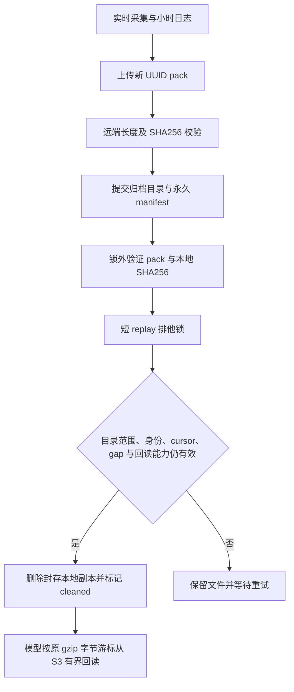

# TASK-55：本地存储保护与部署基线修复

2026-10-15；工程证据级别 A：源码、实际命令与运行状态。本文记录工程边界，不证明模型盈利。

迁移到 PostgreSQL 与 S3 不等于本地历史副本已释放。PG 承担索引和训练投影；小时 replay 仍先写本地，归档需要上传、回读校验、提交目录后才能删本地副本。原 2000 文件边界延迟清理，S3 限流曾终止 worker；随后把远端校验放在整个 replay 排他锁内又使模型读取饥饿。当前改为逐文件、两阶段清理。

还发现生产 API 已部署 PR #60–62，原工作区却基于旧提交 `03cf86f`，模型 worker 使用旧数据契约。旧的 1316 场是抽样资格口径，不能当作新契约完整 cohort。本修复以 `origin/main` 的 `4a1c1cd` 建独立工作树，保留原脏工作区，三方集成 S3 reader 与清理。保留主线报价冷却、7 参数、完整 context、认证门槛及独立训练完成水位。

Mermaid 渲染参考 `reports/decision-model-accuracy/scripts/md_to_html.py`；其在线运行时与离线代码块回退已有主线支持。本文无数值统计图。

| 问题 | 处置 | 边界 |
| --- | --- | --- |
| 大批次推迟清理 | cleanup 每文件释放，先处理已归档文件 | 无验证不删除 |
| 网络/整文件 SHA 占用 replay EX 锁 | prepare 在锁外，commit 只查身份与目录后 unlink | commit 重验 dev/inode/size/mtime/ctime 与完整 pack 区间 |
| 同大小改写恢复 mtime | hash 前后 fstat、path lstat、ctime 绑定 | 仅封存文件，无合法活跃写者 |
| catalog 存在被误称已回读 | 单独进行有界远端 IO 能力探针 | 能力探针不代替每文件完整校验 |
| 多 worker 水位判断分裂 | output 卷共享采样锁与原子状态文件 | API 仅只读，过期显示 unknown |
| 新训练挤占磁盘保留额 | 临界或预计占用侵入保留额时等待 | 不修改 enabled，不 kill 已运行任务 |
| 旧分支重新部署覆盖新功能 | 最新 main 独立集成、冻结测试和容器 SHA 比对 | 原工作区及原镜像保留 |

共享水位在 `output/_archive/disk-pressure.json`，短锁为同目录 `disk-pressure.lock`。后台最多每 5 秒重新采样，API 超过 30 秒显示 unknown。归档 heartbeat 每 5 秒刷新；训练调度每 60 秒重新检查。临界后需达到临界阈值加恢复余量才解除暂停；采样、配置或发布失败时只暂停可选的新任务。实时采集、PG 写入、replay 消费和安全归档继续运行。

| 环境变量 | 默认 | 含义 |
| --- | --- | --- |
| `DISK_WARNING_FREE_BYTES` | 20GiB | 警告绝对保留额 |
| `DISK_CRITICAL_FREE_BYTES` | 8GiB | 临界绝对保留额 |
| `DISK_WARNING_FREE_RATIO` | 0.10 | 警告容量比例 |
| `DISK_CRITICAL_FREE_RATIO` | 0.05 | 临界容量比例 |
| `DISK_RECOVERY_MARGIN_BYTES` | 2GiB | 临界解除余量 |

绝对额与比例取较大值。以上是策略参数，不是磁盘增长预测。API 的 `storage.disk_pressure` 展示状态、原因和采样时间。

单轮预计临时空间超过 100GiB 必须走 `MODEL_REMOTE_TRAINING_COMMAND`，无命令明确报错且不回退本地 fit。manifest 绑定主线资格探针冻结的 cohort、labels、cutoff、已训练集合及 CPU/内存额度；返回 canonical JSON SHA256 必填，artifact 路径限 `models/remote-artifacts`，新契约与正常晋级门槛保持。完整耐久候选后才推进 completed-training。

无显式估算时仅当前 PG 索引读取与内存训练路径使用 `4 × 内存限额 + 64MiB` 保守估算，标记 `bounded_in_memory_pipeline`，不是实测峰值。该路径不恢复全量 S3、不创建本地全量中间集。SQLite 路径额外计入索引数据库与 WAL 大小的两倍作为排序空间估算。配置或 marker 损坏会阻止执行；未来新增落地训练管道必须提供对应估算，不能继承此假设。本地启动还要求剩余容量减估算高于临界保留额。

远程执行当前只有对象存储凭据，尚无 SSH 或训练任务接口。命令门禁和回传核验不代表已经在 S3 服务器实际训练，也不代表远程 CPU/内存限制已实测。pack 使用应用生成的新 UUID 且应用不覆盖；未声称服务端启用 ObjectLock。

回归覆盖替换、追加、同大小改写恢复 mtime、catalog 范围变化、cursor 未追平、gap、新旧 readiness、校验期间共享锁可用、commit 排他、临界/恢复/失效水位，以及远程制品异常。实际最终命令、退出码、冻结 SHA 和部署观测另附验收记录。旧历史重标、足量新代 cohort、同状态 CLV、执行子群成本后增量与权威长期收益仍属开放验收（#55/#58）。
