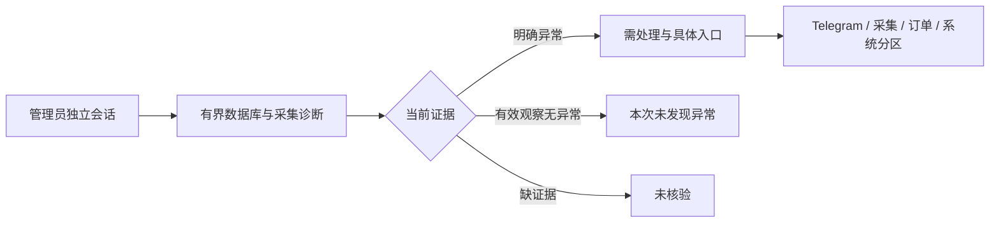

# 管理员逐项待办与诊断边界

更新：2026-10-27。该入口将已有的有界诊断转换成可点击的处理项，不根据容器运行推测账号、盘口或历史迁移成功。



| 待办 | 证据 | 处理入口 | 限制 |
| --- | --- | --- | --- |
| 乐鱼会话 | 最近采集成功、会话失败类别 | 乐鱼采集 | 成功不代表所有盘口新鲜 |
| Telegram授权 | 当前控制端授权状态 | Telegram | 授权不代表可枚举所有群成员 |
| 媒体待上传 | 有界待传数量 | Telegram | 不删除原文，不跳过图片审核 |
| 未解决推荐 | 失败和未解决审核数量 | Telegram | 通过原文与工具原因复核，不制造推荐 |
| 过期报价 | 后台当前时限与真实源时间 | 乐鱼采集 | 不扩大时限或伪造时间 |
| 未知订单 | 未确认订单数量 | 订单核对 | 只核对官方回执，不重发未知订单 |
| 数据库结构 | 当前迁移版本及摘要 | 系统运维 | 不由业务请求自动迁移 |
| 失败迁移记录 | 部署日志另行复核 | 系统运维 | 成功登记表不能证明没有失败，固定显示未核验 |

## 双端操作布局

```text
管理中心
├─ 运行状态 / Telegram / 乐鱼采集 / 会员管理 / 订单 / 系统
└─ 运行状态
   ├─ 逐项待办：名称、数量、状态、处理原因、前往按钮
   ├─ 单场最大盘口、隔离数量、投递错误
   ├─ 轮询与WS时序、新鲜度和队列指标
   └─ 刷新诊断
```

| 界面状态 | 行为 |
| --- | --- |
| Default | 每个处理项单独呈现；按钮切换原管理分区并保持正确导航状态 |
| Loading | 保留上次诊断直至新请求完成，状态附检查时间 |
| Empty | 有效零计数显示本次未发现异常；不是未配置成功 |
| Error | 显示诊断错误并明确待办尚未核验，不补零 |
| Edge-Case | 5000条上限明确显示加号；未知计数不显示零；文本转义，目标分区使用固定白名单 |

验证：独立任务转换3项及实际临时数据库运维7项通过，退出0；浏览器30场景包含待办到Telegram及订单切换，退出0。后续源码修改须纳入最终全量冻结及部署点击，不把此证据代替最终部署。
