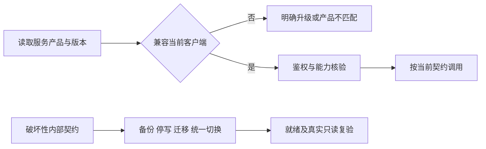

# 接口兼容、升级与弃用契约

更新：2026-10-27。当前公开产品标识为ai-football-experts，API主版本2，最低Android版本代码1。该值来自当前服务能力入口；正式发行前必须与实际签名包、六组件镜像和发布证据一致。

| 调用方 | 当前支持 | 不兼容时行为 | 升级策略 |
| --- | --- | --- | --- |
| 同版本电脑与手机网页 | 当前静态资源与API v2 | 明确读取失败，原筛选同范围可保留上次结果 | 网页与API同候选原子部署，避免缓存旧脚本 |
| Android客户端 | 产品相同、API版本2、客户端版本满足服务最低版本 | 配对拒绝并提示升级，不接受异产品或任意HTTP地址 | 正式签名连续升级及设备验收另行验证 |
| 采集器 | 单场≤500常规数组或同HTTP≤4×500完整分片 | 413/422拒绝并保留重试/隔离原因 | API与采集器在同一兼容窗口统一切换 |
| Hermes/MCP | 当前任务、当前attempt、完整分页及唯一赛事绑定 | 任务失效/分页跳跃/证据过期拒绝 | MCP与API工具契约一起发布，模型自由文本不作成功 |
| 订单执行器 | 本人账号、固定selection白名单、预检和单次发送许可 | 未知结果只查单，不重发 | 新旧账户状态和官方回执保持可读 |

## 字段语义

新增可选字段不改变既有字段含义；客户端忽略未知展示字段，服务端交易与内部配置仍使用精确白名单。不得借增加字段开放任意工具、地址或数据库查询。删除或改变必需字段、身份范围、时间基准及金额语义属于破坏性变更，应先升级能力契约和受支持客户端。

独赢盘口不适用线以显式null表示；仅已知独赢旧零有限兼容。让球与大小必须显式数值，零是合法盘口。不能将缺失/null合为零、重写不可变历史证据或按接收时间解释旧报价。迁移018更换内部冲突索引，旧API写语句不兼容；必须停本项目写入后迁移并统一切换，不承诺滚动混跑。

## 弃用与回退

当前只有开发候选，尚无跨正式版本弃用日期。不得编造旧正式版本支持窗口；首个正式版本发布时登记确切支持客户端版本、接口摘要与升级说明，后续破坏性版本在新能力入口公布最低客户端，旧客户端明确拒绝而不静默改变语义。正式弃用须有发布说明、访问证据和受控迁移计划；不能仅通过隐藏入口代替停止旧写契约。

回退先核对数据库迁移摘要及数据语义。旧镜像不兼容新索引时保持写入关闭，采用兼容修复或独立空目标恢复；禁止把旧镜像强行连到新结构或用历史快照覆盖已有业务。错误码、身份拒绝、游标范围签名、幂等和报价时限均不能为兼容而放宽。

验证关联：Android既有产品/API/最低版本拒绝测试、公开能力入口、018兼容与原子快照专项179项、所有调用方最终冻结回归与浏览器矩阵。真实签名设备升级与正式发布窗口仍保持独立未验收。
