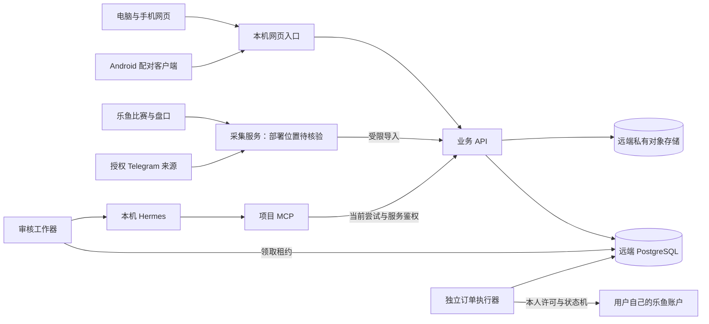
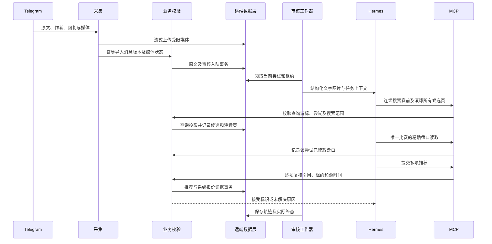
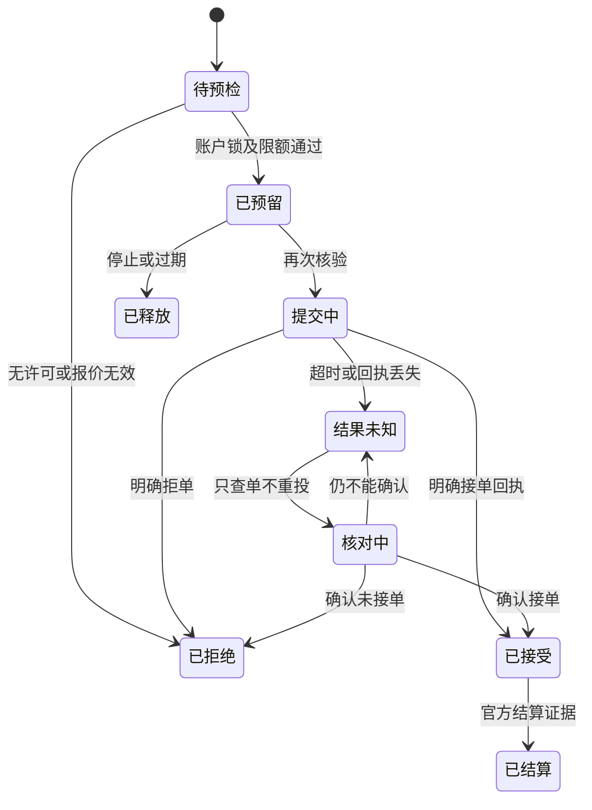

# 第二代平台架构与实施取舍

更新日期：2026-10-26。以下为目标设计。当前实现仅有候选骨架；迁移、身份、协议、工具、结算和客户端未完整验证，不能按本设计推定已经运行。

## 节点与职责

本机 Docker 运行网页入口、业务 API、审核工作器、项目 MCP 和 Hermes。远端 VPS 保存数据库、原文媒体与业务证据。采集、续期及订单执行先检查现有远端部署，再测出口、时延和安全边界决定位置；本地采集编排仅是开发草案，未决定生产迁回。

| 模块 | 输入及输出 | 关键约束 |
| --- | --- | --- |
| 网页和 Android | 页面请求、筛选及本人操作 → 展示及明确状态 | 不持有供应商秘密，不由客户端决定权限 |
| 业务 API | 用户或受限服务请求 → 校验后的数据与写入 | 身份、权益、对象归属、幂等及审计 |
| 采集 | 授权上游消息和报价 → 规范化事实 | 原始标识、真实时间、检查点，不做推荐或下注 |
| 审核工作器 | 消息版本 → Hermes 审核及轨迹 | 租约、尝试隔离、并发、超时及死信 |
| Hermes | 原文和图像 → 受限工具调用及简体中文说明 | 不可信消息不能改权限，供应商调用只在框架内 |
| MCP | 当前尝试的搜索和盘口 → 工具事实及接受结果 | 无 SQL、秘密、终端或交易能力 |
| 结算与订单 | 不可变推荐/成交证据 → 版本化结算 | 专家一单位账与实盘账分开 |

## 消息到推荐的时序

MCP 读取的是业务规范化投影，不直接重新采集上游。模型输出不是成功标志：工具必须确认接受，过期尝试不能写入。搜索完整、唯一消歧、实际读盘和最终报价有效是四道独立门槛。

## 关键设计决策与现有缺口

| 决策 | 选择及原因 | 已发现缺口与验证 |
| --- | --- | --- |
| 数据建模 | 当前盘口投影与不可变证据分开，减少 IO 又能重建推荐和订单 | 仍需版本水位、部分快照处理及保留演练 |
| 任务调度 | 先用 PostgreSQL 事务领用与租约，避免无证据增加中间件 | 尝试令牌、最后一次崩溃、死信和公平性需测试 |
| 匹配 | 键集分页遍历全候选，服务端按双方、联赛和时间唯一判定 | 已有分页骨架，唯一消歧、稳定水位及先读盘口未验 |
| 身份权益 | 独立管理会话、服务端令牌摘要、有效能力合并 | 登录旧字段、双 Cookie 优先及免费覆盖付费待修 |
| 存储连接 | 增量迁移有版本和互斥，运行权限低于迁移权限 | 并发 DDL 曾失败，修复及版本登记待验证 |
| 网页客户端 | 响应式网页共享信息架构，桌面表格和手机单列分别设计 | 当前原型未完成参考对照及完整路由 |
| Android | 先采用受限网页容器加 HTTPS 配对，复用同一界面契约 | 固定测试地址须移除，未构建签名安装；若关键体验不达标再评估原生局部 |
| 支付 | 人工真实开通为基础，外部支付为条件适配 | 未选网关不制造支付成功，也不阻断核心专家业务 |
| 续期网络 | 可编辑代理只供明确登录请求，场馆和采集保持正常出口 | 必须复用当前有效版本并记录无资金请求轨迹 |

## 订单状态和资金边界

unknown 与 submitting 都占敞口。本人许可绑定账号和策略版本，管理员没有隐式代投权。资金操作只在授权范围执行，开发验收使用无资金协议样本。结算修订追加版本，不覆盖原始报价和回执。

## 数据及秘密

- 业务持久数据与媒体在远端。测试只用具名临时库，不静默回落本地生产存储。
- 旧库不破坏，新结构增量隔离；迁移失败保持未就绪。运行工作器不无条件重复迁移。
- 每服务白名单注入；模型提供方密钥仅交 Hermes。旧会话加密主密钥先核验，不能由新密钥替换。
- 媒体私有访问、内容哈希、字节上限、暂存确认和孤儿回收；数据库备份必须与媒体引用共同恢复。
- 高频旧盘口先统计引用并复现收益，再隔离清理演练；当前没有远端清理授权落地动作。

## 性能验证与阶段放行

先测实际源事件至页面、每页搜索、排队、模型、数据库及对象存储耗时分位，再按部署容量制定预算。不给未经测量的延迟贴精确数字。优化从索引、批量写、缓存期限、连接池和任务合并入手，不能删校验换速度。

按“规划基线 → 比分原文可读 → 专家可核验 → 个人账户可控 → 三端发布”推进。每段保存命令、退出码、冻结源码、样本与局限并及时提交。正式发布还须远端恢复、Android 安装升级及实际镜像和 APK 资产核对；候选构建不等于发布。
