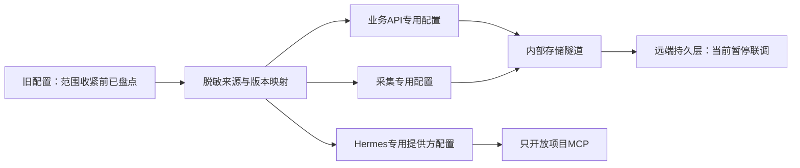

# 旧配置复用与存储接入台账（脱敏）

更新日期：2026-10-26。只记来源、类别与状态，不记录账号、口令、密钥、会话、代理地址或真实连接值。

**当前范围：用户允许只读其他目录，但禁止在其他目录写入、移动或清理。以下路径只记录来源和字段形状，不回显值；项目内仍使用隔离假配置，未启动生产迁移。**

## 本轮只读归档复核（2026-10-26）

本轮仅读取用户已授权的归档 `/root/ai_football-v2-backups/ai_football-preclean-20261026.tar`，未解压到主机、未写入外部目录，也未建立网络连接。归档权限为 `0600`，大小为 `1,661,030,400` 字节，SHA-256 为 `831a0ded11a10a0ae790895af05f9187d8e3325ced11ab6a7df6556b41215a8c`，包含 `58,281` 个成员。归档内抽样确认旧环境、S3 客户端、乐鱼协议、运行台账和两份旧 Compose 均存在。

旧 `.env` 仅记录了键名结构：数据库连接、PI/Hermes 地址与模型、乐鱼 App/H5 登录与签名字段，以及会话缓存；旧 `.env.inference` 只有推理令牌。旧 S3 配置的结构来自 `client/credentials.json`（`access_key`、`secret_key`、`endpoint`、`bucket`、`region`、`ca_file`、`addressing_style`），旧存储编排通过 `S3_CONFIG_FILE` 引用它。审计不会把这些文件的值写入报告。

归档发现一个需要阻断迁移的权限问题：`client/credentials.json` 在归档中为 `0644`，但其结构包含访问凭据键名；该文件不得直接复制到新镜像或共享给服务。旧 `.env` 及签名前配置为 `0600`，旧 CA 为 `0644`。当前项目运行时环境保持 `0600`；`S3_CA_FILE` 指向的 CA 允许 `0644`，因为非 root API 需要读取公开信任材料，审计不会把 CA 误判为秘密文件。乐鱼签名/发现文件仍要求私有权限。

当前项目静态策略复核结果：运行时目录和 `.env` 均被忽略，Dockerfile 未发现复制 `.env`、凭据或私钥的指令，仓库运行时密钥路径之外未发现待提交秘密文件；这只是源树检查，不能替代外部连通性、TLS/权限、令牌有效期或恢复演练。审计报告写在被忽略的 `.runtime/config-audit/read-only-config-audit.json`，仅含键名、结构、权限、哈希和未验证项。

可复现命令（退出码均为 `0`）：

```text
docker run --rm --network none --cpus .5 --memory 256m --user "$(id -u):$(id -g)" \
  -v /root/ai_football:/work \
  -v /root/ai_football-v2-backups/ai_football-preclean-20261026.tar:/input/ai_football-preclean-20261026.tar:ro \
  -w /work python:3.12-slim@sha256:a6e34c598f2467ed0e9a8d349809fcd8b5c603269512df273a0bb1784edc11b1 \
  python -m infra.config.read_only_audit --archive /input/ai_football-preclean-20261026.tar \
  --project-root /work --output /work/.runtime/config-audit/read-only-config-audit.json

docker run --rm --network none --cpus .5 --memory 256m --user "$(id -u):$(id -g)" \
  -v /root/ai_football:/w:ro -w /w python:3.12-slim@sha256:a6e34c598f2467ed0e9a8d349809fcd8b5c603269512df273a0bb1784edc11b1 \
  python -m unittest tests.test_read_only_config_audit -v
```

这组证据可以支持 P01 的旧配置来源盘点和 P02 的权限/来源台账设计；P08 的旧拓扑仅完成归档结构核对，P11-01 的 S3 端点、TLS、授权和恢复仍未在本轮网络禁用条件下验证；P44-03/04 仍需按新编排完成外部权限收敛、备份恢复和正式发布检查。上述节点不因“审计脚本退出码为 0”自动标记为生产完成。

## 状态定义

“找到”代表存在来源或保存路径，“已迁移”代表已放入受保护目标，“验证有效”必须指明验证范围。解密成功不等于 Telegram 授权仍有效；容器健康不等于最新采集正常；能列桶不等于可写或能恢复所有历史对象。

## 本轮实际发现

只读来源索引（不记录秘密值）：

| 来源路径 | 发现内容 | 处理方式 |
| --- | --- | --- |
| `/root/.config/ai-football-v2/runtime.env` | 新平台白名单环境变量，包含数据库、S3、Hermes、会话和启动开关键名 | 只读形状核对；不复制、不加载到生产容器 |
| `/root/.config/ai-football-v2/storage-connection.json` | 数据库隧道、S3端点、桶、区域、CA及代理字段 | 只读字段核对；不输出值、不写入项目 |
| `/root/.config/ai-football-v2/leyu-collector.json`、`leyu-app-signing.json`、`leyu-app-discovery.json` | 乐鱼采集、签名、动态发现及短期代理字段 | 只读字段核对；未登录或刷新真实会话 |
| `/root/.config/ai-football-v2/telegram-collector.json`、`telegram-source-mappings.json`、`legacy-telegram-vault.json` | Telegram应用、来源映射和加密会话字段 | 只读字段形状；未发起Telegram连接 |
| `/root/.config/ai-football-v2/legacy-ssh/`、`tunnel/` | 固定主机密钥、known_hosts及隧道模板 | 只读权限和文件形状；未建立外部隧道 |
| `/root/football-task41-backup/`、`/root/football-task42-backup/` | 历史台账、模型、订单、报告及数据库备份 | 只确认目录类型和文件清单；不把旧模型带入新系统，不删除历史备份 |

| 类别 | 已核验事实 | 当前验证范围及剩余工作 |
| --- | --- | --- |
| 归档 | 58,281 个成员；五份配置、协议、持久层及部署样本恢复后哈希一致 | 样本恢复通过，不等于完整旧服务恢复演练；不再读取外部归档 |
| SSH 部署入口 | 旧专用配置、密钥及已核验 known_hosts 完整，严格主机密钥连接曾成功 | 已停止探针，未采用自动接受新密钥；后续外部操作暂停 |
| 远端拓扑 | 旧 storage API、模型、归档、Redis、PostgreSQL16及 RustFS 仍属旧存储栈 | 原 API/模型各配额1核、归档0.25核，未停止它们；未将采集移回本机 |
| PostgreSQL | 16.15，库约185.7GB；原服务器 ssl=off；设置版本74 | SSH保护下只读事务 read_only=on，未改表、未新迁移、未删除；不能明文公网直连替代隧道 |
| S3 兼容存储 | 找到旧端点、桶、私有访问键、path样式及原公共TLS证书 | 原 CA 校验 TLS1.3及授权列桶/位置/限定前缀查询通过；未做任何写删，恢复及写权限未验 |
| 乐鱼 App | 找到当前远端生效登录、签名、设备、代理、动态发现和v74 token | 已整理采集专用配置及独立签名/发现文档；未真实登录或确认会话新鲜度 |
| 乐鱼场馆 | 找到真实场馆缓存 request_id、host、origin、obtained_at、ttl及Cookie字段 | 无随机生成授权；尚未按新适配完整联调，不把找到的缓存标为仍有效 |
| 登录专用代理 | 找到当前运行代理配置和旧实现引用 | 保留模板配置，未固定出口IP；请求范围由新登录客户端行为测试验证 |
| Telegram 应用 | 版本74设置存在 API ID、Hash、已启用状态及3组来源 | 已整理独立配置，不要求用户重填；未与Telegram发起真实新连接 |
| Telegram 会话 | 找到原 Fernet 密钥及加密会话，原钥成功解密且保留 | 仅验证密文完整与非空；旧服务可能仍使用此会话，未在另一IP并行连接 |
| 专家映射 | 3组来源有 chat_id、sender_ids、title、enabled等配置 | 稳定编号及映射已保存供新平台导入；未迁移专家历史统计或伪造昵称 |
| 模型网关 | 旧环境及远端设置均有模型地址、路由与访问键 | 新Hermes配置已有映射；真实文字、视觉及工具回路未由此盘点验收 |
| 网页入口及证书 | 仅核验旧部署材料，未完成所有Web入口证书及代理归属 | 保留待核验，不覆盖其他项目配置 |
| 新平台密钥 | 新数据的会话与加密配置先前已建立 | 不替代旧会话主密钥，未轮换或覆盖旧密钥 |
| Android 签名及支付 | 未查完既有材料 | 不断言确实缺失，不伪造签名或付款；受当前目录范围限制 |

## 对原阻塞判断的修正

新环境没有 Telegram/S3 键值不代表旧配置不存在：Telegram 应用与来源在远端设置表，Fernet 密钥和会话在远端受保护数据目录；对象存储配置由旧 API 的配置引用指向独立文档。有效来源已经定位，不应要求用户重新提供全部信息。

旧数据库未启用原生 TLS；目标方案为**固定主机密钥的容器 SSH 隧道**，不能为了连通关闭公网直连的 TLS 要求。S3 保留原 HTTPS 端点和 CA，在受限 CONNECT 代理中贯穿端到端 TLS 校验，不使用 verify=False。

S3 认证列桶返回200（约0.59秒）、桶位置返回200（约0.35秒）、新 v2/ 前缀列举200（约0.55秒）、telegram/ 前缀列举200（约0.13秒）；旧桶根目录枚举仍读取超时。由此可确认凭据和受保护网络可用，根目录高基数操作另需优化；不能将根扫描超时等同于存储登录失败。新健康探针和日常请求应限定前缀或精确对象，不扫旧桶根。

## 代码与配置契约



- 盘点工具只读旧数据，秘密仅写获准保护目标；本轮仅读取上述来源路径的元数据和字段形状。恢复样本验证与真实配置有效性分开记录。
- Compose 不再共享整份 env_file。各服务获得显式白名单，模型提供方密钥只交 Hermes，MCP 无数据库或账户秘密。
- 数据库迁移独立于 API/工作器启动；API等待迁移完成，框架依赖按 API→MCP→Hermes→工作器排列，无反向启动环。
- S3 专用配置为 endpoint/access/secret/bucket/region、原 CA及 S3_HTTPS_PROXY；该代理只交 S3 客户端，不能影响普通采集或模型出站。
- 框架本机状态使用受限 tmpfs，业务审核轨迹由工作器写远端。源配置、签名和发现参数只读挂载，不在镜像层携带秘密。
- 当前所有配置绑定默认指向仓库内 .runtime/，该目录被 Git和构建忽略；不会自动建立或读取项目外配置。
- 运行身份应与迁移身份隔离，旧账号已有权限仍需生产切换前收敛；配置模板存在不代表这些账号已创建。

## 验证记录

| 动作 | 实际结果 | 局限 |
| --- | --- | --- |
| 受限 Docker 从归档恢复五份样本并逐件比对 | 退出码0，五件哈希一致 | 范围收紧前；不再访问归档 |
| SSH只读容器、设置和配置盘点 | 退出码0；设置v74及来源结构确认 | 未迁移远端结构或写业务数据 |
| 原Fernet解密与会话配置整理 | 退出码0，密文有效、原钥保留 | 未做 Telegram connect，避免旧会话跨IP冲突 |
| PostgreSQL隧道只读查询 | 成功，read_only=on | 同次S3根扫描失败导致组合命令整体退出码1，不能将组合命令报为全通过 |
| 原CA TLS握手及限定S3查询 | 单独探针退出码0，证书校验有效、授权前缀查询200 | 根目录查询失败保留记录，未写删 |
| 隧道镜像候选构建 | 退出码0 | 尚非正式发布镜像 |
| 收紧范围后停止本任务探针 | docker stop --time 5 ai-football-v2-tunnel-probe，退出码0 | 终止持续SSH，不读取挂载、不删外部文件、不动其他服务 |
| 仓库内配置及CONNECT边界回归 | 最终11项全部通过，退出码0 | 假值、本地环回、秘密不回显、外部挂载拒绝、循环依赖及CONNECT正常/拒绝路径 |
| Compose首次特殊字符检查 | 退出码1，发现单引号dotenv不应双写反斜杠，已修复 | 失败历史保留，不静默忽略 |
| 仓库内最终假配置解析与禁网值探针 | sh infra/check-runtime.sh 退出码0 | 仅配置解析、权限分配和字符传递；未启动生产服务 |

## 后续边界

只继续仓库内实现和隔离测试。真实配置导入、旧服务接管、真实采集/Telegram授权、数据库升级、对象写入和正式部署均保持未完成状态；本轮只读盘点不改变外部文件，也不回滚外部保护材料。
