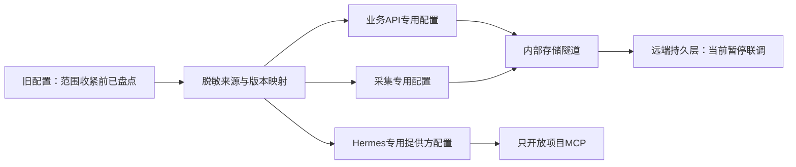

# 旧配置复用与存储接入台账（脱敏）

更新日期：2026-10-27。只记来源、类别与状态，不记录账号、口令、密钥、会话、代理地址或真实连接值。

## 当前配置状态：以本节取代下文早期阶段的现在时

以下按 E99—E101 的实际时间线汇总。下文保留最初盘点、失败与恢复记录，不能把当时的“暂停”“重复授权”或“尚未联调”当作当前状态。当前配置没有因本文核对而重建、输出秘密或修改外部目录。

| 配置类别 | 已核验状态与时间 | 仍未证明的范围或准确失败类别 |
| --- | --- | --- |
| 数据库传输与结构 | E100 已经固定主机密钥的容器隧道，应用 016—018；当前 45 张 v2 表、44 张业务表；018 前备份与恢复目录校验退出 0 | 远端原生 PostgreSQL TLS 未启用，不把 SSH 传输保护说成数据库原生 TLS；完整真实业务恢复另验 |
| 数据库身份 | E100 已切换独立运行身份；非超级用户、无创建库/角色、无表所有权和持久 schema CREATE，旧迁移身份单独保存 | 运行身份无旧表权限是隔离策略，不是旧数据丢失或用户无授权；旧迁移身份仍有授权只读来源 |
| 对象存储 | E100 精确测试对象 put/get/hash/delete 退出 0，仅删除自身对象；后续 HEAD 与限定前缀 LIST 在首轮三秒超时后重试成功 | 根目录高基数扫描此前超时；不据限定前缀成功声称所有历史对象完整可恢复 |
| Telegram 应用及会话 | 原 API ID/Hash 与来源已复用；先前 AUTH_KEY_DUPLICATED 属于已废弃的旧会话。E100 后新授权会话持续 connected，2026-10-27 19:18—19:19 UTC 四来源检查点可读 | 四来源有效租约为 4→4→3，不能说全窗口均无间断；E101 新增稳定账号 get_me 接管校验尚待新镜像部署后只读验证 |
| 来源、普通成员和专家昵称 | 已从原三来源扩展到当前四来源；E100 双端真实点击逐一读取管理员目录、普通成员搜索入口和专家详情，退出 0 | 私有群组编号、账号、昵称不进入此台账；匿名及无法枚举状态保留原有准确原因，不伪造个人身份 |
| 乐鱼业务会话及域名 | E100 同一授权会话读取赛程 2512 场；18:24:53 UTC 唯一赛事刷新 HTTP 200、写入一场，248 报价中 11 条源时间在 15 秒内 | 19:18—19:19 三窗口滚球源价新鲜覆盖为 0；这是报价新鲜度不足，不等于凭据缺失；各凭据确切有效期未由该探针测得 |
| 登录专用代理 | 当前复用 IPRoyal 加密配置，普通采集及盘口不经登录代理；代码与隔离请求边界已验，不再使用青果提取服务 | 本轮未为验证而强制使有效 token 失效或重复登录；不能由正常采集成功推定续期代理当前出口质量 |
| Hermes 模型网关 | 用户指定真实模型路由已在 E99 验证文字、结构化图片及技能调用；E100 有生产框架轨迹和四来源后台审核推进 | 视觉色块和工具调用不是专家推荐语义金标、准确率或盈利证明；E101 新整框架隔离回归独立登记 |
| 网页与管理员 | E100 实际部署 0.0.0.0:3003，1440/390 宽十组真实点击退出 0；E116 已移除平台 MFA、备用码和会话内重验 | 当前公开入口仍 HTTP，正式域名、HTTPS Cookie/WebView 往返尚未取得完整验收证据 |
| Android 正式签名与支付 | 代码、开发包、扫码与导航契约已有独立验证；当前发布状态始终为开发候选，在线支付明确未配置 | 未取得受控设备实际安装升级、正式签名连续性或真实商户支付回执；不当作配置查找失败，更不伪造成功 |

本节是同一轮证据的去敏状态归并，不是新的网络探针。配置缺失、失效、不可达、未核验和有配置但证据不足分别表达；旧配置来源不重复要求用户填写。后续部署及真实有效期变化仍写入进度台账。

**当前范围：用户允许读取其他目录，并明确授权操作 `/root/ai_football-v2-backups/`。外部目录仍未写入、移动或清理；已将经授权读取的运行配置、隧道引用、签名/发现引用和备份内 S3 CA 复制到项目内被忽略的 `.runtime/`，供当前 Docker 候选栈使用。秘密值不回显、不入 Git。**

## 本轮只读归档复核（2026-10-26）

本轮仅读取用户已授权的归档 `/root/ai_football-v2-backups/ai_football-preclean-20261026.tar`，未解压到主机、未写入外部目录，也未建立网络连接。归档权限为 `0600`，大小为 `1,661,030,400` 字节，SHA-256 为 `831a0ded11a10a0ae790895af05f9187d8e3325ced11ab6a7df6556b41215a8c`，包含 `58,281` 个成员。归档内抽样确认旧环境、S3 客户端、乐鱼协议、运行台账和两份旧 Compose 均存在。

旧 `.env` 仅记录了键名结构：数据库连接、PI/Hermes 地址与模型、乐鱼 App/H5 登录与签名字段，以及会话缓存；旧 `.env.inference` 只有推理令牌。旧 S3 配置的结构来自 `client/credentials.json`（`access_key`、`secret_key`、`endpoint`、`bucket`、`region`、`ca_file`、`addressing_style`），旧存储编排通过 `S3_CONFIG_FILE` 引用它。审计不会把这些文件的值写入报告。

归档发现一个需要阻断迁移的权限问题：`client/credentials.json` 在归档中为 `0644`，但其结构包含访问凭据键名；该文件不得直接复制到新镜像或共享给服务。旧 `.env` 及签名前配置为 `0600`，旧 CA 为 `0644`。当前项目运行时环境保持 `0600`；`S3_CA_FILE` 指向的 CA 允许 `0644`，因为非 root API 需要读取公开信任材料，审计不会把 CA 误判为秘密文件。乐鱼签名/发现文件仍要求私有权限。

当前项目静态策略复核结果：运行时目录和 `.env` 均被忽略，Dockerfile 未发现复制 `.env`、凭据或私钥的指令，仓库运行时密钥路径之外未发现待提交秘密文件；这只是源树检查，不能替代外部连通性、TLS/权限、令牌有效期或恢复演练。审计报告写在被忽略的 `.runtime/config-audit/read-only-config-audit.json`，仅含键名、结构、权限、哈希和未验证项。

可复现命令（退出码均为 `0`）：

```text
docker run --rm --network none --cpus .5 --memory 256m --user "$(id -u):$(id -g)" \
  -v /root/ai_football:/work \
  -v /root/ai_football-v2-backups/ai_football-preclean-20261026.tar:/input/ai_football-preclean-20261026.tar:ro \
  -w /work python:3.12-slim@sha256:a6e34c598f2467ed0e9a8d349809fcd8b5c603269512df273a0bb1784edc11b1 \
  python -m infra.config.read_only_audit --archive /input/ai_football-preclean-20261026.tar \
  --project-root /work --output /work/.runtime/config-audit/read-only-config-audit.json

docker run --rm --network none --cpus .5 --memory 256m --user "$(id -u):$(id -g)" \
  -v /root/ai_football:/w:ro -w /w python:3.12-slim@sha256:a6e34c598f2467ed0e9a8d349809fcd8b5c603269512df273a0bb1784edc11b1 \
  python -m unittest tests.test_read_only_config_audit -v
```

这组证据可以支持 P01 的旧配置来源盘点和 P02 的权限/来源台账设计；P08 的旧拓扑仅完成归档结构核对，P11-01 的 S3 端点、TLS、授权和恢复仍未在本轮网络禁用条件下验证；P44-03/04 仍需按新编排完成外部权限收敛、备份恢复和正式发布检查。上述节点不因“审计脚本退出码为 0”自动标记为生产完成。

## 状态定义

“找到”代表存在来源或保存路径，“已迁移”代表已放入受保护目标，“验证有效”必须指明验证范围。解密成功不等于 Telegram 授权仍有效；容器健康不等于最新采集正常；能列桶不等于可写或能恢复所有历史对象。

## 本轮实际发现

只读来源索引（不记录秘密值）：

| 来源路径 | 发现内容 | 处理方式 |
| --- | --- | --- |
| `/root/.config/ai-football-v2/runtime.env` | 新平台白名单环境变量，包含数据库、S3、Hermes、会话和启动开关键名 | 只读读取并按服务白名单生成项目内 `.runtime/runtime.env`；不写回来源目录，当前仅用于开发候选 Compose |
| `/root/.config/ai-football-v2/storage-connection.json` | 数据库隧道、S3端点、桶、区域、CA及代理字段 | 只读字段核对；当前运行值来自用户授权备份与隧道目录，秘密不输出、不写回来源 |
| `/root/.config/ai-football-v2/leyu-collector.json`、`leyu-app-signing.json`、`leyu-app-discovery.json` | 乐鱼采集、签名、动态发现及短期代理字段 | 采集白名单字段加密导入项目台账，签名/发现文档以只读挂载引用；未启用真实投注 |
| `/root/.config/ai-football-v2/telegram-collector.json`、`telegram-source-mappings.json`、`legacy-telegram-vault.json` | Telegram应用、来源映射和加密会话字段 | 只读字段形状；未发起Telegram连接 |
| `/root/.config/ai-football-v2/legacy-ssh/`、`tunnel/` | 固定主机密钥、known_hosts及隧道模板 | 只读权限和文件形状；未建立外部隧道 |
| `/root/ai_football-v2-backups/` | 用户授权备份；包含 S3 CA、旧项目配置和历史运行材料 | 已读取 S3 CA 与配置结构并恢复到项目 `.runtime/`；不删除、不移动、不覆盖备份，其余历史数据未导入 |
| `/root/football-task41-backup/`、`/root/football-task42-backup/` | 历史台账、模型、订单、报告及数据库备份 | 只确认目录类型和文件清单；不把旧模型带入新系统，不删除历史备份 |

| 类别 | 已核验事实 | 当前验证范围及剩余工作 |
| --- | --- | --- |
| 归档 | 58,281 个成员；五份配置、协议、持久层及部署样本恢复后哈希一致 | 样本恢复通过，不等于完整旧服务恢复演练；不再读取外部归档 |
| SSH 部署入口 | 旧专用配置、密钥及已核验 known_hosts 完整，严格主机密钥连接曾成功 | 已停止探针，未采用自动接受新密钥；后续外部操作暂停 |
| 远端拓扑 | 旧 storage API、模型、归档、Redis、PostgreSQL16及 RustFS 仍属旧存储栈 | 原 API/模型各配额1核、归档0.25核，未停止它们；未将采集移回本机 |
| PostgreSQL | 16.15，库约185.7GB；原服务器 ssl=off；设置版本74 | SSH保护下只读事务 read_only=on，未改表、未新迁移、未删除；不能明文公网直连替代隧道 |
| S3 兼容存储 | 找到旧端点、桶、私有访问键、path样式及原公共TLS证书 | 当前候选容器经隧道完成 `head/put/get/hash/delete` 探针，退出码0；只删除自身测试对象，旧数据未扫描或清理 |
| 乐鱼 App | 找到当前远端生效登录、签名、设备、代理、动态发现和 token | 16 项采集白名单设置已加密写入当前台账；采集器重新加载后 WebSocket 有事件，但轮询受上游限流，真实会话新鲜度仍待确认 |
| 乐鱼场馆 | 找到真实场馆缓存 request_id、host、origin、obtained_at、ttl及Cookie字段 | 无随机生成授权；尚未按新适配完整联调，不把找到的缓存标为仍有效 |
| 登录专用代理 | v1 保存的是 IPRoyal 账密；它与青果按量提取服务是不同产品，不能混用。旧实现曾因残留青果提取字段优先级错误而覆盖 IPRoyal URL | 仅保留加密的 IPRoyal 登录代理 URL 与可选密码模板；每次登录生成 59 秒粘性会话，经同一代理读取公网出口 IP 后提交一次 App 登录；普通采集、场馆启动和订单链路不使用代理 |
| Telegram 应用 | v1 PostgreSQL `runtime_settings` 的 API ID/Hash 和受保护配置中的启用标志已复用并加密写入 v2；状态设置已核对 | 不需要重新填写应用凭据；v2 容器曾确认会话授权，但后续 Telegram 返回重复授权错误 |
| Telegram 会话 | v1 受保护配置中的 StringSession 与 v1 `telegram-private/user.session.enc` 解密后的会话相同，已按 v2 数据密钥加密迁入 | 该授权密钥已由 Telegram 以 `AUTH_KEY_DUPLICATED` 废弃；需要用现有 API 凭据重新扫码生成会话，不能继续重试旧密钥 |
| 专家映射 | v1 的 3 个来源及 7 个稳定作者身份映射已事务化写入 v2，3 个来源均启用 | 昵称由已授权会话首次读取时同步；未迁移专家历史统计或伪造昵称 |
| 模型网关 | 旧环境及远端设置均有模型地址、路由与访问键 | 新Hermes配置已有映射；真实文字、视觉及工具回路未由此盘点验收 |
| 网页入口及证书 | 仅核验旧部署材料，未完成所有Web入口证书及代理归属 | 保留待核验，不覆盖其他项目配置 |
| 新平台密钥 | 新数据的会话与加密配置先前已建立 | 不替代旧会话主密钥；项目运行时密钥仅在 `.runtime/`，未轮换或覆盖旧密钥 |
| Android 签名及支付 | 未查完既有材料 | 不断言确实缺失，不伪造签名或付款；受当前目录范围限制 |

## 对原阻塞判断的修正

新环境没有 Telegram/S3 键值不代表旧配置不存在：Telegram 应用与来源在 v1 PostgreSQL 设置表，受保护 collector 配置提供可解析 StringSession 和来源映射；本轮已将应用凭据、会话、3 个来源及 7 个稳定作者映射加密/事务化写入 v2。另一个 legacy Fernet vault 副本与同目录 key 不匹配，没有用作迁移源。Telegram 已确认该会话授权密钥重复并废弃，因此登录会话需重新建立；应用凭据和来源无需重填。

旧数据库未启用原生 TLS；目标方案为**固定主机密钥的容器 SSH 隧道**，不能为了连通关闭公网直连的 TLS 要求。S3 保留原 HTTPS 端点和 CA，在受限 CONNECT 代理中贯穿端到端 TLS 校验，不使用 verify=False。

S3 认证列桶返回200（约0.59秒）、桶位置返回200（约0.35秒）、新 v2/ 前缀列举200（约0.55秒）、telegram/ 前缀列举200（约0.13秒）；旧桶根目录枚举仍读取超时。由此可确认凭据和受保护网络可用，根目录高基数操作另需优化；不能将根扫描超时等同于存储登录失败。新健康探针和日常请求应限定前缀或精确对象，不扫旧桶根。

## 代码与配置契约



- 盘点工具只读旧数据，秘密仅写获准保护目标；本轮仅读取上述来源路径的元数据和字段形状。恢复样本验证与真实配置有效性分开记录。
- Compose 不再共享整份 env_file。各服务获得显式白名单，模型提供方密钥只交 Hermes，MCP 无数据库或账户秘密。
- 数据库迁移独立于 API/工作器启动；API等待迁移完成，框架依赖按 API→MCP→Hermes→工作器排列，无反向启动环。
- S3 专用配置为 endpoint/access/secret/bucket/region、原 CA及 S3_HTTPS_PROXY；该代理只交 S3 客户端，不能影响普通采集或模型出站。
- 框架本机状态使用受限 tmpfs，业务审核轨迹由工作器写远端。源配置、签名和发现参数只读挂载，不在镜像层携带秘密。
- 当前所有配置绑定默认指向仓库内 .runtime/，该目录被 Git和构建忽略；不会自动建立或读取项目外配置。
- 运行身份应与迁移身份隔离，旧账号已有权限仍需生产切换前收敛；配置模板存在不代表这些账号已创建。

## 验证记录

| 动作 | 实际结果 | 局限 |
| --- | --- | --- |
| 受限 Docker 从归档恢复五份样本并逐件比对 | 退出码0，五件哈希一致 | 范围收紧前；不再访问归档 |
| SSH只读容器、设置和配置盘点 | 退出码0；设置v74及来源结构确认 | 未迁移远端结构或写业务数据 |
| Telegram 会话格式检查（禁网容器） | 外部受保护 collector 配置中的 StringSession 经 Telethon 解析，规范化往返一致；无网络连接 | 只证明结构可解析，不证明授权仍有效；legacy Fernet vault 解密失败，未复制其内容 |
| PostgreSQL隧道只读查询 | 成功，read_only=on | 同次S3根扫描失败导致组合命令整体退出码1，不能将组合命令报为全通过 |
| 原CA TLS握手及限定S3查询 | 单独探针退出码0，证书校验有效、授权前缀查询200 | 根目录查询失败保留记录，未写删 |
| 项目候选栈运行时配置恢复 | `.runtime/` 运行环境、SSH 隧道引用、乐鱼签名/发现引用及备份 S3 CA 已生成；Compose config、容器启动和 Web healthz 退出码均为0 | 仅项目内运行时恢复；未向外部目录写入，真实 Telegram 与上游轮询仍受授权/限流状态约束 |
| S3 精确对象探针 | 隧道内 `head_bucket`、限定前缀 `put/get/hash/delete` 退出码0 | 证书需由非 root API 读取，项目 CA 权限已修正为0644；未扫描高基数根目录 |
| 隧道镜像候选构建 | 退出码0 | 尚非正式发布镜像 |
| 收紧范围后停止本任务探针 | docker stop --time 5 ai-football-v2-tunnel-probe，退出码0 | 终止持续SSH，不读取挂载、不删外部文件、不动其他服务 |
| 仓库内配置及CONNECT边界回归 | 最终11项全部通过，退出码0 | 假值、本地环回、秘密不回显、外部挂载拒绝、循环依赖及CONNECT正常/拒绝路径 |
| Compose首次特殊字符检查 | 退出码1，发现单引号dotenv不应双写反斜杠，已修复 | 失败历史保留，不静默忽略 |
| 仓库内最终假配置解析与禁网值探针 | sh infra/check-runtime.sh 退出码0 | 仅配置解析、权限分配和字符传递；未启动生产服务 |

## 2026-10-27 Telegram 配置复用与会话冲突

用户要求直接复用 v1 Telegram 配置。本轮通过严格校验主机密钥的 SSH 隧道只读查询 v1 `runtime_settings`，并只读检查 v1 受保护 collector 配置、来源映射和加密会话文件；秘密值、真实群组编号及昵称均未进入命令输出、报告或 Git。API ID/Hash、启用标志、原 StringSession、3 个来源及 7 个作者身份映射均已写入 v2 加密设置/远端业务表，检查到的会话哈希匹配，但报告不记录哈希值。

v1 API 内置的 Telegram 专家服务在只读运行设置中显示 `enabled=true`、3 个来源、当前 `disconnected`。v2 单个 collector 曾显示会话已授权，随后读取来源时返回 `TypeNotFoundError`，再由服务端返回 `AuthKeyDuplicatedError`；Telegram 官方错误说明明确该错误会使授权密钥失效并要求重新登录生成新密钥（[Telegram API errors](https://core.telegram.org/api/errors)）。因此不能把复制后的旧 StringSession 声称为可用：应用 ID/Hash 与来源配置已复用，登录密钥需通过设置页现有扫码流程刷新。已在 v2 识别重复密钥为会话失效并停止同一密钥的循环重试；v1 配置目录与备份保持只读。

## 后续边界

继续只在仓库内开发和验证；外部来源只读，备份目录不写入、不移动、不删除。当前开发候选已加载经授权的采集配置并完成 S3 精确对象探针，但真实 Telegram 授权、上游限流恢复、数据库历史升级和正式部署仍未完成；不得把候选容器健康冒充生产发布。
