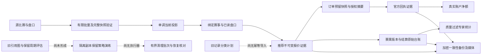

# 数据契约、索引与恢复验收矩阵

更新时间：2026-10-27。本轮只读核对 P09、P10、P12、P42 与当前代码、测试、既有冻结日志；仅新增本文，未改业务、测试或任务状态。目的不是重新规划已实现功能，而是区分可直接关联证据的节点、待最新契约复验的节点及确切尚缺动作。

## 证据口径

| 标识 | 已存在证据 | 能证明什么 | 不能证明什么 |
| --- | --- | --- | --- |
| F693 | `.runtime/hermes-telegram-20261027/full-freshness-final-3.log`，693 项 / 257.085 秒 / 主线确认退出 0 | 冻结时的 Python 单元、真实临时 PostgreSQL 集成及恢复用例通过，45 表恢复财务差异为空 | 不包含随后新增空盘口线/大盘口分块全部变化；不是 Android Java、真实浏览器或生产量级测试 |
| R14 | `.runtime/recovery-seed-20261027/frozen-suite.log`，14 项 / 22.772 秒 / 退出 0 | 45 表、媒体、独立数据密钥、财务一致性及迁移种子预算恢复 | 不是旧项目到新结构迁移，不是生产备份或容量 RTO/RPO |
| Q10k | `docs/platform-v2/HISTORICAL_SETTLEMENT_AUDIT.md` 第二轮及 `evidence/settlement-statistics/optimized-full.json` | 当前生产质量 SQL、合法合成报价/赛果证据、10k 比赛/推荐，统计 HTTP P50 309.092/P95 388.835ms；250 候选十页；命令退出 0 | 非远端真实分布、冷缓存、并发吞吐、磁盘压力；不能用旧无质量证据性能报告替代此报告 |
| D17 | `.runtime/fault-recovery-20261027/frozen-suite-final.log`，7+8+2 项全部通过 / 退出 0 | 真实连接中断 503、事务回滚与重放唯一、媒体迟到/限流/模型429/MCP应答丢失闭环 | 最新 018 在运行时另有编辑，须统一冻结复验；不代表生产注入过故障 |
| N18 | 当前 `tests/test_line_contract.py`、`test_fixture_snapshot_atomic.py`、`test_quote_snapshot_chunks.py` 及增量018；负责代理通知 `.runtime/line-contract-20261027/directed.log` 179 项 / 104.417 秒 / `OK` | 空线/零线区分、501/2000报价单事务完整快照及失败回滚专项已冻结通过；冲突目标与018表达式索引对齐 | 本文不重复运行该专项；最终全量仍需覆盖最新完整树，不能只引用693项旧快照 |
| RL26 | `.runtime/recovery-line-20261027/frozen-suite-final.log`：新5项5.280秒、原恢复14项23.345秒、门禁7项.009秒，合并命令退出0 | 合法winner NULL恢复inventory缺报价0/差异为空，原line/JSON/时间不变；legacy NULL/零受限兼容且numeric/未知/缺键/错证据拒绝 | 仅临时库与合成样本，不是真实旧数据迁移；最终全量需吸收此新增补丁 |

“可完成”只表示该节点写出的设计/代码/隔离验收内容已具备，不把它扩张为生产迁移或整个项目交付。不能仅因早期文档还写“未核验”便推断最新实现不存在。

## P09 领域与接口

| 节点 | 职责与已实现行为 | 对应测试/证据 | 建议状态与确切边界 |
| --- | --- | --- | --- |
| P09-01 | 核心迁移将用户、专家、来源映射、消息版本、审核任务、推荐、账号及订单分开；平台 UUID/赛事来源 ID 独立；消息 `(source,message,revision)` 唯一，任务幂等键唯一，业务链 FK | F693；`test_telegram_api` 编辑版本/唯一任务、`test_reviews` 跨比赛推荐、`test_account_state` 账户绑定/隔离、恢复完整 FK 顺序 | 可关联隔离实现完成。联赛/球队是带可选上游 ID 的赛事投影字段，不是独立主数据实体或联赛/球队 FK；若目标要求独立球队库需单列需求，不伪称已有 |
| P09-02 | 当前报价保留 market_kind/period/line/selection、上游 play/market_instance/selection ID、主线、status、比分基线与 score_basis；推荐保留时点上下文 | F693；`test_leyu_protocol` 附加线/期间/身份/停盘、`test_reviews::test_unchanged_price_does_not_hide_changed_live_score_context`、`test_account_state` 盘口授权 | 基础实现可验；N18 跨业务独赢空线联调完成前保留最新复验标记 |
| P09-03 | Pydantic Decimal/数据库 NUMERIC、非有限值与范围拒绝、复合盘口数值解析已存在；018 明确 winner 无线与 Asian 零线并兼容历史 winner 零线 | F693 的金额/复合盘口测试；N18 的8项线契约及数据库/MCP/订单/结算链路测试 | 待N18最终复验后可完成。此处是真正的近期语义变更，不能直接套用693结论 |
| P09-04 | 源事件/接收/写入/原消息/报价/提交/官方placed/receipt observed/settled时间独立，AwareDatetime与TIMESTAMPTZ；未知源时保持 NULL，不补当前；余额观测与结算来源分开 | F693；`test_leyu_protocol::test_unknown_source_time_stays_unknown_despite_capture_time`、`test_result_ledger::test_unknown_time_quotes_and_chinese_calendar`、官方回执时间及DST测试 | 可关联隔离实现完成。官方未给出的时间仍明确未知；没有把“所有字段非空”当完成标准 |
| P09-05 | 公开、本人账户、管理员及内部采集/MCP路由分开鉴权；游客不取原文媒体，个人导出排除内部载荷与他人行；全局错误脱敏、明确503写入未确认 | F693 权限、身份双会话/权益/归属、`test_result_ledger::test_guest_cannot_read_original_or_media`、`test_identity_lifecycle` 导出、D17 | 可关联隔离实现完成；业务路由并非全部用单一响应模型生成公开文档，不把OpenAPI存在当权限证据 |
| P09-06 | HMAC签名键集游标包含版本、范围哈希、带时区边界与稳定ID；列表排序固定；MCP另有任务快照、expected_cursor及完整分页门槛 | F693；`test_pagination` 篡改/跨范围/错key、`test_result_ledger` 公开分页、`test_operations` 订单筛选游标、`test_reviews` 105场/篡改/跳页/重放 | 可关联隔离完成。MCP不是公共签名游标的简单复用，两个层次已分别验证 |
| P09-07 | 原文事件版本、推荐身份、账户任务attempt、配置CAS/revision、订单幂等/finish摘要及请求ID已持久化；重复成功与409冲突区分；503不许可盲重试 | F693；`test_telegram_api` pending→ready一次入队、`test_identity` 手工授权冲突、`test_leyu_renewal_api` CAS、`test_account_state` 回执摘要冲突；D17丢响应恢复 | 可关联隔离完成。投影导入依源时间幂等而不是任意外部请求号；被隔离的大包不声称已写入 |
| P09-08 | `/public/client-info` 提供 product_id、api_version=2、min_android_version_code=1；Android拒绝异产品/API版本或高于本地最低版本的服务；018旧winner零线兼容边界已设计 | `tests/android/ClientPolicyTest.java::incompatibleServiceOrOldClientRejected`；Python不执行Java，不能算F693；N18兼容测试 | 部分实现。仍需正式写出兼容矩阵、字段弃用/升级窗口及客户端失败提示契约，并把Android既有实际执行证据关联本节点；不是缺服务器接口 |

P09工作包总述还要求“不合法数据入隔离队列”。当前API对非法body返回422/413，采集器对超预算赛事做脱敏隔离统计并继续邻居，没有通用持久化原始错误载荷死信队列。若继续将它作为工作包硬验收，应另建有字节/留存/权限上限的隔离队列，而不是把日志或HTTP拒绝称为队列。

## P10 数据库结构与性能

| 节点 | 职责与已实现行为 | 对应测试/证据 | 建议状态与确切边界 |
| --- | --- | --- | --- |
| P10-01 | 用户/权益/来源/消息/任务/盘口/证据/订单都有非空、唯一、FK和状态CHECK；账户任务、赛果版本、结算链与官方回执独立；018额外校验显式line并预检旧行 | F693各真实PG业务测试；`test_migrations`/`test_runtime_db_role`；N18数据库错误线和旧行升级场景 | 结构基础已完成；018新增约束最终复验后可勾。不等于数据库对每个可能JSON内部字段都有CHECK |
| P10-02 | 推荐唯一键含消息、比赛、玩法、期间、线和方向；同消息两比赛不合并；消息版本产生独立任务，统计仅接受规范报价、官方赛果与一致结算 | F693；`test_reviews::test_same_market_for_two_fixtures_creates_two_signals`、`test_result_ledger` 质量排除/重建/修订、Q10k逐条复算 | 可验基础完成；018表达式唯一键与NULL/旧零同义最终复验后更新完成证据 |
| P10-03 | 单独迁移入口；批次事务/advisory lock/版本与SHA登记；普通进程只check_schema不DDL；两个并行独立连接仅一方应用 | F693；`test_migrations::test_concurrent_cold_start_is_serialized`、`test_normal_schema_verification_performs_no_ddl` | 机制与双连接验收已完成；TODO明确要求“两API进程与worker同时启动”，尚无该多进程启动编排测试。最小补测为同临时库启动迁移+2个API/worker就绪检查，不能把双协程称双进程 |
| P10-04 | 迁移与运行角色分离，运行身份无表所有权/旧表权/持久DDL，schema registry只读，后续新增表需显式refresh | TODO已勾E100；F693 `test_runtime_db_role` 检查旧表/他schema授权/成员或所有权拒绝；主线实际低权限切换证据 | 保持已完成。018迁移后角色refresh与启动schema checksum属本次发布步骤，不重做权限设计 |
| P10-05 | 赛事阶段时间/队名/别名GIN、消息作者时间、结算索引、订单state/time、审核pair/租约/fresh lane均已建索引 | 001/003/006/010/012/017迁移；F693；`test_review_worker`/`test_review_freshness_scheduler` 有锁跳过、持久公平与重启；Q10k计划 | 可关联索引实现完成。没有要求每条查询必须走索引：窗口覆盖大部分合法样本时顺扫不自动是缺陷 |
| P10-06 | 最新基准跑生产signal_scope/QUALITY_METRIC_SQL及HTTP，质量CTE一次物化；1万合法证据/7500复算结算、250候选十页，记录完整计划/资源/分位 | Q10k；`test_performance_statistics` 查询与参数契约；优化前后逐字段一致测试F693 | 合成量级部分已验；未按真实生产表/分布统计估计容量，也缺持续采集并发/冷缓存/真实磁盘。不能用10k tmpfs暖态代替本节点的“生产量级” |
| P10-07 | 连接池command5s、statement5s、lock2s、idle事务10s、闲连接180s；迁移30s锁/60s语句；请求/媒体/框架有总截止和有限重试；超时/断连返503而非假成功 | F693真实锁/statement/command超时；D17实际断连与新连接恢复；工作器租约预算测试 | 可关联隔离完成。无通用显式connect_timeout参数，asyncpg默认连接截止仍有限；不把此事实说成已调好所有上游SLO |
| P10-08 | 初装、重复迁移、checksum篡改、批次失败全回滚后重试、普通校验无DDL；017从旧任务回填并保护未来写入；018含预检与增量兼容 | F693 `test_migrations`五项、`test_review_worker::test_migration_backfills_existing_jobs_and_future_inserts`；N18旧winner/quote身份保留 | 隔离升级能力已做；真实旧生产结构/数据量升级未验，018最新版本也须最终回归。不能因无真实旧样本否定已经通过的失败迁移恢复 |

## P12 投影、证据及保留

| 节点 | 现有职责/测试 | 可完成范围与真正缺口 |
| --- | --- | --- |
| P12-01 | TODO已勾；源时间单调upsert，老HTTP不能覆盖新WS；停盘/关闭分开；F693 `test_leyu_snapshot_monotonic`/`test_reviews` | 保持完成。N18分块改动须复验，不回退到“毫无单调保护”的旧判断 |
| P12-02 | TODO已勾；完整快照缺项才关闭，部分失败保留；新推送水位竞争保护；N18把501/2000盘口分块放同一事务，最后块失败全回滚 | 基础完成；大包原子新增场景待最终专项+全量，不将分块中间数据当完整快照 |
| P12-03 | 推荐写`v2_quote_evidence`不可变时点快照；订单预留`quote_snapshot`；授权核验payload保存`prepared_digest`；官方回执`v2_order_receipt_evidence`哈希去重；结算`v2_signal_settlements.calculation`与版本保留；F693推荐证据、价格/线授权、回执冲突、台账重建 | 已有完整的推荐/订单引用与结算证据链。按本节点“预检、提交分别采样不可变赔率证据”严格看仍缺：预检/提交完整规范载荷仅在内存传输，数据库仅摘要/预留快照，不是独立append-only预检和提交证据。不能仅因表CHECK允许order_attempt/order_receipt/settlement就声称实际写入这些kind |
| P12-04 | 有媒体孤儿引用扫描及legacy分类器、audit_inventory，但均不是旧盘口全量引用图 | 真实旧盘口被专家/订单/报告引用的脱敏计数和归档候选尚未生成。需只读旧结构映射+引用图与不可删集合报告；不是业务代码已全有但缺一行文档 |
| P12-05 | 批量jsonb_recordset合并、固定quote/字节预算、源时单调、推送有限队列/有界重试、新大包分块；Q10k记录计划，F693相关限额/合并 | 批量低IO路径已有；按时间分区及实际保留频率/缓存容量决策尚无完整设计，实际磁盘写放大/死元组/WAL也未测。不要为了打勾强加未经量测的分区；先记录哪些高基数表需要分区及哪些投影不宜分区 |
| P12-06 | 结算重建可复算、恢复inventory可比较；cleanup_gate要求retention/references/恢复/批准证据 | 真正保留周期方案、查询/收益/纠纷/备份影响分析尚未完成。门禁要求证据不等于证据存在；应先在恢复副本建立不同保留期对照 |
| P12-07 | `test_recovery`精确比对数量/净额/敞口/证据，cleanup_gate拒绝整库或有引用数据 | 没有在副本实际执行保留策略并比较前后；这项可先用合成有引用/无引用tick及推荐/订单样本实现，不全依赖生产授权；真实旧数据策略再单独验 |

## P42 备份与旧数据

| 节点 | 现有职责/测试 | 可完成范围与真正缺口 |
| --- | --- | --- |
| P42-01 | `create_bundle`可重复读快照、45表二进制COPY、AES-GCM分块、加密清单、媒体key/SHA索引和实际媒体、独立data_key_reference；密钥不打包；F693/R14错误密钥、坏块/缺图拒绝 | 备份实现与合成验收已做；CLI故意仅接受明确隔离库，不能直接拿它称正式生产备份。真实关系/媒体/加密配置引用的备份与独立密钥保管路径仍需形成一次可恢复产物；角色/WAL/PITR并未覆盖 |
| P42-02 | TODO已勾；R14/F693同一快照还原权限/原文/报价/订单/审计/媒体哈希，独立密钥解密；非空目标、冲突对象、结构不符拒绝；调度预算6精确保留 | 018后发现并经授权修复winner NULL误计缺报价；RL26按winner/证据kind限定义NULL/legacy零，numeric NULL绝不当0，并验证完整恢复原证据不变。保持隔离恢复完成，最终全量待吸收；不是生产恢复 |
| P42-03 | `legacy_quality.classify/plan`完整/可补全/证据不足/非专家分类；系统报价与官方可复算结算才eligible，重复身份双向隔离；F693分类/边界测试；RL26新增winner空线语义 | 分类设计/代码/合成验收可完成；真实旧台账分类汇总尚无。此前合法winner NULL分类缺口已修复，明确line键及winner kind才允许NULL/legacy零，未知/缺失/数值市场NULL拒绝；60秒历史报价窗口是固定迁移口径，需与新热策略关系说明 |
| P42-04 | 分类计划保留作者/chat/message稳定ID、原文/媒体、时间/比赛/线/系统quote/result/settlement及source_evidence_sha256；旧模型明确excluded | 不是已迁移：`import_performed=false`且无真正写入新结构的迁移器/对照持久映射。需要幂等旧→新ID映射、质量隔离、事务导入及回滚/重跑测试。可先合成验证，再选授权真实样本 |
| P42-05 | R14/F693同库备份恢复已比对消息1、推荐2、pending1、unit_net.95、订单2/金额4、reserved2、actual_net1.9，差异为空 | 同结构恢复对照已完整；旧新迁移前后分母/排除原因及收益变化尚无。需对每种质量分类给出解释，不把预期排除的旧模型数量差异认成数据丢失 |
| P42-06 | 693样本backup约.191048s/restore.414064s；R14及历史恢复也测耗时；`P01_RECOVERY_ORDER_OWNERSHIP.md`有依赖顺序/只读回退与未知订单先核对 | 测量机制与只读顺序可完成；业务批准的RPO、备份频率、目标RTO和真实容量实测仍缺，不能把小样本秒数写生产承诺 |
| P42-07 | cleanup_gate强制批次manifest/最大1000、零引用、新鲜扫描、批准到期、备份恢复对照；所有输出明确无删除；F693拒整库/陈旧/篡改/有引用，P01归属保护 | 安全门禁实现可完成；没有批次删除执行器、逐批日志与恢复校验循环。此为真实功能缺口；在真实策略与引用报告前保持不执行远端清理。可先写纯隔离副本演练，无需删除现有数据 |

## 已有数据流与缺口位置

不将预留赔率当真实成交赔率；不将推荐结算当账户盈利；不将分类计划当已导入；不将cleanup门禁当已执行删除。

## 建议下一步最小可验动作

1. 主线对018及大包原子快照最新冻结版本跑完整回归，关联P09-03、P10-01/02/08和P12-01/02新增兼容证据。
2. 补正式兼容/弃用矩阵、最低客户端契约与多进程启动测试；不重写已有签名分页、权限或迁移锁。
3. 为预检与提交分别追加有边界、可重建且去秘密的不可变证据，复用现有订单引用与摘要；增加重复/冲突/未知结果测试。
4. 先在合成恢复副本实现保留候选/引用保护/批次执行/恢复复核，定义可比较指标与不可删表；然后对授权旧数据只读盘点。
5. winner无盘口线兼容已修复并定向验证；下一步实现带原标识映射及质量隔离的幂等导入，同批样本比较原始、排除、可补全与统计eligible数量及收益，明确差异原因。
6. 以真实表量/索引/WAL/网络量测制定分区、缓存与RTO/RPO，不把tmpfs暖态基准外推为远端容量。

审计阶段没有重跑已通过17项；随后获得明确授权，限量修复恢复inventory及legacy分类的空线兼容，新增专用测试并执行RL26，业务/测试源码现已冻结。首轮新测试缩进失败与继承样本market_kind未显式winner的夹具失败均保留于`.runtime/recovery-line-20261027/`，修正夹具后完整26项通过；没有放宽真实约束或改写历史。最新空线/分块专项由原负责代理完成，最终统一验收由主线执行。
