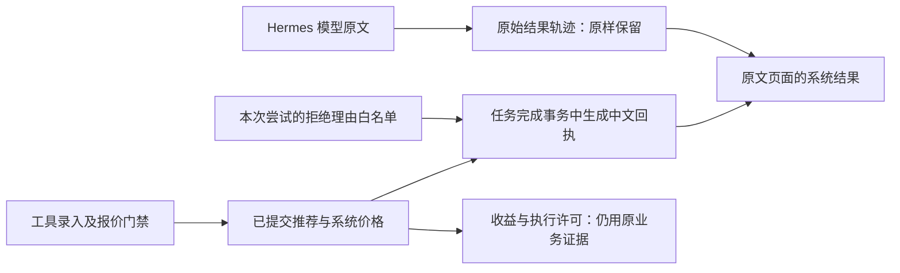

# 系统推荐回执与模型原文分开保存

更新：2026-10-27；关联 E101、P27-08、P28-01。证据级别 A：可核验代码与临时真实 PostgreSQL 回归，不是模型准确率测量。

## 解决的问题

模型可能输出英语，或自由文字声称已接受多项推荐。保留原文是必要审计证据，但该文字不能代表工具已经成功录入，也不能成为正确率、收益或自动执行依据。现在保留完整模型原文，同时在当前任务完成事务中，从系统已保存的推荐和当前尝试的工具拒绝记录生成确定性简体中文回执。

| 内容 | 来源与呈现 | 明确边界 |
| --- | --- | --- |
| 接受数量 | 数据库中本消息实际推荐数量 | 不读取模型声称数量 |
| 比赛及盘口 | 系统赛事、阶段、期间、方向、盘口线与推荐快照价格 | 不使用 TG 原文赔率；独赢不适用线与数值零分别显示 |
| 未解决理由 | 当前尝试的结构化拒绝原因白名单 | 重复工具尝试明确标记，不假称不同推荐数；未知细节不回显 |
| 模型原始说明 | 原有结果轨迹完整保留 | 不翻译覆盖，不当作已录入事实或盈利保证 |
| 长消息 | 摘要最多展示一百项，并明确另有数量 | 全部原始推荐保留，由详情分页读取，不静默截断 |
| 零接受项 | 明确尚未接受、不计收益、不触发自动投注 | 原有审核状态仍为未解决 |

## 隔离验证

实际命令：`sh .runtime/hermes-telegram-20261027/review-summary/run.sh`。在具名临时 PostgreSQL 中应用实际迁移；测试器与数据库各限制半核、384MiB，从只读源码复制冻结快照，不连生产。最终换行收紧后的重跑为 **45 项、40.207 秒、零失败/错误/跳过，退出码 0**，日志保存在项目忽略的私有证据目录。

包含英文假成功声称与零实际推荐、两项工具接受、系统价格、拒绝理由去敏、当前 attempt、历史回放、独赢空线与让球零线、超过一百项的明确展示边界，以及已有任务并发/租约/历史公平回归。两次早期失败分别是 claim 后测试夹具仍用旧 attempt，以及小数位字符串比较；已记录失败并修正测试契约，不更改实际价格或放宽门禁。

这证明系统回执遵循已提交工具证据，不证明自然语言抽取准确率、真实官方赛果或实际盈利。最终全套、双端浏览器与部署同源检查仍按 E101 收尾记录。
