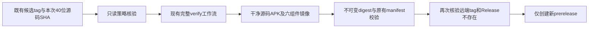

# 可重复发行的不可变开发候选

更新：2026-10-27。状态：工作流及纯策略已写，Docker隔离验证通过；本轮没有创建tag、推送镜像、登录仓库或发行Release。正式版本验收门禁没有变更。

## 问题与行为

旧开发工作流只监听并创建 `v2.0.0-dev`，该发行已经存在时后续候选无法发布。本轮改为显式、唯一的候选标签 `v2.0.0-dev.YYYYMMDD.N`，例如 `v2.0.0-dev.20261027.1`。日期为真实且不晚于执行日的UTC日期，序号为1至999999、无前导零。标签不会由工作流隐式生成或改写；发布准备人员先为待发行的确切源码提交创建一个从未发行过的标签，发行流程只核验既有标签。

| 触发 | 要求 | 拒绝情况 |
| --- | --- | --- |
| 标签push | ref必须为准确标签，匹配严格策略 | 分支push、旧固定标签、正式标签、非法日期/序号、命令注入内容 |
| 手动dispatch | 必填 `candidate_tag`，且该既有标签必须与本次选定ref的提交同源 | 缺输入、标签不存在、tag指向其他提交、已存在同名Release |
| 重复执行 | 允许再次只读检查，发行已存在即拒绝 | 不删除发行、不覆盖资产、不移tag、不把旧资产当新候选 |

旧 `v2.0.0-dev` 及其资产保持原样。本工作流不再尝试向它追加或重发。代码内的Android版本仍为 `2.0.0-dev`，版本代码20000；debug名称仍带 `+debug`，APK文件名、清单格式和Compose映射不变。新候选的区分由GitHub标签和同源元数据完成，**不会宣称Android内部版本已升级**。同版本代码不能作为正式Android升级链证据。

## 执行顺序与源码归属

1. `SOURCE_COMMIT`只从运行的 `github.sha` 获取，要求40位小写十六进制，不接受短SHA、分支或用户输入替代。
2. 只读前置检查必须先通过，随后沿用现有完整 `verify`：后端、真实临时数据库、Compose、浏览器和Android构建/单测/lint。任一失败都不能进入publish。
3. 六组件 `api/collector/executor/mcp/web/storage-tunnel` 均使用该提交构建，推送后拉回并读取registry digest。原manifest要求六项齐全且为 `@sha256:` 不可变引用。镜像临时构建标签仍沿用原源码SHA契约，发行使用digest。
4. 在同一源码清洁检出中重新构建debug及unsigned APK，原manifest检查其源码父提交与工作树状态、包身份、权限、签名性质、大小与哈希。未复用旧Release APK。
5. 发布前再次只读核验远端tag解析后的commit等于SOURCE_COMMIT，并确认该tag的Release返回404。成功策略元数据关联新tag、源码SHA及实际manifest字节SHA-256，作为额外资产上传；不修改原manifest格式。
6. `gh release create`使用已校验tag文件、`--verify-tag`、`--target`和`--prerelease`。没有tag创建、删除、编辑发行、资产覆盖或stable发布命令。创建竞态中若其他运行已经创建同名Release，GitHub创建失败；不退化为更新旧发行。

工作流串行组沿用原设置，不取消正在发行的候选。只读策略job只具contents-read；仅publish具contents-write/packages-write。所有未经信任的输入通过环境变量进入纯策略，不直接插入shell脚本文本；最终shell读取的是严格验证后写出的标签。

## 远端只读策略

新增 `infra/release/development_policy.py`：

- 仅允许固定GitHub API主机和有限GET路径：精确tag ref、tag对象、精确release tag；禁止通用URL或重定向。读取令牌不输出，错误只返回类别。
- 核对返回ref必须准确；轻量tag直接读取commit，annotated tag有界解析最多8个对象，检测环、未知类型和错误对象SHA。
- tag不存在或权限/网络失败即拒绝。Release不存在必须明确404；已有200、401/403、429、5xx均拒绝，不将鉴权失败解释成可创建。
- 每次请求读取截止10秒、正文最多1MiB，job截止5分钟；不自动重试写操作。无远端写入能力。
- APK/镜像清单复验继续要求development通道、`production_ready=false`、完整六digest及两个有哈希的APK资产。

本地测试提供响应夹具，不访问GitHub。真实检查是发行时的点时观测，不声称通过本地测试已证明远端标签存在、registry可用或资产已上传。仓库级tag保护仍应由发布维护者配置；本轮未改仓库设置。创建发行之后的资产读回及安装验收仍由主线发布任务承担。

## Docker证据

冻结校验源为上述工作流、策略模块与专属测试。单元及相关回归在既有验证镜像中复制为只读来源快照，`--network none --cpus=.5 --memory=256m`；actionlint固定镜像摘要并限制同样资源，不重建镜像，不加载生产环境。

| 检查 | 真实结果 |
| --- | --- |
| 新候选策略 | 13项，0.017秒，退出0 |
| 现有开发manifest兼容 | 7项，0.023秒，退出0 |
| 现有正式版只读计划 | 5项，0.240秒，退出0 |
| 固定actionlint镜像 | 开发发行工作流校验退出0，无诊断输出 |
| 源冻结SHA与差异格式 | 退出0 |

合计25项测试0.280秒，退出0。涵盖正常push/dispatch、缺输入、旧标签、非法日期/序号/分隔符、非40位SHA、shell载荷、错源、tag不存在、已有Release、权限错误、tag链环与上限、仓库路径、API重定向、响应预算、网络脱敏、manifest缺镜像/错源/错APK、CLI零输出失败和工作流先验后发/无shell表达式注入。

首次11项执行失败1项：测试将下一个job的env误纳入shell块，已按缩进修正检测，不降低注入约束。后续13项发现显式响应预算异常继承ValueError而被宽JSON异常分类覆盖，修正为优先保留策略类别。失败日志分别保留在私有运行目录；随后重新冻结，上述25项全部通过。工作流首次写入的转义问题在调用actionlint之前已修复，没有运行错误工作流或发布动作。

私有证据：`.runtime/development-release-20261027/policy-tests-final.log`、`actionlint-final.log`、`source.sha256`。

| 产物 | SHA-256 |
| --- | --- |
| 发行工作流 | `3b9787c17d2826ea9a32ce1b5ff9650306b12a9f4b0057128904c03dd9f2a947` |
| 候选策略 | `901d3f19f312f7032d39495bb5a451b11021791b10f55f1cae11011a40d8cf65` |
| 专属测试 | `8dd1366b2c98691febd17d61b9fb7ff09b77df9eaf57a802f91b83210e49295f` |
| 最终25项日志 | `1405ecfeed479eadd71a222a44ade4f1ee8b62d2febf492889defff7496ca802` |

本轮仅修开发候选的不可变标签及归属门禁。没有修改Android版本、其他工作流、真实配置、tag、远端发行或Git引用；所有候选仍为prerelease且 `production_ready=false`。
