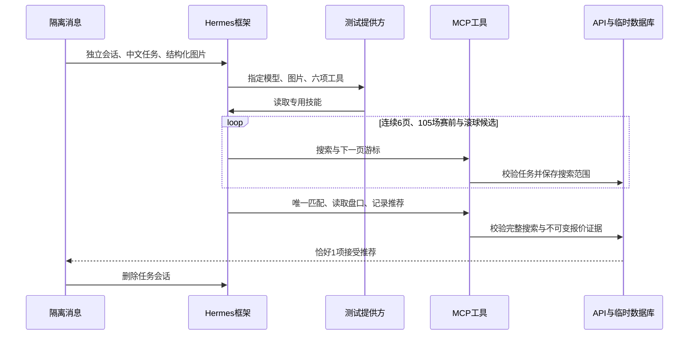

# Hermes 框架隔离联调

2026-10-26。证据等级 A：当前源码、框架镜像和真实执行；模型提供方为显式测试替身。

真实运行 Hermes v0.22.5、MCP SDK 服务、双工作进程业务 API、PostgreSQL 16。提供方由隔离网络内的确定性服务扮演，没有调用外部模型、Telegram、乐鱼、真实账户或投注。



## 实际结果

| 检查 | 测量结果 | 限制 |
| --- | --- | --- |
| 模型路由 | 提供方请求名称为 cline-pass/deepseek-v4.1-flash | 不能由替身证明真实模型支持视觉或语义准确 |
| 图片 | 原生 image_url 数据确实到达提供方 | 使用 1×1 PNG，证明传输而非辨认文字 |
| 技能 | 实际调用 skill_view 并读到项目盘口与分页要求 | 不只检查配置存在 |
| 工具 | skills_list、skill_view 与四项足球 MCP，共六项 | 不开放技能写入、通用资源、终端或交易工具 |
| 搜索 | page_count=6、total_candidates=105、complete=true | 候选为明确标记的测试赛事 |
| 盘口写入 | 匹配第105场并保存1项推荐 | 市场及价格由临时数据库提供 |
| 会话清理 | DELETE 返回200 | 框架内部会话，不涉及Telegram授权 |

框架使用 `tools.tool_search.enabled: off` 直接提供小规模工具白名单。MCP 原生工具之外的自动资源、提示工具关闭。原生 skills 工具集包含写入能力，因此通过框架公共扩展接口注册仅含两个只读技能工具的项目工具集；未修改框架源码。

## 失败及修复

第一次联调 HTTP 200 但零推荐，命令退出1：默认延迟发现导致测试提供方只看到技能工具。第二次退出1：关闭延迟发现后，测试提供方未从框架不可信工具结果包装中解码 JSON。分别修复配置和测试解析，再运行同一路径通过，退出0。没有把 HTTP 200 等同于审核成功。

## 实际验证命令

预先启动本任务专用 PG、API、MCP、测试提供方与 Hermes 隔离容器；无生产配置。测试数据库固定主机和库名检查拒绝其他目标。

```sh
docker run --rm --cpus=.25 --memory=256m \
  --network ai-football-v2-test-net \
  -e INTEGRATION_DATABASE_URL=postgresql://postgres@ai-football-v2-pgverify:5432/v2_integration_test \
  -e PYTHONPATH=/workspace/services/api:/workspace \
  -v /root/ai_football:/workspace:ro -w /workspace \
  ai-football-verifier:v2.0.0-dev python tests/integration/hermes_roundtrip.py
```

首次通过退出码0，12次提供方请求（包含框架辅助请求），六项允许工具、图片与项目技能均确认，连续分页完成，接受推荐1，会话清理200。随后增加精确工具集合断言再次运行通过、退出0：替身累计24次请求，本次仍接受1项推荐、连续6页105场，会话清理200。

框架镜像摘要：`sha256:9c5561579f3ffdf333401797094ac3a743738d6c25d40f4331c7bf77b694238d`。真实模型、实际消息识别、多图片清晰度、上游报价与正式部署仍需独立验收。

## 2026-10-27 旧模型复用与真实视觉

旧环境与当前提供方地址、密钥一致，保留用户指定路由 cline-pass/deepseek-v4.1-flash。曾发生旧容器工作区挂载失效，技能目录及工作目录不可读；强制重建恢复挂载，启动扩展现检查中文上下文及技能存在，缺失就明确失败。

通过真实 Hermes 网关提交合成红蓝色块图，不在问题中透露颜色；HTTP200，3.705秒，左右颜色正确。会话轨迹确实包含 skill_view，随后删除测试会话。运行中的真实专家任务也有完整搜索、唯一消歧、盘口读取与推荐工具调用轨迹；工具拒绝过期/变价的推荐，不以自由文本当成功。

证据：evidence/hermes-telegram/visual.json。单张色块图只证明结构化视觉和技能可用，不能证明真实体育截图或完整推荐语义准确率；历史人工标签与正式质量门槛继续单独验收。
