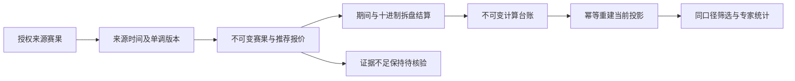

# 历史遗留验收：赛果、结算与专家统计

更新时间：2026-10-27。责任范围：结果导入、一单位结算、专家统计与相应隔离验收。

## 当前证据与工作计划

| 项目 | 已存在实现 | 发现的实质缺口 | 本轮动作 |
| --- | --- | --- | --- |
| 赛果来源 | 来源时间、引用、证据及版本导入；旧版本冲突拒绝 | 乐鱼正式赛果接口尚无可核验契约，不能将 WS 结束通知包装成官方确认 | 保留未验收边界，补输入契约及期间样例 |
| 一单位结算 | 十进制、四分之一拆盘、半场与滚球比分基线 | 未校验不可变报价，投影损坏缺显式重建 | 对照证据，新增幂等重建并保留旧计算 |
| 专家统计 | 结果计数、准确率、净收益、平均每单与有效本金 ROI | 缺报价仍计收益，汇总与趋势时间口径不同，无来源/阶段/玩法筛选 | 统一证据、时间口径，公开质量排除数和筛选 |
| 验证 | 已有结算及隔离数据库测试 | 旧夹具缺完整报价，未覆盖损坏投影及筛选一致性 | 补合法冻结夹具、正常及异常验证，记录真实退出码 |

所有业务验证只使用任务自有 Docker 临时数据库，不向生产写测试数据，不执行真实投注。当前阶段：本轮后端实施及定向隔离验证完成，等待主流程全量回归与页面验收。

## 实现结果与接口契约

- 推荐的比赛、盘口实例、期间、盘口线、方向、价格、源报价时间、比分基线和比分口径必须与不可变系统报价完全一致。缺失或不一致保持待核验，不形成盈利或亏损。
- 已结算按最新结算时间，待结算按推荐创建时间；来源、阶段、玩法和 UTC 左闭右开窗口同时作用于汇总、详情和趋势。昵称更新不拆分稳定作者身份。
- 原始推荐数、可统计数、排除数、缺报价证据数、结算证据不一致数分别返回。无分母准确率和 ROI 为未知，待结算不补零。少于三十条标为有限样本，三十条以上也不代表未来盈利或显著性。
- 来源选项只输出当前窗口有启用专家记录的启用来源编号及展示名，不输出平台群号或用户名。
- 服务鉴权重建入口仅读已保存最新来源赛果、推荐报价和计算证据。同结果同算法重复执行不追加计算、不移动日期；旧算法计算一致时保留首次日期；不可变证据冲突返回 409。真实订单不受影响。
- 严格结果输入拒绝布尔/字符串比分、空来源引用与空证据；同瞬间不同时区统一为 UTC 幂等。明确 void 才取消比赛并关闭盘口；provisional 撤回收益但不自动重新开放投注。

| 玩法或期间 | 必需证据 | 缺失时行为 |
| --- | --- | --- |
| 全场独赢、让球、大小 | 已确认常规全场比分、匹配期间、玩法及系统报价 | 待结算 |
| 上半场 | 已确认且与全场一致的双方半场比分 | 不填零 |
| 下半场 | 半场与常规全场比分可相减 | 待结算 |
| 滚球剩余期间 | 期间比分、系统确认的剩余规则与推荐时比分基线 | 规则未知或基线超过赛果不结算 |
| 加时、点球、未支持项目 | 专项提供方规则及结果 | 不套常规足球结果 |
| 作废、取消、延期、腰斩 | 明确提供方作废确认及规则 | 仅明确 void 归零，其余不猜测 |

## 真实命令与退出码

1. 首轮 `sh .runtime/settlement-audit-20261027/run.sh` 退出码 1：十项纯结算通过，旧验证镜像缺 Pillow 导致数据库套件导入失败，失败日志保留。
2. `docker build --cpuset-cpus=0 -f infra/test/Dockerfile -t ai-football-settlement-verifier:20261027 .` 退出码 0，使用项目固定依赖，宿主机未安装包。
3. 第二轮定向退出码 1：CASE 时间参数推导为 text；改为显式 timestamptz，不放松业务校验。
4. 第三轮定向退出码 0：十项纯结算与十五项 PostgreSQL 集成通过。
5. 最终冻结定向同命令退出码 0：十项纯结算 0.002 秒、十七项 PostgreSQL 集成 17.662 秒。覆盖缺证据与错价格、损坏投影与恢复、不可变冲突、同版重建、旧算法日期、修订撤回、来源/阶段/玩法/窗口、跨群同名、昵称、作废及严格输入。
6. 目标变更 `git diff --check` 退出码 0。完整工程、浏览器点击、部署及远端 CI 由主流程在所有修改冻结后统一验收，定向通过不替代全套。
7. Docker 内 `python -m unittest discover -s /workspace/tests -p test_expert_statistics.py -v` 退出码 0：两项统计口径测试 0.063 秒。全赢/半赢/全输/半输/走盘/作废与 79 条待结算的分母隔离、空样本和全中立样本均通过。

## 可验收与外部依赖

- P31-01/02/03/04/05、R05-02/03 后端有可复核测试，前端和真实浏览器由主流程验收后再勾选。
- P31-06 可从原始台账重建当前投影与实时 SQL 聚合，未引入缓存聚合表；大规模增量聚合性能另验。
- P29 真实乐鱼常规时间、加时、取消和订单赛果协议仍缺新样本；旧结束通知与缓存比分不能作为 confirmed，此项保持未验收。
- R05-04/05 账户白名单、协议及资金隔离由对应模块与主流程验收，不用真实投注证明统计。

## 第二轮：真实性能与优化

基准改用当前生产 signal_scope 与 QUALITY_METRIC_SQL，不再使用旧无质量校验的聚合。夹具为一万比赛、五万当前报价、一万消息、一万推荐、一百作者、一万不可变报价证据、七千五百规范赛果及结算计算；全部为合成数据。独赢不再虚构走盘，采用全赢、全输、提供方明确作废及待结算各二千五百条。七千五百份计算逐条调用当前结算函数复算、核对规范来源哈希，全部一致。

### 查询优化

初始计划将质量 CTE 内联，报价证据子计划一万次重复执行两轮，结果与结算子计划七千五百次重复执行两轮。正式查询将 checked 显式物化，仅计算一次；收益、准确率、证据排除及时间筛选语义保持不变。来源下拉只需要筛选后的来源名称，不需重复计算收益质量，因此明确使用纯筛选路径。第一次仅物化的实验曾使来源查询也执行证据检查，HTTP未改善；已修复整条请求，未只展示单条 SQL 好看的结果。

| 测量 | 样本 | P50 毫秒 | P95 毫秒 | 范围 |
| --- | ---: | ---: | ---: | --- |
| 原统计聚合 | 25 | 478.453 | 590.913 | 优化前独立轮次，旧256MiB临时存储 |
| 最终统计聚合 | 25 | 285.100 | 296.588 | 当前生产查询 |
| 同库原未物化对照 | 25 | 478.832 | 499.059 | 同样行、参数及资源，逐字段与当前结果相等 |
| 最终来源选项 | 25 | 17.004 | 82.577 | 当前生产纯筛选 |
| 原统计 HTTP | 30 | 505.013 | 595.721 | 优化前观测，不能当生产容量结论 |
| 最终统计 HTTP | 30 | 303.421 | 384.511 | 当前完整接口，含来源选项与JSON序列化 |

最终聚合 EXPLAIN：规划0.717毫秒、执行300.149毫秒，90316共享块命中、零磁盘读及临时块；来源规划0.440毫秒、执行81.465毫秒。完整原始计划、源码哈希、镜像摘要、资源及响应量保存于 evidence/settlement-statistics/optimized.json，原始 baseline 与中间实验独立保留。量级为本地内网、暖态、单并发、CPU受限、tmpfs；不代表远端 VPS 磁盘、生产P95、并发容量或收益正确率。存储预算调整过，跨轮HTTP差异只是隔离观测；同库对照SQL用于确认计算优化。

### 分页500根因及测试设施修复

完整基准曾在第二页返回500。保留的 API 与 PG 日志明确为 DiskFullError / PG PANIC，pg_wal 写满256MiB tmpfs，随后连接中断；并非服务器IP、模型边界或游标解析错误。独立 ASGI 两百五十候选十页、消歧及五个盘口全部正常。修复仅作用于任务自有测试数据库：512MiB tmpfs、768MiB容器内存、128MiB WAL上限与30秒检查点，fsync及WAL继续启用；保留退出日志。生产分页源码未作无证据修改。

Docker 完整性能命令经冻结项目快照运行，PERFORMANCE_IMAGE=ai-football-settlement-verifier:20261027，退出码0；两百五十候选十页、精确消歧、五盘口读取全部通过，完整报告 evidence/settlement-statistics/optimized-full.json。独立统计模式同镜像同预算退出码0，35.320秒测量，返回50343字节、一百作者，一万记录全部质量合格，七千五百计算复算一致。

最终整套重跑（两项生产优化均已纳入）退出码0，测量29.507秒：统计HTTP P50=309.092/P95=388.835毫秒，首页P95=86.017、详情47.245、作者原文38.164、搜索首屏77.327、盘口读取51.357毫秒。两百五十候选十页并精确消歧101.602毫秒；任务API、PG与内部网络退出时清理完毕，其他项目容器未操作。该整套报告替换前一次只物化的中间报告，基线与最终独立统计报告保持单独留存。

优化后冻结定向：十项纯结算、十八项PG集成（19.158秒）、两项性能查询测试（1.600秒）退出码均0；新增测试对照物化前后每个字段，覆盖九十天前报价、provisional撤回、赛果修订及陈旧结果版本损坏。完整工程及浏览器仍由主流程统一执行。

### 官方赛果证据复核

本轮再次只读检查 V1_LEYU_IMPLEMENTATION_ANALYSIS、LEYU_PROTOCOL_VERIFICATION 和现有采集器：可核验链路仅全量赛事快照、批量盘口、C103等比分/阶段事件与C105等盘口更新；没有经过确认的官方结算结果接口、常规时间/加时/点球规则及取消作废证据。采集器没有向结果导入发送 confirmed 的路径。比分结束标记可以用于展示完场，不能用于专家收益正式确认；真实官方赛果接入保持未验收。
