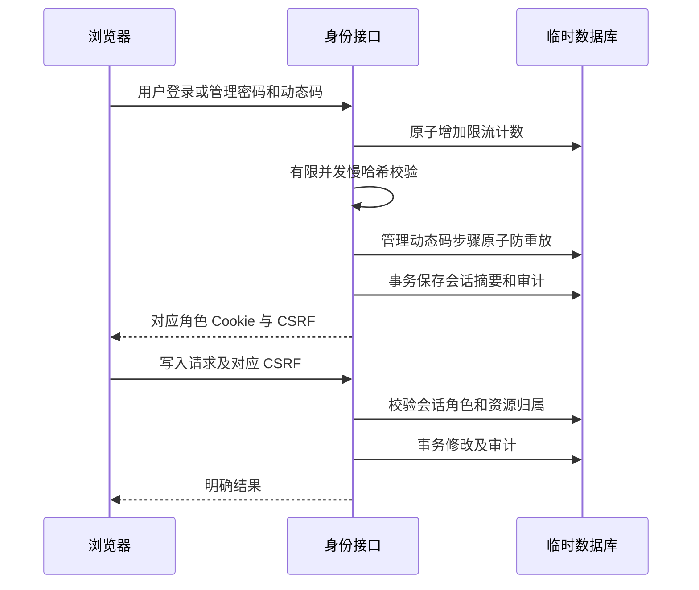

# 身份、独立管理会话与会员隔离验收

状态说明（E116，2026-10-30）：本文记录旧版本验收，不描述当前登录因子。平台 TOTP、备用码及会话内再次验证已移除；当前实现与验证结果见 [管理员二次验证退役记录](ADMIN_MFA_VERIFICATION.md) 和 `PROGRESS.md` 的 E116。以下历史测试仅供追溯。

日期：2026-10-26。状态：后端隔离行为验证通过；网页完整联调、生产配置及正式发布尚未验收。该结果不表示全部平台完成。

## 修复范围和设计

旧登录调用读取已被移除的访问令牌响应字段，导致设置 Cookie 后仍返回错误；管理员 Cookie 又优先于普通用户 Cookie，造成双身份操作混淆。现在长期令牌仅写入 HttpOnly Cookie，数据库与审计只存摘要。用户接口强制用户会话，管理接口强制独立管理会话，公共接口默认用户上下文，显式管理预览可发送 `X-Session-Context: admin`。

管理员和用户的退出、CSRF Cookie 分别校验及删除。用户会话支持刷新轮换、全部设备撤销和修改密码后撤销。密码哈希限制 scrypt 参数，避免损坏数据带来资源放大；数据库持久限流在不同工作进程间共享，密码计算有并发限制。管理员 TOTP 接受有限时钟偏移并通过数据库已用步骤拒绝重放。管理员引导有事务锁，不覆盖既有管理员。

会员按全部当前生效、未撤销、未到期且套餐启用的授予合并能力。展示主方案优先付费，不再用结束日期最长的一条覆盖其他权益。每个能力单独返回有效期，未来续期段在开始前不提前授予能力。

人工开通必须有 UUID 幂等键及原因；同一操作重放返回同一授予，参数变化拒绝。续期从同一套餐最长有效截止续接，用户行锁串行并发续期。撤销不删除原记录，有原因审计，失去自动投注权益时同时关闭新增许可。绑定或更换个人乐鱼账号也关闭原账号许可，不能继承旧授权。

## 时序和边界



接口不会从模型或客户端角色字段建立管理权限；用户资料、账户及会员均以会话身份为索引。管理审计写入失败时同一事务的敏感配置变更回滚。

## 前端接入契约

| 操作 | 接口及请求 | 注意事项 |
| --- | --- | --- |
| 用户身份 | `GET /api/v1/auth/me` | 不自动选择管理会话 |
| 管理身份 | `GET /api/v1/admin/me` | 独立管理会话 |
| 用户退出 | `POST /api/v1/auth/logout` | 仅删用户 Cookie，用户 CSRF |
| 管理退出 | `POST /api/v1/admin/logout` | 仅删管理 Cookie，管理 CSRF |
| 全设备退出 | `POST /api/v1/auth/logout-all` | 撤销当前用户全部用户会话 |
| 用户续期 | `POST /api/v1/auth/refresh` | 需有效会话及 CSRF，旧令牌立即无效 |
| 修改昵称 | `PATCH /api/v1/auth/profile`，`display_name` | 拒绝空白及控制字符 |
| 修改密码 | `PUT /api/v1/auth/password`，`current_password`、`new_password` | 成功后全部用户会话撤销 |
| 人工开通 | `POST /api/v1/admin/membership/grants`，`email`、`plan_code`、`days`、`idempotency_key`、`reason` | 同一表单重试保留键，新的业务操作生成新键；原因至少三个非空字符 |
| 撤销授予 | `POST /api/v1/admin/membership/grants/{id}/revoke`，`reason` | 幂等撤销，保留历史 |
| 用户和授予 | `GET /api/v1/admin/users`、`GET /api/v1/admin/users/{id}/memberships` | 仅管理会话，列表不返回密码、会话或账号秘密 |

普通写操作读取 `v2_csrf`，管理路径读取 `v2_admin_csrf`；不能继续“优先管理 CSRF、否则用户 CSRF”的全局逻辑。两个角色的 Cookie 可同时存在。

## 真实验证命令和退出码

为了避免共享工作树修改迁移导致假失败，最终测试先在容器内复制冻结快照，然后运行。测试每例创建独立 `identity_` 临时数据库，结束删除，不读取生产配置。

```sh
docker run --rm --cpus=0.75 --memory=384m \
  --network ai-football-v2-test-net \
  -e PYTHONDONTWRITEBYTECODE=1 \
  -e IDENTITY_TEST_DATABASE_URL=postgresql://postgres@ai-football-v2-pgverify:5432/postgres \
  -v /root/ai_football:/source:ro --entrypoint sh \
  ai-football-api:v2.0.0-rc1 -c \
  'mkdir -p /tmp/identity-frozen/tests && cp -a /source/services/api/app /tmp/identity-frozen/app && cp -a /source/services/api/migrations /tmp/identity-frozen/migrations && cp /source/tests/test_identity.py /tmp/identity-frozen/tests/ && cd /tmp/identity-frozen && python -m unittest discover -s tests -p test_identity.py -v'
```

最终：**20 个测试全部通过，退出码 0，测试 9.763 秒**。覆盖注册、错误凭据、Cookie 摘要、CSRF、双角色独立退出、禁用与过期、刷新轮换、修改密码撤销、MFA 重放、限流、角色伪造、审计失败回滚、免费付费重叠、未来权益、停用套餐、幂等及冲突续期、撤销、个人账户隔离及重绑停用。

历史失败：首轮 17 测试有 1 项在初始化时因共享迁移文件变更出现校验和不一致，退出码 1。不是通过放宽迁移校验解决；改为冻结副本后 17 项全部通过，再增加边界场景最终 20 项通过。失败初始化留下的 1 个无连接临时数据库已定向清理，清理退出码 0。未清理其他库、容器或业务数据。

## 待后续完成

- 前端按上述接口适配并验证两角色完整流程；会员设计、支付及移动布局仍由相应工作包验收。
- 管理员敏感变更再次认证及丢失 MFA 的受控恢复尚未实现，不能将管理身份工作包整体勾选完成。
- 用户邮件验证、忘记密码外部投递、数据导出与注销属于后续功能，不能用本轮修改密码流程替代。
- 真实乐鱼登录、余额、交易执行、生产权限配置、TLS 及限流入口真实客户端地址仍需其他链路验证。
- 此处只验后端隔离契约，不代表真实上游、性能容量、网页截图或 Release 验收。
