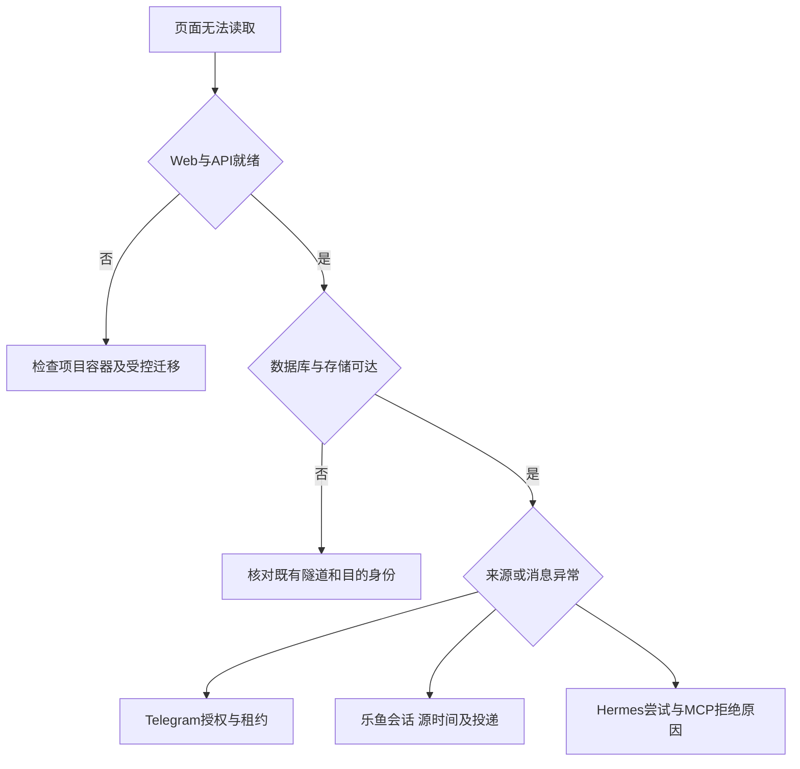

# 当前系统运行与恢复交接

更新：2026-10-27。全部运行、构建和测试采用Docker。此文描述可执行入口及安全顺序，当前开发候选不等于正式签名版本或已经证明盈利。凭据只使用项目内受保护运行引用，不写入本文或Git。

## 日常运行

网页绑定0.0.0.0:3003。使用项目根目录的Compose编排，先核对服务状态及现有运行配置，不重新生成已有效的Telegram应用或存储凭据。管理员账号通过现有受保护配置与数据库身份管理；用户已要求当前管理员关闭两步验证，不能因部署自动启用。

```sh
docker compose ps
curl -fsS http://127.0.0.1:3003/healthz
docker compose logs --since 5m --tail 100 api
```

日志只在受控终端查看，分享前继续去敏。控制台诊断分别查看源时间、采集成功、WS投递、媒体、审核和订单；不要把进程存活当作上游正常。



## 升级与回退

1. 保留当前镜像摘要、源码提交、受保护配置引用和迁移版本；创建v2数据库备份并验证摘要和目录，不把文件存在当作业务恢复成功。
2. 先运行隔离全量、浏览器和配置检查。迁移不能更改既有迁移摘要；新结构在临时库验证初装、旧行升级及失败完整回滚。
3. 先完成候选构建。若迁移修改运行中的冲突索引或字段契约，明确停止本项目写入服务再受控迁移；不停止其他项目，不清理旧库或对象桶。
4. 迁移成功后刷新并验证独立运行角色，先API就绪再启动采集与审核。执行器仍按默认关闭真实投注启动，未知订单保持查单与敞口。
5. 采集所有者切换可能等待原90秒租约，保持旧租约自然交接，不删除检查点或反复登录。部署后执行双端真实只读点击，再观察源时间、投递和检查点。
6. 失败保留维护或上次结果，不把新结构的库直接交给不兼容旧镜像。回退优先兼容修复；确需数据恢复时按独立空目标、媒体与资金差异核对流程执行，禁止覆盖已有业务库。

完整端口、归属与恢复顺序见[P01恢复说明](P01_RECOVERY_ORDER_OWNERSHIP.md)，恢复工具和限制见[恢复验证](RECOVERY_VERIFICATION.md)。

## 授权续期与配置

| 类型 | 修改入口 | 生效证据与失败处理 |
| --- | --- | --- |
| 乐鱼业务Token及域名 | 管理员乐鱼采集分区 | 核对保存版本、采集器配置回执及真实采集，不凭保存成功宣称恢复 |
| 登录代理 | 受保护续期配置 | 仅明确失效后的单次登录调用使用；普通赛程、盘口和订单不能继承代理 |
| Telegram来源和可信作者 | 管理员Telegram分区 | 自动目录与昵称按稳定身份同步；群权限失败保留旧完整目录，普通成员须选择后才监控 |
| 模型及报价时限 | 系统设置 | 下次审核经Hermes读取；报价按后台时限与真实源时间判断，不用接收时间补新鲜 |
| 数据库及对象存储 | 项目受保护运行配置 | 核对TLS/隧道身份、只读连通及按服务最小权限；不要全环境注入 |

密钥轮换先确定用途、版本与原数据解密能力。保存旧密钥引用的可恢复路径，再按服务更新与验证；不得新建密钥覆盖仍用于历史密文的旧密钥。Token撤销不可因回滚恢复为有效；秘密不写日志、镜像层、客户端或Git。

## 停止真实执行与未知订单

本人停用自动投注立即阻止未发送任务；全局开关保持关闭即不允许实盘提交。明确关闭与紧急停止不应依赖会员仍有效。已发送或结果未知的订单仍需保留账和敞口，只查官方订单不盲目重发。管理员不能继承用户许可，开发测试不实际下注。

## 验证入口

```sh
sh infra/test/run.sh
sh tests/browser/check.sh
sh tests/browser/integration-check.sh
sh tests/browser/accessibility-check.sh
sh infra/check-runtime.sh
```

各脚本清理自己的临时容器和网络，不能按名称前缀删除其他资源。最终版本的退出码、冻结范围、CI和部署证据以[进度](PROGRESS.md)及对应PR为准。正式Android签名、实际设备升级、官方足球赛果与真实支付尚有独立验收门槛，不得以开发包或隔离数据代替。
