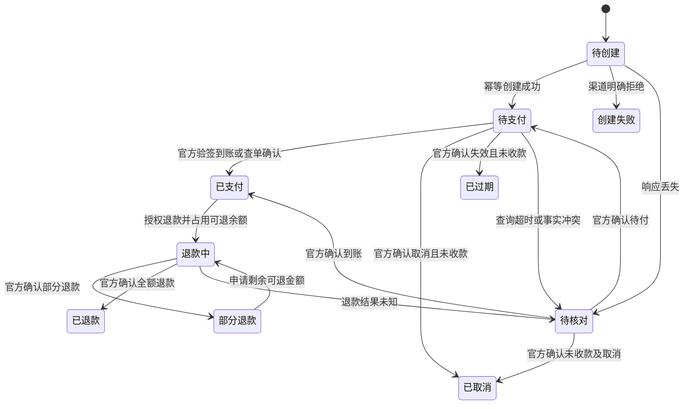
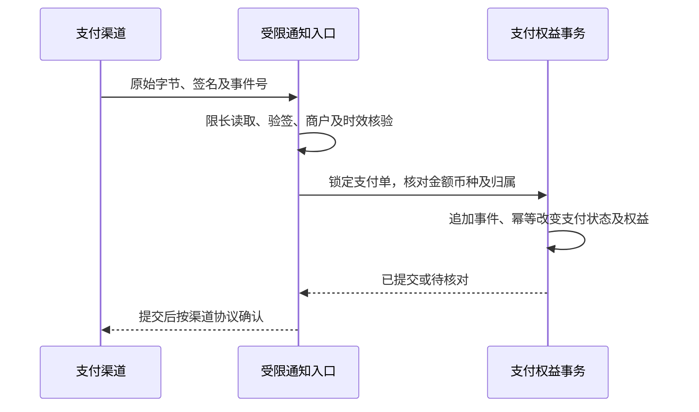

# 会员支付状态与对账设计

更新：2026-10-27。本设计完成P16-02的状态、唯一键和补偿规则。尚未选择实际支付渠道，页面继续提示无法在线购买；人工会员授权仍通过现有独立审计操作。设计不代表已完成资金接入。

| 数据域 | 必需字段及约束 | 拒绝行为 |
| --- | --- | --- |
| 支付单 | 稳定用户、套餐版本、权益快照、币种、金额、渠道、幂等键、创建和失效时间 | 更改套餐后重新解释旧单价格 |
| 渠道交易 | 商户身份、交易号、通知摘要、验签结果、源时间及接收时间 | 客户端跳转直接激活权益 |
| 退款 | 独立退款号、原支付单、币种、请求与确认金额、剩余可退额度、原因 | 并发超退、未知结果再次发起新退款 |
| 权益 | 原付款事件、用户、套餐快照、生效到期、撤回原因、审计 | 重复通知双倍授权、退款删除原账 |
| 人工补偿 | 管理员、凭证引用、原因、独立幂等键、金额及权益差异 | 将人工开通标记为渠道已到账 |

金额采用有限十进制并按实际渠道的币种最小单位校验，禁止浮点和隐式汇率。商户、渠道和交易号组成外部唯一键。重复事件返回同一结果；金额、币种、身份或交易归属冲突进入人工核对，不能覆盖原事实。

提交后响应丢失通过相同事件重放读取既有结果，不重复授予。通知与查单乱序以官方版本和已确认资金事实判断，不按本地到达时间降级已付状态。退款保留付款证据，是否撤回剩余权益取决于实际渠道规则和合同，原因和用户通知状态单独留存。

## 接入选择与后续验收

下表为项目适配设计，非性能测量或供应商调研结论。实际渠道选择另行核对官方文档、商户权限和合同。

| 方案 | 前提 | 事实依据 | 时效 | 运维 | 退款 | 项目状态 |
| --- | --- | --- | --- | --- | --- | --- |
| 管理员人工开通 | 管理身份与有效套餐 | 人工核验凭证及审计 | 无自动到账承诺 | 人工核对 | 人工权益调整及原因 | 已有能力，非支付网关 |
| 直接商户渠道 | 实际可用商户与官方接口 | 验签通知与官方查单 | 待测量 | 密钥、回调、对账 | 官方幂等退款接口 | 未选择和配置 |
| 聚合渠道适配 | 实际合同及子商户权限 | 聚合订单与实际资金流水 | 待测量 | 增加中间方对账 | 双方资金状态核对 | 未选择和配置 |

后续必须验证真实隔离商户、签名反例、通知重放、乱序、金额币种冲突、通知丢失查单、并发退款、权益恰好一次、身份隔离及审计。P16-01和P16-03在真实渠道未明确前保持未验收；不生成占位支付成功。
