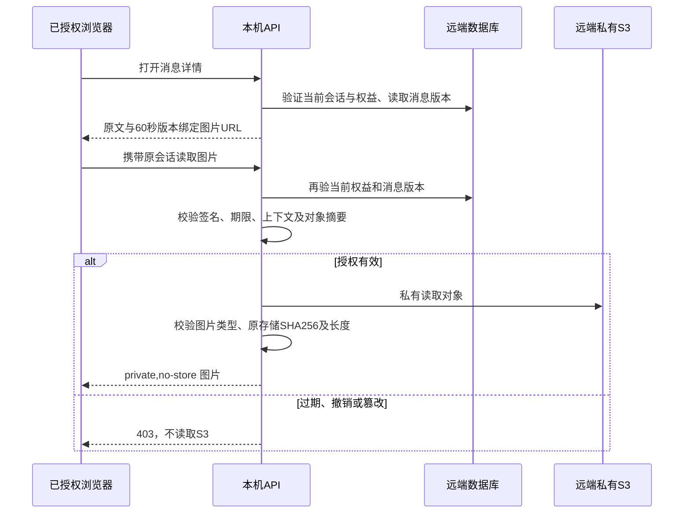

# 专家原图短期授权与别名一致性验收

更新时间：2026-10-27。证据等级A：当前源码、临时PostgreSQL和Docker实测。没有向生产S3上传或删除对象，没有修改会员或真实消息。

## 原图读取

消息详情、专家消息页与推荐详情中的图片URL带60秒HMAC票据，绑定用户编号、会话令牌摘要、用户或管理员上下文、消息版本、图片序号和对象摘要。票据不包含S3对象键、桶或凭据；图片仍经API代理从远端读取。读取前再次验证当前会话及完整记录权益，随后验证票据；因此签发之后会员撤销、会话退出、换身份、消息版本改变都会失效。

返回内容继续受原图片8MiB及解码预算限制。存储证据已记录SHA256或字节数时必须一致，损坏返回503；没有证据的历史字段不伪造。前端立即按正确身份取图，并沿原有提示在失败时要求重新打开消息。已加载的浏览器Blob不等于永久服务器授权；关闭详情释放Blob URL。

| 对照 | 原逐次授权 | 新短期会话票据 | 直接S3签名URL |
| --- | --- | --- | --- |
| 当前会员撤销 | 每次复核 | 每次复核 | 通常到期前仍可用 |
| 消息版本绑定 | 无链接级绑定 | 强制绑定 | 需另外实现 |
| 跨会话重用 | 有会话即可访问同路径 | 签名范围拒绝 | 通常持链接即可 |
| 私有对象键暴露 | 无 | 无 | URL通常含键 |
| 到期 | 会话到期 | 60秒且仍须有效会话 | 配置期限 |
| 图片完整性 | 类型解码 | 类型、SHA256、字节数 | 客户端另验 |

表为机制比较，不是三方案实测性能评分。没有将S3永久公开，也没有引入长期Bearer分享链接。Nginx仅记录不含查询串的URI，API关闭默认完整URL访问日志，避免新票据和分页游标进入访问日志。

## 别名搜索

历史数据可能绕过当前入库规范化而保留大写及空格。原检索用已casefold查询与数组原值直接比较，唯一解析却对数组casefold，导致可解析比赛未进入候选。检索现在对别名做数据库lower与首尾空白处理，解析同样trim；新入库仍沿既有casefold。赛事项目、阶段、日期和完整候选分页门禁保持，女足与青年队不因相同俱乐部简称合并。

PostgreSQL lower与Python casefold对少数非ASCII特殊字母并不等价，当前回归覆盖历史ASCII大小写、中文与队伍后缀边界，不宣称所有语言转写已完成，也不自动创建人工确认别名。

## Docker专项实测

命令：`sh .runtime/final-acceptance-20261027/focused.sh`，退出0。源码先复制到容器私有目录、临时PostgreSQL内部网络、验证器0.5CPU/384MiB。

- 媒体4项1.320秒：正常及临期、过期/未来/篡改、跨身份/会话/上下文/消息版本/对象/序号拒绝；临时真实数据库验证会员撤销、编辑失效、无票据不读S3和损坏图片503。零跳过。
- 原文阅读7项9.561秒：分页、双Cookie管理员原图、撤销、完整工具返回与私有缓存全部通过。
- MCP比赛及报价23项28.153秒：包含混合大小写旧别名和女足/青年队反例；原105候选、同队双赛和时限门禁全部通过。

一次仅离线入口的4项中数据库项跳过，保留其日志但不作为完整验收；上列临时数据库完整重跑零跳过。后续统一冻结和浏览器联调需包含新的签名链接合同。
