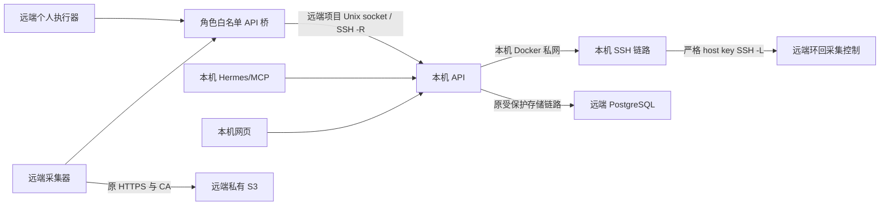

# 远端采集与执行部署包及切换证据

更新：2026-10-27。状态：代码已写、隔离验证；实际远端切换由主代理统一执行，本包没有执行 SSH、登录、投注或远端写入。

## 目标与边界

本机继续运行网页、API、Hermes、MCP 和审核工作器；远端 VPS 运行采集器、登录续期与个人账户执行器，持久 PostgreSQL、私有 S3 维持原有位置。采集器仍仅向 API 写标准化业务，执行器仍只通过本人账户许可处理任务，不能从模型直接交易。远端执行器开关固定为 false，API 总开关在切换期间也必须为 false。

本包不修改根编排、业务代码或 sshd 配置，不把 API 暴露到远端公网，不打开 GatewayPorts。远端控制仅发布到主机 127.0.0.1:18092；本机 SSH 容器在私网提供 18092，无宿主发布端口。API 的市场精确刷新地址由 TELEGRAM_CONTROL_URL 统一派生为 /leyu/refresh，因此本机 overlay 同时切换 Telegram 管理和盘口控制。

## 配置、权限与镜像

- 本机保护配置：项目内运行环境与现有 SSH 配置目录；额外链路配置仅保存 SSH 配置引用和已验证 host 别名，形状参考部署目录示例。SSH 密钥、host key、令牌不复制到镜像或本说明。复用 SSH 配置必须无额外隐式 Forward；检查有效配置而不回显身份值。
- 远端项目路径必须为 /root/ai_football。主代理只读核验已确认该目录存在；本包不推断其私有子目录已经建立。
- 远端保护环境仅含采集内部令牌、执行内部令牌、S3 最小权限配置与镜像摘要；不注入 API 会话密钥、数据加密密钥或模型提供方密钥。令牌必须不同。S3 保留 HTTPS、CA、限定 v2/ 前缀，不使用全局 HTTP 代理。
- 项目运行目录保持 0700；远端 socket 子目录 root:10005、02750；SSH root 创建的 socket root:10005，守护器仅将该 socket 改为 0660。签名和发现配置 root:10005、0440，采集 UID10003、执行 UID10004各自加入10005；其他 UID 无读权。CA 非秘密但只读。所有挂载 create_host_path=false，缺少配置必须失败。
- API 桥 UID10006:GID10005，仅 workers 内网，无外网，按两种内部令牌区分路由；不转发 Cookie、不接受任意 URL/查询、没有自动重放。单请求正文与响应最多4MiB、16并发，正文及上游有截止。采集批次保持单 HTTP，API 仍负责原子事务。
- 同一干净源码提交的 collector、executor、storage-tunnel 必须锁 registry digest；部署清单同时核对实际拉取的 RepoDigests、内容 ID 和 OCI revision 标签。不能只填写同一提交字符串冒充镜像来源。远端桥与 socket 守护器复用 collector 镜像并只读挂载本次同源部署代码。
- socket 守护器使用 host 网络仅观察内核 Unix socket 归属，无主机 proc 挂载、无秘密、无 TCP 监听、无 capabilities。worker 仍普通隔离网络。

## 实际路由覆盖与恢复

白名单测试调用现有 Telegram 后端全部方法、乐鱼续期 RPC、比赛快照上传及执行器实际主循环，再捕获它们生成的方法/路径/查询。此次实际发现执行器始终使用 POST claim?live_capable=false；已精确允许 false，拒绝 true、重复参数及任意参数。续期完成及订单、任务标识要求标准 UUID。

链路健康检查显式覆盖镜像继承的存储 HEALTHCHECK：检查 SSH 子进程和经过实际 -L 转发的鉴权 /status。该健康只证明控制链路，不把 partial、stale、unknown 或 Telegram degraded 判为业务就绪。发布诊断单独聚合 missing、invalid、unreachable、expired、unverified，并核对采集消费的配置版本与检查前后版本；没有 Hermes 真实任务证据时仍为 unverified。

远端 sshd 当前 StreamLocalBindUnlink=no。客户端同名选项不能保证删除远端 -R Unix socket，本包不依赖它。socket 守护器只检查保护目录中的准确 socket：内核仍有关联（包含 bind 后未 listen）的对象永不删除；仅两次 ECONNREFUSED、至少30秒旧、至少1秒间隔、inode/ctime不变、类型和root:10005归属正确且再次无内核关联才删除残留。SSH 退出后由 restart 退避重建。权限错误、未知错误或非 socket 停止而非随意 rm。断开期间桥返回503，不重放可能已写请求；业务原幂等及租约负责恢复。

## 主代理可执行切换顺序

以下命令是切换操作清单，不是已执行记录。所有路径均在两端同名项目内；真实保护环境绝不 cat、shell xtrace 或写入 Git。执行前保存脱敏的镜像检查与两端实例计数。

1. 将本包与同一源码镜像发布到远端项目，拉取三种摘要；保存 docker image inspect 的非秘密结果，并填部署清单。S3 只做限定前缀读取，数据库仍只在本机 API 使用。不得把整份本机环境传给远端。
2. 在远端 Docker root 工具容器内执行 `python -m infra.remote.deployment --root /root/ai_football --prepare`，显式添加仅 CHOWN/FSETID 所需权限并挂载本项目；此动作仅创建并设置项目 socket 目录。复用既有签名配置权限工具准备10005私有共享，先验证UID10003/10004可读及其他UID拒绝。
3. 仅先启动远端 `socket-guard api-bridge`：`docker compose --project-directory /root/ai_football --env-file .runtime/remote-workers.env -f infra/remote/compose.remote.yml up -d --no-build socket-guard api-bridge`。不启动worker。
4. 本机现有保护环境补充固定摘要和链路配置引用；执行 `docker compose --env-file .runtime/runtime.env -f docker-compose.yml -f infra/remote/compose.local.yml up -d --no-build remote-link`。只创建链路，尚不重建 API。主机密钥、转发、S3读取失败则停止切换。
5. 保持 API 与执行器真实投注总开关 false；停止本机 `collector executor`：`docker compose --env-file .runtime/runtime.env -f docker-compose.yml stop -t 30 collector executor`。核对本地和远端四类实例均为0；只读核对TG来源租约排空及持久检查点，记录未知订单，禁止将许可当成交或盲重发。
6. 填入真实只读事实后在 Docker 运行 `python -m infra.remote.deployment --manifest .runtime/remote/deployment.json`；任何观察缺失、双实例、未验证镜像/主机密钥/权限、活跃租约不明均退出1。零实例检查必须在启动前重新执行，不能复用旧结果。
7. 远端启动唯一 `collector executor`：`docker compose --project-directory /root/ai_football --env-file .runtime/remote-workers.env -f infra/remote/compose.remote.yml up -d --no-build collector executor`。核对执行器LIVE=false及来源接管身份、租约；本机再按上述overlay `up -d --no-build --no-deps api` 切换控制地址。禁止直接使用无overlay的全量up，亦不设置legacy-local-workers profile。
8. 验证本机remote-link实际健康、API采集配置消费版本、TG四来源检查点推进、实时/历史分开速率、媒体等待、源报价新鲜度及个人账户只读状态；保存脱敏证据。需要 `preflight --probe` 时在带现有最小环境的本机 API 工具容器运行，显式标记已核验SSH保护；工具不登录、不交易、S3不写删。Hermes证据另行补齐，不能将仅连通当全部就绪。

回滚严格反向：远端先 `stop -t 30 collector executor`，确认远端两类为0与租约到期；验证本机旧镜像和配置仍有效且不得恢复撤销凭据；本机使用基础编排 `up -d --no-build --no-deps collector executor api` 恢复控制地址，再验证检查点与配置消费。保留链路与远端桥可供诊断，禁止清除数据库或媒体。真实投注继续false，未知结果仅查单。

## 隔离验证与局限

- Docker冻结副本专项19项；末轮见项目运行证据目录 final.log，退出0。初次扩展有2个测试夹具错误（关闭后的HTTP客户端与模拟stat遗漏字段），原失败日志保留，修复后重跑。
- `sh infra/remote/check-compose.sh`：以明确假配置渲染两端编排，检查默认配置确实排除本机worker、健康覆盖、远端服务/网络/镜像/资源/挂载/环回端口，退出0；不启动业务。初次验证器误以为默认渲染仍含profile服务，修复为分别渲染带profile合同和默认服务列表，原失败保留。
- root受限Docker执行 `python -m infra.remote.socket_contract`：实际root:10005目录/socket、服务UID连接、其他UID拒绝、活socket保留、关闭残留安全删除及同路径重新监听均通过，退出0。仅测试容器自有临时路径；所需CHOWN/SETUID/SETGID/FSETID仅验收容器使用，不授予生产守护器。
- 未执行真实远端切换、真实SSH断网演练、登录续期或真实资金请求。实际远端socket所有权、存储私有端点Docker路由及稳定窗口速率必须由上述生产步骤验收，不得以本包测试冒充。
