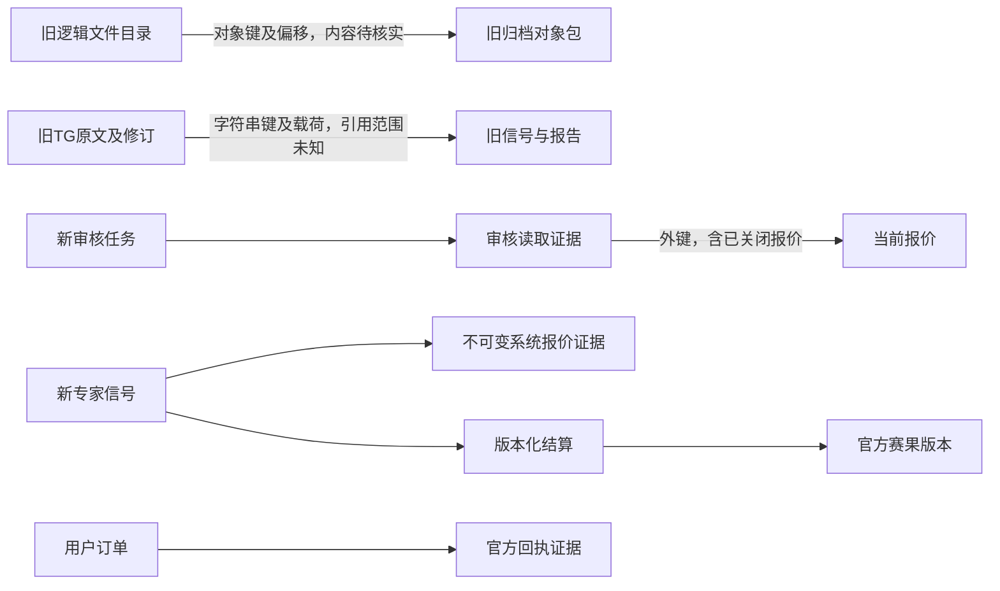

# P12 旧数据引用与存储写放大调查

更新：2026-10-27 19:08 UTC。状态：只读测量与设计已记录；未实施分区、维护、迁移或清理。本报告不是删除许可。

## 范围与测量方法

- 仅使用当前 API 运行角色的既有数据库连接；没有提权、读取凭据值、追加上游请求或扫描对象存储。旧项目归档只读查看三处存储模块的建表和引用逻辑，不运行旧项目。
- 数据库连接三秒、单条语句五秒、锁等待一秒、整体四十秒；服务端默认只读，并为每项查询开启只读事务。查询失败记录未知类别，不以零代替。
- 十二项测量于 19:02:41.557 至 19:02:53.849 UTC 完成；每项数据库往返 661.22–814.86 毫秒。该时长含网络与驱动，不能解释为磁盘时间、SQL 执行时间或 P95。
- 仅读取限定表的系统目录、大小、统计视图、外键结构，及获授权的新表聚合。计划使用 `EXPLAIN (FORMAT JSON)`，没有 `ANALYZE`；不执行目标查询。输出剔除过滤条件、参数值、原文、人员标识、对象键、连接地址和账号。
- 每项独立事务，采集仍在运行；表估算和后续精确聚合不保证同一快照。`reltuples < 0` 表示未知，`n_live_tup` / `n_dead_tup` 是统计估算，不是实时精确计数。
- 当前角色对本次十八张旧表均没有 `SELECT`。旧表精确行数、payload 内软引用、对象引用覆盖、收益复现与对象存在性全部未知。没有报错后切换高权限账号。

本次保留的私有证据位于 `.runtime/retention-inventory-20261027/`：固定查询探针、脱敏元数据、后续引用聚合。它们不进入应用镜像或发布资产，也不属于可部署通用 SQL 工具。全套测试冻结期间未新增业务源码或测试。

| 证据 | SHA-256 |
| --- | --- |
| 固定查询探针 | `8a8646b20bdd33229589255d259c0183c858f19a3c2dc3cf5651c30c9d46bff9` |
| 元数据聚合 | `321c936f7604ac0192f1ba6f94debd3230cacb97fa369dd38464ec52358d083d` |
| 引用聚合 | `7134e3dd1410626232ab8d1fb15d9bdde7bc1ef2d8227ab170d5f7a25ca54256` |

## 已测规模

当前数据库目录大小 **186,142,268,439 字节（173.358 GiB）**。本次白名单覆盖的旧表合计 186,033,086,464 字节，新表合计 94,732,288 字节（90.344 MiB）；白名单并非数据库全部对象，二者不能直接作为完整资产盘点。大小是数据库目录元数据，不含远端对象内容或本地归档。

| 表 | 统计行数估算 | 表及 TOAST 字节 | 索引字节 | 合计字节 | 性质 |
| --- | ---: | ---: | ---: | ---: | --- |
| `model_predictions` | 82,083,856 | 85,358,460,928 | 56,809,160,704 | 142,167,621,632 | 旧模型推理，精确行数未知 |
| `model_inputs` | 22,094,310 | 30,373,240,832 | 4,730,208,256 | 35,103,449,088 | 旧模型输入，软引用未知 |
| `files` | 3,310,359 | 1,181,401,088 | 3,024,658,432 | 4,206,059,520 | 旧逻辑归档目录，不能称盘口条数 |
| `packs` | 738,793 | 134,111,232 | 78,536,704 | 212,647,936 | 旧对象包目录，包内容未读取 |
| `decisions` | 832,271 | 1,906,532,352 | 662,216,704 | 2,568,749,056 | 旧决策及推荐载荷，不等于新专家信号 |
| `decision_statistics` | 842,526 | 482,557,952 | 898,146,304 | 1,380,704,256 | 旧统计，非新收益依据 |
| `v2_current_quotes` | 182,698 | 42,696,704 | 32,653,312 | 75,350,016 | 当前报价投影 |
| `v2_fixtures` | 3,627 | 5,988,352 | 2,899,968 | 8,888,320 | 当前赛事投影 |

两张旧模型表占数据库目录大小约 **95.234%**。这说明容量研究的优先顺序，不证明它们仍在写、正在拖慢新服务或已经可以删除。

19:02 左右的获授权精确聚合：

| 对象 | 精确计数 |
| --- | ---: |
| 赛事：未开赛 / 滚球 / 完场 / 取消 | 2,058 / 588 / 928 / 56，共 3,630 |
| 报价：active / closed / suspended | 46,254 / 130,814 / 6,642，共 183,710 |
| 推荐赔率证据 / 专家信号 / 官方赛果版本 | 0 / 0 / 0 |
| 专家结算 / 用户订单 / 订单回执证据 | 0 / 0 / 0 |
| 审核读取报价证据 | 954 |

这些零是新表当时的已授权精确统计，不能推导旧台账无引用。`active` 也不表示源时间在十五秒内，不以此作为可投注报价数量或业务成功。

## 引用结构与不可删集合

旧备份源为用户授权读取的重构前归档，大小 1,661,030,400 字节。只读取旧存储模块的源码，不解包配置，不导入旧业务数据。源码与当前数据库列元数据交叉核对得到：

| 集合 | 已知引用机制 | 未核实部分 | 当前处置 |
| --- | --- | --- | --- |
| 旧 `files` → `packs` / 对象内容 | `files.path` 唯一；`object_key`、偏移、压缩标识、原始大小、内容哈希；`packs.object_key` 唯一 | 私有路径类别、每包有效引用、物理对象存在性、报表引用 | 全部保留，候选数量未知 |
| 旧 TG 消息 / 修订 / 任务 / 信号 | `message_key`、revision、群及作者稳定标识、`match_id`，并含 payload / entry / analysis | payload 内赔率、媒体与比赛证据是否完整；同一原文的报表引用 | 全部保留，不能因无 SQL 外键删除 |
| 旧 decisions / imports / labels | identity、比赛标识、来源载荷、结果修订、文件导入来源 | 报告及对账是否引用旧推荐、价格与结果 | 全部保留，待分类、摘要和恢复核对 |
| 旧模型输入及推理 | 当前目录含比赛及模型索引，旧业务已退出产品推荐链路 | 与历史订单/报告/旧专家原文的软引用及留存义务 | 仅列容量研究优先级，不列可删数据 |
| 新专家消息、授权媒体、报价证据、信号、赛果版本及结算 | 明确 FK、reference_id 与内容哈希、版本链 | 真实完整推荐/官方赛果链当前无样本 | 不按容量或日期直接清理 |
| 新用户订单、执行任务、预留本金及官方回执 | 用户/账户归属、幂等键、订单外键、规范回执证据 | 实盘外部回执完整性仍依赖官方协议 | 无论已结算或未知都保留 |
| 当前报价 / 当前赛事 | 审核读取外键；赛事另被搜索候选、绑定、推荐及结果引用 | 关闭不代表无人引用 | 保留身份及所有被引用行 |
| 搜索游标、候选和分析轨迹 | 任务与尝试绑定，审计/原文页面及排查会读取 | 已完成任务的约定审计期限尚无产品批准 | 仅设计后续分层归档，不立即设 TTL 删除 |

系统目录中未发现本次旧表间的 SQL 外键，**这不是零业务引用**。旧实现明确依赖字符串键和不透明载荷，不能仅靠 `pg_constraint` 生成删除名单。

19:04:23 UTC 再次只读按状态聚合 `v2_review_market_reads JOIN v2_current_quotes`：

| 报价状态 | 被引用报价去重数 | 审核读取证据行数 |
| --- | ---: | ---: |
| active | 372 | 562 |
| closed | 184 | 376 |
| suspended | 16 | 16 |

存在 184 条已关闭报价仍被读取证据引用。该外键没有级联删除；清理时应保护它们，不能通过删除审核证据或解除外键来绕过。后续新信号为零也不取消这些引用。



## 死元组、WAL 与索引

| 表 | 活元组统计估算 | 死元组统计估算 | 最近自动 VACUUM（UTC） | 解释 |
| --- | ---: | ---: | --- | --- |
| `model_inputs` | 21,103,976 | 3,337,919 | 10-24 20:27 | 需要隔离副本研究，不估算可回收字节 |
| `files` | 3,378,114 | 312,252 | 10-26 02:34 | 索引约为表体 2.56 倍，不能仅据比例判定膨胀 |
| `model_predictions` | 86,602,859 | 11,503 | 10-17 05:54 | 大小高但死元组统计少，不能靠 VACUUM 宣称释放主要空间 |
| `v2_current_quotes` | 183,546 | 32,501 | 10-27 18:50 | 频繁投影更新存在 churn；当前统计不等于实际膨胀 |
| `v2_fixtures` | 3,627 | 1,017 | 10-27 19:02 | 正常更新仍可能产生旧版本；需观察速率 |

最大旧索引为 `idx_model_predictions_observation`，39,169,925,120 字节；旧模型主键 16,655,745,024 字节；旧输入主键 4,130,013,184 字节。旧文件主键 1,176,944,640 字节、迁移索引 1,048,911,872 字节、前缀索引 686,407,680 字节。全部被测索引 ready / valid；累计扫描次数不能证明某索引现在无用，不能直接删除。

`pg_stat_wal` 显示自 2026-10-11 16:59:15 UTC 重置以来：WAL 306,332,851,055 字节，659,729,128 条记录，13,451,716 个 FPI，1,093,193 次 buffers full。它是**集群累计量**，不是本轮写入量、磁盘 WAL 占用或每秒写速率，不能归因新采集。数据库累计临时文件字节 9,164,885,503,885、deadlocks 2；统计重置时间未知，不能推算当前吞吐。读取/写入计时为零，不解释成没有 IO。

本次未采集设备级延迟、IOPS、cgroup IO、当前 WAL 文件占用、复制槽保留和长期事务；不能以该报告认定“当前慢一定是磁盘 IO”。下一轮如需根因归因，先在批准稳定窗口取同一口径的前后差量，再与应用事务耗时关联，不能添加高频全表统计。

## 关键查询计划

| 固定查询 | 计划与估算 | 能确认的边界 |
| --- | --- | --- |
| 滚球按开赛时间及标识取前 100 场 | Limit → Index Only Scan；`v2_fixtures_phase_kickoff_idx`，候选估算 577 行 | 结构可走阶段/时间索引；不是实际延迟测试 |
| 单场按玩法/盘口线/方向取最多 500 项 | Limit → Sort → Bitmap Heap Scan → `v2_quotes_reference_unique`；估算 50 行 | 使用无业务标识占位参数，仅核对通用计划，不证明真实大场排序成本 |
| 专家推荐证据种类与 reference_id 精确查找 | `v2_quote_evidence_reference_idx` Index Scan，估算 1 行 | 证据表当前为空，未证明未来大规模统计性能 |

计划成本是优化器成本单位，不是毫秒。本次未执行旧大表 `COUNT(*)`、`EXPLAIN ANALYZE`、重建索引、VACUUM、ANALYZE 或复制数据。合法十万级统计/一万场基准另见结算审计；不能把该隔离基准当成本生产设备 IO 测量。

## P12-05 设计决策

### 先降低无效写入，再研究分区

现采集已有单场最多 2,000 报价、每片 500、单 HTTP 原子提交及 4 MiB 正文预算；API 批量驱动 `executemany` 并进行唯一键冲突更新。它不是每场串行查询，也不能称为一条数据库写 SQL。不要再新增第二套写入器。

| 功能 | 当前证据与缺口 | 最小设计 | 隔离验收与失败处理 |
| --- | --- | --- | --- |
| 重复投影更新合并 | 赛事/报价使用 `>=` 单调门禁，相同源版本仍可能写 received_at 及相同值 | 保留源时间与状态排序；只在业务字段、源版本或必要健康水位变化时更新投影；接收健康另用有界批次水位，不以刷新接收时间伪造新价格 | 同版本重复、源未知、乱序、停盘、完整删盘、并发新增均等价；比较 WAL/更新行数；任何新报价漏写则撤回优化 |
| 短批与锁预算 | 单场上限已明确，但高并发事务仍会争抢相同赛事 | 沿用稳定身份排序；同场短窗口只合并可证明单调的最新增量，关闭事件/完整快照边界不得被丢；保留失败重试与原子计数 | 250/500/2,000 边界、满队列、锁冲突、重启后恰好一次；不能截断后称完整成功 |
| 对象写入去重 | 新媒体有哈希身份，旧包目录含哈希但未核实引用 | 使用已有内容哈希键与私有对象，不因每次审核重复上传原图；元数据提交失败仍由待处理记录可恢复 | 超时迟到、相同哈希重传、编辑新图、提交回滚、授权读取必须通过 |

### 分区对象与主键边界

1. **当前赛事/报价不按 received_at 分区**：它们是频繁更新的稳定主键投影，报价唯一键及审核外键跨时间存在；搬分区会增加写放大并破坏现有引用。保持当前索引，先测同值抑制效果。
2. 旧模型大表先做只读导出和软引用分类，不恢复训练/模型推荐。若确有历史查阅用途，再考虑按已核实的不可变观测时间月分区或远端列式归档；当前不能猜字段、补时间或按大小删除。
3. 新追加轨迹/事件/审计数据达到实际阈值后才研究按创建时间月分区。PostgreSQL 分区唯一约束必须含分区键；现有 UUID 主键及任务 FK 不能直接套时间分区。候选方案为保留窄身份/引用注册表、追加分区载荷，或统一复合键迁移；需先在恢复副本比较复杂度、存储和查询计划。
4. 不可变赔率证据、官方赛果修订及金融回执不按短 TTL 自动删除。可先压缩远端归档并保留可核验检索索引；只有原始哈希、引用和结算重建均一致才考虑热冷分层。
5. 初始触发阈值（**设计假设，未生效**）：单个追加表超过 5 GiB 或月增长超过 1 GiB，再对分区与现有索引方案做同样本比较；不是当前迁移理由。生产规模和保留义务确认后调整。

### 有限缓存与热冷查询

- 比分展示可使用短期、有容量上限的进程缓存，缓存键含筛选、角色可见性、配置/投影版本；建议初始 1–2 秒、最多 256 项作为隔离压测参数。故障时明确标旧结果及其时间，不刷新源时间。
- Hermes 工具可以缓存同一任务及尝试内已核验搜索候选，但不能跨消息版本复用已完成分页证明。盘口、提交前验证和源时间门禁始终读当前事实；展示缓存不授权下注。
- 专家统计缓存按统一窗口、来源、阶段、玩法、结算修订版本及质量口径区分；推荐/赛果修订后失效，不能把不同用户权益或当前零样本混入其他统计。
- 大表历史采用明确时间窗口和键集分页。禁止热请求为了显示总数扫描旧 files、模型表或全量对象前缀；归档计数和精确核对走有截止、可续扫的只读离线任务。

### 保留期与实施顺序

| 数据层 | 当前保留策略 | 后续候选，均未生效 | 放行条件 |
| --- | --- | --- | --- |
| 活跃/未知订单及全部财务证据 | 保留 | 不设自动删除 | 法定及纠纷期限、官方回执与账户归属确认 |
| 原文、图像、推荐价格、结果版本及结算链 | 保留 | 热冷分层，不能只留统计数字 | 原文授权、收益复现与对象恢复一致 |
| 当前报价中已关闭且无人引用的行 | 保留 | 完场后宽限期及引用反连接分批候选；初始 30 天只是待批准假设 | 禁止活跃/未知订单、审核及报表引用；逐批≤500、回滚计划、恢复验证 |
| 已终态任务的候选/轨迹 | 保留 | 初始 90 天热层，仅作待批准设计参数 | 编辑/重试/争议窗口已结束，审计页面可从归档读取 |
| 旧 files/packs/模型表 | 全部保留，旧引用未知 | 按证据分类导出及保留清单 | 受限只读旧数据权限、软引用与包哈希核实、保留研究及隔离恢复对照 |

实施依赖为：分类权限与查询预算 → 按稳定键分块引用清单 → 不可删集合和对象 manifest → 备份可读/校验 → 恢复副本实施候选策略 → 比较原文/推荐数/净收益/订单余额/全部证据引用 → 评审发布计划。任何差异、超时或 unknown 一律保持原始数据；不扩大五秒语句预算，不用解除外键或直接删桶解决。

## 验收归属与真实命令

- **P12-04 仍未完整验收**：已完成规模、结构、现有新引用统计与不可删集合；旧精确类别、payload 软引用、报表及对象包引用覆盖未知。不能勾成旧数据可清理。
- **P12-05 设计已记录**：分区、批写、同值合并、有限缓存、主键/FK约束、失败回滚及隔离验收均列明。设计节点可引用本报告；性能优化代码和生产效果没有在本次实施。
- **P12-06/P12-07 未验收**：留存影响/真实收益复现未完成，未在恢复副本执行保留策略，未清理生产数据。旧备份文件存在不代表恢复或授权有效。
- 父任务全套回归正在冻结运行；本次不新增测试工具，也不改业务源码或迁移。报告与私有探针不改变被测应用。

实际执行：

```sh
# 已授权归档只查看建表源码；分别过滤结构行，无私有数据输出。
tar -xOf /root/ai_football-v2-backups/ai_football-preclean-20261026.tar ai_football/store/archive.py
# 运行命令使用固定私有探针，不接受外部SQL或表名。
docker exec -i ai-football-v2-api-1 python - < .runtime/retention-inventory-20261027/probe.py > .runtime/retention-inventory-20261027/metadata.json
sha256sum .runtime/retention-inventory-20261027/probe.py .runtime/retention-inventory-20261027/metadata.json .runtime/retention-inventory-20261027/references.json
```

首次聚焦源码读取中错误引用了不存在的迁移路径，退出 2；该读操作没有执行数据库变更，随后改用真实目录与索引检索，退出 0。第一次私有探针写入的工具字符串未正确转义，传输解析失败且未落文件；修正后写入并执行。正式元数据探针退出 **0**，19:02:41 至 19:02:53；后续只读引用聚合退出 **0**，19:04:23 完成；Docker 内脱敏比例计算退出 **0**。没有扩大超时、重试拒绝权限或把失败覆盖为零。
