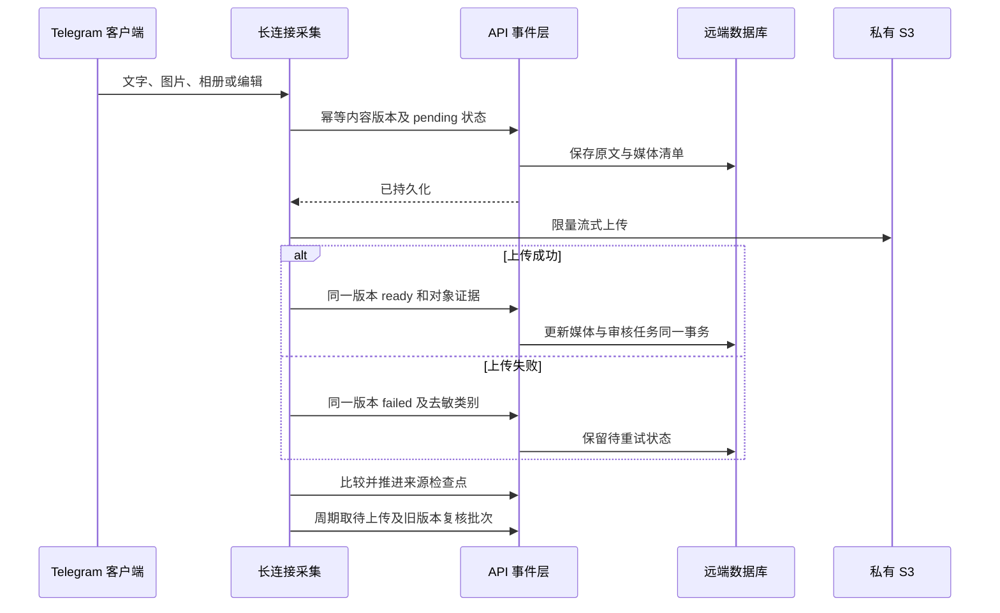

# Telegram 接入、消息完整性与控制通道验收

日期：2026-10-26。状态：采集组件及 API 的隔离行为验证通过，尚未执行真实 Telegram/S3 联调。按用户最新范围，仅操作项目树与本项目临时 Docker，不读取项目外凭据、不连接旧会话。

## 已实现的行为

- 持续复用内存 StringSession 客户端；新消息、编辑、相册和删除事件使用同一连接。退出取消扫码任务、释放主连接与临时连接、停止控制线程。
- 每个来源采用远端租约和比较更新检查点，按消息编号升序补拉，单页/单周期资源预算不作为完整历史边界；下一周期续接，不依赖最近二十条和内存 seen。
- 先持久原文及媒体状态，再推进检查点。媒体失败保留原文和可重试事件，恢复为 ready 才幂等入审核队列，不在缺图时分析图文消息。
- 文字、图片说明、回复最小上下文和相册全部成员形成同一内容版本。昵称与版本分离，改名不复制消息；版本冲突、乱序旧编辑和重复投递明确处理。
- 删除或新编辑保留旧原文及资金证据，使旧审核尝试失效并给信号标记 withdrawn。相册一张删除时整体撤回，防止缺图的剩余内容误成新推荐。
- 新消息检查点不能发现旧编辑，因此增加远端有预算的轮转复核：近期版本五分钟、较旧版本六小时调度，批次之间持续轮转，覆盖完整已捕获记录。该调度是目标间隔，积压和限流可能延后，不等于实时保证。
- 图片流按单图、整消息、数量及元数据像素上限限制，检查实际文件标记再上传私有 S3。客户端支持既有 HTTPS 代理与 CA 机制，不改变签名端点。
- QR、二步密码和取消状态在采集进程内存，通过只在内网开放的鉴权控制服务传递。密码不写数据库、文件或审计；仅授权成功的 StringSession 加密写远端，持久化失败不能宣称授权完成。
- 群实体解析失败先查询已加入对话，区分未加入、不可访问、管理员枚举受限；管理员与对话列表分页，允许人工核验编号，匿名管理员可能不在枚举结果中。
- 管理原文阅读支持稳定签名游标和全文详情，返回原文、图片引用、回复、模型轨迹及真实比赛盘口关联；同时间戳分页不漏记录。



## 生命周期和接入契约

采集工作器创建一次 `TelegramCollector(config, api=client, api_url=API_URL+'/telegram')`；该 HTTP 客户端带采集服务令牌。调用 `start_control_server(token=TOKEN, host='0.0.0.0', port=8092)` 一次，每轮 `apply_config(config)`、`sync_once()`，最终 `disconnect()`。采集来源由远端启用来源及信任作者表决定，不以配置中的首屏列表推断。

API 需包含新增 Telegram router。设置 `TELEGRAM_CONTROL_URL` 指向私有采集控制端点；本机 Docker 默认 `http://collector:8092`，跨节点必须用既有安全网络，不能公开裸露控制端口。

| 接口组 | 作用 |
| --- | --- |
| `/internal/telegram/sources` | 启用来源及稳定可信作者编号 |
| `/internal/telegram/checkpoints/claim`、`/checkpoints` | 来源租约、检查点及比较更新 |
| `/internal/telegram/events`、`/pending`、`/observed` | 原文媒体事件、失败恢复及完整旧记录轮转 |
| `/internal/telegram/session` | 只持久成功授权后的加密 StringSession |
| `/api/v1/admin/telegram/status`、`/auth/qr`、`/auth/password`、`/auth/cancel`、`/disconnect` | 管理员 QR 及二步验证；写请求使用管理 CSRF |
| `/api/v1/admin/telegram/dialogs`、`/admins` | 群频道及管理员分页、失败类别和手工提示 |
| `/api/v1/admin/telegram/messages`、`/messages/{id}` | 完整版本原文阅读、分析及推荐明细 |

审核输入应读取新增 `reply_context`。订单预检须拒绝 `withdrawn_at` 非空的信号；该标记不是会计作废，不得删除已接受订单或改变真实资金事实。

## 冻结验证命令

```sh
docker run --rm --cpus=0.75 --memory=384m --network ai-football-v2-test-net \
  -e PYTHONDONTWRITEBYTECODE=1 \
  -e TELEGRAM_TEST_DATABASE_URL=postgresql://postgres@ai-football-v2-pgverify:5432/postgres \
  -v /root/ai_football:/source:ro --entrypoint sh ai-football-api:v2.0.0-rc1 -c \
  'mkdir -p /tmp/telegram-api-frozen/tests && cp -a /source/services/api/app /tmp/telegram-api-frozen/app && cp -a /source/services/api/migrations /tmp/telegram-api-frozen/migrations && cp /source/tests/test_telegram_api.py /tmp/telegram-api-frozen/tests/ && cd /tmp/telegram-api-frozen && python -m unittest discover -s tests -p test_telegram_api.py -v'

docker run --rm --cpus=0.5 --memory=256m --network=none \
  -e PYTHONDONTWRITEBYTECODE=1 -v /root/ai_football:/source:ro \
  --entrypoint sh ai-football-collector:v2.0.0-rc1 -c \
  'mkdir -p /tmp/telegram-frozen/tests && cp -a /source/services/collector /tmp/telegram-frozen/collector && cp /source/tests/test_telegram_collector.py /tmp/telegram-frozen/tests/ && cd /tmp/telegram-frozen && python -m unittest discover -s tests -p test_telegram_collector.py -v'
```

最终结果：API **14/14** 通过，退出码 **0**，7.714 秒；采集 **18/18** 通过，退出码 **0**，0.706 秒。API 每例创建和销毁独立临时库；采集使用显式假客户端，不连接 Telegram、代理或 S3。源码复制到容器内冻结副本后运行，不受其他代理后续编辑影响。

覆盖超二十条补拉、105 管理员分页、源间故障隔离、FloodWait、持久失败不推进、相册双图、媒体恢复、编辑及删除、旧消息断线复核、二维码取消过期及二步密码、授权保存失败、错误令牌、重复入队、版本冲突、租约与检查点比较更新、删除墓碑、相册残片、同时间戳阅读分页及内存密码代理。

## 未验收与已知限制

- 真实旧账号身份、三个历史来源权限、扫码到 Telegram/S3 端到端和媒体私有读取尚未验证；本轮测试不能替代这些步骤。
- 用户消息编辑或删除发生在首次成功捕获之前时，上游可能已无法提供原文；本系统不能恢复不存在的证据，不能声称历史绝无缺口。
- 突发积压或 Telegram 限流会推迟旧版本轮转复核；部署需测资源、队列与新鲜度并设告警。
- 当前群管理员基本成员/频道两条路径已按已安装 Telethon 签名实现；实际群权限和匿名行为仍需授权联调。
- 手机设置布局、真实 QR 图像渲染、会员原文 UI 与只读媒体接口由主代理整合后做浏览器验收。
