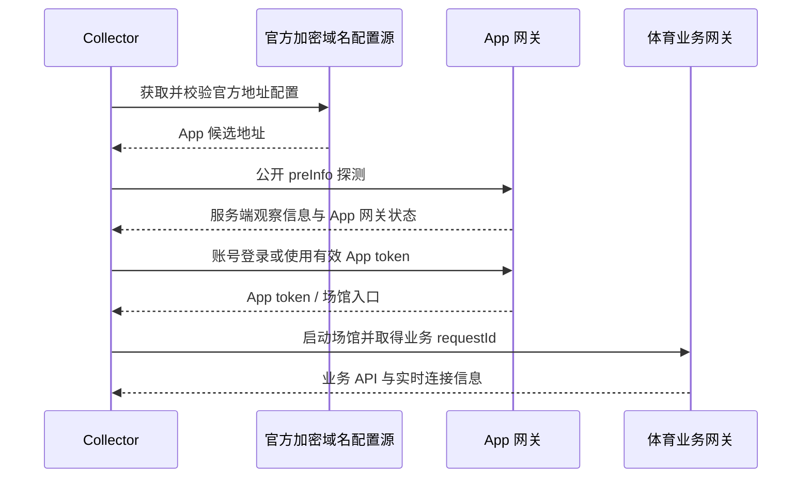
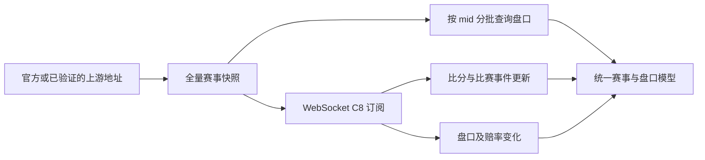

# v1 乐鱼接口实现分析

更新时间：2026-10-27。本文将 v1 官方 Android App 静态分析与 v1 Web/H5 旧抓包分开记录。两条链路的令牌、域名来源和数据协议不同，不能互换。

## 结论

v1 Android App 的登录凭据是 App 网关令牌；体育场馆启动后另行取得业务 `requestId`。v1 Web/H5 抓包中的 `requestId` 则直接作为该旧业务网关的会话头。旧 H5 的赛程、盘口和 WebSocket 解析可作为 v2 赛事数据模型参考，Android 登录和动态域名发现只能按官方 App 证据实现，不能从 H5 参数推导。

当前 v2 对接应保留三类独立状态：App 登录令牌、体育业务 `requestId`、采集连接状态。网络失败、限流、区域拒绝和令牌过期必须分类处理；只有明确的 App 令牌过期才进入账号续期判断。此前 v1 实测中，账号密码登录仍受到上游拒绝保护，不能将该历史结果写成续期已保证可用。

## 证据与方法

REA 对官方 Android 2.0.1 APK 进行了包信息检查。原始 APK 是加固壳，完整登录、签名和地址发现结论来自 v1 归档中校验过 DEX 校验和的反编译证据；代码未执行。当前重新检查的原 APK 只确认了包元数据，衍生 DEX 搜索也没有单独找到 `Login` 类，因此本文以归档中已有的 REA 证据为准，不声称本次重新反编译复现了全部协议。

| 主题 | 证据等级 | REA 证据 ID |
| --- | --- | --- |
| Android 登录请求字段 | A：反编译静态观察 | `ev_ab4b8f677e80a2ebdca33ae52dc38a3c56c6ea609da3658438b331fcd9cc6877` |
| 登录默认参数 | A：反编译静态观察 | `ev_9591981a78bcd5980263fcfef37c50d7e12e400185495ddecd81567f8e007144` |
| App 拦截器签名调用 | A：反编译静态观察 | `ev_f6f86bacf802d61ebcb17864727e5990f3bc8aa31c511371132bf36e18085b78` |
| 路由签名和时间/IP 输入 | A：反编译静态观察 | `ev_34de0aa4b8a5174c9e4f7211a8e6ccbaa275f5d43bb5fb36a0aded0cb95039cc` |
| 动态域名发现与解密调用链 | A：反编译静态观察 | `ev_c298cca747ff6ba93f17a0516251fb89807facd6004cf014e9680ed3065f9344`、`ev_aff57b0d8c5e14d09cfc47a8a4347dc8d24ed3de60b329459386cabe7d64ef7f` |
| 域名配置格式及 App 候选 | A：反编译/配置观察 | `ev_43ea7a2ed7fd464d9cce20e23fb68882975d3140f458954bf99d11029c27810c`、`ev_251b864e12dd6bdb7c9e4dac6c8de6d6870ee038177cc0fb2790351819ba06e1` |
| H5 赛事、盘口、WS 结构 | A：历史 Fiddler 抓包与 JS 实现；旧报告复核 | v1 `docs/architecture/leyu-api-protocol.md`，抓包时间 2026-09-29 至 2026-09-30 |

完整方法和状态边界见归档报告 `reports/leyu-session-resilience/REPORT.md`；其配套 `data/evidence.csv` 记录证据映射。REE/REA 导出中的私有签名材料不复制到本项目文档或源码。

## Android App 授权与地址发现

REA 静态证据显示，App 登录路径为 `POST /site/api/v1/user/login`，字段包括设备 UUID、账号名、密码、Flag、App 版本及默认验证参数。密码按该 App 协议摘要后发送；动态路由签名包含毫秒时间和随机分量，另一加密头包含秒级时间与 preInfo 返回的观察地址。实现必须从配置和运行状态取得这些输入，不复用抓包中的旧地址或 IP。

App 的域名发现由加密配置、native 解密入口和 provider 回退链共同完成，候选地址需要 HTTPS 探活。H5 的 CDN 或旧 `liveDomain` 不能直接提升为 App 登录目标。签名正确也不能消除上游账号拒绝、设备校验或官方验证要求。

## H5 赛事、盘口与赛况

历史 v1 H5 抓包显示，赛事列表通过 `GET /yewu11/v2/m/getOriginalDataPB?t=<毫秒时间>` 取得，响应主体以 Base64/Gzip 封装 JSON。赛事主键为 `mid`；比赛状态 `ms`、开赛时间 `mgt`、阶段 `mst/mmp`、比分与事件序列 `msc` 用于匹配与展示。

盘口通过 `POST /yewu11/v1/w/structureMatchBaseInfoByMidsPB?t=<毫秒时间>` 批量查询。`hpsPns[]` 描述玩法、盘口类型和盘口线；赔率落在 `hpsData[0].hps[]` 及 `hpsAdd[]`，赔率整数按 `ov / 100000` 解码。`hpsAdd` 需按玩法与盘口线关联，不能仅按数组位置拼接。历史观测单批约 12 场，不足以推出服务端最多只能查询 12 或 20 场；客户端应分批并处理部分失败。

实时变化通过 `/yewuws2/push?requestId=...` WebSocket 推送。旧客户端使用 C0 心跳、C8 订阅；C103 对应赛况，C105/C118 等承载盘口变化。完整订阅和重连仍以有效的业务 `requestId`、当前协议响应为前提；已有抓包描述的是 2026-09 的 H5 链路，不能保证目前上游版本完全相同。

## v2 复用边界

| 能力 | v1 可复用信息 | v2 必须再次验证 |
| --- | --- | --- |
| 账号续期 | Android 登录字段、签名输入和 token/业务会话分层 | 当前网关、账号授权、实际上游响应、退避分类 |
| 动态地址 | Android provider/配置解密逻辑与 HTTPS 探活顺序 | 当前配置可达性、证书验证、地址用途与有效期 |
| 赛程 | `mid`、状态、开赛时间、比分事件字段 | 当前赛事覆盖与状态语义、分页/限额变化 |
| 盘口 | 玩法与盘口线关联、`ov` 缩放方式 | 当前盘口映射、赔率时效、缺项和改价处理 |
| 实时赛况 | WS 心跳/订阅和旧消息类型映射 | 现行握手权限、事件类型、断线补数与重连 |

当前 v2 的真实 Telegram 授权、乐鱼上游登录与长期续期仍须单独验收。静态 REA 和历史抓包只能证明实现线索，不等于当前外部账号可用。
