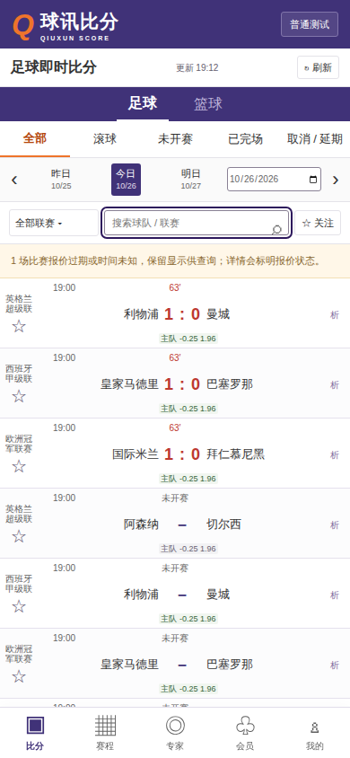
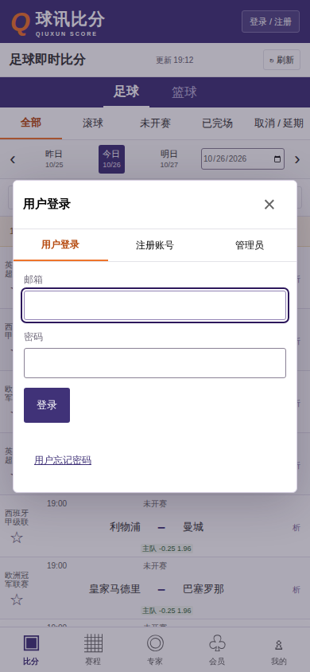
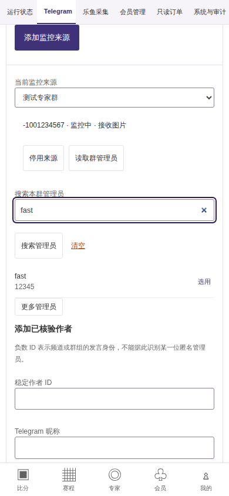

# 网页可访问性专项验证

更新时间：2026-10-26。状态：源码冻结，Docker 隔离专项与网页业务回归通过；下列失败记录保留。没有宣称完整 WCAG 合规或生产接入通过。

## 设计与边界

针对当前桌面 1440×960 与手机 390×844，在同一 Docker Chromium 与人工协议样本下复现比分、专家、原文、会员、个人中心和管理页面。补充用户登录、联赛筛选、比赛详情、管理员换机、再次验证、确认与成功弹窗。后端不改动，不真实登录 Telegram、乐鱼或模型，不执行投注。

用固定版本 axe-core 记录规则、节点选择器与对比度数值，不输出原始 DOM、密钥或一次性备用码。另以真实 Tab、Shift+Tab、Enter、Escape 及 DOM 几何测量检查初始焦点、弹窗焦点约束、关闭后返回、手机管理入口、焦点可见与底栏遮挡。文本以普通文字 4.5:1、大字 3:1 为依据；目标尺寸至少 24×24 CSS 像素，较小目标需验证间距例外，手机主要操作优先 44 像素。参考 [WCAG 2.2](https://www.w3.org/TR/WCAG22/) 与 [原生 dialog 技术](https://www.w3.org/WAI/WCAG22/Techniques/html/H102)。

触及目录：网页样式、页面结构与交互；浏览器开发依赖、专项检查、回归结果与快照；本目录证据。根任务、总进度与后端保持只读。本人限额按新增接口契约补充每日时区选择，紧急停止保持直接可用。

## 修改前实测与修复

固定 [axe-core 4.10.3](https://github.com/dequelabs/axe-core/releases/tag/v4.10.3)，完整依赖由浏览器锁文件与 Docker 镜像限定，只用于开发审计，不进入网页生产资源。自动规则覆盖 WCAG A/AA、2.1 AA、2.2 AA 及最佳实践；没有禁用失败规则。

修改前运行 28 个页面/弹窗状态，出现 493 次违规节点报告（包括不同状态的重复节点，并非 493 个独立缺陷）。20 项行为/汇总检查中 17 项失败，其中两项是新时区尚未实现。浅灰小字、橙色选中、比分红色、旧赔率颜色不达标；重复侧栏地标、快捷信息无区域归属以及手机“析”按钮目标仅 20×27 像素也被复现。详情弹窗无可访问名称、跳过导航没有实际聚焦主内容、MFA 成功替换内容后失焦、手机独立管理入口不足 44 像素由行为检查确认。

| 现象 | 实际变更 |
| --- | --- |
| 普通小字对比度不足 | 提深辅助文字、橙色文字、比分红、有效/旧赔率及会员说明；品牌装饰橙色独立保留 |
| 普通表单边界过浅 | 输入框、选择框与多行框边界统一为可测深色，焦点用深紫外环与白色内环 |
| 原生弹窗 Tab 可走到页面 body | 公共弹窗入口统一命名和焦点；在当前最上层弹窗内循环 Tab/Shift+Tab，保留原生 Escape 与 inert |
| 长内容和换机成功后失焦 | 首次与替换内容均聚焦静态标题；登录聚焦邮箱、重验聚焦密码、取消确认聚焦取消选项 |
| 关闭后原按钮已被实时刷新移除 | 回到当前页面标题；原按钮仍存在时回原按钮；叠加重验关闭返回下层弹窗 |
| 小型触控区 | 通用按钮至少 24 像素；手机“析”26×40、主要提交/管理入口/危险操作至少44高、关闭44×44、复选框24×24；保持比分行密度 |
| 状态只有颜色 | 导航补当前页、分组按钮补按下状态；收藏仍有稳定名称与按下状态，盘口涨跌保留箭头 |
| 减少动画不覆盖过渡 | 对元素及伪元素取消动画、过渡和自动平滑滚动 |

24 像素是最低尺寸/间距门槛，不能描述为全站全部达到 44 像素。可聚焦后显示的跳过链接在隐藏时是 1×1 裁剪区域，单独验证其聚焦后真实尺寸与可操作性；不能把隐藏尺寸当作可触摸目标。间距算法依据 [W3C 目标尺寸说明](https://www.w3.org/WAI/WCAG22/Understanding/target-size-minimum.html)，几何检查仍需结合实际遮挡和界面意图复核。

## 失败与修复链

| 记录 | 命令与退出码 | 结论 |
| --- | --- | --- |
| 修改前观察 | `sh tests/browser/accessibility-check.sh --baseline`，0 | 观察模式明确保留失败，不代表通过；原始数据为 accessibility-baseline.json |
| 第一轮修复 | `sh tests/browser/accessibility-check.sh`，1 | 手机叠加弹窗读取焦点过早；attempt1 保留 |
| 扩大管理分区与取消确认 | 同上，1 | 去掉 open 属性与异步 close 事件不是同一时刻；attempt2 保留，增加等待可观察焦点返回，截止1秒，未删除返回断言 |
| 补自动工具未判定颜色 | 同上，1 | 自动规则已为0，但 CSS 渐变端点补测发现会员说明最差4.37:1，仍低于4.5；attempt3 保留并提亮文字 |
| 时区真实API第一轮 | `sh tests/browser/integration-check.sh`，1 | 测试误写403，真实服务按未校验账户返回409；保留 integration-attempt-timezone.json，改为验证409及明确中文原因，未放宽后端 |

CSS 颜色补测覆盖 axe 的 incomplete 对比度候选：渐变背景取两个端点的最差值，普通符号与裁剪文字读取实际样式；仅装饰元素单独标识。这不是屏幕逐像素或辅助技术结论。补测确实发现自动规则零错误仍存在的 4.37:1 问题，因此不能用 axe 零错误作为全部验收标准。

## 补充功能边界

本人每日限额时区提供北京时间、UTC、柏林，并保留 API 读取的其他有效时区。启用保存发送所选时区；关闭和紧停不依赖该字段。浏览器样本验证 America/New_York 读取后切至 Europe/Berlin。真实临时 API 只验证默认时区、传输与未通过账户的拒绝，不在这个浏览器任务中人为打开实盘。时区持久授权及跨日累计另见后端独立行为测试。

Telegram 目录与管理员搜索按名称、稳定 ID 或 @用户名提交 q，重新搜索和清空都重置游标。请求序号隔离迟到结果，空结果仍能清空或手工填写已核验身份；服务端分页与搜索范围由后端保证。负数发言身份明确表示频道/群组，不能据此识别具体匿名管理员。头像仍为占位，没有虚构原图。

## 最终复核证据

最终同一冻结网页顺序运行下列命令，全部退出0：

| 命令 | 实际范围与结果 |
| --- | --- |
| `sh tests/browser/accessibility-check.sh` | 1440与390视口共38个页面/弹窗状态，自动规则违规0；29项行为/汇总检查通过；124次自动未判定颜色候选完成CSS补测 |
| `sh tests/browser/check.sh` | HTTP Mock 25场景通过，包含新TG双目录搜索与乱序，不使用真实账号 |
| `sh tests/browser/integration-check.sh` | 最新API源码构建、全部有序迁移与独立临时PG，11场景通过，无真实采集、模型、资金或外部挂载 |

两视口中测得搜索框边界3.71:1、深紫焦点环对白底15.03:1、白色内环对紫色导航10.79:1。会员渐变说明由最差4.37提升至5.05:1。重点键盘场景包含跳过导航、连续64次Tab可见性、弹窗正反向Tab、Escape和返回、列表删除原触发按钮、手机管理入口、新登记→取消确认→再次验证→成功替换内容→关闭清除。原生close事件异步恢复在1秒内核验；没有用固定长等待跳过断言。

38个状态为每个视口19项：比分、联赛弹窗、详情弹窗、专家、原文页、完整原文弹窗、会员、个人中心、管理概览、TG/乐鱼/会员/只读订单管理分区、MFA设置、MFA登记、取消确认、叠加重验、成功一次性展示、登录。管理员未开放的状态、二维码到期和加载/错误/离线等业务状态另由25项业务Mock覆盖，不把这些没有运行axe的状态算入38项。

原始扫描、选择器、颜色值与行为结果位于 `tests/browser/accessibility-results.json`；失败基线与三次尝试分别保留，不覆盖成全绿历史。公共产物与测试源码哈希由同目录网页快照封存。

离线报告重新生成并在 `--network none` 的同一固定浏览器中验证：1440与390页面各25张图片全部解码、流程图和可展开Mermaid源码可读、局部横向滚动、正文不横溢出、外部请求0；另以file直接打开25张图片也可读。生成、3项报告检查及快照命令全部退出0。快照包含25/11/3/29检查结果、38状态、36个截图/图示摘要，以及当前网页与浏览器检查源码哈希。本轮任务具名临时容器、网络与PG均由trap清理；结束后任务容器/网络查询为空。

## 尚未验收的范围

浏览器规则与程序化键盘操作不能替代真人使用辅助技术。尚未运行 NVDA、JAWS、VoiceOver、TalkBack，未进行真实手机触觉、语音控制、外接键盘及不同操作系统高对比度验证。没有工具报错不能据此宣称完整 WCAG 合规。中文内容质量、认知负担与体育数据持续变化的体验需要人工后续评估。

渐变补测依赖当前两个端点与样式的单调色彩，不覆盖今后替换成图片或复杂叠层的背景；字形抗锯齿、设备显示与放大后的视觉识别仍需要实际人群使用。原站和本平台小字密度不同于大字辅助界面，本次保留比分密度，没有据此宣称低视力的全部需求已满足。
