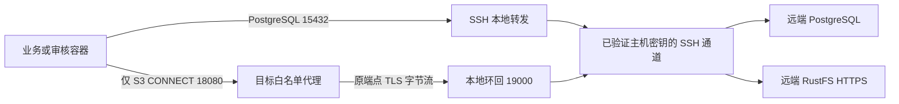

# 存储隧道与受限 S3 代理

本模块把无原生 TLS 的旧 PostgreSQL 放在严格主机密钥验证的 SSH 连接内。S3 保留原 HTTPS 端点与 CA 验证，通过唯一目标的 CONNECT 代理转发；代理不解密 TLS，不持有 S3 访问密钥。



## 配置契约

- `tunnel.example.json` 描述唯一 PostgreSQL、S3 目标和本地端口，不能开启任意动态或反向转发。
- `ssh_config.example` 必须配预先核验的 known_hosts 和专用密钥；不采用自动接受新主机密钥或 `StrictHostKeyChecking=no`。
- Compose 的配置绑定默认位于项目内 `.runtime/`，目录不入库、不进入构建上下文；当前工作不创建或读取项目外配置。
- 隧道服务仅在私网 expose 15432、18080，无宿主发布端口；S3 的 19000 只绑定容器环回。
- 使用原 HTTPS endpoint、原 CA、`S3_HTTPS_PROXY=http://storage-tunnel:18080`，代理只传给 S3 客户端的 `Config(proxies=...)`，不设置全局代理环境。
- PostgreSQL 使用专用内部隧道地址；若连接不在已验证 SSH 保护内，必须要求数据库 TLS，不能把明文直连当作回退。
- 配置挂载只读且不携带供应商模型密钥、用户会话密钥或 S3 密钥。SSH 用户应限制为所需转发目的地；已有旧用户权限待生产切换前收敛。

## 状态与限制

SSH 进程断开会使监督器退出，由容器重启策略退避恢复。主机密钥不匹配或端口绑定失败立即失败。健康检查只证明监督器及转发监听存在；真实数据库查询、S3 精确读取和消息新鲜度必须另行检查，不能以此宣称业务健康。

CONNECT 限制目标、请求头大小、并发、空闲时间及总传输字节，不记录认证头和请求内容。不允许普通 GET、目标替换、Host 不符、代理认证或带体 CONNECT。私网内的服务鉴权仍由 PostgreSQL/S3 自身实施。

## 当前验证边界

用户收紧目录范围之前完成的只读证据：严格主机密钥 SSH 下 PostgreSQL read_only=on；原 CA 校验的 S3 TLS 1.3 与授权查询通过。旧桶根扫描超时，但限定前缀查询返回 200，故健康探针不得扫描旧桶根。

收到“不要操作其他目录”后已停止外部验证。执行 `docker stop --time 5 ai-football-v2-tunnel-probe`，退出码 **0**，终止本任务持续 SSH 连接；没有读取挂载或删除外部文件，没有停止其他服务。今后验证仅使用仓库内假配置和隔离容器，不会通过本模块继续读取真实远端。

镜像已完成一次候选构建，但不是正式发布。构建固定 Python 基础摘要、OpenSSH 包版本，镜像内记录包版本；进一步供应链锁定及生产受限转发账号仍属发布工作。

## 仓库内离线检查

```sh
docker run --rm --cpus=0.5 --memory=256m --network=none \
  -e PYTHONDONTWRITEBYTECODE=1 -v "$PWD:/w:ro" -w /w \
  python:3.12-slim python -m unittest discover -s tests -p test_config_reuse.py -v
sh infra/check-runtime.sh
```

第二条只生成明显假值、渲染 Compose 并启动一个禁网的值传递探针，不启动任何业务、SSH、数据库或真实采集。`.runtime/` 只保存这些本任务假配置。
