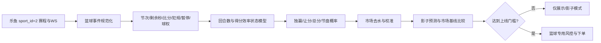

# 当前决策模型能否用于篮球，以及能否分析乐鱼篮球场次

日期：2026-10-11。结论：**当前模型不能直接用于篮球投注决策；乐鱼篮球场次可以被采集和展示，但尚不能进入现有分析、训练或自动下注链路。** 可复用采集、快照、走势、影子模式、审计和门控基础设施；必须重写篮球状态、得分过程、盘口映射、结算器、特征版本和验证集。

## 1. 证据范围

证据等级：A=官方规则、公开论文、可核验源码；B=行业公开资料；C=社区实测。来源和访问结果见 `data/source_fetches.csv`。FIBA/NBA官方站点对自动请求返回403，因此未把不可访问正文伪装成已下载证据；论文页面可访问，但其结果不等于本项目收益保证。

## 2. 复用边界

| 层 | 足球现状 | 篮球可否复用 | 必要动作 |
|---|---|---:|---|
| 乐鱼赛程/WS采集 | `LEYUMatch`保留 `sport_id/sport/period/score_raw`，C103/C105/C102/C109 | 部分可 | 增加篮球字段字典和样本回放，确认四节/加时编码 |
| 快照/走势存储 | 按盘口线和选项保存，带接收时间 | 可 | 新 `sport=basketball` 版本，禁止混入足球训练 |
| 影子模式/训练审计 | 已有开关、版本隔离、S3修复链 | 可 | 独立模型制品和数据集 |
| 市场去水 | 二/三项通用概率工具 | 部分可 | 按让分、总分、独赢、节盘定义结果空间 |
| 现有Poisson | 剩余进球、半场足球结算 | 不可 | 替换为篮球得分过程模型 |
| 特征 | 足球比分、红牌、半场、足球盘口 | 不可 | 节次、剩余秒、球权、犯规、暂停、阵容、领先分 |
| 结算 | `HAD/AH/OU`和`*_1H`足球规则 | 不可 | 四节/半场/加时、走盘、半赢半输和节盘结算器 |
| 下单 | `sportId==1`硬校验 | 不可 | 新篮球订单协议和回执审计；上线前继续阻断 |

## 3. 为什么不能直接迁移

FIBA规则将比赛组织为四节，第四节平分时进行每次五分钟的加时（官方规则入口 S1）；NBA规则也以节、暂停、犯规和加时管理计时（S2）。因此“进行到一半”不是篮球的单一连续时间：节间、暂停、罚球和末节犯规战术会改变每回合得分机会。

足球模型核心是低频进球的剩余 Poisson/Skellam 过程。篮球是高频、离散、强状态依赖的得分过程；回合数、进攻效率、罚球率、失误、篮板、犯规困境和阵容共同改变得分率。公开研究将篮球建模为按回合或状态分层的随机过程（S3、S4），与把主客队当作两个独立“进球率”不同。把篮球总分除以时间后塞进足球 Poisson，会在末节犯规战术和加时盘口上系统性失真。

代码还有明确硬边界：`collector/sources.py` 默认 `SOCCER_SPORT_ID="1"`；`service/analysis.py` 筛选 `sport_id==1`；`service/betting.py` 拒绝 `sportId != "1"`。解析器确实能保留 `sport_id=2`、`period`、`score_raw`，但 `msc` 的 `S1/S2` 语义、`mmp/mst` 的节次/时钟含义必须用篮球样本确认，不能沿用足球全场/半场解释。

## 4. 应建设的篮球决策链

最低输入：Q1–Q4/OT、剩余秒、比分、暂停/罚球、犯规数和球队犯规困境、球权（若可得）、阵容/伤停、盘口线与赔率、盘口更新时间和接收时间。字段缺失时必须扩大不确定性并降级，不能用中性值伪造信息。

建议分阶段：先用去水市场概率加盘口线/剩余时间校准；再使用按回合的主客进攻/防守效率和负二项或层级状态空间处理过度离散；最后加入犯规、暂停、球权、阵容和伤停。独赢、让分、总分、节盘必须分别验证。

## 5. 乐鱼篮球可行性判定

| 问题 | 当前答案 | 证据/风险 |
|---|---|---|
| 能否列出篮球赛程 | **能，理论上** | `parse_match_list`保留`csid/csna`；需在线样本确认当前返回量 |
| 能否接收篮球盘口推送 | **协议层大概率能** | C105通用解码；盘口`hpt/hv/ol`仍需篮球回放映射 |
| 能否展示篮球场次 | **需新增sport过滤和展示适配** | 当前分析循环只接受sport_id=1 |
| 能否用现有Poisson给篮球概率 | **不能** | 过程、阶段和结算假设不成立 |
| 能否训练篮球模型 | **当前不能** | 无篮球标签/特征版本/按比赛分组验证集 |
| 能否自动下注篮球 | **不能且应继续阻断** | 下单构造器和执行器硬编码sportId=1；结算器为足球 |

## 6. 实施门槛与停机安全

不改变当前生产自动下注开机要求；篮球新增链路默认只读、影子和展示，和足球执行器隔离。上线前至少完成100场按比赛分组的时间滚动验证（建议目标200场以上），每种市场分别有样本；与乐鱼去水市场基线比较 Brier、log loss、校准、让分/总分支付状态误差、固定规则影子ROI，并按联赛、节次、盘口线、是否加时分层。置信区间按比赛而不是盘口行计算。未显著优于市场基线时，投注保持关闭。

数据版本必须包含 `sport=basketball`、规则版本、盘口语义版本和结算版本。足球旧数据不得混入篮球训练；S3原始包永久保留，修订包记录SHA256、来源和修复原因。阶段无法核验、终场/加时状态缺失、赔率没有接收时间的样本进入隔离队列。

## 7. 最终结论

**当前决策模型不能直接适用于篮球，最多复用市场先验、数据管线和影子评估框架。**

**乐鱼篮球场次可以先做独立采集、字段审计、盘口展示和影子预测；当前生产代码会主动过滤篮球，且下单层明确拒绝 `sportId=2`。** 在篮球专用状态、结算、训练链路完成并通过滚动验证前，不应让篮球进入自动下注。
