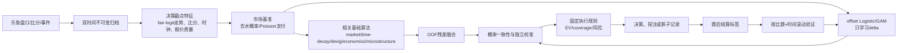
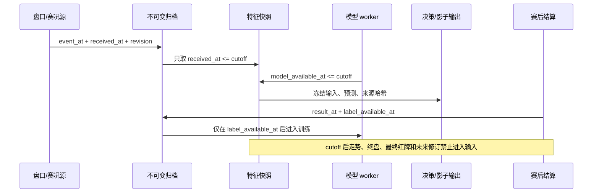
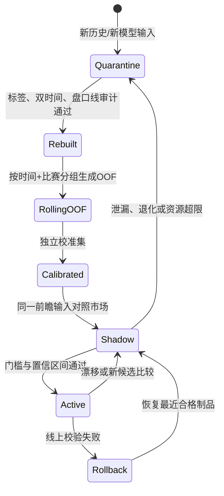

# 最大化决策正确率：当前项目的证据、方案与实施路线

日期：2026-10-11
范围：乐鱼单一盘口源、实时 HAD/OU/AH 决策、Poisson + 监督校准路线
结论性质：研究与实施计划；本报告没有启动训练，也没有启用真实投注。

## 结论先行

当前系统最大的问题不是参数量少，而是“可学习的信号、标签和评估口径”还没有完全可信。历史审计发现 904,473 条旧输入带有异常同伴概率特征，79,972 条标签发生翻转；在同一批 139 场、145,897 条共同记录上，修正标签后的旧模型准确率约 59.88%，市场基准约 63.53%。这不是干净重训结果，但足以说明旧的 62% 以上成绩不能作为改进起点。

在当前机器和“不使用基础大模型”的约束下，最大化正确率应按下面的顺序做：

1. **先恢复可信训练集和评价单位**：每个盘口、每个决策时点全部保留；按比赛分组、按时间滚动；同时约束发生时间和系统获知时间。
2. **把市场当成先验而不是普通特征**：使用 `logit(p_market) + delta(features)` 的 offset Logistic/GAM，模型只学习盘口以外的残差；当残差不可靠时精确退回市场概率。
3. **让走势成为时间量而非 tick 序号**：15/60/180 秒的 fair-logit 变化、斜率、回撤、更新频率、最长空档和报价年龄都按决策截点计算。
4. **用 OOF 残差融合相关算法**：多个算法共享同一盘口输入，不能把五个相关概率当五份独立证据；融合前保存同一比赛、同一盘口、同一时点的 OOF 预测。
5. **统一概率和支付结构**：HAD 使用 top-1；OU/AH 使用全赢、半赢、半输、全输、走盘的支付权重；同时报告 Brier、log loss、校准、coverage 和固定执行规则下的 EV。
6. **最后才比较树模型和动态 hazard/Poisson**：只接受严格时间+比赛隔离后仍有稳定增益且满足 CPU、内存和 2 秒链路预算的候选。

不能把提高 `min_probability`、减少推荐数量或只报告高置信区间当成模型变准。那是选择性预测的 coverage 变化，必须单独报告。

## 证据与限制

证据等级采用：**A** = 当前源码、可重放数据、原始论文或官方文档；**B** = 学术综述或聚合；**C** = 社区经验。量化结论区分“项目测量值”和“研究建议”。互联网来源及访问地址写入 [`data/research_sources.csv`](data/research_sources.csv)，当前代码和状态的哈希快照写入 [`data/current_snapshot.json`](data/current_snapshot.json)。

外部研究只能说明可测试的方向：2026 年一篇滚球足球预印本在 140 场英超、Betfair 价格环境中，把开赛市场校准到球队强度并加入随时间变化的 post-shot xG，分类准确率接近交易所价格；作者认为市场校准是主要驱动因素。样本少、联赛单一、数据源和赔率市场不同，不能把其 70.2%、4.5% ROI 或模型结构直接迁移到乐鱼。

项目快照也不是跨库原子快照：历史修复 worker 可能继续改变数量。因此报告里的旧数据只用于诊断，不用于宣称现模型已经达到某个准确率。

## 当前代码链路

当前实现的主要入口是 [`core/live_model.py`](../../core/live_model.py)、[`core/ensemble.py`](../../core/ensemble.py)、[`core/decision_features.py`](../../core/decision_features.py)、[`core/learned_model.py`](../../core/learned_model.py)、[`service/model_training.py`](../../service/model_training.py) 和 [`service/model_service.py`](../../service/model_service.py)。逻辑可概括为：市场去水概率反演剩余进球强度，再生成多个结构相近的算法概率，最后以监督残差模型和 EV 门控输出决策。



### 已核验的实现特点

| 模块 | 当前行为 | 正确率风险/机会 |
| --- | --- | --- |
| `live_model` | 独立 Poisson；OU 反演总进球；HAD 反演主客 share；保留走盘和截断尾部 | 结构可解释，但盘口本身已经包含大量市场信息，不能把反演视为独立优势 |
| `ensemble` | 多个概率线性平均，叠加历史表现和市场相对 Brier 的收缩 | 输入高度相关时会重复计权；应改为 OOF 残差元模型 |
| `decision_features` | 已有 15/60/180 秒走势、报价年龄、overround、红牌差和交互特征方向 | 必须确认所有值在 cutoff 前可见；在线与离线特征要做哈希对账 |
| `learned_model` | L2 Logistic，市场 logit 作为 offset，学习剩余特征；模型版本和特征版本严格匹配 | 轻量、可回退；非线性和交互能力有限，先做校准和数据清理 |
| `model_training` | 独立 worker、时间验证、资格门槛、校准/晋级状态 | 与 API 解耦是正确方向；训练禁用或仅 shadow 时不能把预测当 active 效果 |
| `training_data` | 多盘口、多算法、多时间记录；历史走势在决策截点冻结 | 身份键、双时间、标签可用时间必须继续强化，禁止把一场压成一行 |

当前仪表盘显示训练状态为 `disabled`、推理为 `shadow`，训练限制为 1 CPU、512 MB、600 秒；因此目前不能声称“正在训练并已提升准确率”。

## 正确率必须拆成四个目标

### 1. 方向命中

HAD 是三分类，应统计最大概率方向的 top-1 命中；不能将主胜、平、客胜分别以 `p >= .5` 当三个二分类。OU/AH 应按选中方向统计五种结算状态。

### 2. 概率质量

若预测概率为 (p)，结果为 (y)，至少记录：

```text
Brier = mean((p - y)^2)
log_loss = -mean(y log p + (1-y) log(1-p))
```

Brier 和 log loss 是适当评分，适合检测概率是否可信；准确率只看阈值后的一位结果，无法发现“预测 60% 实际只有 52%”的问题。可靠性图、校准截距/斜率和按比赛成组置信区间必须一起展示。

### 3. 亚洲盘支付

令 `W/L/U` 分别为全赢/半赢和输/走盘的本金权重期望，则：

```text
q = W / (W + L)                 有效胜率
r = W + L                       实际参与输赢的本金比例
EV = W × (odds - 1) - L
```

`q` 变好不代表 `r` 或 EV 变好。走盘不能简单删掉，半赢/半输应按 0.5 权重。模型训练、页面展示和投注门控要分别报告这三个量。

### 4. 选择范围

每个候选模型都要在相同盘口、相同时间点、相同赔率过滤规则下报告 `coverage`、推荐数、赔率分布、市场分组和执行延迟。提高阈值后的高命中率只能叫“选择性预测结果”，不能叫“全体模型准确率”。

## 当前数据的可疑基线

历史审计的同一 139 场、145,897 条共同记录如下。由于保留了受污染特征，这不是干净回测，只能说明必须先修复数据。

| 口径 | 准确率 | Brier | log loss |
| --- | ---: | ---: | ---: |
| 旧模型 + 旧标签 | 62.41% | 0.21533 | 0.61485 |
| 旧模型 + 修正标签 | 59.88% | 0.22748 | 0.64388 |
| 市场基准 + 修正标签 | 63.53% | 0.21773 | 0.62216 |

最近的综合置信度按决策时点重放结果为：20–30% 分箱 50.00%，30–40% 分箱 60.65%，40–50% 分箱 78.97%，更高分箱暂无样本。统计含待结算记录，不能直接当生产命中率；完整数据见 [`data/confidence_accuracy.csv`](data/confidence_accuracy.csv)。高分箱样本为空本身说明“置信度”尚未被充分验证，不能据此把门槛调到 50% 以上。

## 防止时间泄漏的训练时序

每条输入同时保存盘口或事件的发生时间、系统接收时间、决策 cutoff、模型制品可用时间和标签可用时间。事件发生但断线后才收到时，必须按接收时间判断是否可见；赛后修订不能倒填到原始结算时刻。



当前代码已保留同场多盘口、多决策；建议身份键固定为：

```text
match_id + cutoff + market + normalized_line + outcome
```

同一盘口同一时点的多算法概率放在同一宽表中用于元模型，原始长表仍永久保存。训练可以按比赛等权，也可以按真实交易频次加权，但两种结果必须同时展示。

## 方案比较

评分是工程优先级建议，不是实测效果。所有候选必须用同一外层时间测试集、同一比赛分组和同一市场基准比较。

| 方案 | 信息来源 | 非线性 | 可解释性 | CPU/内存 | 泄漏敏感度 | 当前适配 | 主要风险 |
| --- | --- | --- | --- | --- | --- | --- | --- |
| 市场 offset Logistic | 盘口概率 + 少量残差特征 | 低 | 高 | 低 | 中 | **首选** | 真实边际信号不足时收益有限 |
| offset GAM | offset + 平滑时间/盘口/走势项 | 中 | 中-高 | 低-中 | 中-高 | 第二候选 | 小样本平滑过拟合、在线实现不一致 |
| LightGBM/XGBoost | 全部结构化特征 | 高 | 中 | 中 | 高 | 挑战模型 | 记住盘口/赛事模式、校准差、线程资源超限 |
| OOF 残差 stacking | 多算法 OOF 残差 + offset | 中 | 中 | 低-中 | 高 | **融合必做** | 默认随机折会泄漏，相关模型重复计权 |
| 动态/双变量 Poisson | 进球强度、相关比分、事件状态 | 中 | 高 | 中-高 | 中 | 结构挑战 | 参数估计和事件质量不足，延迟可能超预算 |
| Weibull/hazard | 进球到达时间、市场校准、赛况 covariate | 中 | 中-高 | 中 | 高 | 研究候选 | 当前历史事件和 xG 不完整，外部结果不可迁移 |

树模型并非自动更准：表格数据研究只说明它们值得作基线；LightGBM、XGBoost、CatBoost 官方文档则提供 CPU、正则、线程和早停等控制项。第一版限制深度、叶数、学习率、线程数和迭代次数，保存 RSS/p95/p99 延迟；无法在资源预算内完成的候选不进入 active。

## 推荐架构与算法改造

### A. 市场 offset 残差模型

首个可上线实验应是：

```text
logit(q_hat) = logit(q_market) + delta(x)
delta(x) = intercept + beta · residual_features
```

惩罚只施加于 `delta`；零权重时精确回到市场基准。候选特征按证据顺序加入：比分差×剩余时间、盘口线×当前总进球、fair-logit 走势斜率、报价年龄、overround 变化、数据质量、同盘口算法的 OOF 残差。市场概率系数如果需要放松，使用 `(beta_market - 1)^2` 的收缩而不是普通 L2 把它拉向 0.5。

statsmodels 的 GLM 提供 offset 接口；XGBoost 的 `base_margin` 可作挑战实现，但训练和推理必须使用同一先验。每次折叠都要保留 `delta=0` 的市场回退基线。

### B. 时间窗口走势

当前若只取最近 40 个 tick，三个赔率变化在 2 秒和 600 秒内可能形成相同特征。应在线维护固定时间窗口，缺数据时保留缺失标记而不是用未来点插值：

| 类别 | 特征 | 验证要求 |
| --- | --- | --- |
| 概率趋势 | 15/60/180 秒 fair-logit 变化、斜率、回撤 | 窗口消融；不可跨 cutoff |
| 市场微结构 | 更新次数、覆盖时长、最长空档、quote_age | 与预测质量和执行延迟分开评估 |
| 盘口结构 | overround、盘口线迁移、相邻线差异 | 线变动不可当同一合约连续价格 |
| 赛况状态 | 进球、红牌、黄牌、VAR 的发生/接收时间 | 只有 as-of 事件进入；与赔率增量做消融 |
| 数据质量 | 补传、停盘重开、缺项数、观察窗口比例 | 质量特征不能使用赛后清洗结果 |

赛况有潜在增益，但盘口通常已经快速反映进球和红牌。只有当事件在盘口更新前被可靠接收、且时间戳可审计时，事件变量才可能带来盘口之外的信号；否则它只是重复编码赔率，甚至造成泄漏。

### C. OOF 融合与跨盘口一致性

元模型输入应优先使用：

```text
logit(p_algorithm) - logit(p_market)
```

同一比赛、同一盘口、同一截点的算法共享 fold；禁止用今天的历史权重回放过去。完成 OOF 后再做概率校准；HAD 三向归一，OU/AH 两向互补，支付状态由同一比分分布导出，避免每个方向独立校准后总和不一致。

Gneiting/Ranjan 的预测分布融合研究和 Dirichlet/Beta calibration 论文支持“融合后仍需校准”的方向，但不保证任何特定权重。校准集必须晚于训练集且独立于最终测试集。

### D. 动态结构模型作为挑战

Dixon–Coles、双变量 Poisson、动态 Poisson 和进球到达过程适合检验低比分相关性、时变球队强度和红牌状态。当前项目已经用比分、时钟和市场反演强度；新增结构只能在留出盘口/时间段中证明增益，不能仅因模型更“足球化”就替换 offset 基线。

## 验证协议



每个候选模型执行以下流程：

1. 外层最后一段时间冻结为测试集，整场比赛不得在训练、调参或校准中出现。
2. 更早样本做 3–5 个滚动时间折；同一场比赛不跨折，标签必须在验证开始前已知。
3. 用内层时间折选择正则、窗口和树复杂度；单独的晚期校准集拟合 Platt/Beta/Dirichlet 或低自由度 GAM 校准。
4. 同时输出市场、offset、stacking、挑战模型在同一输入上的预测，并用比赛成组 bootstrap 或比赛日 block bootstrap 给出差异区间。
5. 只有当候选的 `ΔBrier < 0`、log loss 不退化、主要盘口 top-1/支付状态不退化、coverage 和延迟在预设范围内时，才进入 shadow 晋级评审。

“显著”建议定义为按比赛配对的差异区间上界小于 0；样本不足时写“不确定”，不要写“验证通过”。多次尝试模型后要保留试验清单，避免反复查看同一测试集造成 backtest overfitting。

## P0-P4 实施计划

完整矩阵见 [`data/priority_matrix.csv`](data/priority_matrix.csv)。

| 阶段 | 交付 | 通过条件 |
| --- | --- | --- |
| P0 数据与口径 | 历史修复资格清单、双时间字段、不可恢复行隔离、HAD top-1 与支付指标 | 未来值审计为 0；同一反例不再把三向二分类当命中 |
| P1 轻量增益 | offset Logistic/GAM、固定时间窗口、OOF 残差融合、跨盘口一致性 | 对市场基线的滚动 OOF 配对结果不退化；缺失和异常可回退 |
| P2 挑战模型 | 受限树模型、动态 Poisson/hazard、事件消融 | 严格留出仍改善；CPU/RSS/p99 满足预算；模型服务与 API 解耦 |
| P3 前瞻影子 | 候选/当前/市场同输入、漂移监控、版本晋级和回滚 | 至少一个完整前瞻窗口；置信区间、coverage、延迟和错误率齐全 |
| P4 生产策略 | 仅对通过验证的候选启用投注门控 | 盘口变动幂等、重试不重复下注、无 active 制品时安全回退市场/不下注 |

建议的第一轮验收不是“准确率达到某个固定百分比”，而是：在冻结测试期中，offset 候选相对于市场基准的 Brier、log loss、HAD top-1、OU/AH 支付状态、coverage 和 p99 延迟全部有可解释结果；如果只改善其中一项，其余退化必须公开记录。

## 不建议的路线

- 不把 Laya 或其他基础语言模型作为当前数值决策路线的替代；它们不能自动修复盘口线、结算和时间泄漏。
- 不用随机 K-fold、同场拆分或未来终盘信息训练滚球预测。
- 不把红黄牌、进球事件直接堆成 one-hot；先验证事件的 `event_at/received_at`，并与赔率变化做增量消融。
- 不因为树模型或深层结构参数更多就替换 Poisson/offset 基线。
- 不把短期高 ROI 或一次高置信度分箱当成稳定证据；先看按比赛聚类区间和前瞻窗口。
- 不删除旧数据或只保留赢家样本。原始归档、训练输入、模型输出、结算标签和修复谱系应永久保存，训练可使用时间衰减但不能破坏审计链。

## 互联网来源

主要来源如下，完整列表及访问时间见 [`data/research_sources.csv`](data/research_sources.csv)。

| 来源 | 等级 | 用途 | 边界 |
| --- | --- | --- | --- |
| Gneiting & Raftery, Strictly Proper Scoring Rules | A，全文 | 使用 Brier/log loss 评估概率 | 不是足球收益保证 |
| scikit-learn calibration / model evaluation | A，官方 | 校准曲线、评分和校准器选择 | 文档不替项目选超参 |
| scikit-learn TimeSeriesSplit + GroupKFold | A，官方 | 时间与比赛分组验证构件 | 两者需组合，单用都不够 |
| Gneiting & Ranjan, Combining Predictive Distributions | A，全文 | 预测分布融合与校准动机 | 不给出本项目权重 |
| Kull et al., Beta/Dirichlet calibration | A，全文 | 二分类/多分类概率校准候选 | 需要独立校准集 |
| statsmodels GLM/GAM | A，官方 | offset 和低自由度平滑实现 | 不是效果证明 |
| Dixon–Coles、双变量/动态 Poisson | A，题录/摘要 | 足球比分结构挑战模型 | 未取得本项目滚球迁移证据 |
| LightGBM/XGBoost/CatBoost 官方参数 | A，官方 | 资源、正则、线程限制 | 表格模型不保证增益 |
| arXiv:2605.16066 | A-，摘要 | 市场校准 + 动态事件的滚球方向 | 140 场英超、Betfair，不能迁移效果数值 |

## 复现与交付边界

```bash
python3 -m py_compile reports/decision-accuracy-maximization/scripts/build_assets.py
python3 reports/decision-accuracy-maximization/scripts/build_assets.py
python3 reports/decision-model-accuracy/scripts/md_to_html.py \
  reports/decision-accuracy-maximization/REPORT.md \
  reports/decision-accuracy-maximization/REPORT.html
```

脚本只读取本地 JSON/CSV/源码并生成哈希和矩阵，宿主机不需要安装第三方包。当前交付只验证研究资产、报告渲染和数据口径；它没有运行浏览器采集、模型训练、真实投注或生产容器。业务代码的全量测试应在代码冻结后按仓库 `AGENTS.md` 的 Docker/CPU 限制流程执行。
