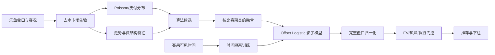
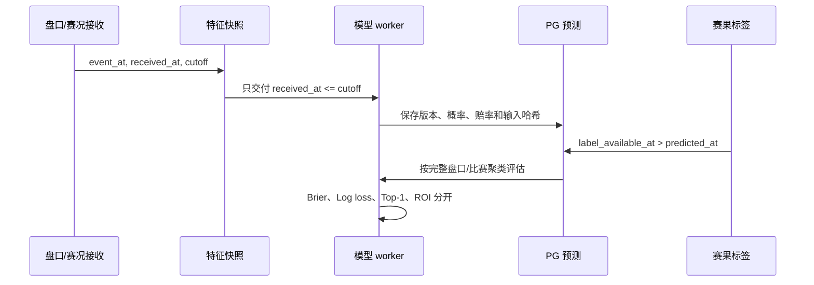
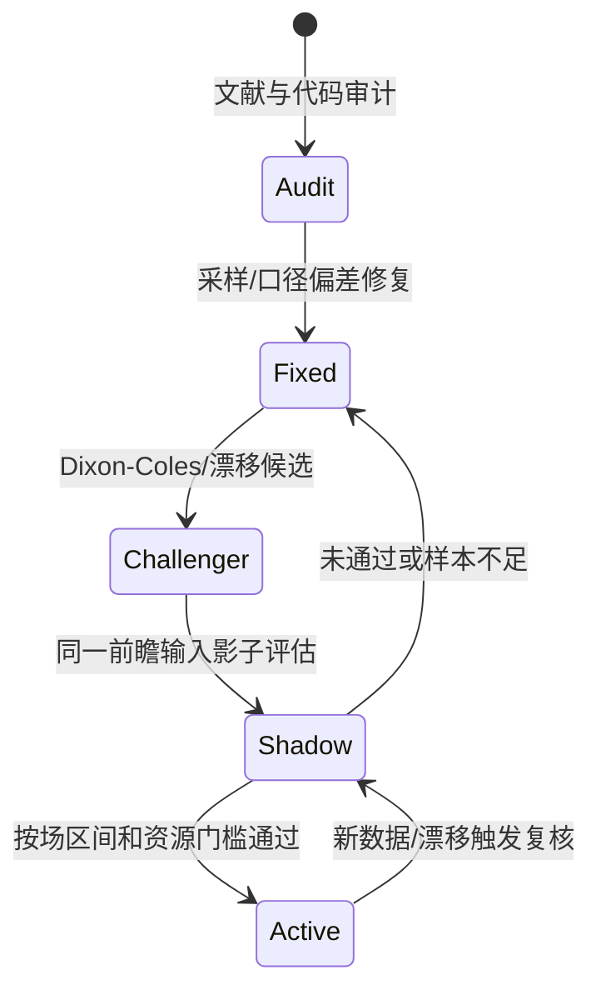

# 决策算法与决策模型文献审计

研究日期：2026-10-13。研究对象是当前工作区 `main` 代码和 PostgreSQL 训练投影；没有开启真实投注，也没有把未晋级候选模型切入生产。文献清单由 OpenAlex Works API 串行抓取，保留查询词、DOI、作者、摘要片段和引用量，见 [`algorithm_papers.csv`](data/algorithm_papers.csv) 与 [`model_papers.csv`](data/model_papers.csv)，两组各 80 篇；开源项目清单由 GitHub 检索 API 获取，算法/模型各 100 个，见 [`oss_algorithm_projects.csv`](data/oss_algorithm_projects.csv)、[`oss_model_projects.csv`](data/oss_model_projects.csv)；两份 manifest 记录检索时间和请求结果。

文献证据分级如下：A 表示源码、原始论文页面或可复核的论文元数据/摘要；B 表示从论文方法抽取的可迁移原则；C 表示工程建议或本项目尚未测量的假设。OpenAlex 元数据不是逐篇全文审阅，因此报告只使用摘要和可核验方法结论，不把外部收益率迁移为本项目效果。

## 结论

当前系统**没有结构性架构错误**，但有三个已确证的 P0 实现缺陷：它们使“模型计算的赢”与“场馆结算的赢”不是同一个事件，并在权重、门控与训练标签中自我强化，已在 [auto-betting-loss-audit](../auto-betting-loss-audit/REPORT.md) 用 160 笔真实订单逐笔定量。其余方向与文献主流一致：赔率作为市场先验，Poisson/盘口支付分布提供结构化概率，按时间和比赛分组做前瞻验证，使用 Brier、Log loss 和校准信息，而不是只看命中率；候选模型还必须和同样本市场基准做配对比较。结论已整理为远程 issue #55（见文末）。

发现了一个确定的实现偏差和一个口径不一致，已经在本轮执行修复：

1. PostgreSQL 训练采样原来对每场使用 `ORDER BY i.at ... LIMIT 40`，只保留最早的 40 条输入；SQLite 路径已经使用均匀时间采样。远程部署因此偏向开场阶段，和代码声明的多时点训练分布不一致。现在改为由已结算比赛驱动的 `LATERAL` 查询，在每场内部按决策时间均匀抽样，保留索引驱动和有界内存。
2. `core.learned_model.metrics()` 原来没有执行与线上推理相同的完整盘口概率归一化，候选 artifact 的训练/验证 Brier 可能和线上输出口径不同。现在先调用完整盘口的 coherent normalization，再计算离线分数；二分类准确率仍保留为诊断指标，HAD Top-1 由 `model_validation.evaluate()` 单独报告。

这两项会影响模型训练分布和离线报告的可比性，但真正解释真实资金亏损的是更早一轮的逐笔对账（[auto-betting-loss-audit](../auto-betting-loss-audit/REPORT.md)）：滚球 AH 以累计比分为结算对象、负号复合盘口解析错误、“经济学风控”把单元素概率归一化为 100%。160 笔可匹配真实订单实际净亏 10.67 元（ROI **-1.41%**），而旧代码把同一批订单算成 **+235.83 元**；修复口径后 160/160 与场馆逐笔一致。缺陷经由算法权重、命中门控和训练标签自我强化，构成“设计方向正确、结果仍然亏损”的完整机制链。修复已落地、自动下注保持关闭；本报告新增的系统总评、亏损归因与开源对照用于回答“接下来怎么优化”。



## 研究方法与文献覆盖

两组文献的检索不是把标题按领域硬凑到篇数上限。脚本对每个查询取公开元数据，按标题和摘要关键词打分、去重并保留原始查询；模型组要求摘要包含 football/soccer/goal/match/sport 之一，算法组覆盖两类：直接体育投注/赔率方法，以及可迁移的概率预测、校准、评分规则、融合、在线学习和风险决策方法。算法组中约 19 篇是直接体育/投注研究，其余是通用于概率决策的统计方法；模型组约 79 篇含足球或足球进球模型。这个区分写入审计表，避免把天气预测论文伪装成足球收益证据。

### 决策算法组（80 篇）

算法清单完整记录在 CSV。代表性方法覆盖：

| 主题 | 代表论文（CSV 中有 DOI/摘要） | 对当前系统的审计启示 |
| --- | --- | --- |
| 概率质量 | Gneiting & Raftery, *Strictly Proper Scoring Rules, Prediction, and Estimation*；Wilks, *Probabilistic Forecasts, Calibration and Sharpness*；Walsh & Joshi, *Machine learning for sports betting: should model selection be based on accuracy or calibration?* | Brier、Log loss、可靠性必须和准确率同时报告；当前已有，且前端已区分 Top-1 与二分类。 |
| 去水与赔率 | Clarke, Kovalchik & Ingram, *Adjusting bookmaker’s odds to allow for overround*；*Betting Markets: Defining odds restrictions, exploring market inefficiencies and measuring bookmaker solvency*；*Is the soccer betting market efficient?* | 比例去水不是普适最优；Power/Shin 只能作为同样本挑战方法，不能凭外部联赛结果切换。 |
| 融合与校准 | *Forecast Combination in Predictive Analytics*；*Ensembles for Time Series Forecasting*；*Enforcing calibration in ensemble postprocessing*；*Learning Calibration Functions on the Fly...Concept Drift* | OOF 生成和时间隔离正确；融合权重还需要跨时间漂移监控和不确定性收缩。 |
| 下注与风险 | Baker & McHale, *Optimal Betting Under Parameter Uncertainty*；Busseti, Ryu & Boyd, *Risk-Constrained Kelly Gambling*；*Extending Kelly Staking Strategies to Peer-to-Peer Betting Exchanges* | Kelly/成交概率是资金决策层，不能被当作提高预测准确率的模型；当前 `q_fill_model` 参数仍是量级示意。 |
| 验证与漂移 | *Time Series Cross-Validation* 相关研究；*A robust machine learning framework for detecting temporal drift...*；*Deployable Machine Learning...Leakage-Safe Prediction and Calibration* | 时间外验证和 label-as-of 约束是必要条件；应补充漂移指标、嵌套调参和多重比较控制。 |

算法组中还包含评分规则、集合预报、概率区间、组合仓位、在线更新、概念漂移和体育市场效率研究。清单中的未来年份条目按 OpenAlex 当前元数据保留为“可检索条目”，不在报告中使用尚未公开验证的效果结论。

### 决策模型组（80 篇）

模型清单完整记录在 CSV。代表性方法覆盖：

| 模型族 | 代表论文（CSV 中有 DOI/摘要） | 对当前系统的审计启示 |
| --- | --- | --- |
| Poisson/动态强度 | Dixon & Coles, *Modelling Association Football Scores and Inefficiencies in the Football Betting Market*；*Dynamic modelling and prediction of English Football League matches for betting*；*Stochastic modelling of football matches* | 当前 Poisson 盘口反演是合理基线，但并非已实现 Dixon-Coles 的低比分依赖和球队强度动态。 |
| 双变量/相关比分 | *On the dependency of soccer scores – a sparse bivariate Poisson model...*；*Who’s the Favourite? A Bivariate Poisson Model...*；*A Bayesian bivariate conditional Poisson regression...* | 独立主客 Poisson 可能错估 0-0、1-0、1-1 和平局；应作为挑战模型做同样时间外消融。 |
| 机器学习 | *Machine Learning in Football Betting*；*Data-driven prediction of soccer outcomes using enhanced machine and deep learning techniques*；*Soccer match outcome prediction with random forest and gradient boosting models*；*Predicting match outcomes in football by an Ordered Forest estimator* | 树/神经网络不是自动优于市场；需限制容量、校准并记录训练资源，当前 offset Logistic 的保守门控是正确方向。 |
| 滚球模型 | *A Bayesian In-Play Prediction Model for Association Football Outcomes*；*Forecasting the opening goal in second-half...*；*A big data analysis of Twitter data...in-play forecasting* | 事件只有在 cutoff 前可靠收到才可用；当前 `visible_history` 和双时间契约遵守这一点，事件增益仍需消融。 |
| xG/事件 | *A Goal Scoring Probability Model for Shots...*；*A new xG model for football analytics*；*A machine learning approach for player and position adjusted expected goals* | 当前系统没有独立 shot/xG 数据，不能把比分和赔率特征称作 xG；外部 xG 论文只支持未来数据接入研究。 |
| 深度模型 | *Deep learning for football outcomes prediction based on football rating system*；*Predicting Soccer Match Outcomes Using Deep Learning: LSTM*；*Large-Scale In-Game Outcome Forecasting...Axial Transformer* | 在没有足够独立赛事和 GPU 预算前，深度模型会增加过拟合和延迟风险，不应直接替换当前路线。 |

## 当前实现逐项审计

| 维度 | 论文共识 | 当前实现 | 结论 | 处理 |
| --- | --- | --- | --- | --- |
| 市场先验 | 赔率是强基线，模型增益必须和同样本市场比较 | `p_market` 作为 offset，候选晋级比较 market Brier/Log loss | 一致 | 保持 |
| 盘口支付 | 亚洲盘要按完整盘口和半赢/半输结算 | `settle_with_basis`、完整组选择、半注权重 | 一致 | 保持并继续按组统计 |
| 时间泄漏 | 训练输入只能使用决策截点前可见信息 | cutoff、decision/quote received 时间和 label availability 均校验 | 一致 | 增加自动审计计数 |
| 训练分组 | 同一比赛多个盘口/时点不是独立样本 | 训练按比赛归一权重，paired bootstrap 按比赛聚类 | 一致 | 保持 |
| 概率校准 | 先 OOF，再在未来校准集评估 | OOF peer/calibration、Brier/Log loss/ECE | 基本一致 | 增加校准漂移监控 |
| 训练采样 | 采样不能只取某一比赛阶段 | PG 曾取最早 40 条，SQLite 均匀采样 | **实现偏差** | 已改为 PG 每场均匀时间采样 |
| 线上/离线口径 | 评估必须复现线上归一化和盘口约束 | `metrics` 曾跳过 coherent normalization | **口径偏差** | 已修复并加回归测试 |
| 进球分布 | 低比分相关性和时变强度需要专门模型 | 独立 Poisson + 盘口反演 | 基线限制 | P1 研发 Dixon-Coles/bivariate challenger |
| 多算法融合 | 相关模型不能被误当独立投票 | 同一盘口多算法，Beta/Brier 收缩和权重 cap | 基本合理 | 加相关性/漂移诊断 |
| 模型不确定性 | 概率误差应进入仓位和晋级 | 晋级 bootstrap；下注为 fractional Kelly + 启发式 q_fill | 预测与资金层尚未完全闭环 | P1 估计参数不确定性 |
| 调参选择 | 多次看测试集会造成选择偏差 | 固定滚动折，尚无系统的嵌套调参记录 | 优化缺口 | P1 增加预注册搜索与独立前瞻集 |
| 漂移 | 市场/联赛/盘口结构变化需监控 | 只保存版本和窗口指标 | 优化缺口 | P1 增加 PSI、分层 Brier、报警 |
| 事件特征 | 事件必须有可审计发生/接收时间 | 仅 verified red-card context；未知事件不解释 | 一致 | 保持保守输入 |



## 系统设计合理性总评

| 维度 | 结论 | 依据 |
| --- | --- | --- |
| 概率建模路线 | **合理** | 赔率先验 + Poisson 盘口反演是文献主流基线；全盘口归一化、proper scores、市场配对比较均已具备 |
| 验证设计 | **基本合理** | 时间隔离、按比赛聚类、前瞻预测时间校验正确；缺漂移监控、嵌套调参和 CLV |
| 资金决策层 | **不合理（部分修复）** | Kelly 只存在于展示层（≤25%），执行层固定 5 元且无全局未结算敞口；与文献及开源注码层共识不符 |
| 信息独立性 | **不合理** | 五个算法共享同一 OU/HAD 输入；方法分歧不是新增信息，同庄家公平赔率期望恒为 `-m/(1+m)` |
| 结算与执行 | **曾严重错误（已修复）** | AH 结算对象、负号解析、标量归一化三个 P0；订单终态对账仍缺 |
| 工程纪律 | **合理** | 版本化、影子部署、旧数据隔离、未知回执不重发、报价新鲜度检查 |
| 数据覆盖 | **受限** | 单庄单源、无事件/xG、无第二市场价格参照、无 CLV |

总评：**方向合理、执行曾有严重缺陷、信息源单薄**。文献与开源对照同时支持三点：(1) 以赔率为先验、只信 proper scores 与同市场配对比较的框架正确；(2) 资金决策层必须与预测层闭合（分数 Kelly、回撤约束、全局敞口），当前尚未闭合；(3) 单一庄家赔率源是信息上限而非 bug——它使系统难以区分“模型错”与“价格错”。修复三个 P0 只恢复可评价性，不产生正期望：修正后同 160 笔的 ROI 聚类区间仍跨零。

## 亏损归因：为什么真实资金会亏

文献与开源对照只能回答“设计方向是否正确”，真实亏损需要逐笔证据。[auto-betting-loss-audit](../auto-betting-loss-audit/REPORT.md) 对 165 笔场馆已结算订单做了完整核验（证据等级 A），机制链如下：

| 因果层 | 机制 | 实测证据 | 处置 |
| --- | --- | --- | --- |
| 直接原因 | 滚球 AH/AH_1H 用累计比分而非“下注后净胜球”结算 | 160 笔旧代码重算 +235.83 元 vs 场馆实际 -10.67 元；改为剩余比分后 143/160 一致 | 已修（`settle_with_basis` + 剩余进球分布） |
| 直接原因 | `-0/0.5`、`-0.5/1` 等复合盘口第二半注符号丢失 | 只修比分仍有 17 笔不符，继承负号后 160/160 一致 | 已修（`split_line` + 真实回执回归） |
| 直接原因 | 单元素向量收缩被归一化为 p=1.0 | 17,570 条 `live_forecast` 的 `economics_risk_adjusted` 全为 1.0 | 已修（完整 Bernoulli 向量） |
| 放大器 | 错误结算 → 算法权重、命中门控、训练标签 | 735,839 条可恢复标签输入中 79,972 条赢/输翻转；旧模型修正标签后 59.88% / Brier 0.22748，落后市场 63.53% / 0.21773 | 旧数据版本全部隔离 |
| 放大器 | 命中次数 ≠ 优势：5 胜 995 负仍可下单；执行层不用 Kelly | 代码与离线诊断 | 已加版本/ROI/独立比赛数门槛；全局资金预算仍缺（P2） |
| 结构性 | 同源赔率被当独立信息；同一庄家去水后期望为负 | 五算法共享同一 OU/HAD 推导 | 需第二价格源与 CLV（P1/P2） |

**“看起来设计合理、结果还是亏”的完整解释**：方向正确 + 三个实现缺陷让“模型计算的赢”和“场馆结算的赢”不是同一个事件，于是模拟利润是假的（同批订单由 +235.83 元修正为 -10.67 元），错误标签又自我强化地挑选“已领先球队”。修复后真实订单仍是 -1.41%（95% 聚类区间 -11.52%～+8.26%），没有证据表明存在正优势——这是先熄火、再验证的依据。

## 开源项目对照审计（算法 / 模型各 100 个）

为交叉验证设计合理性，除 160 篇论文外，另以固定查询从 GitHub 采集两个各 100 个项目的可复核目录（查询词、命中数与检索时间见 `data/oss_manifest.json`）。证据等级：**A** 为仓库元数据与描述原文（未逐个审阅源码，不以 star 数推断效果）；**B** 为从主流项目设计抽取的可迁移模式；**C** 为本项目建议。

### 算法组（投注决策 / 概率 / 风险）

| 设计簇 | 代表项目（stars） | 主流做法 | 当前系统 | 判定 |
| --- | --- | --- | --- | --- |
| 套利 / 交易所 | `pretrehr/Sports-betting`(536)、`HintikkaKimmo/surebet`(88)、`odds-api`(33) | 跨庄家对齐同一事件、以交易所价格做参照 | 单一来源（乐鱼），无第二价格 | **缺口**：无法区分模型错与价格错 |
| 价值投注 / EV | `DevanshDaxini/Sports-EV-Bot`(12)、`Sanju311/plusEV-odds-finder`、`brodyautomates/sports-betting-intelligence` | 多庄家扫描 + 收盘线比较 | 单庄家 EV，无收盘线/CLV | **缺口**：P1 记录 CLV |
| Kelly / 注码 | `subodh101/bet-optimizer`、`sergeisukhovmkt/...Drawdown-Constrained-Kelly`、`jensolson/Kelly-Criterion-optimal-betting` | 分数 Kelly + 回撤约束 + 参数不确定性 | 展示层 ≤25%，执行层固定 5 元 | **脱节**（已确认） |
| 去水 / 隐含概率 | `stuartread7/Unibet-Scraper`、`carterlasalle/SportsArbFinder`(16) | 多方法去水（proportional/power/Shin）并保留分歧诊断 | 5 种方法 + 分歧诊断 | **一致** |
| 概率校准 | `FilippoMB/Ensemble-Conformalized-Quantile-Regression`(104)、`turingism/worldcup-predictor` | 校准 + 预测区间/覆盖 | Brier/Log loss/ECE | **基本一致**；缺漂移监控 |
| 回测 / 验证 | `kernc/backtesting.py`(9040)、`ml4t/backtest`(31)、`fasiondog/hikyuu`(3560) | 事件驱动、可配置成交与费用、防前视 | 时间隔离 + 报价时点校验 | **一致**；缺嵌套调参与候选登记 |
| 组合 / 风控 | `ml4t/backtest`、`AllenLiu45/LightQuant`(15) | 组合级敞口、回撤、相关性约束 | 单场计算上限，无全局占用 | **缺口**（已确认） |

### 模型组（比分 / 滚球 / 事件）

| 设计簇 | 代表项目（stars） | 主流做法 | 当前系统 | 判定 |
| --- | --- | --- | --- | --- |
| Poisson / Dixon-Coles | `martineastwood/penaltyblog`(236)、`octosport/octopy`(77)、`scibrokes/dixon-coles1996`、`jpmouracodex/football-mle` | 低比分相关性 + 时变强度 | 独立 Poisson + 盘口反演 | **基线合理**；DC/bivariate 挑战是共识路径 |
| Elo / 评级 | `Hicruben/world-cup-2026-prediction-model`(93)、`avpv/team-balance` | Elo 作为长期强度先验 | 无独立评级，HAD 缺失即停 | **可选**：仅在缺少 HAD 时需要 |
| xG / 事件 | `ML-KULeuven/soccer_xg`(261)、`eddwebster/football_analytics`(2808)、`Dato-Futbol/xg-model`(81) | shot 级事件特征 | 无 shot/xG 数据，不冒充 | **诚实边界**；接入需事件源与接收时间契约 |
| 机器学习 | `kochlisGit/ProphitBet`(580)、`MauroAndretta/AIFootballPredictions`(62)、`abailey81/MatchOracle` | 容量限制 + 校准后与市场比较 | 30 参数 offset Logistic（shadow） | **方向一致**，暂不升级复杂度 |
| 滚球 / in-play | `martineastwood/penaltyblog`、`umitkaanusta/MacTahminBotu`(26) | 状态相关强度 + 事件更新 | 无已验证事件特征 | **缺口**：P3 在接收时间契约下消融 |
| 蒙特卡洛 / 模拟 | `vickyfriss/football-league-predictions`、`manuelpeba/world-cup-2026-forecast` | 全赛季/锦标赛模拟 | 单场完整盘口分布 | **一致**（目标是盘口结算，不是赛季模拟） |

从 200 个项目抽取的三条共性模式（B）：(1) 成熟方案普遍以**多庄家/交易所报价**作为独立信息源，单源是当前系统与主流最大的结构性差距；(2) 注码层普遍把**回撤约束与参数不确定性**写进公式，而不是只放一个 Kelly 上限；(3) 验证层普遍区分**收盘线价值（CLV）**与命中率，当前系统还没有 CLV 字段。

## 已执行优化

### 1. PostgreSQL 训练采样修复

修改 [store/training_data.py](/root/ai_football/store/training_data.py) 的 `_postgres_training_sample_query()`：

- 仍由已结算比赛集合驱动 `CROSS JOIN LATERAL`，避免 2300 万行输入的全局排序。
- 每场在 `at, algorithm, market, line, outcome` 的稳定顺序上计算 `ROW_NUMBER` 与 `COUNT`。
- 用 `MOD((row_number - 1) * cap, total) < cap` 选出均匀时间样本。
- 状态中的采样口径从 `earliest_qualified_inputs_per_match` 改为 `evenly_spaced_per_match`。

这样保留同场多盘口和多算法，同时不把训练分布锁死在最早 40 条报价。

### 2. 离线指标与线上概率空间统一

修改 [core/learned_model.py](/root/ai_football/core/learned_model.py) 的 `metrics()`：先对完整 HAD/OU/AH 组调用 `coherent_probabilities()`，再计算 Brier、Log loss 和二分类诊断。生产推荐方向仍使用同一组归一化概率，HAD Top-1 仍由 `model_validation.evaluate()` 单独报告。

### 3. 回归验证

已执行：

```text
./scripts/cpu-limited.sh run -- python3 -m unittest \
  tests.test_training_data tests.test_learned_model tests.test_model_training -q
Ran 31 tests ... OK
```

新增/更新测试覆盖了 PG 均匀采样 SQL、采样口径、时间边界和模型训练路径。完整流水线在最终交付前继续执行；远程 PostgreSQL 查询本身不在宿主机伪造验证，需通过 model-worker 容器的真实配置复核执行时间和返回行数。

## 后续优化计划

这些是优化项，不是当前生产致命缺陷；按优先级执行，不改变真实投注金额：

| 优先级 | 事项 | 验收门槛 |
| --- | --- | --- |
| P0 | 在 model-worker 真实 PG 上比较修复前后每场采样的时间分位数、盘口/算法覆盖和查询耗时 | 采样不集中在前 10% 比赛时间；查询 p95 在训练墙钟预算内；标签可见时间审计为 0 泄漏 |
| P1 | Dixon-Coles/稀疏双变量 Poisson 挑战模型 | 3 个滚动时间折至少 2 折优于市场，按场 Brier 95% CI 上界 < 0，且资源/推理延迟合格 |
| P1 | 漂移与分层校准监控 | 按盘口、联赛/比赛类型、赔率分箱输出 Brier、ECE、覆盖、样本独立比赛数；异常才报警 |
| P1 | 嵌套时间调参和候选登记 | 调参集、校准集、最终测试集不重叠；每次候选记录搜索空间和停止原因 |
| P2 | 盘口线迁移和跨市场相关风险 | 同场联合收益与最大回撤进入门控，避免把多个相关盘口当独立下注 |
| P2 | 用真实提交/改价日志估计 q_fill 和执行成本 | q_fill 分层 Brier/校准通过；实测成本替代当前量级示意参数 |
| P2 | 同场多线/多方向的联合风险预算与最大回撤纳入门控 | 同场累计敞口有硬上限；模拟回撤不超预算 |
| P1 | 记录收盘线并计算 CLV（收盘线价值） | 每笔推荐保留收盘价快照；CLV 分布与校准指标同时报告 |
| P2 | 第二来源报价对照（交易所/多庄家） | 与乐鱼同一事件可对齐；分歧时只记录不自动下单 |
| P3 | 可靠事件输入的增量消融 | 同一时间窗口加入事件后，独立前瞻 Brier/Log loss 改善且不存在接收延迟泄漏 |



## 远程 issue：已发布

用户要求把建议发布到远程仓库。已于 2026-10-13 在 [1420970597/ai_football](https://github.com/1420970597/ai_football) 发布 **issue #55：决策链路文献与开源审计 —— 亏损归因、设计合理性与 P0–P3 优化建议**，正文包含：三个 P0 缺陷的逐笔证据、系统设计总评、P0–P3 优化清单与验收门槛、恢复自动下注的停牌条件，并交叉引用 #52（P0-P4 优化计划）与 #41（经济学+LLM 配对评估）。本文档与 `data/` 清单是该 issue 的证据附件。

只有出现以下任一证据才**重开/升级**：

- 新版本标签累计 ≥100 场后，前瞻校准/Brier 仍不能在同一集合上优于市场基准；
- 修复后的采样仍在特定比赛阶段偏斜，且导致滚动 Brier/收益显著变化；
- 生产路由绕过 `promotion.approved` 使用候选模型；
- 完整盘口组在写入、评估或下注之间发生身份丢失，导致同一合约重复执行；
- 出现 `label_available_at <= predicted_at` 的新训练/影子记录。

## 复现与边界

```bash
python3 -m py_compile reports/decision-algorithm-model-audit/scripts/collect_literature.py \
                        reports/decision-algorithm-model-audit/scripts/collect_oss.py
python3 reports/decision-algorithm-model-audit/scripts/collect_literature.py
python3 reports/decision-algorithm-model-audit/scripts/collect_oss.py
./scripts/cpu-limited.sh run -- python3 -m unittest \
  tests.test_training_data tests.test_learned_model tests.test_model_training -q
python3 reports/decision-model-accuracy/scripts/md_to_html.py \
  reports/decision-algorithm-model-audit/REPORT.md \
  reports/decision-algorithm-model-audit/REPORT.html
```

论文与开源项目样本来自公开元数据 API，检索结果会随数据库更新；两份 CSV 中的查询词和时间戳用于复核。报告不承诺任何盈利，不执行真实下注，也不把候选模型当前 26 场前瞻窗口当作稳定准确率。
