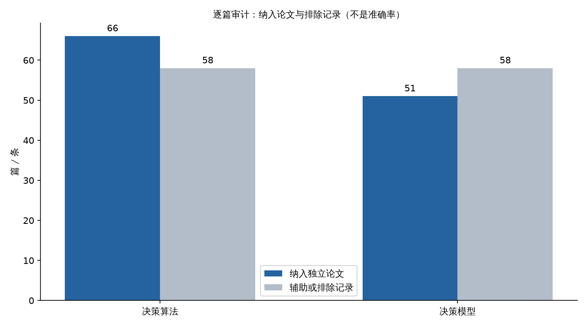
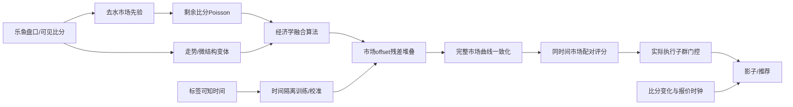
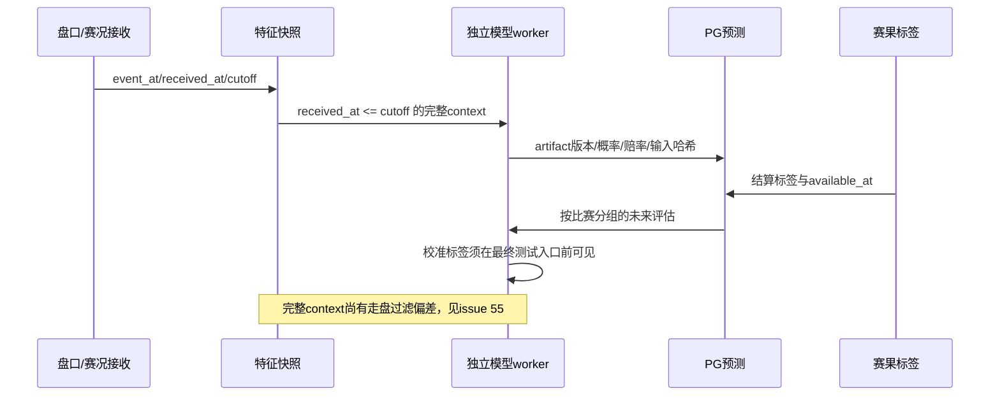
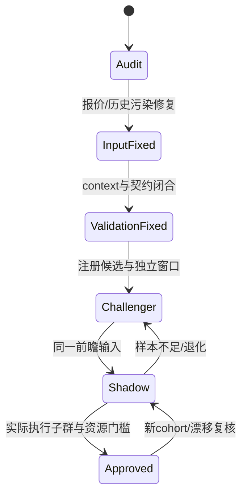

# 决策算法与决策模型：117篇独立论文与当前实现审计

文献与PG测量日期：2026-10-13；最终整合复核：2026-10-14。审计分支为 `fix/TASK-55-literature-validation-audit`，整合最新主分支 `f2d1aa6`（含已合并的 #60、#61）。源码、摘要来源、修复、历史证据和生产测量分别标明；工作区中其他任务的未提交修改不作为本PR实现。

## 1. 结论与交付边界

严格纳入**决策算法66篇、直接足球决策模型51篇独立论文**，均超过各50篇的要求。逐篇来源、方法、代码映射、排除理由、适用性和阅读深度见[算法审计CSV](data/algorithm_paper_audit.csv)与[模型审计CSV](data/model_paper_audit.csv)。这是**元数据/摘要级审计**，全文阅读与论文实验复现均为0，不能称117篇全文系统综述。

市场先验、残差学习、时间外验证和按比赛聚类的方向有文献依据。但已确认的采样、校准时间泄漏、评估与持久化参数不一致、汇总指标掩盖执行子群退化会使验证结论失真，属于重大实现偏差。相关代码已在本分支修复；仍未闭合的问题已发布到[issue #55](https://github.com/1420970597/ai_football/issues/55)，包括完整预测上下文、旧模型晋级契约、真实执行敞口、影子走盘本金和训练调度。

其他agent在[issue #58](https://github.com/1420970597/ai_football/issues/58)提供了进球后旧价格与虚拟赛误分类证据。本次整合其已合并的[#60报价冷却修复](https://github.com/1420970597/ai_football/pull/60)及[#61七坐标堆叠学习器](https://github.com/1420970597/ai_football/pull/61)，保留本分支的验证修复。先修输入和评价的有效性，再验证模型增量；没有证据支持仅调高阈值或增加参数就能获得正收益。

本轮未提交真实投注、未晋升候选、未部署本PR。#58中的生产关闭下注和上线结果属于另一agent的报告，本次不将其称为自身部署验证。

## 2. 纳入规则与论文覆盖

| 轨道 | 审计记录 | 严格纳入独立论文 | 未纳入 | 阅读深度 |
| --- | ---: | ---: | ---: | --- |
| 决策算法 | 124 | **66** | 58 | 28元数据+摘要、22保存摘要片段、16元数据与既有方法核验 |
| 决策模型 | 109 | **51** | 58：29辅助、29排除 | 44 OpenAlex摘要、3出版社登记摘要、3 arXiv摘要、1机构摘要 |

算法组有65个独立DOI与1条可核验无DOI来源；4篇直接体育研究、62篇可迁移统计/经济方法。模型组51个不同DOI，42篇期刊文章、6篇会议论文、3篇预印本。跨轨道纳入DOI重叠为0。独立论文不等于独立数据集：若干模型论文复用Soccer Prediction Challenge样本。

证据分级：**A** 为本仓库可核验源码/测试/测量和原作者、机构、出版社登记材料；**B** 为聚合摘要与方法迁移；**C** 为待测工程假设。44篇模型组OpenAlex摘要本轮未逐一对照原出版物；算法组16篇只有元数据与既有方法核验，不能将未读全文的实验细节当作已确认结论。[算法审计说明](data/algorithm_review_notes.md)、[模型审计说明](data/model_review_notes.md)逐项保留限制。

去重同时核对DOI、题名、作者和版本。NFL、球员位置/门将/疲劳、合作价值等错目标条目排除；xG/action-process、书章、综述、信息时点未明的候选不计入直接模型门槛。高准确率但无时间设计/指标口径的记录不用于参数调优。模型审计披露了Kaggle数据赛季矛盾、摘要拼接污染、重复期刊/预印本版本等情况，没有据此断言论文造假。访问遇到Crossref 429、出版社403等限制均保留记录。



图由[审计数量CSV](data/audit_summary.csv)和`make_figures.py`重现，使用WenQuanYi中文字体。改变严格性只会改变覆盖数量，不会使文献自动成为生产收益证据；不使用主观分数冒充测量值。

### 算法论文的关键对应

| 方法族 | 可核验代表论文 | 当前代码/判断 |
| --- | --- | --- |
| 概率评分 | Gneiting & Raftery, Strictly Proper Scoring Rules（[DOI](https://doi.org/10.1198/016214506000001437)）；Brier（[DOI](https://doi.org/10.1175/1520-0493%281950%29078%3C0001:VOFEIT%3E2.0.CO;2)） | `core/model_validation.py`、`core/learned_model.py`；Brier/log loss与准确率分开 |
| 融合/stacking | Wolpert, Stacked generalization（[DOI](https://doi.org/10.1016/S0893-6080%2805%2980023-1)）；Breiman, Stacked regressions（[DOI](https://doi.org/10.1007/BF00117832)） | `core/ensemble.py`、`core/oof_peer.py`；同源算法数量不等于独立信息数量 |
| 校准 | Beta calibration（[DOI](https://doi.org/10.1214/17-EJS1338SI)）；Stable reliability diagrams（[DOI](https://doi.org/10.1073/pnas.2016191118)） | `core/probability_calibration.py`；挑战方法需时间外校准，不能用测试标签拟合 |
| 去水 | Štrumbelj（[DOI](https://doi.org/10.1016/j.ijforecast.2014.02.008)）；Clarke等（[DOI](https://doi.org/10.11648/j.ajss.20170506.12)） | `core/devig.py`；proportional/power/Shin不是本身的优势来源 |
| 多重搜索/漂移 | White Reality Check（[DOI](https://doi.org/10.1111/1468-0262.00152)）；Hansen SPA（[DOI](https://doi.org/10.1198/073500105000000063)）；concept drift survey（[DOI](https://doi.org/10.1145/2523813)） | 当前缺完整候选登记、嵌套搜索与分层漂移监控 |
| 不确定性/资金 | Baker & McHale（[DOI](https://doi.org/10.1287/deca.2013.0271)）；Risk-Constrained Kelly（[DOI](https://doi.org/10.3905/joi.2016.25.3.118)） | `core/economics.py`有函数；`service/betting.py`未有全局原子预算闭环 |

66篇的完整结论逐行保存于CSV；天气等研究只用于评分/校准方法迁移，不当作足球盈利证据。

### 模型论文的关键对应

| 模型族 | 可核验代表论文 | 与本实现的关系 |
| --- | --- | --- |
| 独立/低比分Poisson | Maher（[DOI](https://doi.org/10.1111/j.1467-9574.1982.tb00782.x)）；Dixon & Coles（[DOI](https://doi.org/10.1111/1467-9876.00065)） | `core/live_model.py`是市场反推剩余比分基线，并非已实现动态球队能力或低比分ρ |
| 动态/双变量 | Dixon & Robinson（[DOI](https://doi.org/10.1111/1467-9884.00308)）；Karlis & Ntzoufras（[DOI](https://doi.org/10.1111/1467-9884.00366)）；Koopman & Lit（[DOI](https://doi.org/10.1111/rssa.12042)） | 相依比分、状态强度是挑战方向，需同窗口消融 |
| 历史数据+赔率 | Combining historical data and bookmakers' odds（[DOI](https://doi.org/10.1177/1471082X18798414)） | 当前独立球队历史/评级信息不足；多数peer仍由同源盘口产生 |
| 树/领域知识 | Relational gradient boosted trees（[DOI](https://doi.org/10.1007/s10994-018-5704-6)）；domain knowledge（[DOI](https://doi.org/10.1007/s10994-018-5747-8)） | 先确认可见特征和增量，再增加容量 |
| 滚球模型 | Bayesian In-Play Prediction Model（[DOI](https://doi.org/10.3390/app10082904)）；Stochastic modelling（[arXiv](https://arxiv.org/abs/2312.04338)） | 事件、阶段与补时需要可靠时钟；不能使用决策后的走势 |
| 深度预测 | Deep learning framework（[DOI](https://doi.org/10.1007/s42452-019-1821-5)）；2024评估研究（[DOI](https://doi.org/10.1007/s10994-024-06608-w)） | 复杂度不保证优势；目前资源和独立样本优先支持小模型 |

## 3. 最新系统架构与公式



#61已将原60坐标梯度残差学习器改为**7个可估计坐标**：截距、融合算法残差、5个peer算法残差；其余权重为0。保存的权重向量仍长60，因此应区分`parameter_count=60`与`active_parameter_count=7`。本分支保留该实现，并保留明确分区、持久化权重最终测试和执行子群门槛。

概率形式为 `p = sigmoid(logit(p_market) + w · residual_vector(x))`；市场logit是固定offset，权重全0时回到市场。peer经训练期/OOF校准，再投影到完整盘口的概率空间。市场OU/HAD反推Poisson不等于独立球队强度、xG、红牌hazard或Dixon-Coles；已验证可见的部分赛况进入特征也不等于完整事件编码。

训练不是强化学习。它以已结算标签监督拟合，按比赛权重而非相邻报价独立计权；模型推理/训练仍由worker承担。默认训练/较早验证预算24/12，#61 Newton求解另设最多30次；这是CPU资源取舍，不能从迭代次数宣称准确率提高。



## 4. 实现偏差、修复与未完成项目

| 审计项 | 原问题/当前限制 | 本PR状态 |
| --- | --- | --- |
| PG取样 | 每场按最早输入LIMIT40，偏向早期；SQLite MOD也欠采样 | 已改时间分层完整曲线 |
| 全局校准 | 使用最终测试入口尚不可知的标签 | 已按settled_at严格排除 |
| 最终认证 | 验证的是另一次临时fit而非保存权重/peer校准 | 已复用持久化参数和明确分区 |
| 概率后处理 | `metrics`、live/hybrid的coherence路径不一致 | 已统一函数；完整context仍未等价 |
| 执行子群 | 辅助算法提升可掩盖真正执行的ensemble退化 | 已要求economic_ensemble单独过门槛 |
| 走盘/无评级 | `target is None`在推理前过滤，改变跨线context | **重大未解决项，#55** |
| 旧artifact | 旧approved可沿用，缺独立验证契约版本 | **重大未解决项，#55** |
| 资金执行 | 固定注额/置信度倍数没有兑现展示Kelly/全局敞口 | **重大未解决项，#55** |
| 影子收益 | 继承实现的分类过滤漏计走盘本金 | **重大未解决项，#55；不随本PR提交** |
| 训练调度 | active未替换可能重复消费cohort；check-only仍全量载入 | **#55后续优化** |
| 迁移工具 | 新空PG创建预测表缺双receipt-clock列 | **#55，独立迁移验收** |

执行子群合成反例：120场、5个辅助算法加ensemble时，pooled Brier delta为−0.09875且区间全负，旧门控批准；实际ensemble Brier从市场0.2025退化到0.4225。新增门槛正确拒绝。它是单元测试反例，不是生产收益测量。

完整context反例：OU2.5概率[.4,.6]与OU3概率[.7,.3]同时投影为[.55,.45,.55,.45]；3球赛果使OU3双向走盘被过滤后，离线只剩[.4,.6]。必须先完整推理再graded mask计分，不能把走盘伪造成二元标签。

## 5. 对其他agent issue的复核与分歧

| 来源 | 可采纳结论 | 必须保留的边界 |
| --- | --- | --- |
| #58逐帧回放 | 进球后旧价可以在年龄门槛内被误判fresh；模拟利润被不可成交价格放大 | 一小时回放是机制证据，不是全库统计；本次未重新跑全量生产对账 |
| #58 ROI附件 | 本地233场订单按决策赔率重算ROI −8.53%，聚类区间[−17.52%,+0.29%] | 不是场馆权威已结算盈亏；与TASK-40样本/时间/口径不同 |
| #60已合并 | 45秒默认比分变化冷却、报价晚于变化+冷却、执行同检查；N分钟虚拟赛识别 | 旧历史台账/训练分类未重标；冷却长度是策略参数，不是普适最优 |
| #61已合并 | 7坐标堆叠候选、60维artifact格式；报告称尚未过晋级门 | 其benchmark不是本PR完整context/执行子群认证；需新独立数据复核 |

同源算法不提供额外外部信息，但跨盘口约束是否有可成交增量必须实测，不能仅从同源断言所有定价方法必然无效。对于比例去水的同一完备市场，若`S=sum(1/odds)>1`，`q=(1/odds)/S`，则`odds*q−1=1/S−1<0`；这不是所有去水方法或跨盘口策略的无盈利定理。

外部锐价、独立球队历史/事件、校准与状态建模都是可研究增量，不将“外部参照是唯一盈利路线”视为已证定理。也不把30/60秒未来同盘口变化直接称为公平CLV：必须区分同状态、状态变更、半场/全场基准和未成交报价，否则新的指标仍会混入比分事件。

#58涉及密钥/API权限建议作为独立安全事项引用；本轮没有轮换用户凭据、采购数据源或更改真实下注开关。历史污染必须先隔离/重标，然后重新建立权重和训练基线；只修当前输入不能自动使旧利润和旧模型有效。

## 6. 成熟方案对照与后续优化顺序

下表是**定性工程评估，不是测量分数**；代表成熟工具以官方资料为参照，未执行其本机速度对照。

| 方案 | 接入层级 | 数据要求 | 盘口完整性 | 资源/延迟 | 校准/验证 | 维护成本 | 本项目适用性 |
| --- | --- | --- | --- | --- | --- | --- | --- |
| [penaltyblog](https://penaltyblog.readthedocs.io/) Poisson/DC/双变量 | 比分预测 | 历史球队结果/赔率 | 比分分布支持AH/OU | 小-中；需实测 | 需自建时间外评估 | 中 | 候选基线，不能冒充已实现 |
| [scikit-learn](https://scikit-learn.org/stable/modules/linear_model.html#logistic-regression) Logistic/校准 | 概率预测 | 冻结特征与标签 | 需外部coherence | 小；offset需专门实现 | 支持常规校准，时序契约由项目负责 | 低-中 | 当前手写offset路线参照 |
| [LightGBM](https://lightgbm.readthedocs.io/) | 非线性预测 | 足量独立特征 | 需外部支付/context | CPU中等；需限制线程 | 需时间外校准 | 中 | 后续挑战者，不直接替换 |
| [PyTorch](https://pytorch.org/docs/stable/) 序列/事件网络 | 序列预测 | 大量可见事件与历史 | 需外部结算/context | 高；训练资源压力大 | 全部由项目验证 | 高 | 当前不优先 |

优化先后：输入可成交性/历史污染 → 完整context与契约 → 可信概率/收益评估 → 增量信息与候选调参 → 资金执行。正CLV、低Brier或高胜率各自只证明相应指标，不能单独推出正净收益。

| 优先级 | 任务与状态 | 验收标准 |
| --- | --- | --- |
| P0 | 最新报价冷却/虚拟赛新规则：#60已合并，本分支保留 | 不回退新规则；历史污染隔离另验收 |
| P0 | 本PR采样/时间/持久化/执行子群：已实现 | 正常+泄漏/退化回归通过；数据与artifact可追溯 |
| P1 | 完整context与graded mask：#55待实现 | 走盘、半赢半输、缺方向、无评级的线上/离线逐方向概率一致 |
| P1 | validation-contract版本：#55待实现 | 旧artifact拒绝；load/shadow/rollback/promotion统一检查 |
| P1 | 历史旧价/虚拟赛污染隔离、shadow收益口径 | 走盘计本金1利润0；分类和完整收益样本分离；同场去重清晰 |
| P1 | 资金原子预占/释放与回执对账：#55待设计 | 并发/未知回执/重试不超单场和全局预算 |
| P2 | 最近训练cohort独立进度、增量check-only | 新比赛训练期间不丢；未晋级不重复fit；探针不全量重载 |
| P2 | 候选登记/nested时间调参/漂移 | 调参/校准/最终测试分离，按盘口/联赛/时段报独立比赛数 |
| P2 | 外部价格或独立球队历史；DC/动态强度/事件消融 | 同一前瞻窗口配对Brier CI上界<0、log loss不劣，至少3折中2折改进；执行子群和资源另过门槛 |
| P2 | 状态可比的CLV与成交成本 | quote/state/成交价可追溯；未来事件分层，缺价不伪填0 |

训练24/12预算和报价45秒冷却均是可调配置；更改预算应重跑同一冻结评估，改变冷却应衡量状态污染/推荐覆盖/可成交性，不能凭默认值宣称最优。执行子群100场门槛是最低样本约束，仍要求配对置信区间；放宽为50场可能降低检出可靠性，加严到200场可能延迟晋级，均不消除context偏差。



## 7. 真实PG采样与性能

[PG数据加载附件](data/pg_dataset_verification.json)记录一次只读repeatable snapshot检查：978.4195秒（约16.3分钟），SQL 973.9919秒，35批、每批最多64个标签比赛，最慢批55.0012秒。检查50,075行，得到47,437有效行/1,057场；未评级2,638、缺标签0。2,193标签比赛中1,136场无匹配输入；9,508时间桶中1,959空桶。

PG最多8个索引驱动时间桶，SQLite按稳定时间点分桶，采样单元为完整`(match_id,at,algorithm,market)`曲线，保留所有盘口线/方向。因此40行是**软目标**：每场最大87，均值47.3746，没有40行硬上界；内存需按真实行数预算。目录估计25,371,612行/957场与本次1,057场抽样口径不同，`full_audit_complete=false`，不能当作全库准确计数。

[PG采样fixture附件](data/pg_sampling_verification.json)覆盖HAD单/多点、OU多线、无效receipt-clock整曲线拒绝和重复检查。生产5519689有75行/8点/36完整line组；5767981有43行/7点但1个源方向组不完整。采样保留曲线不修复上游已缺失的数据。单次加载与批次最慢值不是p95，也不是训练一轮时长；新#60/#61尚未重跑该生产抽样。

## 8. 验证与复现

先前冻结选择性PR树Python3.12 Docker unittest：1,604项、跳过14、92.202秒、退出码0；mypy116文件、ruff退出码0。包括继承修改的旧工作区：1,626项、跳过11、55.592秒、退出码0。实际命令与源文件git blob哈希见[验证附件](data/validation_results.json)。最新#60/#61整合后的冻结树全量测试1,618项、跳过14、90.143秒，mypy118文件、ruff、182个Python文件编译均退出码0。初次整合全量测试和单独复跑因ctime夹具失败；用确定性元数据变化修正测试后全量通过，生产迁移核验逻辑未改。实际命令、两次失败和源文件哈希追加在同一附件。

首次只读挂载全量测试因测试创建临时项目文件而失败，之后可写隔离冻结树复验通过。旧AGENTS所列根`requirements.txt`在当前仓库不存在；analytics镜像不提供requests/bs4，旧依赖检查未通过，实际runtime的redis/psycopg导入检查通过。未改爬虫依赖，也不宣称旧爬虫链路已验收。

```bash
python3 reports/decision-algorithm-model-audit/scripts/verify_literature.py
python3 -m py_compile reports/decision-algorithm-model-audit/scripts/*.py
python3 reports/decision-model-accuracy/scripts/md_to_html.py \
  reports/decision-algorithm-model-audit/REPORT.md \
  reports/decision-algorithm-model-audit/REPORT.html
```

图表必须在容器挂载`/usr/share/fonts/truetype/wqy`后执行`make_figures.py`，输出本报告1张图；不在宿主机安装包。原始`collect_literature.py`仅重抓来源目录，不能替代逐篇审计CSV或覆盖本次人工判定。

## 9. 历史与远程跟踪

TASK-40的160笔/758本金/−10.67利润/−1.41%ROI，以及旧代码+235.83与修正160/160对账，来自[历史亏损报告](../auto-betting-loss-audit/REPORT.md)。本轮未重测。#58的−8.53%是另一日期/样本下按决策赔率重算，不是“修复后权威资金又亏8.53%”的因果证明。

重大未解决项保持[#55](https://github.com/1420970597/ai_football/issues/55) open，关联[#58](https://github.com/1420970597/ai_football/issues/58)和[#52](https://github.com/1420970597/ai_football/issues/52)。本PR不关闭这些issue；已合并#60/#61的功能保留。原两组80篇/160篇有效、200个成熟项目共性的表述撤回；GitHub清单只保留元数据目录，未逐个审源码，不能作为成熟实践证据。
