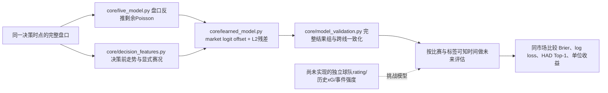

# 模型论文逐篇审计（2026-10-13 修订）

本次只修改 `model_paper_audit.csv` 与本文件。逐条重读既有 109 条记录的已保存摘要/元数据，按目标、研究版本、可见时点与来源可靠性重新分类；另读取 Crossref 单 DOI 条目、arXiv 原始摘要与机构原始摘要补核若干记录。没有把元数据核验写成全文阅读，没有执行论文数据复现，也没有将作者报告的准确率或盈利直接赋予当前系统。

## 数量与严格口径

| 口径 | 数量 | 含义 |
| --- | ---: | --- |
| 原始审计记录 | 109 | 80 条检索记录与 29 条经典补充，含重复、辅助与错领域记录 |
| 直接比分/赛果/滚球模型论文 | **51** | `included=true` 且 `independent=true`；51 个不同 DOI；42 篇 article、6 篇 conference-paper、3 篇 preprint |
| 辅助/方法候选/时点未明/书章参考 | 29 | `included=false`；xG、动作过程、综述、学位论文、目录候选、时点不明及书章不充当直接门槛 |
| 排除记录 | 29 | 运动/目标错误、方法可靠性待核查或重复版本，其中 3 条是重复版本 |
| 去除已识别版本重复后的记录 | 106 | 包含直接、辅助与排除，不等于 106 篇有效论文 |
| 纳入的独立直接论文全文阅读/实验复现 | **0 / 0** | 本审计属于摘要与代码层级的对应检查，不宣称系统性全文综述 |

直接清单的 source_index：`2 4 5 6 12 16 20 25 26 29 31 38 42 43 47 55 57 58 60 63 68 70 72 73 77 78 80 S1 S2 S3 S4 S5 S7 S9 S10 S11 S12 S13 S14 S15 S16 S17 S19 S20 S21 S22 S23 S24 S27 S28 S29`。所有直接条目的摘要、具体方法、当前代码映射、适用性/限制、来源说明均非空；方法栏未复用同一泛化模板。

严格清单包括明确的负面或非最优结果，未仅按“高准确率”筛文献。不同论文可能使用同一 Soccer Prediction Challenge 数据，独立论文数不等于独立数据集数；也不等于 51 项证实盈利的实验。

## 阅读深度与来源核验

| 深度 | 全部记录 | 直接清单 | 本次实际动作与限制 |
| --- | ---: | ---: | --- |
| 已保存 OpenAlex 摘要与元数据 | 95 | 44 | 逐条重读全文摘要，原始出版全文未核验；B 级摘要证据 |
| 出版社登记摘要与元数据 | 5 | 3 | 本次 Crossref 单 DOI 读取原始登记摘要：4、25、57 纳入；45、51 排除；A 级原始摘要仍不等于可信收益复现 |
| arXiv 原始摘要与元数据 | 4 | 3 | 本次读取 38、43、50、70 的原作者版本页；50 为动作数量辅助，其他直接纳入；A 级来源但含预印本不确定性 |
| 机构原始摘要与元数据 | 2 | 1 | S14 曼彻斯特机构页补取 Weibull-copula 摘要，27 的 LMU 摘要用于核对与25同版本；A 级原始摘要 |
| 只有目录信息 | 3 | 0 | S6、S8、S18；OpenAlex/Crossref/Elsevier未返回摘要或出版社受限，不从题名推测实验 |

A 表示可核验原作者、机构或出版社登记的原始材料，B 表示聚合保存摘要；这一分级描述来源，不评价论文方法可靠程度。所有条目均未读全文；所有作者报告的性能均未由本审计复现。公开来源遇到的限制包括 Crossref 429、ScienceDirect 403、Salford机构页403和部分机构页不返回正文；这些条目明确保留限制，而非绕过访问控制。

原始摘要补核地址：

- S14：<https://research.manchester.ac.uk/en/publications/7f8bfe1a-2b32-407f-9997-a45cc5a345d3>，补取摘要并将出版年修正为2017；不是2016年正式发表。
- 27：<https://epub.ub.uni-muenchen.de/29028/>，用于版本/作者/方法核对。
- 38：<https://arxiv.org/abs/2608.07168>；43：<https://arxiv.org/abs/2608.05030>；50：<https://arxiv.org/abs/2511.18730>；70：<https://arxiv.org/abs/2312.04338>。
- 4：<https://api.crossref.org/works/10.5171/2025.4637725>；25：<https://api.crossref.org/works/10.1515/jqas-2017-0067>；57：<https://api.crossref.org/works/10.54941/ahfe1002524>。

## 研究版本和信息污染

1. 27 与25：四位作者相同、三届欧洲杯训练、同双变量Poisson/boosting、同百万次赛事模拟；27是2016 LMU技术报告，25是2018正式期刊论文。只计25。
2. 69 与59：相同 Ordered Forest 题名与完整摘要，保留版本溯源不重复计数。59本身为书章，严格论文主清单也不用。
3. S25 与S24：相同 DOI `10.3233/jsa-200462`、题名与摘要，完全重复，只计S24。
4. 22 与31虽题名近似，OpenAlex作者分别为Omar Osman与Bing Shen Choi等，不认定重复；22因学位类型及收益/时序设计未明仅列辅助。
5. 2 与57共享部分作者及2017 Challenge数据，但分别使用TabNet与boosting，不是同一论文版本；只能算两项方法研究，不得说是两份独立数据验证。S15、S16以及S27、S28等也分别共享challenge样本。
6. 30、49明确是NFL美式足球，17、67是门将/球员位置，33是疲劳，11、37是球员合作/价值，全部不算足球结果模型。67末段错误提汽车推荐系统，属于摘要内容污染。
7. 64把Kaggle European Soccer Database描述成2023–2024赛季，与其已知2008–2016覆盖矛盾；45的99%、32的98.34%、14的92%缺可见时点或指标/时间设计，均不用于效果结论。这里是“证据不足而不采用”，没有断言这些论文造假。
8. 62的conversion rate、对手xG/goals是明显整场结果相关变量；23、34的shots/possession/技术战术统计未说明时点。它们可研究方法但不能作为当前决策前预测效果。

## 当前实现与文献的对应结论

| 文献支持的路线 | 当前实际实现 | 偏差/限制 | 审计结论 |
| --- | --- | --- | --- |
| Poisson/联合比分与动态球队能力（16、S1–S5、S7、S12、S14、S29） | 市场OU/HAD反推Poisson，简单时间衰减 | 不是历史球队动态能力模型；尚无双变量/低比分/Weibull-copula估计 | 合理研究基线；“Poisson”同名不等于完整实现这些论文 |
| 市场先验 + 独立历史信息（20、S17） | 固定market logit的L2 Logistic残差，零权重等于市场 | peer算法多数源于同盘口，无独立Elo/pi/xG实体历史 | 当前架构可保留；不能把多种赔率变换视为独立证据 |
| rating与领域特征优于盲目复杂化（2、57、63、S15、S16、S27、S28） | 盘口短窗、比分/时间、显式红牌及缺失标记 | 缺球队长期rating/阵容与独立历史统计 | 下一步应先验证独立信息增量，再决定树/神经模型；不是直接增加参数量 |
| 动态事件/剩余比赛目标（58、70、77） | 比分×时间、红牌差×时间可作为残差输入 | 尚无可核验全事件编码、随机补时、动态hazard | 红牌等可能有影响，不应仅因“赔率已经反映”而永远丢掉；必须先看市场之上的增量 |
| 概率评价与收益区别（31、73、77、S11、S14） | grouped rolling、Brier/log loss、HAD一致概率、单位shadow收益 | binary accuracy不是HAD Top-1，HAD/OU/AH改进不一定同步 | 必须按盘口/合约与同时间市场对照；80%命中不能独立证明优于市场 |
| 时间与信息隔离（20、S16、S24、S27、S28） | 决策前history cutoff，训练/校准按已知settlement时间约束 | 数据抽样/评估artifact/线上概率路径此前有实现缺陷，由主任务修复核验 | 这是验证有效性要求，不是“调几项参数”即可替代 |

已审阅的代码包括 `core/live_model.py`、`core/decision_features.py`、`core/learned_model.py`、`core/model_validation.py`和`service/model_training.py`。逐条映射记录了具体信息来源、模型结构和研究目标，不把论文名称套在相似函数上。影子/评估与真实执行应使用同一概率空间；最终评估应对应实际保存artifact，并且校准器只能看到决策时点前已结算的标签。主任务已识别的抽样、时间泄漏、artifact不一致和线上coherence问题属于验证/实现偏差，需要在主报告与远程issue中分别给修复状态，不能因路线本身合理而否认。

## 不能由本清单直接推出的结论

- 不自动更换当前模型或提升候选模型：文献数量不等于该机器当前数据的前瞻证据。
- 不将论文的Kelly仿真误写成当前真实资金硬限制。`service/betting.py`若仍用固定/置信度金额，Kelly/max_total_exposure只是推荐口径时需作为主任务的重大差异跟踪；本子任务未改下注。
- 不声称双变量Poisson、Elo/pi、xG、随机补时、完整事件模型或树挑战者已经上线。
- 不把同场多决策当独立比赛样本；完整同盘口结果组、按比赛权重与标签可知时间仍是必要约束。
- 不把只保留“高准确率”论文的筛选结果当科学结论；负面、有限增益和公开不确定性均保留。

未确定事项：44篇直接论文的原始摘要/正文尚未本次独立核验；若要称“系统性全文综述”，需要进一步取全文并逐篇复核数据划分、特征可见性、下注成本与效果置信区间。当前51篇是相关模型论文的摘要级审计，不是51篇高质量前瞻获利证据。
