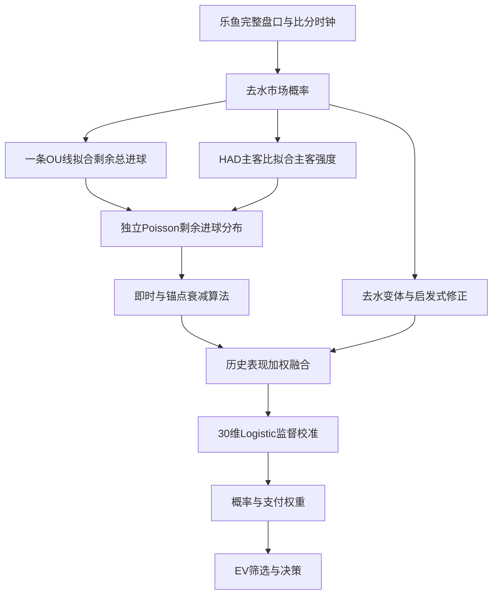
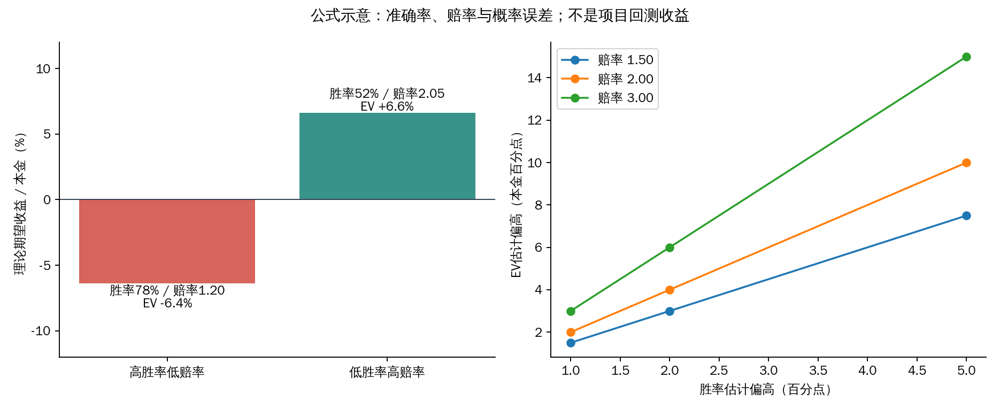
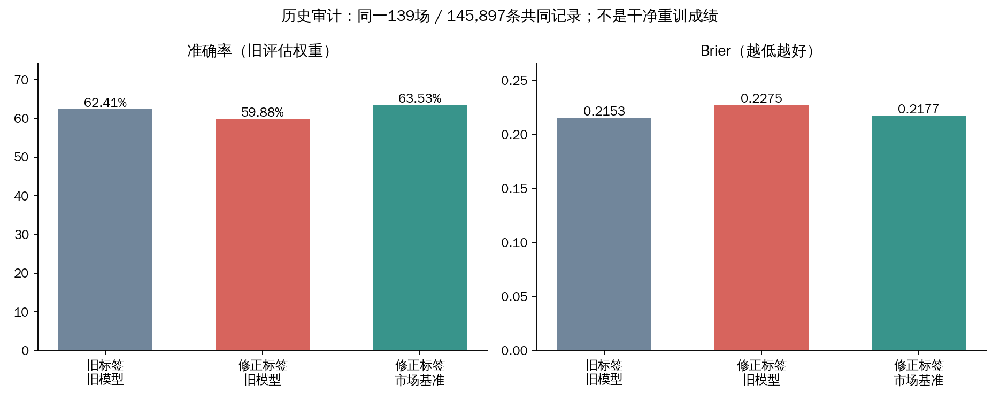
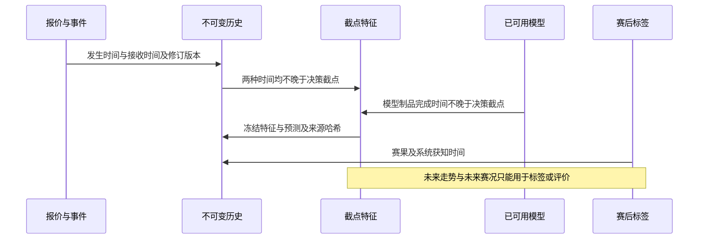
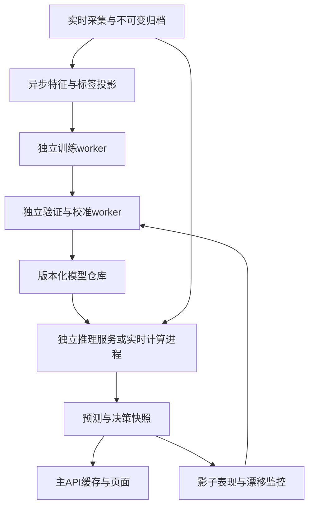
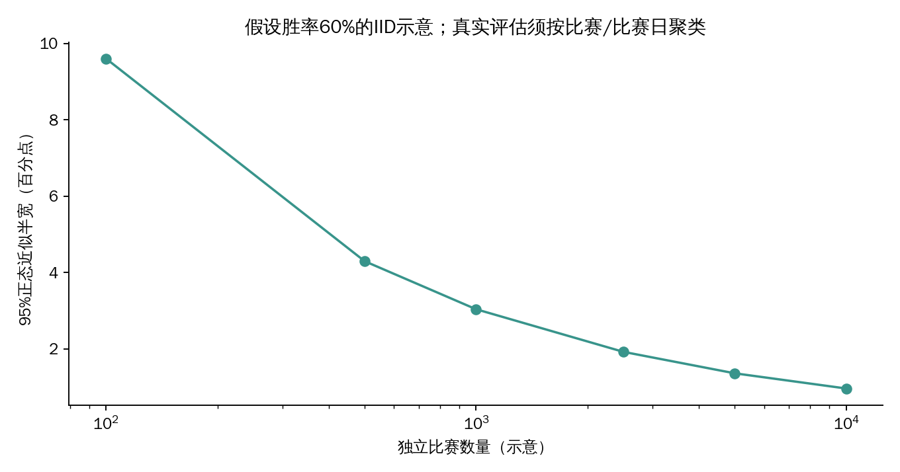

# 现有数值决策模型：提高准确率与概率质量的研究方案

日期：2026-10-11；任务：TASK-43。代码基线 `d068713`，另冻结读取了 TASK-42 正在开发的工作区文件。本文是研究与实施方案，未修改生产模型、启动训练或执行投注。

## 1. 核心判断

建议沿用“盘口概率 + 比分/时间 + 数值走势 + 监督校准”的路线。最优先的工作是建立正确标签、可靠的时间截点与统一评估；之后改进市场先验的学习方式、走势特征、算法融合；最后才比较更复杂的树模型和动态进球模型。增加参数量、增加算法投票数、提高推荐门槛，都不能单独证明预测能力提高。

当前最有价值的候选是 **市场概率作为固定 offset 的 Logistic/GAM 修正模型**，以小规模交互项学习市场偏差，再用受限配置的 LightGBM/XGBoost 做挑战模型。它们适合现有结构化数据和 4 核 / 8GB 无计算 GPU 的机器，但任何准确率或收益提升仍须干净的前瞻数据验证。

不能把旧模型展示的 62.70% 当成现有模型的可信起点。历史审计已发现结算标签和特征污染；修正标签后，旧模型在共同记录上的准确率约 59.88%，市场基准约 63.53%。这只是说明旧成绩不可靠的诊断，既不是干净重训结果，也不能据此推算未来可提高多少。[本地审计，A]

本次新增的确定性代码探针还发现：同样三次赔率变化，无论发生在 2 秒还是 600 秒内，现有特征完全相同；HAD 胜平负三个方向均以 0.5 二分类阈值计分时，即便实际推荐方向错误，示例准确率仍可达到 66.67%。这两个问题应先于“大模型化”处理。[代码探针，A]

## 2. 证据范围与可信度

证据分级：**A** 为可核验源码、项目审计、原始论文或官方文档；**B** 为学术综述/聚合；**C** 为社区经验。本报告的主要判断使用 A 级证据；工程优先级、参数范围、上线门槛另标为“建议”，不是文献或项目测量值。

| 证据 | 本次取得内容 | 使用限制 |
| --- | --- | --- |
| 仓库已提交代码 | 30维 Logistic、Poisson、融合、训练数据与资源限制 | 基线冻结在 `d068713` |
| TASK-42 工作区 | 模型应用、历史重建等文件的独立哈希快照 | 属于开发中状态，不当成最终部署结果 |
| 历史污染审计 | 139场共同样本的重新计分、污染数量 | 保留旧特征，不能当干净回测 |
| SQLite 只读快照 | 版本数量、比赛数、时间范围 | 修复任务并行运行；各库独立事务，不是跨库原子快照 |
| 外部来源 | 校准、聚合、数值模型论文全文；官方文档；部分足球经典论文的登记摘要/元数据 | 未取得全文的论文不引用具体系数或收益 |
| 示例图与探针 | 公式计算、特征相等性、评价口径反例 | 示例不代表本项目实际预测效果 |

代码哈希见 `data/code_manifest.json`，历史结果见 `data/historical_audit.json`，数据快照见 `data/data_snapshot.json`，来源下载状态与 SHA256 见 `data/source_fetches.json`。相关原始网页/PDF缓存于本次研究环境的 `/tmp/task43-evidence/sources/`，不将第三方全文再分发入库。

公开搜索有明显噪声：Bing RSS 多次只命中查询中的单个词，返回阀门、自行车、体育门户等无关页面；Crossref 的若干“in-play”查询也返回体育生理学或机器人论文，均未作证据。部分出版商返回 403，Crossref 曾返回 429，后改为串行查询。某 PDF 地址虽 HTTP 200，却只返回31字节 HTML，已标记无效；不能将请求成功视为读到论文。

## 3. 当前模型究竟在做什么



该图描述现有技术路线。学习模型的 active/shadow 应用正在 TASK-42 调整，图不表示训练模型已经在生产推荐中启用。

| 模块 | 核验行为 | 对提高预测能力的含义 |
| --- | --- | --- |
| `core/live_model.py` | 主客独立 Poisson；OU反演总强度；HAD主客条件比例反演share | 主要将已有市场信息转成统一进球分布，不自然产生独立优势 |
| `service/live_expert.py` | 多算法共享盘口；锚点按剩余常规时间线性衰减；价格漂移启发式修正 | 不同算法名字不等于不同信息来源 |
| `core/ensemble.py` | 概率线性平均；按历史准确率与市场相对Brier调整权重；分歧扣EV | 预测融合和风险偏好部分混合，需分别验证 |
| `core/learned_model.py` | 30参数 L2 Logistic；250轮固定步长；按比赛归一权重 | 模型轻，但缺少非线性、交互及收敛/调参机制 |
| `store/training_data.py` | 按决策截点冻结特征，保留多线/多算法/多时点；版本隔离；半赢半输权重0.5 | 已有正确方向，仍需严格审计重建来源和评价单位 |
| 训练与模型服务 | 独立worker训练；1核、512MB、600秒CPU上限；父进程900秒墙钟上限 | 大量Python行对象及固定全量循环可能先受资源限制 |

30维中有：两个概率logit、时钟、比分差、方向/盘口/算法标记、盘口线、端点涨跌、逐tick波动、点数及五种同伴算法概率。没有独立联赛/球队先验、红牌状态、报价年龄、盘口水位变化、固定时长走势窗口等特征。**比分和比赛时间已经进入模型**，不能把“引入比分”当新增能力。

`devig_consensus` 是同一来源的几种去水方法平均，不是多家公司独立报价共识。`economics_risk_adjusted` 向市场固定收缩；`microstructure_adjusted` 直接按赔率涨跌改概率，这些系数尚未被证明适用于当前数据。

## 4. 先纠正“准确率”的定义

### 4.1 目前有三个不同问题

1. **预测方向是否正确**：HAD 应统计三个方向中概率最大的方向是否命中；OU/AH 应统计当时选中方向的结算。
2. **概率是否可信**：给出60%时，长期相近样本是否约60%；通过 log loss、Brier、可靠性图、校准斜率等评估。
3. **报价是否值得接受**：概率结合赔率、走盘权重与执行成本后是否有正期望；与命中率不等价。

代码 `metrics()` 把每个方向按 `p >= 0.5` 视为一次二分类。HAD 示例 `[0.40, 0.35, 0.25]` 实际客胜：推荐主胜错误；三个二分类预测却为“都不发生”，其中两项正确，得到 66.67%。这是一条确定性反例，不说明生产所有命中率都是66.67%。前端推荐命中、模型二分类准确率、HAD top-1 是不同指标，应分别命名和展示。

`data/code_probes.json` 保存了该反例及2秒/600秒走势特征相等结果。它还确认比分差6与10会被同样裁到5；这属于现有建模取舍，是否需要改变取决于真实比赛覆盖与消融，不能自动判成所有赛事的致命问题。

### 4.2 亚洲盘预测目标要和支付结构一致

设 W 为预测分布中的赢本金权重期望，L 为输本金权重期望，U 为退回本金权重；在忽略极小截断尾部时 W+L+U=1。定义：

```text
q = W / (W + L)                 有效胜率（非走盘本金口径）
r = W + L                       预期参与输赢的本金比例
EV = W × (odds - 1) - L
   = r × (q × odds - 1)
```

半赢/半输监督权重0.5已在当前版本实现。q 不是“全赢概率”，也不是把走盘简单删除后按条数计算的胜率。当前学习模型主要校准 q；r 仍来自 Poisson。因此 q 变好也不能保证金额EV变准。第一阶段应同时报告 q 的加权概率分数和 W/L/U 支付预测误差；后续可从统一比分分布导出支付，或在足够样本后联合预测五种结算状态。

按比赛归一权重是合理的宏观研究口径，但它不是按真实交易本金计的损益口径；两者都应报告，不能用一个替代另一个。

### 4.3 最低评价集合

| 维度 | 建议指标 | 防止的误判 |
| --- | --- | --- |
| 固定候选集合 | 同时点同盘口同方向 log loss、Brier、相对市场skill | 靠删掉难样本制造提升 |
| 推荐决策 | HAD top-1；OU/AH全赢/半赢/半输/全输/走盘分布；本金权重胜率 | 二分类方向分数冒充买入命中 |
| 选择范围 | coverage、推荐数量、赔率区间、时间段、市场分组 | 提高门槛降低覆盖率冒充模型变强 |
| 概率可靠性 | 可靠性图、校准截距/斜率、不同分箱ECE及置信区间 | 只看单一分数忽略过度自信 |
| 经济效果 | 固定规则的净EV误差、影子成交ROI、拒单/改价成本 | 高胜率低赔率却亏损 |
| 不确定性 | 按比赛成组的配对bootstrap；按比赛日区块的敏感性分析 | 将同场几千条记录当几千场独立证据 |

Brier和log loss是适当概率评分，但它们同时反映区分能力和校准，**Brier降低不等于校准一定改善**。[S1、S2] ECE依赖分箱，不宜单独作为选模目标；AUC也不能替代概率质量。



图为公式示意：78%胜率、1.20赔率的理论EV为−6.4%；52%胜率、2.05赔率的理论EV为+6.6%。赔率2.00时，高估胜率2个百分点会高估EV 4个本金百分点（r=1）。将误差改为1或5个百分点，方向相同、幅度线性变化；r<1时按r同比缩小。没有使用真实交易回测数据。

## 5. P0：重建可信的数据与评估底座

### 5.1 旧模型不能直接继续增训

历史审计发现：904,473条旧输入的同伴概率特征受异常饱和值污染；训练队列36,794条记录中有1,890条标签翻转。滚球AH基于下注后净胜球，而旧逻辑使用累计比分；负盘口解析也曾失真。已有修复及版本隔离，不应再次把这批旧x仅改y后当干净数据。

| 同一139场 / 145,897条共同记录 | 准确率 | Brier | log loss |
| --- | --- | --- | --- |
| 旧模型、旧标签 | 62.41% | 0.21533 | 0.61485 |
| 旧模型、修正标签 | 59.88% | 0.22748 | 0.64388 |
| 市场基准、修正标签 | 63.53% | 0.21773 | 0.62216 |

表中采用旧审计的同一评价权重，只用于可比诊断。原制品62.70%使用147,904条，不能直接与上述共同集合混比；审计JSON还包含修正支付权重后的旧模型结果，但未提供同权重市场基准，所以本表没有拼入该值。所有行都不是新版本干净回测。



本次只读快照记录到：899,253条NULL旧版本输入，494场；6,468条标记v2输入，28场。修复进程正在重建历史，故数量会变；**版本标记和输入场数不等于审核合格且有标签的训练场数**。此前仪表盘缓存仍显示4场/267条及过期心跳，也不能当当前全量事实。应由独立worker输出带时间戳的资格清单，而不是根据文件大小或历史总比赛数判断模型已具备训练条件。

重建合格条件：盘口线符号、入场比分、比分口径、比赛阶段、所有原始报价与实际接收时间可恢复；用修正算法重算整个特征向量；赛果有来源和可用时间；生成来源哈希、代码版本、重建原因。入场比分曾截断且无原始证据的行、只存污染向量的行保持隔离。修复派生数据时保留原始归档和修复谱系，本地/S3永久保存策略继续适用。

### 5.2 每场多个盘口、多个决策全部保留

建议身份键：`match_id + snapshot_id/cutoff + market + normalized_line + outcome`，各算法概率作为同一身份的列保存，原始算法记录也保留用于审计。

**不把每场压成一个样本。** 一场内不同盘口线、不同时间仍是有效预测问题；但同一时间同一盘口的五个算法输出不是五份独立赛果。元模型可用“一行 + 五列概率”减少重复计权和内存；每场权重再在市场/时间片内分配，防止更新特别频繁的某盘口占满该场。训练抽样不删归档，固定评价集合不随抽样改变。

若继续保留算法长表训练，至少为同一身份做权重归一；同时保留“按比赛等权”和“按真实决策频次”两套结果，明确各自回答的问题。

### 5.3 同时约束发生时间和系统获知时间



现有实时 `training_series` 先检查上游时间和接收时间，是正确方向；输出history只保留上游时间与赔率，后续重建若缺独立接收时间证据，应降级而非推测“当时已知”。所有事件同样需要双时间、撤销/修订标志。对晚到报价、断线补传、进球撤销、半场标记错误做专项审计。

预测后的走势、终盘、全场红牌总数、最终xG、赛后修正事件不得作为当时输入。收盘价可作为附加诊断，不能喂给较早决策。若赛果后来被修正，训练标签的可用时间应是该修正被获知的时间，不能倒填到原始结算时刻。

### 5.4 从单次80/20改成按场的滚动时间验证

现有实现已经按比赛划分，并要求训练标签在验证开始前已知，应保留。增强为：

1. 最外层冻结最后一段时间作测试；测试期间整场不进入训练/调参/校准。
2. 更早数据做3–5个滚动时间折（数量为建议，按独立场量调整）；每折训练标签获知时间严格小于验证首条输入时间。
3. 超参数在内层时间折选择，校准器使用更晚且独立的一段；最后测试集只评价一次。
4. 复合模型保存每折OOF预测；同一场不跨折，同盘口同截点所有算法共用fold。
5. 通过多轮试验后另留前瞻影子期；记录尝试过的配置，避免反复看同一个测试集选赢家。

`TimeSeriesSplit` 单独使用不保证同场隔离，`GroupKFold` 单独使用不保证先后顺序。[S5、S6] 滚动折存在训练暖启动区，不能直接套默认 `StackingClassifier` 的随机/分层K折；宜显式生成有时间和比赛约束的OOF表。[S7] 结算跨时间边界时按标签可用时间purge，gap由实际赛程和数据迟到分布决定，不硬填一个通用分钟数。

## 6. P1：最值得先做的轻量模型改进

### 6.1 固定市场先验，学习有证据的修正

现有模型虽从市场logit权重1初始化，但L2最终将该权重也向0惩罚，即向0.5收缩。市场先验在小样本或强正则时可能被不必要地削弱。

建议首个候选：

```text
logit(q_hat) = logit(q_market) + delta(features)
delta(features) = intercept + beta × residual_features
惩罚只作用于修正系数，delta=0精确退回市场基准
```

另一可比方案是保留自由市场系数，但惩罚 `(beta_market−1)^2`；二者通过时间折比较。概率logit映射使用稳定数值边界，检查0.01/0.99裁剪是否丢掉极端赔率信息，不能直接扩大边界制造高置信度。

这属于统计学习先验设计建议，不是论文保证的涨点。statsmodels GLM支持offset，XGBoost支持逐样本base_margin；训练与推理必须使用相同先验。[S8、S11] 保持现有纯数值路线即可实现。

优先加入少量可解释交互：比分差×剩余时间、盘口线×当前总进球、市场类型×算法残差、红牌差×剩余时间、时间阶段×走势速度。样本不足时共享全局系数并对市场/联赛偏置收缩；不要立即为每个球队或每种盘口训练独立模型。

### 6.2 将最近40tick变成可比较的时间窗口

确定性探针证实当前特征不识别history时间间距，波动也是逐tick均方变化而非单位时间量。建议在持续保留原始tick的前提下，在线维护固定时间窗口的增量统计：

| 特征组 | 第一轮候选 | 注意事项 |
| --- | --- | --- |
| 去水概率走势 | 15/60/180秒的fair-logit变化、回撤、斜率 | 窗口为待调建议；缺完整对手报价则标记缺失 |
| 波动与更新 | 固定时间网格实现波动、更新次数、窗口覆盖时长、最长空档 | 用历史as-of值填网格，不用未来点插值 |
| 水位与线 | overround及变化、盘口线迁移、相邻线相对概率 | 线变化不能被误当同一合约连续价格 |
| 时效与事件 | quote_age、接收延迟、距进球/红牌/重开盘时间 | 延迟可能影响执行质量，须与方向预测分开消融 |
| 跨市场一致性 | HAD/OU/AH隐含强度差、共同比分模型的拟合残差 | 同一时点可用，但不是独立来源 |
| 数据质量 | 缺项数、是否补传、停盘重开、实际观察窗口比例 | 质量特征不能泄漏赛后清洗判断 |

优先用去水概率或logit变化，避免水钱改变被当成比赛胜率改变；另保留原赔率变化作对照。先比较单窗口与多窗口，再比较15/60/180秒和30/120/300秒。若效果依赖某一个精确窗口，应警惕过拟合。

### 6.3 把相关算法输出变为OOF残差融合

以 `logit(q_algorithm)−logit(q_market)` 作为输入，而不是将多个高度重合概率当独立投票。第一版用有收缩的线性元模型；复杂的状态门控只有在各时间/市场层样本够时再加。

只有同时间折生成的OOF结果可以训练元模型和选择权重。基础算法若含历史表现自适应参数、球队先验或学习模型，也必须在各折重建当时状态，不能用今天的最优权重回放过去。用验证误差协方差、逐算法删除实验识别冗余；保留有效多样性，不能按算法数量给更高置信度。

线性概率池不自动保持校准；聚合后还需独立校准验证。[S3] 现有风险相关系数和EV扣减不能当成统计协方差估计。先输出预测概率与不确定性，再让策略层决定阈值、敞口和成本扣减。

### 6.4 预测需要满足同一盘口的概率一致性

开发中的TASK-42应用代码对每个候选独立校准；尚无共同归一约束，可能使HAD三个方向和不为1，OU/AH两向不互补。该问题是代码结构风险，本次没有声称已观测到某个线上数值违例。

HAD建议市场概率offset的softmax，或合适的多分类校准；OU/AH同一线使用共享潜变量或只预测一向、另一向取互补。跨线可从共同进球分布导出，或采用清楚定义盘口符号的约束投影。约束应覆盖HAD和为1、两向互补、合法区间、同一目标下跨线单调性、非负支付权重与尾部质量。

Dirichlet calibration是成熟的多分类候选，但需要足够独立校准比赛；不是仅把三个独立概率除以和就自动校准。[S4] 当前Logistic使用logit输入，已包含恒等映射，不应误读Beta calibration论文而宣称它不能保持原概率。Beta可作为独立候选校准器，与温度/斜率校准比较。[S2、S9]

校准本身可能改变阈值命中率，却不增加排序能力。若校准后Brier好而top-1不变，仍是有效概率改进，应准确描述。

## 7. P2：动态进球模型和赛况的增量价值

### 7.1 先完善现有Poisson，再考虑更复杂分布

现有两步拟合只用一条接近均衡的OU线与HAD主客条件比，未显式拟合draw；可能遗漏相邻OU线、AH线和平局结构中的信息。建议用同一时点多线联合拟合主客剩余强度，并按报价新鲜度、完整性和水钱给权重，输出拟合残差作为模型不适配指标。

不要反演某盘口再把重构该盘口的吻合称作独立预测优势。联合拟合属于当时市场信息的结构化；若要证明跨市场新信息，做“去掉目标盘口族拟合，再预测目标盘口”的对照。这是独立信息检验，不意味着使用即时目标盘口本身构成时间泄漏。

下一步用时间/比分状态驱动的hazard代替简单线性衰减：

```text
lambda_home(u | known_state) = exp(time_spline(u) + strength_prior
                                  + score_time_interaction + red_card_effect + ...)
remaining_home_mean = integral(lambda_home(u), u=t..end)
```

未来比分状态还会改变强度：若强度依赖未来比分变化，就不能仅积分一次后仍宣称整个过程严格独立Poisson；应数值求解状态转移或使用有误差标注的近似。先试分阶段、非线性时钟模型，再评估动态birth-process。补时长度未知不靠猜测直接放开；45/90分钟边界、半场与加时规则应独立建模，证据不足时保持观察态。

Dixon–Coles处理赛前低比分依赖，Karlis–Ntzoufras研究双变量Poisson，Koopman–Lit研究动态球队强度。[S12–S15] 它们支持比较候选结构，不证明直接套到当前滚球AH就有效。经典双变量Poisson的共享分量主要表达非负相关；是否需要平局膨胀、相关性或过度离散，先检查当前数据残差与概率校准，避免无识别地加参数。

### 7.2 事件虽然会反映进赔率，仍值得永久保存

市场价格可能已经吸收事件，但这是“是否还有增量信息”的经验问题，不是删掉事件数据的理由。

| 信息 | 可能用途 | 优先级与边界 |
| --- | --- | --- |
| 实时比分、阶段、时钟 | 当前已使用；改进剩余强度与交互 | 最高；先保证时间/比赛口径正确 |
| 红牌/人数差、距红牌时间 | 持续改变比赛状态；帮助辨认重开盘冲击 | 第一批新增，先核验事件码与撤销 |
| 进球、VAR、撤销、停盘重开 | 判断盘口滞后、异常报价；重置状态 | 第一批新增；不一定用于押方向 |
| 黄牌、角球、射门等短窗统计 | 可能反映节奏与压力 | 第二批；单个事件方向噪声大，靠消融决定 |
| 球队/联赛长期强度 | 跨场共享先验、低样本收缩 | 需要此前已知赛果和球队映射，不做赛后编码 |
| 实时xG、阵容伤停 | 更细的比赛信息 | 当前来源未核验则不宣称已有；最终xG禁止倒灌 |

当前 `events` 主要随结果展示，未知码没有映射成红牌或xG，**不能据此说模型已经利用了所有事件**。红牌研究题录[S16]支持其值得调查，但本次没有取到该论文全文，不引用“红牌使进球率改变X%”。

按完全相同的时间折做：A市场/比分时钟；B加走势；C加已核验事件；D加历史球队先验；E全部。比较整体及事件后分组的配对Brier/log loss和推荐指标，并固定coverage报告。若事件仅改善时效判断，就放质量/执行模块；若提供稳定概率增益才进方向模型。完整保留它们让这一检验可追溯。

## 8. 成熟模型方案对比

下表是基于官方功能与本项目结构的工程判断，不是本机基准测试或数值评分。资源栏只作相对描述，不宣称固定耗时或准确率。

| 方案 | 非线性/交互 | 市场先验接入 | 小独立场量 | 概率校准 | 结构约束 | CPU/内存 | 解释/维护 | 本项目位置 |
| --- | --- | --- | --- | --- | --- | --- | --- | --- |
| 正则Logistic/GLM | 手工交互 | 固定offset或以1为中心的惩罚 | 较合适，仍需收缩 | logit斜率/截距、Beta | 二向共享与HAD多项模型 | 通常最轻；避免Python全量行循环 | 清楚，最低新增复杂度 | 首个候选与稳定基线 |
| GAM/样条GLM | 平滑时间曲线、少量交互 | GLM offset | 控制样条自由度后较合适 | 独立校准段验证 | 单调约束需实现支持核验 | 轻至中；矩阵和样条增加开销 | 较易解释，需管理平滑度 | 第二个解释性候选 |
| LightGBM | 自动非线性交互 | init_score；推理必须一致加先验 | 叶子数/最小叶样本约束很关键 | 通常需后校准比较 | 单调特征支持；不会自动跨方向归一 | CPU histogram；线程与叶数可限 | 中；需版本与特征契约 | 挑战模型 |
| XGBoost | 自动非线性交互 | base_margin，推理同样提供 | 深度、子采样与正则控制 | 独立校准 | 支持单调/交互约束；多市场一致性需另做 | CPU hist与线程限制 | 中；依赖成熟 | LightGBM的替代挑战模型 |
| CatBoost | 非线性与类别处理 | baseline需明确验证接口语义 | 类别稀疏仍可能过拟合 | 独立校准 | 参数支持需按任务核验 | 小数据也要实测，不默认更轻 | 中；类别处理便捷 | 球队/联赛类别成熟后备选 |

依据：GLM/GAM[S8、S10]，LightGBM[S17]，XGBoost[S11]，CatBoost[S18]。树模型在许多表格任务中是强基线[S19]，但那些数据集并非本项目，不能外推“至少提高几个百分点”。

第一轮建议搜索范围：Logistic正则强度的少量对数尺度候选；GAM低自由度时间样条；树深2–4/叶7–15、100–300轮、早停、最小叶样本按**独立比赛分布**检查。这里是缩小搜索成本的起点，不是已经找到的最优参数。某叶有100条同场tick不等于100场支持。

优先验证Logistic与一个树模型，避免同时搜索五套方案后只报告最好者。不能仅以“每新增100场”判断是否应该晋级；训练触发周期、统计证据量和概念漂移是三个不同问题。

## 9. 当前机器与解耦实现

实测主机4 vCPU、AMD EPYC-Genoa KVM、总内存7,945MiB；一次取样可用3,840MiB、Swap已用8,812MiB。内存为瞬时观测，不能将总8GB都分给训练；GPU情况沿用此前硬件核验的无计算GPU结论。资源记录见 `data/hardware.json`。

轻量数值路线可行；主要隐患是全量Python列表、重复算法行和固定250轮循环。100,000行×30维×250轮约7.5亿次特征梯度项，属于运算量示意，**没有在本机测得对应训练耗时**。1,000,000×30的float32矩阵本体为120MB（约114.4MiB），还不包括元数据、分折副本、模型和原生库；512MB不保证能装下实际任务。

建议以冻结的按日期/版本列式投影或连续数值数组供训练读取，原始本地/S3归档永久保存。先从宽表消除同身份算法重复行，再分批读取，采用收敛判据与早停。评估worker不应在API请求时扫全历史或临时从S3下载全部归档。



训练、离线评估、模型推理与主API解耦；实时推理缓存加载制品，原子切换版本，不在请求内训练或扫描历史。独立推理进程失效时使用明确的市场基线回退，并记录本次实际模型版本。

第一阶段建议训练1核，必要时独立worker2核；保留页面CPU/内存限制，原生库线程数也限住。研究批处理继续遵守2核上限，不能因生产服务已解除CPU限制就将训练打满主机。

每场整批推理p99≤20ms可作为**初始工程预算**，并非已实测值；若特征或候选数增长要重测。两秒总体目标需逐段记录报价接收、排队、特征、推理、发布与请求发送时间，外部回执另记；轻模型快不意味着网络和执行链路已满足两秒。

## 10. 验证计划与上线门槛

### 10.1 分阶段实验表

| 阶段 | 实验 | 接受条件 | 失败后的处理 |
| --- | --- | --- | --- |
| E0 | 结算、as-of、版本与重建来源审计 | 抽样对照原始证据；污染和不可恢复行明确隔离 | 先修数据，不发布新模型 |
| E1 | 修正指标的市场与现有算法基线 | 固定时间折、候选集合、权重和coverage可复现 | 修评估，禁止比较新旧异口径成绩 |
| E2 | 市场offset Logistic + 交互 | 多折配对分数稳定改善且关键市场不恶化 | 回退市场，保留阴性结果 |
| E3 | 加固定时窗走势、逐项删减 | 增量效果跨时间窗稳定；不靠一个精确超参 | 删除无增益特征，数据仍永久保留 |
| E4 | 加事件与队伍先验 | 同样本消融有效；获知时间可证明 | 仅用于质量控制或不进入模型 |
| E5 | OOF残差融合 + 独立校准 | 概率一致性通过，分数/可靠性/覆盖率共同检查 | 简化融合，减少自由参数 |
| E6 | 受限树模型挑战 | 优于最佳轻模型，含资源、延迟与依赖成本 | 保留Logistic/GAM |
| E7 | 冻结模型前瞻影子期 | 配对概率分数、决策和执行指标与区间达到预设标准 | 继续观察或回退，不自动用资金验证 |

“稳定改善”的建议定义：预先冻结主指标和关键市场；按比赛配对 `ΔBrier=Brier_candidate−Brier_market`，对比赛成组重采样得到置信区间；当上界小于0且log loss没有实质退化时才声称超越市场。若统计证据不足，标记“不确定”，不要写“验证通过”。再用按比赛日区块重采样检验同日相关性；少比赛日时明确区间不稳定。

不强行要求每个很小分组都显著，但不得让整体分数掩盖某主市场的严重退化。校准图、top-1、coverage和执行成本分别报告。若多数候选近似市场而实际推荐只占很小一部分，整体Brier改进不保证推荐子集更好，必须单独验该子集，控制重复试验。

### 10.2 样本量不能用“记录条数”替代



仅作IID二项正态近似示意，假设胜率60%：100场的95%半宽约9.60个百分点，1,000场约3.04个百分点，10,000场约0.96个百分点。将假设胜率改为50%或70%，数值改变而“百场难以证明小提升”的方向不变。真实项目不是一场一个独立二项试验，必须用比赛/比赛日聚类配对方法；证明ΔBrier所需场量由实际配对误差方差决定，不能照抄本图。

这不意味着必须凑齐固定一万场才可训练，而是训练门槛100场不是“已证明模型更准”的门槛。

### 10.3 前瞻监控与再训练

监控数据缺失/迟到、概率分布、各市场Brier与log loss、校准斜率、coverage、推荐赔率、比分/红牌子群和推理延迟。预测保存 `input_schema/data/model/config_version + cutoff + model_available_at`；只有真实预测时记录而且先于标签获知的输出可算前瞻。

漂移触发重新评估，不直接把短期输赢当失效。新模型和旧模型在同一前瞻集合配对比较；对照组基线不随候选模型输出自我污染。训练集包含最近窗口与较长历史的衰减方案需要时间折选择；永久存储不等于每次全量等权训练。所有版本留存，晋级/回退可审计。

## 11. 实施优先级与具体落点

以下是待实施研究TODO，不表示本次已经修改业务代码：

| 优先级 | 工作 | 主要代码落点 | 可审查交付 |
| --- | --- | --- | --- |
| P0-1 | 结束历史重建审核、标记不可恢复数据，保留谱系 | `store/training_data.py`、TASK-42 repair模块 | 资格清单、来源哈希、结算抽检结果 |
| P0-2 | 分开二分类、HAD top-1和推荐结算指标 | `core/learned_model.py`、模型worker、页面统计 | 同一示例不再出现口径混淆 |
| P0-3 | 按场滚动验证、独立校准/测试、双时间检查 | 训练/评估模块 | folds清单与泄漏审计；多盘口全部保留 |
| P1-1 | 市场offset Logistic与少量交互 | `core/learned_model.py` | 时间折与市场基准的配对结果 |
| P1-2 | 固定时窗fair-logit与质量特征 | 实时特征层、训练投影 | 实时/离线同截点特征一致 |
| P1-3 | 概率一致性、OOF融合和校准 | `core/ensemble.py`、独立推理层 | HAD归一、二向互补、跨线/支付约束 |
| P2-1 | 事件码核验及消融 | collector映射、特征层 | 红牌/VAR双时间与增益分组报告 |
| P2-2 | 多盘口联合拟合、非线性剩余强度 | `core/live_model.py` | 拟合残差与留出目标盘口对照 |
| P2-3 | 一个受限树模型挑战、资源基准 | 独立训练/推理worker | 分数、RSS、线程、CPU、p99报告 |
| P3 | 前瞻影子晋级、漂移与回退 | 模型服务、数据与模型页面 | 时间戳、同集合对照、置信区间 |

优先完成P0与offset轻模型，通常比盲目扩大模型更有信息价值。实际收益大小仍未知；不能承诺某个命中率数字，也不能用提高筛选门槛代替模型改进。

## 12. 文献与官方资料

访问日期均为2026-10-11，下载状态详见 `source_fetches.json`。A-元数据表示仅核验题录/登记摘要；未取得全文不推导细节。

| 编号 | 来源与链接 | 证据级别与本报告用途 |
| --- | --- | --- |
| S1 | Gneiting & Raftery (2007), [Strictly Proper Scoring Rules, Prediction, and Estimation](https://sites.stat.washington.edu/raftery/Research/PDF/Gneiting2007jasa.pdf) | A全文；适当评分规则 |
| S2 | [scikit-learn Probability calibration](https://scikit-learn.org/stable/modules/calibration.html) | A官方；校准、评分分解、小样本isotonic风险 |
| S3 | Gneiting & Ranjan, [Combining Predictive Distributions](https://arxiv.org/abs/1106.1638) | A全文；融合不自动校准 |
| S4 | Kull et al. (2019), [Dirichlet calibration](https://arxiv.org/abs/1910.12656) | A全文；原生多分类校准 |
| S5 | [scikit-learn TimeSeriesSplit](https://scikit-learn.org/stable/modules/generated/sklearn.model_selection.TimeSeriesSplit.html) | A官方；时间验证与gap |
| S6 | [scikit-learn GroupKFold](https://scikit-learn.org/stable/modules/generated/sklearn.model_selection.GroupKFold.html) | A官方；同组不跨折 |
| S7 | [scikit-learn StackingClassifier](https://scikit-learn.org/stable/modules/generated/sklearn.ensemble.StackingClassifier.html) | A官方；OOF、默认折与prefit过拟合警告 |
| S8 | [statsmodels GLM](https://www.statsmodels.org/stable/generated/statsmodels.genmod.generalized_linear_model.GLM.html) | A官方；offset接口 |
| S9 | Kull et al. (2017), [Beta calibration](https://proceedings.mlr.press/v54/kull17a.html) | A全文；二分类校准及恒等映射讨论 |
| S10 | [statsmodels GAM](https://www.statsmodels.org/stable/gam.html) | A官方；低自由度平滑项 |
| S11 | [XGBoost parameters](https://xgboost.readthedocs.io/en/stable/parameter.html) | A官方；base_margin、线程与正则 |
| S12 | Dixon & Coles (1997), [Modelling Association Football Scores…](https://doi.org/10.1111/1467-9876.00065) | A登记摘要；赛前Poisson与低比分候选，不外推滚球收益 |
| S13 | Dixon & Robinson (1998), [A birth process model for association football matches](https://doi.org/10.1111/1467-9884.00152) | A元数据；动态过程候选，未引具体参数 |
| S14 | Karlis & Ntzoufras (2003), [Analysis of sports data by using bivariate Poisson models](https://doi.org/10.1111/1467-9884.00366) | A元数据；相关比分模型候选 |
| S15 | Koopman & Lit, [A Dynamic Bivariate Poisson Model…](https://doi.org/10.1111/rssa.12042) | A登记摘要；时变球队强度 |
| S16 | Ridder et al. (1994), [Down to Ten: Estimating the Effect of a Red Card in Soccer](https://doi.org/10.1080/01621459.1994.10476850) | A元数据；事件研究线索，不引用效应量 |
| S17 | [LightGBM parameters](https://lightgbm.readthedocs.io/en/stable/Parameters.html) | A官方；CPU线程、复杂度、约束与确定性 |
| S18 | [CatBoost parameter tuning](https://catboost.ai/docs/en/concepts/parameter-tuning) | A官方；类别模型备选 |
| S19 | Grinsztajn et al. (2022), [Why do tree-based models still outperform deep learning on tabular data?](https://arxiv.org/abs/2207.08815) | A原始研究摘要；表格任务选基线，不外推具体增益 |
| S20 | Clarke, Kovalchik & Ingram (2017), [Adjusting Bookmaker’s Odds to Allow for Overround](https://www.sciencepublishinggroup.com/article/10.11648/j.ajss.20170506.12) | A出版页摘要；不同去水假设应对照，不凭单篇确定方法 |
| S21 | Walsh & Joshi, [Accuracy or calibration?](https://arxiv.org/abs/2303.06021) | A全文；NBA单赛季实验提示关注概率；不迁移其ROI到足球 |
| S22 | Bailey et al., [The Probability of Backtest Overfitting](https://doi.org/10.2139/ssrn.2326253) | A登记摘要；重复试验风险，不照搬其CSCV替代时间验证 |
| S23 | [scikit-learn Model evaluation](https://scikit-learn.org/stable/modules/model_evaluation.html) | A官方；指标定义 |
| S24 | [Football-Data historical data](https://www.football-data.co.uk/data.php) | A来源页；可补赛前背景基准，但赛前表格不能代替当前滚球tick回放 |

去水方向：可比较normalization、power等，但文献在不同项目上的结果不是乐鱼所有盘口的定论。三向与亚洲盘有效胜率口径也应分别核验。现有唯一来源条件下，本方案不假设已经获得额外博彩公司、实时xG或完整阵容数据。

## 13. 复现与验证说明

目录包括3张中文图、4份生成的量化CSV、30维特征清单与审计JSON。统计图使用文泉驿字体；公式图明确标为理论示意，旧成绩图明确标为污染诊断。

```bash
./scripts/cpu-limited.sh run -- python3 reports/decision-model-accuracy/scripts/probe_current_model.py
./scripts/cpu-limited.sh run -- python3 -m unittest discover -s reports/decision-model-accuracy/scripts -p 'test_*.py' -v
python3 -m py_compile reports/decision-model-accuracy/scripts/*.py
docker run --rm --cpus=2 --memory=512m --memory-swap=512m \
  -v "$PWD:/w" -v /usr/share/fonts/truetype/wqy:/usr/share/fonts/truetype/wqy:ro \
  -w /w python:3.12-slim sh -c \
  'pip install -q matplotlib==3.10.7 && python3 reports/decision-model-accuracy/scripts/make_figures.py'
python3 reports/decision-model-accuracy/scripts/md_to_html.py \
  reports/decision-model-accuracy/REPORT.md reports/decision-model-accuracy/REPORT.html
```

本次只验证研究脚本、数据公式和报告渲染，不将其声明为业务链路、训练效果或真实投注验证。实际命令退出码与浏览器在线/离线Mermaid检查见 `data/validation.json`。
