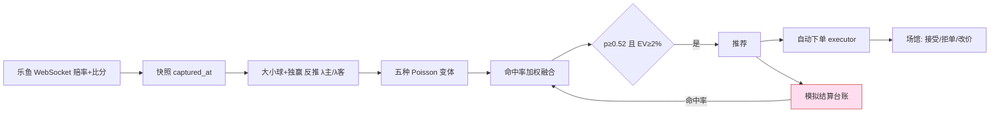
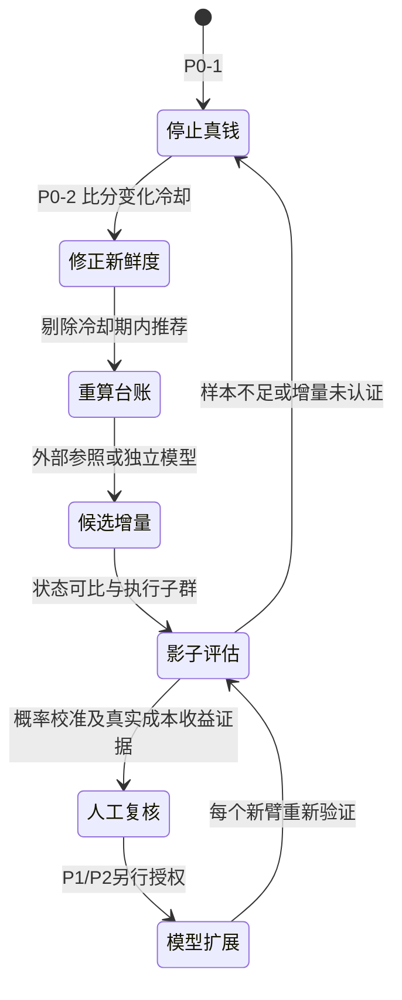

# 独立策略审计：2026-10-13 历史快照

审计日期：2026-10-13。数据截点：生产 PostgreSQL 与 `output/ledger` 于当日读取。
本报告独立于仓库中其他审计（TASK-40、#52、#55），只采信本次亲自复现的数字；引用他人结论时注明。

**归档说明（2026-10-14）**：本文描述 2026-10-13 读取时的历史实现和配置，来源报告提交为 `d05451e5d7dda7e21f05c322e7023b3416e5a324`；未保存精确数据库 as-of 或算法版本筛选，不能据此推断当前系统状态。[#60](https://github.com/1420970597/ai_football/pull/60)、[#61](https://github.com/1420970597/ai_football/pull/61) 与 [#62](https://github.com/1420970597/ai_football/pull/62) 的后续修复另行记录。本轮仅修正措辞、统计口径说明和公开数据脱敏，不查询 PG 或重跑历史 bootstrap。历史 ROI JSON 保持原字节，固定附件哈希见 [archive_manifest.json](data/archive_manifest.json)。

证据等级：**A** 本仓库代码、生产库查询、回放日志逐帧追踪；**B** 统计推导或文献共识；**C** 工程判断。

## 0. 一句话结论

**历史非虚拟模拟样本中，高模型—市场分歧组贡献了 79.4445% 的净利润；另一份单小时回放发现比分变化后旧价被推荐的机制。二者不能合并为“79.4% 利润由不可成交旧价造成”的因果比例。历史本地订单按推荐决策价和本地结算重算 ROI 为 −8.53%（约 −8.5%），并非场馆权威资金盈亏。**
历史证据提示应先修正价格状态一致性与评价，再验证独立增量。单源同盘口去水本身不证明优势；跨盘口模型是否存在可成交增量仍须检验。30/60 秒后的价格变化可能夹带进球、红牌、比赛时钟和阶段变化，只能先作为未来价格漂移诊断，不能直接称为状态可比 CLV。

## 1. 这个项目实际在做什么（不看 README）

README 把它描述为"LLM + 经济学算法决策平台"。历史代码与当时读取的生产配置显示：

| 环节 | 实际实现 | 证据 |
| --- | --- | --- |
| 数据 | 单一软庄（乐鱼/YBTY 场馆）App 协议 + WebSocket 滚球赔率 | `collector/leyu_realtime.py` |
| 定价核心 | 用当前大小球 + 独赢反推剩余进球 Poisson 强度，再给让球/半场盘重新定价 | `core/live_model.py`、`service/live_expert.py:_calculate` |
| "五个算法" | 同一 Poisson 分布的五种变体：原样、锚定衰减、去水共识、收缩、走势修正 | `service/live_expert.py:evaluate_markets` |
| 融合 | 按历史"命中率"加权平均五个变体，得到 `economic_ensemble` | `core/ensemble.py:pool` |
| 学习模型 | 60 参数逻辑回归，市场 logit 作偏移项；**从未通过晋级门** | `output/models/status.json` |
| LLM | 每场一次调用的配对实验；**96% 请求失败或过期** | 生产库 `decisions` 表 |
| 执行 | 自动真钱下单，`betting_enabled=true`，`decision_mode=algorithm` | 生产 `runtime_settings` v50 |

它本质上是一个**滚球软庄价差捕捉器**：用庄家自己的大小球/独赢价格推一个模型价，去买同一庄家其他盘口里"看起来便宜"的选项。
LLM 和学习模型在该历史截点的生产路径上都未发挥已认证的决策作用。



红色节点是本次审计发现的主要失真来源：模拟台账按"决策时看到的赔率"结算，并回流成算法权重。

## 2. 历史模拟收益与本地订单重算的差异

### 2.1 账面：模拟收益与推荐价本地重算（A）

| 口径 | 场次 | 注数/本金 | 盈亏 | ROI | 按场聚类 95% 区间 |
| --- | ---: | ---: | ---: | ---: | --- |
| 台账全部 forecast（单位注） | 2,426 | 241,906 | −12,093 | −5.0% | — |
| 综合推荐 `economic_ensemble`，标为真实足球 | 1,395 | 8,609 | +1,120 | +13.0% | +10.1% ～ +15.9% |
| 同上，剔除 8 分钟虚拟赛 | 1,209 | 7,575 | +1,075 | +14.2% | +10.9% ～ +17.2% |
| 同上，且模型−市场概率差 ≤ 20pp | 972 | 5,409 | +25 | +0.5% | −2.2% ～ +3.1% |
| 同上，且概率差 ≤ 10pp | 697 | 3,329 | −39 | −1.2% | −4.3% ～ +2.2% |
| 同上，**概率差 > 30pp** | 274 | 649 | **+854** | **+131.6%** | +114.6% ～ +148.9% |
| **真实已下单**（按决策赔率重算） | 233 | ¥1,384 | **−¥118** | **−8.5%** | −17.5% ～ +0.3% |

数据：`data/roi_evidence.json`，历史计算脚本为 `scripts/roi_evidence.py`。该脚本现在重跑读取当前库，无法恢复固定历史快照。

非虚拟历史模拟样本的净利润中，`854.14 / 1075.14 = 79.4445%` 来自仅占 8.6% 本金、模型与市场分歧超过 30 个百分点的子群。它是子群净利润占比与相关性描述，不是旧价造成的利润比例，也未证明该群每笔价格能否成交。“132% ROI”提示需审查输入与成交假设，不能单凭数值断言每笔都不可成交。
另一个本地订单子群中，模型相对推荐赔率倒数的概率差 > 20pp 的 45 笔，按决策价与本地结算重算亏 **33.8%**；没有逐笔场馆成交与权威结算支持因果归因。

**两个分歧口径不同**：模拟表用 `p_fused − p_market`，其中 `p_market` 来自记录的市场概率；订单子群用 `p_fused − 1/decision_odds`，后者是推荐赔率倒数，含水钱且不等于去水市场概率。旧 JSON 的 `real_orders_gap_le_20pp_non_virtual` 保留历史名称与数值；重算脚本改用明确键名 `real_orders_model_minus_inverse_decision_odds_le_20pp_non_virtual`，不能将两类“20pp”直接合并比较。

### 2.2 根因一：进球后的旧价格被当作"新鲜报价"（A，本次新发现）

`service/live_expert.py` 判定盘口新鲜的规则是 `age <= quote_max_age_s(15s) 且未停盘`，**不检查报价是否早于最近一次比分变化**。
场馆在比分推送与赔率重定价之间有数秒延迟，这段时间内系统用"进球后的比分 + 进球前的价格"计算，必然得到巨大的假优势。

回放日志逐帧追踪（比赛标识已去除，2026-10-12，`output/ledger/live-replay.2026101218.jsonl.gz`）：

| 相对推荐时刻 | 时钟 | 比分 | 上半场独赢 主/平/客 | 报价年龄 | 判定 | 推荐 |
| --- | --- | --- | --- | --- | --- | --- |
| −31.5s | 41:52 | 0-0 | 9.2 / 1.11 / 9.1 | 2s | fresh | — |
| **−7.7s** | 41:52 | **0-1** | 9.7 / 1.10 / **9.6** | 2s | **fresh** | **买客胜 @9.6，p_model=0.648** |
| +16.8s | 41:52 | 0-1 | 56 / 8.4 / **1.02** | 2s | fresh | — |

回放中客队上半场取胜价格在比分变化后由 9.6 改为 1.02。系统在这 24 秒窗口里给出"EV=+522%"的推荐，同一帧还给出一笔全场让球的同类推荐；这证明输入状态可能错配，未提供逐笔提交和场馆成交回执。
模拟台账按 9.6 结算并记为盈利，这笔"盈利"进而抬高该算法的命中率权重。

一小时全量回放统计（`data/post_goal_picks_2026101219.csv`，脚本 `scripts/post_goal_picks.py`，统计每个选项的首次推荐）：

| 距最近比分变化 | 推荐数 | 占比 | 平均概率差 | 概率差 > 30pp 占比 |
| --- | ---: | ---: | ---: | ---: |
| ≤ 30 秒 | 195 | 50.0% | 0.200 | 13.8% |
| 30–120 秒 | 61 | 15.6% | 0.077 | 0.0% |
| > 120 秒 | 56 | 14.4% | 0.091 | 1.8% |
| 本小时内无比分变化 | 78 | 20.0% | 0.127 | 1.3% |

**该一小时样本中，一半的首次推荐出现在比分变化后 30 秒内，大分歧推荐集中于该窗口。** 这是机制与相关性证据，不能外推全库旧价比例或全量利润归因。
同类历史诊断：上半场独赢推荐中，买"当前领先方且赔率 ≥ 4"的 63 笔贡献 +299 单位，提示应逐笔核查报价状态与可成交性；该数值本身不能证明所有报价无法成交。
大小球上半场推荐的 ROI 随入场时间单调上升（<30 分 +20%，30–40 分 +59%，40–45 分 +97%），与"临近半场、每个进球对价格冲击更大、旧价更离谱"一致。

下单执行器 `service/betting.py:_check_state` 只校验"决策时比分 == 下单时比分"，同样不校验报价是否晚于比分变化，所以拦不住这一类。
历史记录有改价、拒单（业务码 0400459/0400455 共 67 笔）；该汇总不证明这些回执逐笔对应上述旧价窗口，也不提供权威已结净收益。

### 2.3 根因二：单一软庄"自己和自己比"，没有独立信息（B）

五个"算法"共用同一组输入：同一庄家、同一时刻的大小球与独赢价格。
对同一完备市场做比例去水，令 `S=sum(1/odds)=1+m`，则 `q=(1/odds)/S`，原赔率下 `odds*q−1=−m/(1+m)`。该恒等式仅覆盖这组同盘口比例去水概率，不是所有去水方法、跨盘口约束或独立模型均不可能盈利的定理。Poisson 反推使用同源输入，能否贡献可成交增量需消融检验：

- 相关研究使用多庄共识（Kaunitz 2017，A46/B43）、交易所（Franck 2010，A23/A38）或独立统计模型（Koopman & Lit 2015，B04）；它们是可研究路线，不证明唯一性。
- Hubáček 等研究强调模型误差与市场的相关性（2019，A37/B32；2023，A36），准确率提高仍需检验成本后收益，不能将去相关表述为充分条件。
- 部分目录项目使用 Pinnacle/交易所/多庄共识（OA01、OA08、OA10、OA16、OA17、OA25）。目录未经逐项成熟度与源码审计，不能代表全部开源实践。

### 2.4 根因三：独立 Poisson 在滚球场景下的系统性偏差（B）

- 恒定强度 × 剩余时间比例：进球率随比赛进程上升，且依赖当前比分（Dixon & Robinson 1998，A42/B16；B21；B26）。
- 半场结束固定在 2700 秒（`service/live_expert.py:631`），忽略上半场补时，40 分钟后剩余进球被低估。
- 无低比分相关修正（Dixon-Coles ρ，B02）和过度离散（Weibull，B05），恰好错在让球和小球的关键比分。
- 红牌未映射（代码注释已承认），而红牌对进球率影响显著（B22、B23、B24）。

校准表（非虚拟、已结算推荐 7,333 笔）显示模型越自信越过度：

| p_model 区间 | 笔数 | 平均预测 | 实际兑现 | 市场隐含 |
| --- | ---: | ---: | ---: | ---: |
| 0.5–0.6 | 1,693 | 0.557 | 0.527 | 0.492 |
| 0.6–0.7 | 1,918 | 0.651 | 0.598 | 0.558 |
| 0.7–0.8 | 1,916 | 0.746 | 0.645 | 0.602 |
| 0.8–0.9 | 1,399 | 0.846 | 0.716 | 0.672 |
| 0.9–1.0 | 407 | 0.923 | **0.699** | 0.784 |

实际兑现率处处落在"模型"与"市场"之间，说明模型的增量大部分是噪声。最高档甚至低于市场。

### 2.5 放大器：错误被反馈回系统（A）

| 放大器 | 实测 | 后果 |
| --- | --- | --- |
| 模拟台账回流成权重 | `adaptive_weights` 用台账命中率与 Brier 给五个变体加权 | 吃到旧价的变体被加权，形成自我强化 |
| 虚拟赛被标为真实足球 | "瓦尔基里杯/瓦尔哈拉杯 (8分钟)"共 415 场被判为 `real`；`VIRTUAL_PATTERN` 不含"分钟" | 136 场进入训练输入；28 笔真实订单 ¥114 下在虚拟赛上 |
| CLV 从未采集 | 89,077 条推荐的 `closing_odds` 全为 0 | 系统没有任何"是否买到好价"的领先指标 |
| LLM 臂基本失效 | 40,380 次配对实验中仅 1,402 次（3.5%）返回可用结果，其余为 `llm_unavailable`/502/过期 | "LLM + 经济学"的配对评估（#41）没有可用样本 |
| 学习模型不达标 | 候选模型配对 Brier 差 −0.0003，95% 区间 [−0.0017, +0.0009] 跨零；前瞻 ECE 0.106 | 门控正确地拒绝了晋级，但真钱下单仍在继续 |
| 资金管理 | 当时执行用 `confidence_multiplier × 10 元`，与分析层 Kelly 无关 | 下注额与估计优势、组合敞口的关系需单独核验 |

### 2.6 对既有结论的独立复核

| 既有结论 | 本次复核 |
| --- | --- |
| TASK-40：滚球让球结算口径与负号错误导致模拟虚盈 | 历史结算修复不等于报价状态和成交假设有效；§2.2 补充旧价错配机制，未量化其全库因果贡献 |
| #55：结算修复后"只恢复可评价性" | 仍须校验报价/状态、完整上下文、实际执行子群和真实成本；不能因工程修复直接宣称盈利 |
| #52/#55：研究 Dixon-Coles 等模型 | 应先保证输入与评价有效，再按同一前瞻窗口检验挑战者；外部参照是候选增量而非唯一先决条件 |

## 3. 当前设计是否合理

| 维度 | 判定 | 理由 |
| --- | --- | --- |
| 工程纪律（幂等下单、版本隔离、时间安全训练、配对 bootstrap 晋级门） | 历史基线有相关门控 | 当时配对区间跨零，未认证优于市场；不能由此断言全部实现无偏差 |
| 去水实现（五法 + 分歧诊断） | 市场基线 | 同盘口比例去水不自动产生优势，跨盘口增量另测（A34、A35） |
| 优势来源 | 未认证 | 同源输入与旧价机制需控制，尚无独立前瞻净收益证据（§2.2、§2.3） |
| 报价新鲜度 | ❌ 缺陷 | 只看报价年龄，不看比分变化时间 |
| 评估口径 | ❌ 不合理 | 用模拟结算命中率做权重与门控；无 CLV；文献明确收益率是噪声大的指标（A63/B34） |
| 多算法融合 | 需消融 | 同源变体数量不等于独立信息数量；预测变换有无增量须实测 |
| LLM 臂 | ❌ 不可用且无依据 | 96% 失败；2026 年多项基准显示 LLM 赛果预测不胜市场（B65、B66、B67） |
| 资金管理 | ⚠️ 脱节 | 执行层未使用 Kelly 与组合敞口；同场多盘口高度相关（A60） |
| 真钱开关 | ❌ 应关闭 | 没有任何证据证明正期望时仍在自动下注 |

## 4. 如何高效盈利：可行路线与诚实边界

**该历史样本未证明任何路线可稳定盈利。** 以下为当时研究方向的定性工程判断，未进行本机成本/速度对照，不是主观评分的测量值；不因列出路线自动采购数据源或恢复实盘。

| 路线 | 机制 | 证据 | 可行性 | 主要风险 |
| --- | --- | --- | --- | --- |
| R1 外部锐价参照的价值投注 | 使用 Pinnacle/交易所/多庄共识作候选参照，验证乐鱼价格与其差异 | A46、A23、A34；OA01、OA16、OA25、OA67 | 可研究，未证明唯一性或当前适用收益 | 限额、数据费、时间与盘口对齐误差 |
| R2 状态可比价格评价 | 记录未来参照价并区分状态变化，另行定义可比较的 CLV | A63、OA33；待本系统验证 | 需补齐状态/时钟/报价与成交证据 | 30/60 秒后同盘口也可能比分、红牌、阶段变化，价格漂移不能直接作为 CLV 或晋级证据 |
| R3 交易所做市/对冲 | 在交易所上做价差或用交易所对冲软庄头寸 | A47、OA17、OA18 | 中，需交易所账户与流动性 | 地域可用性；佣金 |
| R4 真正独立的统计模型 | 赛前用多季结果/xG/阵容建 Dixon-Coles 或双变量 Poisson，滚球用时变强度更新 | B02、B04、B05、B19、B20 | 中低，文献中正收益多限于特定联赛和时期 | 市场持续变得更有效（A20、A28） |
| 旧价错配诊断 | 检查比分变化前后输入是否一致 | 本审计 §2.2 | 优先修正数据有效性 | 不将回放报价当作成交；本地订单重算不等于场馆权威收益 |

**候选研究方案（R1 + R2，不作为实盘恢复授权）**：

1. 接入一个锐价参照源（如 The Odds API 的 Pinnacle 价，或 Betfair 交易所），按 match/market/line 对齐。
2. 比较参照源的比例/Power/Shin 去水与成本后收益；`edge = 乐鱼赔率 × 候选公平概率 − 1`，阈值须以独立窗口验证，不能将固定比例当成已证最优。
3. 每笔推荐记录 30s/60s/终点参照价、比赛状态、时钟和实际成交价；先称未来价格漂移，只有状态和基准可比时才进入预先定义的 CLV。
4. 历史建议的 ≥ 300 场仅是候选样本下限，不能以价格漂移或单一 CLV 下界决定晋级。仍须实际执行子群的配对概率/校准、状态可比价格、成交成本与权威结算收益，以及资源和资金约束。

## 5. 算法能否扩展

可以；先保证价格状态与评价有效，再比较外部参照或独立模型的增量。未来价格漂移、状态可比 CLV 与实际收益需分开报告。

| 扩展 | 解决什么 | 依据 | 优先级 |
| --- | --- | --- | --- |
| 比分变化后的价格冷却期 | 消除 §2.2 的旧价假优势 | 本审计；A39、A40 | P0 |
| 外部参照价与跨源分歧特征 | 产生真正独立的信息 | A46、OA16、OA17 | P0 |
| 时变进球强度 + 补时 + 比分状态 | 修正剩余进球分布 | B16、B17、B21、B25、B26 | P1 |
| Dixon-Coles ρ / 双变量 / Weibull 计数 | 修正低比分与让球关键比分 | B02、B03、B05；OB02、OB05 | P1 |
| 红牌与事件特征（xG、射门、角球） | 独立于价格的状态信息 | B18、B22–B24、B45；OB21、OB23、OB27 | P2 |
| 不确定性感知下注（Bayesian Kelly、回撤约束、同场联合求解） | 控制估计误差与相关性 | A55、A56、A58、A60；OA42、OA44 | P2 |
| 按校准而非准确率选模型；Venn-ABERS/保形区间弃权 | 让概率可直接用于定价 | A66、B52；OB55、OB57、OB58 | P2 |
| LLM 臂 | 当前无证据支持；仅保留离线研究 | B63–B67；OB64–OB69 | 暂停 |

## 6. 其他问题

| 级别 | 问题 | 证据 |
| --- | --- | --- |
| 高 | 运行配置 `output/runtime-settings.json` 以明文保存 LLM API Key | 文件内容（未在此复述值） |
| 高 | `.env` 保存账号口令、PG 口令与 App token；PG 服务暴露在公网地址 | `.env` 与 `store/postgres.py` |
| 高 | `api/app.py` 无鉴权，`8000` 端口对外映射，包含账户与下注草稿接口 | `docker/docker-compose.yml`、`api/app.py` |
| 高 | `AUTO_ENABLE_BETTING=1` 写死在 compose 中，重建容器会自动恢复真钱下注 | `docker/docker-compose.yml` |
| 中 | 虚拟赛识别缺"分钟"等关键词，415 场虚拟赛被当成真实足球 | §2.5 |
| 中 | 台账未保存报价时间戳（`ts_ms`、`quote_received_at_ms` 为空），无法事后审计新鲜度 | 生产 `decisions.payload` |
| 中 | 订单状态 325 笔长期 `pending`，未与场馆终态对账 | 生产 `orders` 表 |
| 中 | 台账 JSONL 达 2.5 GB、回放日志单小时 1.3 GB，分析需逐行解压，审计成本高 | `output/ledger` |
| 低 | README 与 AGENTS.md 描述与现状不符（容器数量、浏览器沙盒、文件名） | 文档对照 |

## 7. 改进路线（含验收门槛）



| 编号 | 动作 | 验收门槛 |
| --- | --- | --- |
| P0-1 | 关闭 `betting_enabled`，从 compose 移除 `AUTO_ENABLE_BETTING=1` | 重建容器后执行器保持关闭 |
| P0-2 | 盘口在比分/阶段变化后进入冷却：只接受 `ts_ms > 比分变化时间 + 冷却秒数` 的报价；执行器做同样检查 | 回放中"进球后 30s 内推荐"占比降到接近 0；概率差 > 30pp 的推荐消失 |
| P0-3 | 修正虚拟赛识别（加入"分钟"、联赛名白名单），重标历史并从训练集剔除 | 名称含"(8分钟)"的赛事 `competition_type` 全部为 `virtual` |
| P0-4 | 台账保存报价 `ts_ms`、接收时间、最近比分变化时间 | 新记录字段非空率 100% |
| P0-5 | 撤换明文密钥，给 API 加鉴权或只绑定内网 | 设置文件中不再出现密钥；未带凭据访问返回 401 |
| P1-1 | 记录未来参照价/状态，区分价格漂移与状态可比 CLV | 缺价或状态不可比时明确标记，不伪填有效 CLV |
| P1-2 | 权重与门控使用时间外配对概率/校准及真实成本后收益；CLV 仅为补充 | 同时间市场与实际执行子群独立评价，不以单一漂移/模拟 pnl 晋级 |
| P1-3 | 时变强度 + 补时 + Dixon-Coles 挑战模型 | 3 个滚动折中 ≥ 2 折 Brier 优于市场，且按场聚类区间上界 < 0 |
| P2 | 事件特征、不确定性下注、校准选模 | 各自通过同一晋级门 |

## 8. 调研覆盖

| 类别 | 数量 | 文件 |
| --- | ---: | --- |
| 论文：市场效率、去水、滚球、锐庄/限额、Kelly、评分规则 | 70 | `data/papers_A_markets.csv` |
| 论文：比分模型、滚球强度、红牌、市场 vs 模型、机器学习、回测偏差、LLM 预测 | 67 | `data/papers_B_models.csv` |
| 开源：价值/套利扫描、交易所与锐庄客户端、CLV、Kelly、去水、回测、数据源 | 70 | `data/oss_A_betting_tools.csv` |
| 开源：比分模型、滚球胜率、xG/事件数据、机器学习、评分与校准、LLM 预测基准 | 70 | `data/oss_B_models.csv` |
| **分类条目合计** | **论文 137 条，开源 140 条** | |

两组存在重复（如 Dixon-Coles 1997、penaltyblog）。按 `re.sub(r'[^a-z0-9]', '', title.casefold())` 得到 **119 个规范化标题组**（18 对重复）；它不是 DOI/独立研究身份核验，也不证明已阅读全文。按 repo 的 `strip().casefold()` 得到 **128 个唯一仓库名**。目录保存检索/GitHub 元数据及方法说明，未逐一审核源码、成熟度、实验或收益，不能称 140 个成熟项目，也不能将目录条数纳入 #55 的严格论文数量。

调研中与本系统最相关的共识：

1. 同盘口比例去水本身不产生优势；外部参照、独立统计或跨盘口约束均须通过增量检验（A34、A46、OA01、OA16）。
2. 滚球市场对进球的反应总体迅速且完整，可利用的是信息差而不是时间差（A39、A40、B40、B42）。
3. 能赚钱的价值投注者会被软庄限额，这是成功的标志也是上限（A46、B43、OA14）。
4. 独立 Poisson 在平局和低比分上有系统偏差，滚球强度随时间与比分变化（B01–B03、B16、B26）。
5. 收益率噪声较大，应同时报告概率/校准、明确状态可比的 CLV 与真实成本后收益，不能用 30/60 秒漂移替代（A63、A66、B34、B52）。
6. 参数不确定时应缩小 Kelly，同场多注需联合求解（A55、A57、A60）。
7. 截至 2026 年，LLM 赛果预测未能稳定战胜博彩市场（B65、B66、B67、OB64–OB66）。

## 9. 固定归档与当前数据重算

固定归档保留当日读出的历史数字。`roi_evidence.py` 没有 as-of/算法版本过滤，当前运行会读取当前 PG；默认订单输入仍是本归档 CSV，两者不保证属于同一观察窗口，不能声称复现精确历史快照。脚本只读数据库，默认输出到项目 `output/independent-strategy-audit/current/`，不覆盖固定附件。本次归档修正未连接 PG、未重跑 bootstrap。

```bash
# 需要仓库根 .env 中的 PG_* 变量
set -a && . ./.env && set +a
python3 reports/independent-strategy-audit/scripts/roi_evidence.py \
    --output-dir output/independent-strategy-audit/current
python3 reports/independent-strategy-audit/scripts/post_goal_picks.py \
    output/ledger/live-replay.2026101219.jsonl.gz \
    output/independent-strategy-audit/current/post_goal_picks.csv
```

- `data/real_orders_joined.csv`：历史本地订单与推荐的连接，保留推荐赔率、本地模拟结算与所有数值；去除绝对交易时间和联赛名，增加 `is_virtual` 保留原“分钟”筛选口径。
- `data/roi_evidence.json`：§2.1 全部口径与 bootstrap 区间（2,000 次，按场重采样，种子 20261013）。
- `data/sim_roi_by_gap.csv`：按模型−市场概率差分桶的模拟收益。
- `data/post_goal_picks_2026101219.csv`：一小时回放中每个选项首次推荐距最近比分变化的秒数；去除绝对发布时间，保留比赛时钟与相对秒数。
- 两份逐条 CSV 的比赛 ID 使用相同确定性别名，行序、比赛分组和其余字段不变；公开别名不保证不可再识别。无原生订单号字段，不宣称曾泄漏场馆订单号。
- [archive_manifest.json](data/archive_manifest.json)：固定数据附件的 SHA256、来源提交、统计与更正范围；`roi_evidence.json` 历史键名、数字和字节不变。

**局限**：历史审计时场馆结算因维护无法读取；订单 ROI 按推荐决策赔率与本地结算重算，并非场馆权威金额。TASK-40 的 160/160 是其他样本的历史核对，不能认证本报告 321 笔/233 场的权威已结收益，改价后成交订单仍可能有差异。
"进球后 30 秒"统计只覆盖一个小时的回放，作为机制证据而非全量估计。

本报告不构成投注建议，也不承诺任何收益。
