# 捷报比分网界面与系统能力调研

观察日期：2026-10-26
证据等级：A 为可直接复核的官方页面或发布文档；B 为本次浏览器/HTTP 观察；主观判断会单独标明。

## 结论

捷报比分网值得作为赛事信息密度、导航层级和专家内容组织的主要参考。桌面首页把足球/篮球/AI预测/竞彩/资料库/会员放在一级导航，并将前瞻文章、赛事数据和作者排行并列；手机版改用体育切换、即时/直播/赛程/资料/AI预测二级导航，以及比分/预测/前瞻/捷报猫/我的底部导航；会员页是独立的权益与套餐转化区；赛事页围绕单场对阵组织让球分析和指数内容。

这意味着 v2.0 应学习其“比分发现 → 比赛详情 → 专家内容 → 会员权益 → 个人中心”的浏览路径，并统一赛前与滚球赛事的筛选方式。不能把捷报的推荐结论、作者文章、Logo、球队图片或未授权静态资源复制进新产品。本项目会匹配其信息层级和响应布局，使用原创品牌、文案与授权素材。

## 页面观察

| 页面 | 可观察结构 | 对 v2.0 的落实 |
| --- | --- | --- |
| 桌面首页 | 顶部品牌与登录入口；足球、篮球、AI预测、计划单、预测、竞彩、资料库、会员等一级导航；前瞻文章、赛事区块、临场专区和作者排行并行 | 宽屏使用赛事导航与内容栏并列；优先呈现赛程、比赛状态、推荐作者和最新专家内容 |
| 移动首页 | 顶部 App 下载提示；足球/篮球/体彩切换；即时、直播、赛程、资料、AI预测标签；底部比分、预测、前瞻、捷报猫、我的 | 采用窄屏赛事单列、横向日期/联赛筛选和固定底部导航；保留赛前/滚球清晰状态 |
| 单场详情 | 标题含日期、市场类型和双方队名；页面资源包含 odds 与分析专属样式/脚本；正文围绕指数与赛前分析 | 统一详情页头部、比分/比赛状态、市场和盘口 tabs；专家推荐必须绑定该系统赛事与盘口 |
| 会员页 | 独立页面；月/季/年等套餐入口、权益说明、用户/登录状态相关区块 | 将会员作为独立 entitlement 模块，套餐和权益可由管理员配置；付款未接通前不得伪造成功 |

## 视觉证据

以下截图由 Playwright 在观察日期获取，供布局研究；截图内容仍属于原站。实现时只引用其布局，不将原站图片作为新产品静态资源。

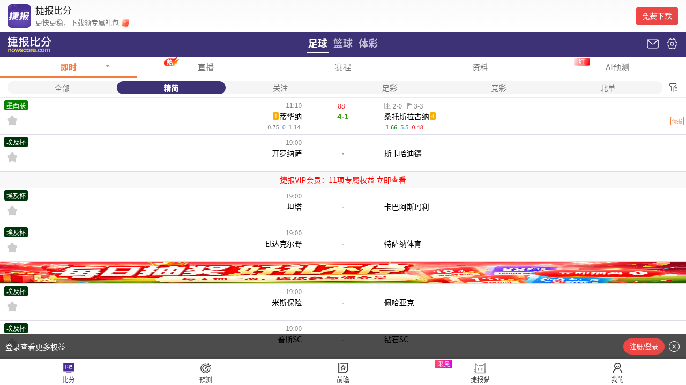

本次浏览器观察记录：首页标题为“足球比分_篮球分析_比分直播_足球比分直播 – 捷报比分网”；桌面页面包含前瞻/分析内容、联赛/赛事入口与作者排行。桌面截图首屏被计划单推广弹层覆盖，说明促销是可能出现的页面状态，但该弹层遮挡了主体内容，v2.0 不应照搬其遮挡式体验。移动版 390×844 实际截图显示了完整比赛行、会员横幅、登录权益条和比分/预测/前瞻/捷报猫/我的五项底栏。早先一次移动抓取出现“数据加载中”提示；另一时点成功加载，说明抓取结果具有时变性，不把单次超时写成常态。

会员页截图实际显示 VIP 主视觉、月/季/年套餐卡、开通按钮和权益列表入口。价格会随运营变化，因此不复制价格；v2.0 套餐由管理员配置。

## 方案对比矩阵

表中“直接观察”是页面结构的可见事实；“主观评分”是本次实现参考价值判断，不是产品性能或覆盖率测量。成本/授权风险是项目侧评估，未做源站压测。

| 方案 | 接入层级 | 赛事信息密度 | 专家/编辑内容 | 移动导航 | 会员体系 | 本项目复刻成本 | 版权/依赖风险 |
| --- | --- | --- | --- | --- | --- | --- | --- |
| 捷报比分网 | Web、移动 Web、Android 下载入口 | 高；比分、赛程、分析、赔率入口并行 | 高；前瞻、作者排行、预测内容 | 高；底部五项导航和体育/栏目切换 | 高；独立 VIP 套餐与权益页 | 中高；页面与内容模块多 | 中高；品牌、文章和媒体资产需授权 |
| 500彩票网 | Web 与移动入口 | 高；赛事比分与彩票相关页面并列 | 中；以赛事、赛果和购彩分析内容为主 | 中高；适配移动访问 | 中；围绕购彩产品的会员/服务能力 | 中；需重新映射产品和投注语义 | 高；购彩业务、文案和素材属于独立产品 |
| Flashscore | Web 与移动应用 | 高；实时比分与赛事列表是核心 | 低至中；赛事信息优先 | 高；移动端以比分、关注赛事和导航为核心 | 中；应用/内容增值能力需按市场验证 | 中；列表密度高但会员内容不同 | 中；品牌、球队图标和数据授权需核验 |

## 流程映射

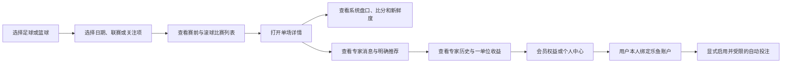

## 可复核来源

- [捷报比分网首页](https://www.nowscore.com/)：桌面导航、首页内容栏目和登录入口。
- [捷报比分网移动版](https://m.nowscore.com/)：移动赛事与底部导航结构。
- [捷报比分网赛事详情示例](https://live.nowscore.com/analysis/2995379.html)：对阵标题、让球分析、赔率页面资源。
- [捷报比分网 VIP 页面](https://guess.nowscore.com/vip)：会员权益和套餐布局。页面套餐内容可能随运营变化，不把观察到的价格固化为 v2.0 配置。
- [500彩票网](https://www.500.com/)：赛事与彩票内容呈现对比。
- [Flashscore 足球](https://www.flashscore.com/football/)：比分优先和移动应用式赛事列表对比。
- [Hermes Agent v0.22.5 Release](https://github.com/NousResearch/hermes-agent/releases/tag/v0.22.5)：本次选定的固定运行版本。
- [Hermes API Server 文档](https://hermes-agent.nousresearch.com/docs/user-guide/features/api-server)：Hermes 内置 Agent API；业务调用应送到该内部 Agent API，而不是向模型供应商另发请求。
- [Hermes MCP 文档](https://hermes-agent.nousresearch.com/docs/user-guide/features/mcp)：自定义工具服务器接入方法。
- [Hermes Skills 文档](https://hermes-agent.nousresearch.com/docs/user-guide/features/skills)：技能发现与项目技能目录配置。

## 研究限制

浏览器和 HTTP 页面观察可复核；早期一次移动请求未载入比赛，后续390宽截图已经成功加载，二者分别保留记录。网页源站和会员套餐持续变化，截图与导航结论仅代表 2026-10-26 的观测。对比表中的实现成本、信息密度和授权风险均为主观工程判断。正式发布前需复核数据展示权、赛事图标授权、会员/支付规则及目标域名的访问行为。

## 2026-10-26 补充采样与实现对照

本轮 Docker 浏览器重新访问官方桌面比分、桌面首页和手机比分，退出码均为0。手机视口明确为390×844，桌面为1440×960。旧的“移动截图”实际宽1280，只保留为较宽视口证据，不能再作为390宽度验收图。新手机截图成功加载比赛列表；原文“移动数据区未成功加载”仅对应早期某次请求，不能代表最终观察。

| 位置 | 官方可见结构与本次测量 | 实现方式与主动差异 |
| --- | --- | --- |
| 桌面赛事页 | 紫色一级导航约50高，赛事主区约1030宽，比分表约32高行，白底隔行灰，状态与队名分列 | 1180容器内主栏与专家栏并列，比赛行40高以容纳系统报价证据；独立品牌 |
| 手机赛事页 | 紫色体育栏约46高，二级栏目约38高，比赛行60至70高，联赛标签、双方、比分、赔率分层 | 同样单列分层，增加日期筛选、取消状态、来源时间，比赛行74高 |
| 手机底栏 | 五项固定底栏，带图标及文字，约49高 | 比分、赛程、专家、会员、我的，57高加安全区；删除旧AI与算法入口 |
| 会员 | 深色与金色主视觉，月季年套餐并列，权益列表 | 套餐由后端实际配置，未接支付显示不可在线购买；不复制运营价格、收益宣称 |
| 原文与管理 | 原站信息布局作为参考，本项目功能来自TG及乐鱼业务契约 | 增加审核原文、工具轨迹、报价编号、本人账户隔离、独立管理入口 |

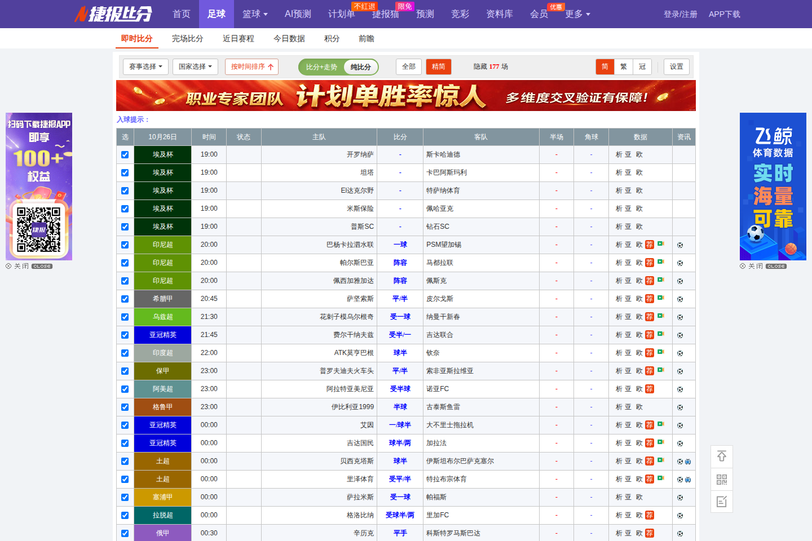

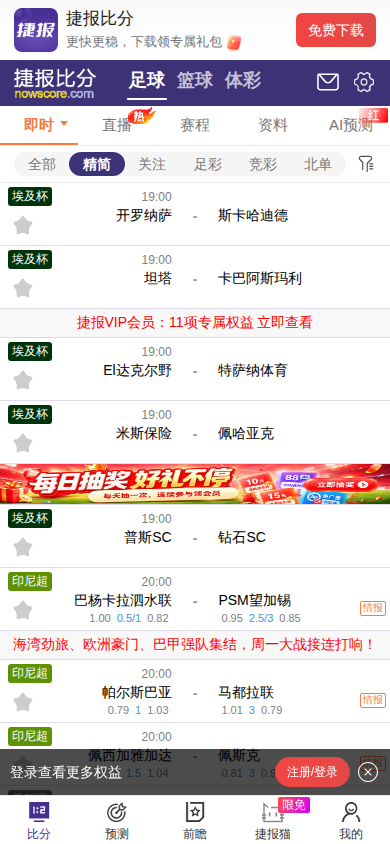

以下为隔离固定样本的候选实现截图，所有球队、专家、收益和时间均为浏览器测试样本，不能作为生产数据或盈利证据：

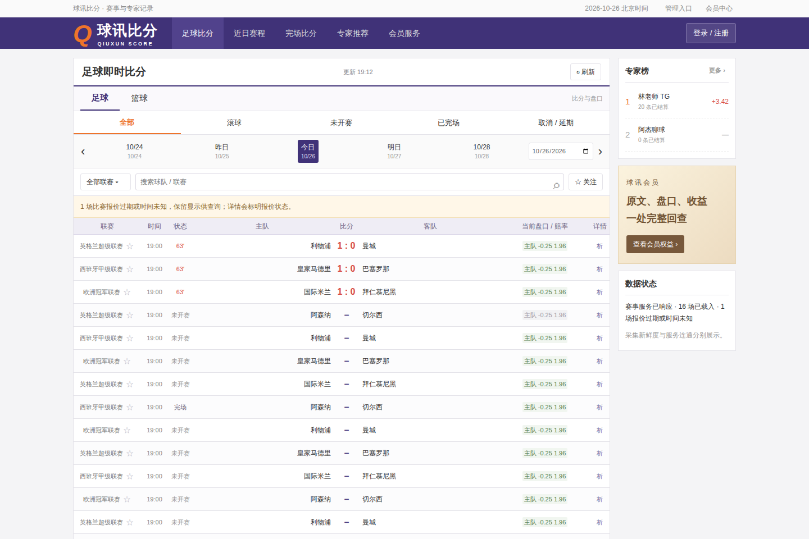

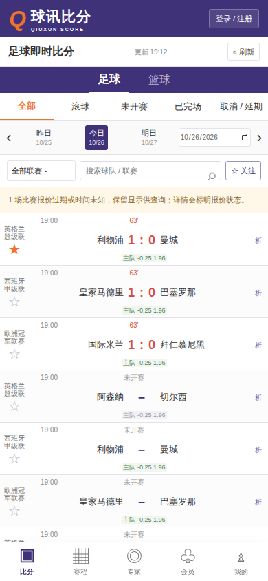

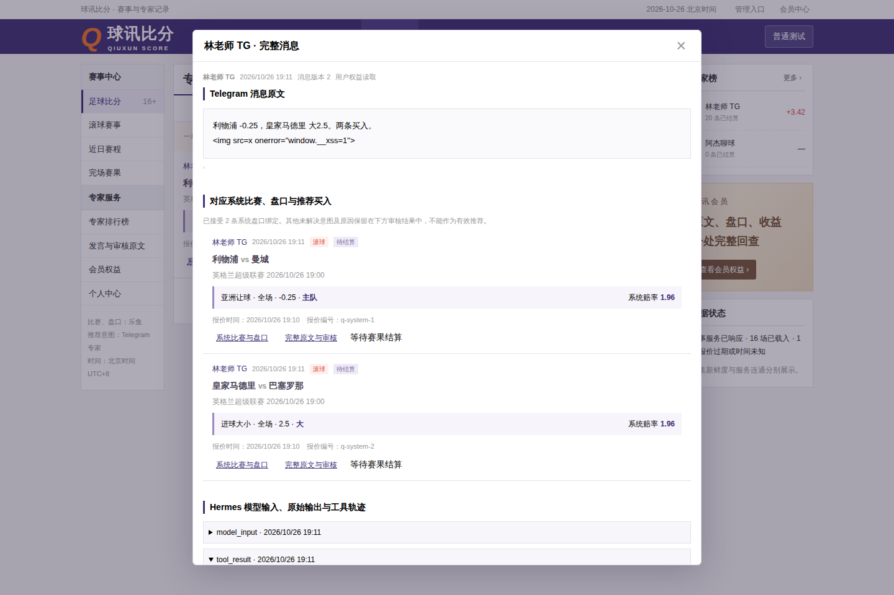

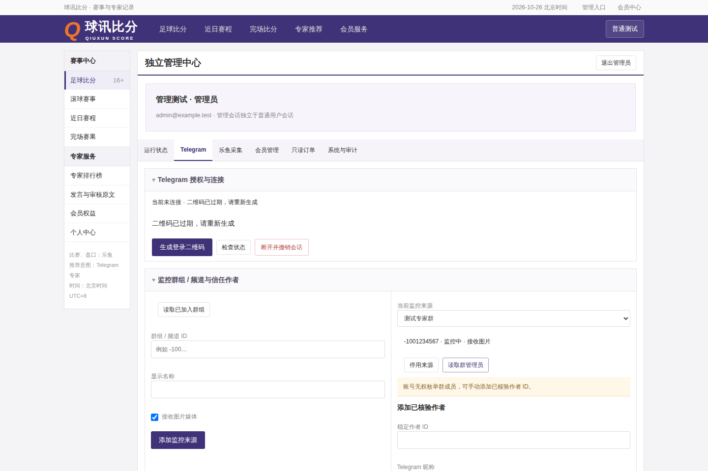

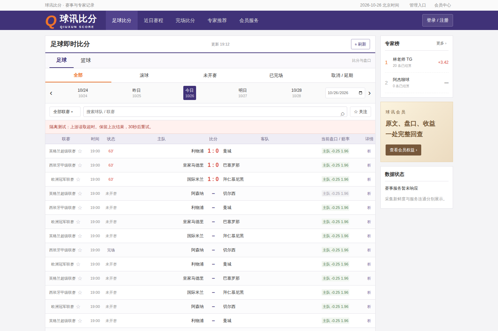

原站资源依赖已经单独记录在资源清单中，授权未确认的品牌、文章、广告、球队图及样式均未打包进产品。生产页面的品牌、装饰和图标由代码构成；二维码库保留MIT版权声明。此次实现匹配已观察的信息层级和布局规则，不宣称所有页面像素完全一致。

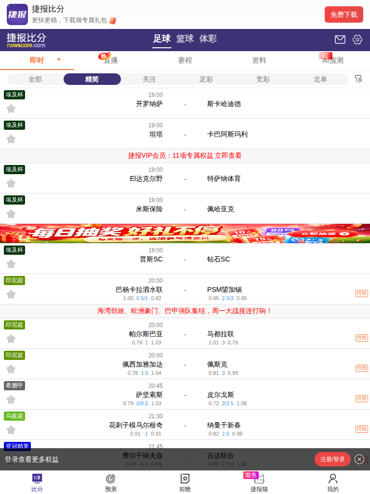

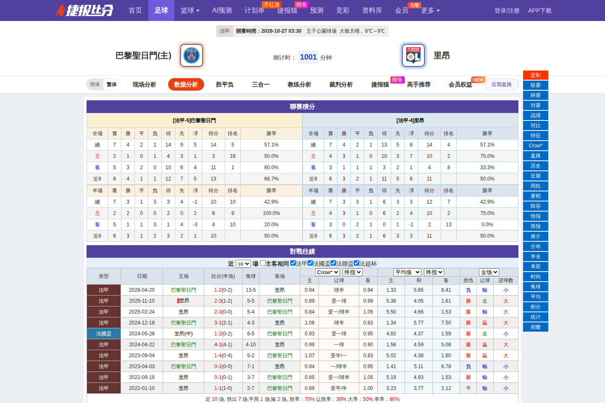

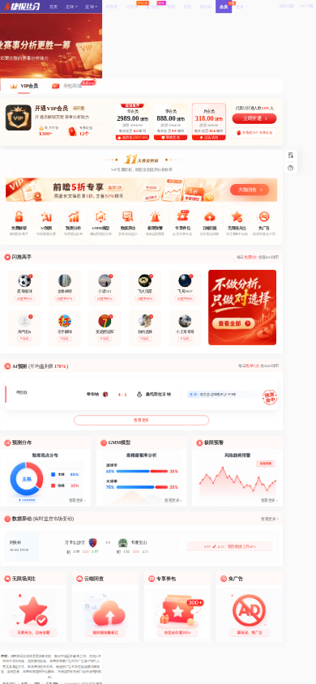

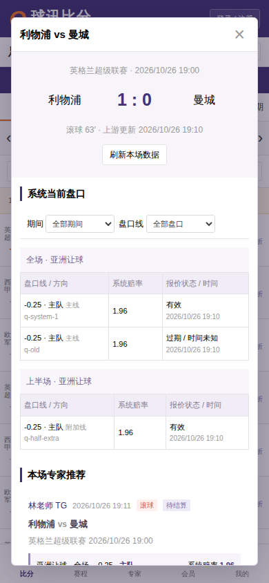

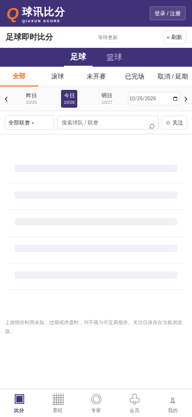

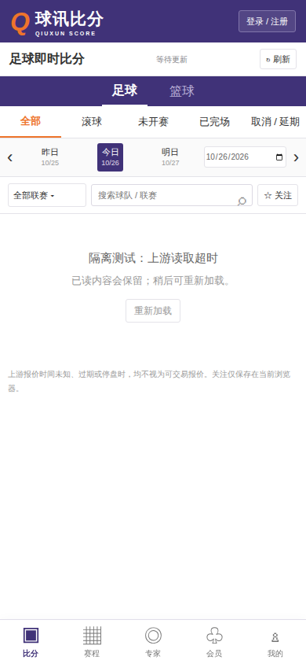

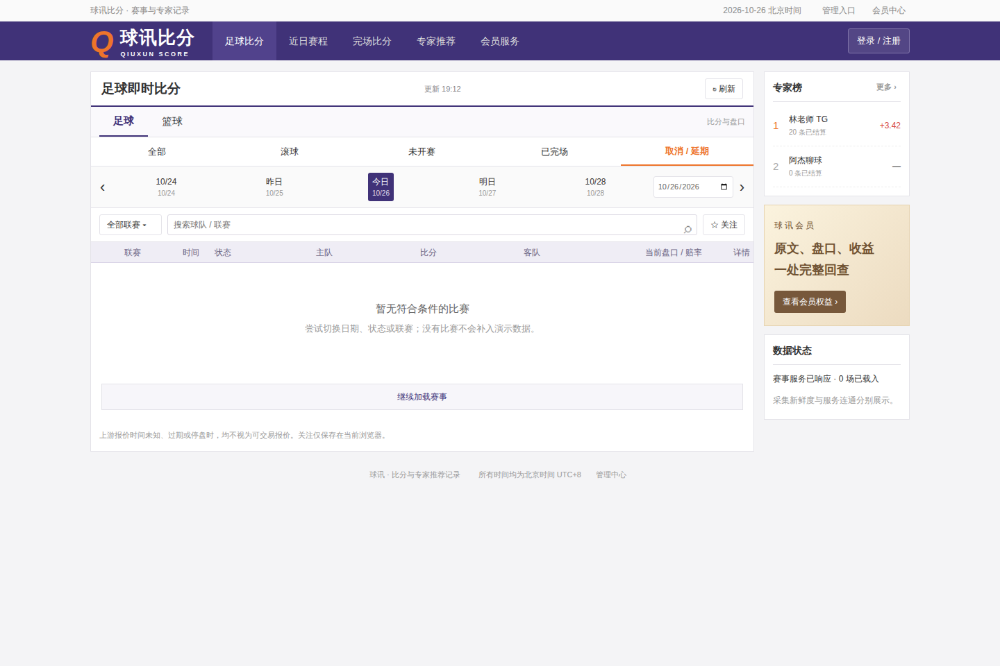

正式差异：原站存在AI预测、购彩内容、文章及广告，本平台只保留专家业务；原站昵称、头像、盈利宣传和付费价格均不进入生产样本。未观察到的原站错误重试行为不作推测，本平台按已验证的读取超时和旧内容保留要求自行实现。

桌面复核已修正早期候选的联赛列过窄：原77宽及57文字限制改为120列宽/100文字宽，时间、状态、比分列相应收紧，完整title作为长名称补充。上方候选截图由最新隔离浏览器重生成；40高比赛行保留，与原站约32高的差异明确存在。浏览器验收另覆盖360、390、768、1280、1440宽，不用原站某个更宽视口冒充手机证据。

界面验证分两类：HTTP Mock覆盖状态、故障和并发竞态；隔离真实API联调用当前构建、任务专属临时PostgreSQL及人工样本验证身份、会员、原文和账户排队。二者均不接真实账户和资金。远端生产新鲜度、模型、TG和S3授权图片仍需单独真实联调，不能从上述截图推导已上线或盈利。

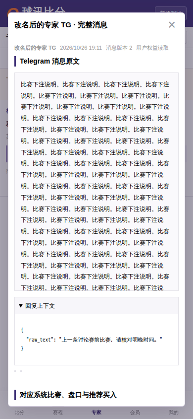

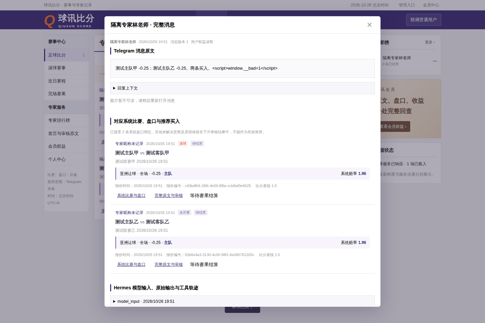

最终HTTP Mock 22项及隔离真实API 10项均通过，退出0。新增真实链路涵盖本人资料导出、人工恢复码重置后登录、管理员一次性恢复码、只读运维和注销撤销会话。媒体S3未配置的503在结果中单列；下方图片来自样本浏览器，不是生产截图。
