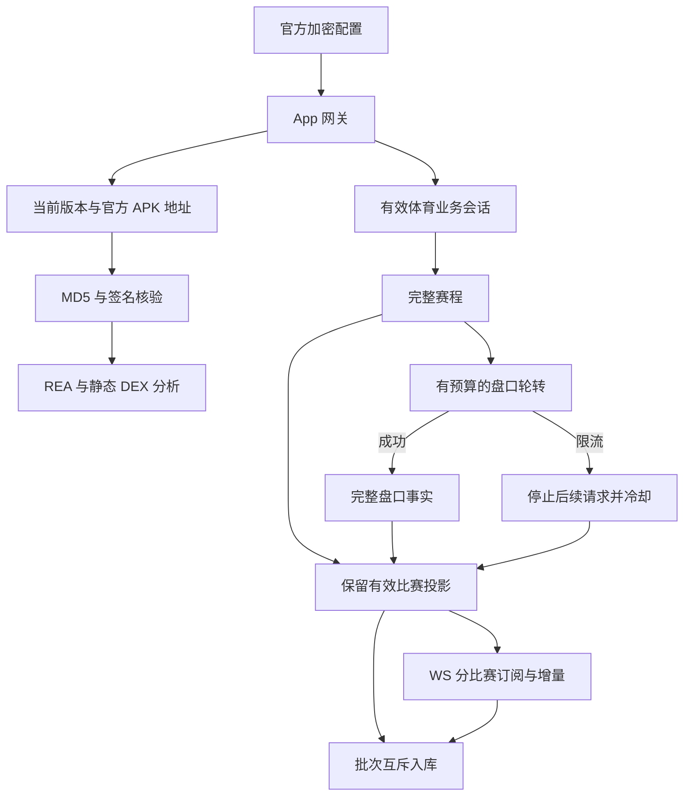

# 乐鱼 0401038、域名与 Android 2.0.2 核验

日期：2026-10-27，时间统一 UTC。任务 TASK-76。当前阶段：APK 与协议分析完成，采集恢复修复正在真实验收。

## 结论与证据边界

当前没有证据支持“0401038 是业务域名已经失效”。12:27:52 与 12:29:00，部署中的同一业务域名分别成功返回全量赛程；12:29:00 的单批盘口也成功。12:30:39 的受控低并发测试完成 2,075 场赛程及 36 场盘口，三批盘口全部成功，没有更换域名、业务令牌或代理。以上为测量事实，不等于已测出上游限流阈值。

项目故障放大点已从代码确认：首次补盘会选出全部到期赛事；任一盘口批次返回限流会中止整轮，丢弃已成功的赛程及盘口；下一轮仍从头开始，因此实时连接虽然在线，初始比赛投影却一直为空，订阅数为零。缺失批次明细还会逐场回退请求，缺少整轮上限。新修复限制每轮补盘并跨阶段轮转，保留完整赛程；限流后停止后续盘口请求、保留成功结果并冷却，不借换域名、换 IP 或重复登录继续请求。

官方当前发行信息确实已从 2.0.1 更新为 **2.0.2 / 202**；这证明版本陈旧，不证明版本差异是限流的直接原因。当前 App 网关与官方加密域名配置解出的地址相同，公开初始化及两个版本查询均返回 6000。

## 方法与来源

证据等级：A 为官方当前 HTTPS 响应、已验证发行包、REA 静态证据及真实运行测量；B 为行业或二手资料；C 为社区观点。本次结论仅使用 A 级来源与明确标记的工程推断。

从用户此前授权的原生抓包恢复 `versionInfo` / `fixVersionInfo` 的公开版本查询路径，再通过部署中已经核验的官方 App 网关读取当前响应。响应给出的官方 CDN 用于下载，不使用搜索引擎中的同名下载站。官方配置另给出的两个公开下载落地页本次均返回 HTTP 错误，因此没有把它们描述成成功访问的网页。发行信息以当前官方接口及签名连续性为依据。

| 样本 | 当前官方字段 | 大小 | SHA-256 | 核验 |
| --- | --- | ---: | --- | --- |
| 2.0.1 历史主包 | 旧抓包版本响应 | 193,074,625 | `51fb16eb7d527908657e254226e191a194f0f80daaa884cef03bdfb151738ed9` | 历史官方 MD5；本次签名复核 |
| 2.0.2 当前主包 | android_all_url | 198,610,342 | `08f0d8c1e0eb0e2637740bc3d36981ab4479d3cc679c7f8c1e5226ac6c9c5253` | 当前官方 MD5 一致 |
| 2.0.2 当前修复包 | fixVersionInfo.android_all_url / replace_url | 198,614,552 | `298bc7d8844d1530e325d007807c61913d3b764dcc7260caceba919ba49e5462` | 当前官方 MD5 一致；REA 包信息 |

三个样本均通过 `apksigner verify --verbose --print-certs`，退出码 0，v2/v3 签名通过，同一证书 SHA-256 为 `c69a0d8b2cc5b56a8e848114f770d84031458bc2be6bfb3e1946914c6714ac52`。REA 本身没有验证签名，该项由独立 Android 工具完成。新修复包包名为 `com.s15af5x.all2`，最低 SDK26、目标 SDK34。没有安装或运行目标 APK。

原始包直接反编译只有六个壳类。新旧 x86_64 静态装载器逐字节 SHA-256 相同，因此复用已验证装载格式做静态转换；新版共恢复九个 DEX，全部 SHA1 头和 Adler32 校验通过。旧脚本原先锁定八个 DEX，首次运行因此拒绝，核对九个独立校验后才将新样本计数固定为九。派生分析 APK 不是官方签名安装包。

## 三条实现链路对照

| 维度 | 历史 App 2.0.1 | 当前 App 2.0.2 | 部署 v2 与修复 |
| --- | --- | --- | --- |
| 地址引导 | 加密 IPJson / provider 候选 | REA 证实仍为 HTTP 配置 → AES → ApiInfoEntity | 现有加密源可解码，当前地址与部署相同 |
| App / 业务令牌 | App token 与场馆 requestId 分离 | OBNetworkExceptionEngine 存在业务刷新契约 | 保持分离；限流不触发登录 |
| 赛事列表 | 旧 H5 全量快照 | 原生 liveMatchesPB 与 noLiveMatchesPagePB | H5 getOriginalDataPB 当前实测成功 |
| 盘口 | H5 批次与单场明细 | 原生 getMatchBaseInfoByMidsPB / matchDetail | H5 structureMatchBaseInfoByMidsPB 当前实测成功 |
| 并发与预算 | 旧客户端含限流退避 | 原生接口存在滚球与赛前分页 | 修复为默认并发一、间隔一秒、每轮 96 场补盘 |
| 部分失败 | 历史实现与重试路径不同 | 未做完整运行验证 | 保留全量比赛，失败盘口明确不完整 |
| 实时连接 | C0 / C8 | 本次未运行 App 抓取 WS | 修复后 2,058 场订阅已恢复，继续核验写入 |
| 入库冲突 | 不在 APK 职责内 | 不在 APK 职责内 | 发现轮询与推送行锁竞争，增加本地批次互斥 |

原生 API 路径来自 DEX 注解静态解码，区别于 REA 的类和方法观察；不得把它们称为真实成功调用。当前 H5 接口仍可用，因此没有盲目替换为请求体和响应未完成验证的原生接口。

## 关键 REA 证据

| 观察 | 证据 ID | 范围 |
| --- | --- | --- |
| 2.0.2 修复包元数据 | `ev_4b434331690435473624a92cd207a87850972975d377b0f1d88d0b7c9c2e3bd7` | 包声明与壳层；非签名验证 |
| IPJsonProvider | `ev_acad959a83a52f9a524c775eab4370d37b47f1cd56614b0c1a282248d3edaaa4` | 新派生 DEX 的接口 |
| 配置请求和解密调用 | `ev_34d5b328f0271fc497c2d6315da7ea7630e410a82bb534a418ce17cd21242e26` | GET 15 秒超时、HTTP200、AesUtil、ApiInfoEntity |
| OBApi | `ev_e2b3204de04d17ad2e3cf504e304a9c5ad169368432af1ac241c0aec5fe93413` | 体育 API 方法清单；抽象方法无执行体 |
| 业务令牌刷新接口 | `ev_dc105acf04ab61e4fd3d4c8c013abecc4031b1fdc4b0d1d9b9f18b91e7e40b40` | refreshToken 契约，未据此推断 0401038 语义 |

## 验证与剩余问题

- 首轮 Docker 冻结全套回归：473 项、180.801 秒、退出码 0；加入入库互斥后再次运行针对性测试并进行真实部署验收。
- 上游没有公开可核验的 0401038 限流规则；本次没有测量“每秒多少次必触发”。低负载成功与全轮失败支持请求扇出/失败处理方向，但服务端容量、账号预算、路由策略仍可能共同作用。
- 登录代理仍只用于登录，普通采集保持直连；本次调查没有再次提交密码登录，没有进行投注。
- Telegram 当前另有 `AuthKeyDuplicatedError`，官方赛果确认仍未配置；本次乐鱼修复不等于这些业务验收完成。
- 持久数据继续写远端，APK 与本次脱敏证据仅作被忽略的项目内分析缓存，未提交 Git。

## 远端数据库故障放大与恢复测量

首次恢复全量赛程后又暴露独立瓶颈：采集轮询与 WebSocket 同时更新同一赛事，而旧入库路径每场比赛、每条赔率均单独往返远端数据库。单次实测往返为 0.583 秒；这只是一次测量值，不是长期延迟分位数。数十场比赛加上千条报价会把事务拉长，触发 25 秒 HTTP 超时和行锁等待。只限制上游并发不能解决这个远端写入瓶颈。

本次修复使用一次 JSON 记录集 upsert 写入一批赛事，报价通过 asyncpg 管线批量写入；完整快照只关闭未出现的精确盘口键，旧事件不会覆盖新价格或关闭新报价。重复来源编号在任何写入前拒绝，混合新旧赛事只接受不陈旧的记录。轮询和推送在每个上传批次边界互斥，盘口最多 2,000 条/批，纯赛事元数据提高到 250 场/批，减少远端事务开销，并在批次间允许实时推送交替写入。

| 时间（UTC） | 真实测量 | 解释 |
| --- | --- | --- |
| 12:51:08 | 远端投影 2,104 场、58 场滚球足球 | 当前投影包含之前见过的场次；不等于当轮有效订阅数 |
| 12:52:00 | 3,299 条盘口、1,535 条 active，324 条 active 源时间在一分钟内 | 不以接收时间冒充源时间 |
| 12:56:01 | 2,119 场投影、60 场滚球足球，公开接口 HTTP200、1.633 秒、1,059 条摘要盘口 | 该时点默认 15 秒交易门禁下零场标为 fresh，不能据此宣称全部可投注 |
| 12:56:07 | 实时订阅 2,032 场、队列深度 0、丢弃 0、写入失败 0 | 重启后的新观察窗口，不能和重启前累计窗口直接比较 |
| 12:56:07 | 源事件至写入 P50 3.460 秒 / P95 6.586 秒；队列等待 P50 0.555 秒 / P95 1.468 秒 | 样本数分别 59 与 62，为短窗口实测，不是长期 SLA |

系统状态仍为 partial：并非每场比赛都有持续变价，历史报价和当前盘口的源时间会自然变旧；新鲜度门禁继续保留，未用增大门禁或改时间伪造“全绿”。上游没有可核验的公开 0401038 限流阈值，本次低并发默认值是保守运行预算，并非官方承诺值。若扩大到并发二或增加每轮预算，预计请求压力和触发风险上升；若减半预算，补盘覆盖速度下降但完整赛程及 WS 覆盖仍应保持。没有为了寻找阈值对真实上游做压力测试。

## 可复核文件与构建

公开发行来源与校验和见 data/apk-provenance.json；受控请求测量见 data/measurements.csv；真实恢复快照见 data/runtime-verification.json 和 data/collector-verification.json。Mermaid 源码、编译器版本及哈希在 data/，静态 SVG 位于 images/。原始抓包和发行包不提交仓库，报告不包含会话或签名秘密。

双端报告采用既有离线渲染链，真实浏览器检查 1440 与 390 像素、图片解码、页面溢出、流程图可读及 file 直接打开。首次检查暴露“流程图已经能完整放下却要求必须滚动”的过强断言，以及长校验和在手机上撑宽页面；分别改为只对溢出流程图验证滚动、长代码自动换行，再通过原检查。报告不依赖在线 CDN。

最终本机 Docker 冻结回归（包含 250 场元数据批次）：477 项、182.094 秒、零失败/错误/跳过，退出码 0。定向 LeYu 协议与生命周期 46 项、0.249 秒，退出码 0；Compose 契约、8 文件 Python AST、规划结构和 Git 差异空白检查均退出码 0。完整命令为 sh infra/test/run.sh，证据摘要见 data/regression.json。正式提交内容还需通过 GitHub 干净检出 CI；本机冻结快照不冒充已提交内容验收。
