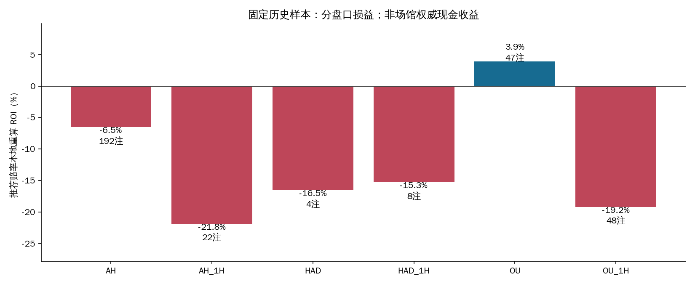
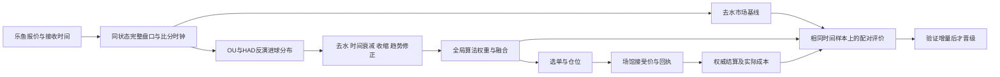
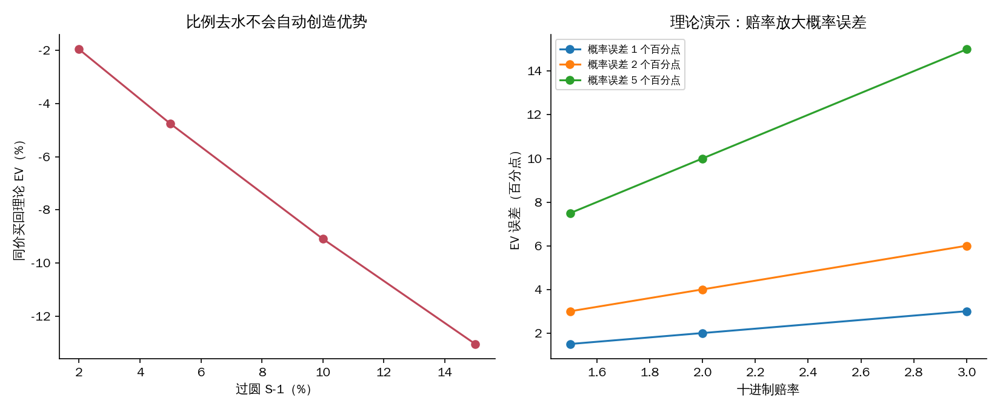
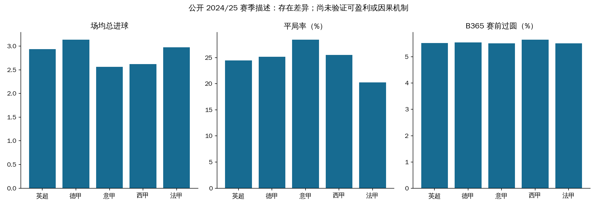
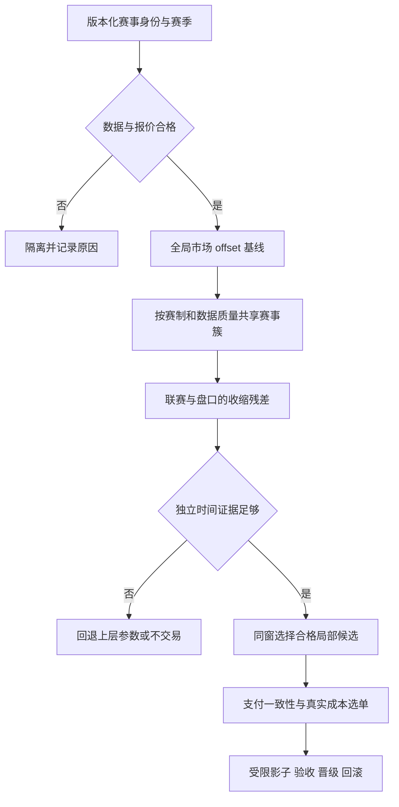
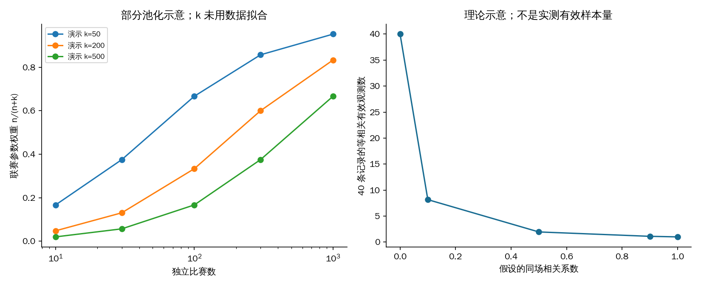
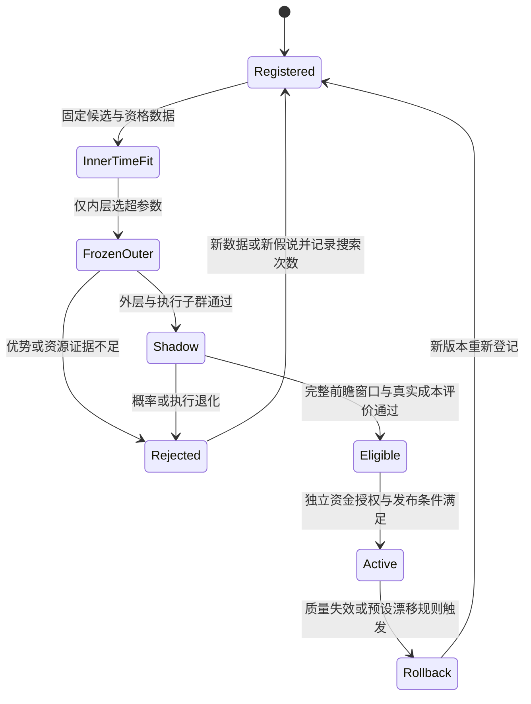

# 纯算法为什么亏损，以及如何按联赛优化决策

研究日期：2026-10-15。代码基线：`origin/main` 的 `4a1c1cd68db6f2b12f8c836edc126b33de8c4b97`；关联 [#55](https://github.com/1420970597/ai_football/issues/55)、[#58](https://github.com/1420970597/ai_football/issues/58)、[#52](https://github.com/1420970597/ai_football/issues/52)、[#42](https://github.com/1420970597/ai_football/issues/42)。本报告描述这一冻结版本的算法和既有审计，未重新测量生产状态。

## 1. 直接回答两项需求

**当前没有证据表明纯算法在真实成本后具有持续正期望。** 已确认的历史问题包括结算对象错误、复合盘口负号解析错误、概率收缩调用错误、比分更新与旧报价混用，以及数据/验证人口不一致。这些错误曾制造虚假高胜率和高收益。相应工程修复已有提交；修复正确不等于修复后的策略已证明盈利。当前结构性风险是：大部分算法把同一套乐鱼赔率反演、平滑、去水后再融合，市场信息的重复转换没有自动增加独立预测优势；时变进球、比分/红牌、报价质量和成交选择仍需同窗实验验证。

**值得替换的是未经验证的概率修正规则及其选单方式。** 优先路线是市场 offset 加收缩残差，并以动态进球模型、事件强度模型及受限树模型作挑战者。概率模型决定“有没有优势”，决策算法决定“哪些优势值得交易、交易多少”；调 Kelly 或提高命中率本身不能扭转负期望。只有时间外推、实际选单子群、真实成本和成交价格全部对齐后，才有依据晋级。

**足球存在有官方体育裁决支持的比赛操纵个案，但未发现足以证明某个完整联赛当前由资本或庄家系统控制的证据。** 历史俱乐部案件不等于整个国家或联赛有固定操盘规律；本项目单一盘口数据也不能识别操盘者或资金意图。可疑赔率不应自动生成“反向跟庄”交易信号。

**可以设计按具体联赛自动优化，而且不需要先证明操纵成立。** 联赛的进球分布、赛制、赔率偏差、更新质量及模型残差可能不同。建议采用“全局基线 → 赛事簇 → 联赛×盘口”的部分池化，样本少时共享参数和回退；在独立时间测试上证明局部模型更好后，才增加该联赛的独立参数。全面改造应覆盖数据身份、概率、选单、成本、校准、晋级和回滚，而不是只增加一个 `league` 开关。

## 2. 证据范围与口径

证据等级：**A**＝冻结源码、已保存原始记录、一手机构/作者/出版社材料；**B**＝学术结论及统计推导；**C**＝工程假说或社区观察。来源真实性与结论适用范围分别评价：出版社摘要是 A 级来源，但不能据此声称复现了论文实验。本文没有用社区盈利传闻作为证据，也没有主观数值评分。

| 证据 | 本轮做了什么 | 能回答什么 | 不能回答什么 |
| --- | --- | --- | --- |
| TASK-40 真实回执历史审计 | 阅读已有报告和附件说明；未再次访问场馆 | 当时真实损益与代码结算错配 | 修复后现在的长期净收益 |
| TASK-58 脱敏订单固定快照 | 重算已结分母、金额及分盘口数据 | 指定旧样本的本地重算损益 | 场馆接受价、手续费或权威现金结算 |
| 冻结主线源码 | 检查 `live_expert`、`ensemble`、`economics`、`learned_model`、验证契约 | 当前实现做了什么、缺什么 | 每个缺陷分别造成多少真实亏损 |
| 足球公开赛季 CSV | 校验原文件 SHA256；统计 1,752 场结果及赛前 B365 赔率 | 描述五个联赛单赛季差异 | 乐鱼滚球优势、操纵发生率、策略 ROI |
| CAS | 阅读三份官方结果通报完整文字 | 当时的体育裁决和具体案件 | 完整判决理由、后续刑事史、2026 年联赛风险 |
| Sportradar | 浏览器核验 2024/2025 官方新闻稿及报告入口 | 机构自报的监测数量 | 可疑场次全部被证实、逐联赛真实发生率 |
| 方法研究与软件文档 | 逐项标明作者 PDF、摘要或文档范围 | 提出可检验方法和实现参照 | 宣称已全文复现全部论文或候选必盈 |

来源与哈希见 [sources.csv](data/sources.csv)，输入见 [input_manifest.json](data/input_manifest.json)，阅读说明见 [source_notes.md](data/source_notes.md)。历史材料的日期与版本是不同快照，不能串成“修复后再次亏损”的因果链。

## 3. 亏损证据：两种损益不能混用

### 3.1 当时真实现金亏损和错误结算已有直接证据

[TASK-40 历史报告](../auto-betting-loss-audit/REPORT.md)的 2026-10-11 场馆快照中，160 笔可匹配自动订单、120 场、投入 758.00、场馆净额 −10.67，ROI **−1.41%**。相同成交赔率、金额和结果，在当时错误本地结算中得到 **+235.825**；79 笔金额不一致。按下注后的剩余比分与正确负号拆盘重算后，160 笔均对齐结果，仅有合计 0.065 的逐笔分钱舍入差异。它直接证明结算缺陷会制造虚假盈利，不能证明其修复能让未来策略盈利。

该历史报告给出的按比赛聚类区间约 −11.52%～+8.26%，样本不足以确定长期期望。本轮引用旧归档，没有重跑场馆查询、原 bootstrap 或将旧开关状态当当前状态。

### 3.2 另一份快照的 −8.53% 是推荐赔率重算

TASK-58 的固定 CSV 共 **362 行**，其中 **41 pending** 排除，剩 **321 笔已结、233 场**。本金 **1,384.03**，本地重算净额约 **−118.03**，ROI **−8.53%**。脚本用 Decimal 保存精确算术值 −118.02560，只是快照对账，不代表测量精度或稳定收益率。原归档的区间约 −17.52%～+0.29%，本轮未重跑；不能称已统计证明长期亏损，也不能称场馆权威资金亏损 −8.53%。

| 盘口 | 已结笔数 | 本金 | 推荐赔率重算净额 | 重算 ROI |
| --- | ---: | ---: | ---: | ---: |
| 全场 AH | 192 | 860.60 | −56.19 | −6.53% |
| 半场 AH | 22 | 107.00 | −23.35 | −21.82% |
| 全场 HAD | 4 | 17.41 | −2.88 | −16.54% |
| 半场 HAD | 8 | 35.13 | −5.36 | −15.27% |
| 全场 OU | 47 | 171.09 | +6.70 | +3.92% |
| 半场 OU | 48 | 192.80 | −36.95 | −19.16% |
| 合计 | 321 | 1,384.03 | −118.03 | −8.53% |



见 [historical_by_market.csv](data/historical_by_market.csv)。同场可跨盘口，分盘口比赛数不能相加作为独立样本数。全场 OU 的局部正值不构成选择该策略的依据；样本小、同场相关、旧报价与规则混杂，且没有本轮重新估计区间。公开脱敏字段相同的两行也可能是不同订单，不凭字段相同擅自删单。

此前模拟中，高模型−市场分歧组贡献约 79.44% 净利润，只是子群利润占比，不能解释为“79%来自旧价或操盘”。单小时回放发现 195/390 首次推荐出现在比分变化后 30 秒内，是局部机制/相关性证据，不能外推全库污染比例或真实成交率。下单后 30/60 秒价格漂移可能包含新比分、红牌和时钟变化，不直接视为状态可比 CLV。

## 4. 当前纯算法为何缺少可靠盈利依据

### 4.1 决策链与验证缺口



`service/live_expert.py` 从接近五五开的全场 OU 去水概率反演剩余总进球强度，再用 HAD 主/客胜比拆主客强度。独立 Poisson 生成剩余比分分布；时间衰减版本把锚点强度按剩余常规时间线性缩放；半场采用剩余时间比例。去水共识、固定收缩和趋势调整主要仍来自相同盘口。

| 问题 | 已确认事实 | 亏损机制或待测假说 | 当前处置状态 |
| --- | --- | --- | --- |
| 结算对象、拆盘与概率错误 | TASK-40 回执与源码反例可核验 | 虚假胜率/EV/收益进入权重和标签 | 历史代码问题已修；旧样本影响须按谱系隔离 |
| 比分与旧价混用 | TASK-58 单小时回放有机制证据 | 新比分配旧赔率产生不可成交优势 | #60/#62 有冷却与执行复核；全库重标待验收 |
| 数据和验证人口错配 | #55 记录最早 40 截取、未来可见性、参数与执行子群缺口 | 离线成绩不能认证线上策略 | #62 已统一契约；新代效果另验收 |
| 多算法同源 | 冻结代码共享赔率、强度和支付分布 | 变换噪声被误当独立共识 | 待比较市场基线、单算法与残差融合 |
| 线性时钟/独立强度 | 当前模型结构可核验 | 比分、红牌、补时和低比分相关导致失配 | 是研究假说，尚无各因素亏损分解 |
| 权重目标与选单人口 | Beta 命中率及相对市场 Brier，按全局算法首判聚类 | 赔率差异、推荐选择和重复比较带来偏差 | 聚类/收缩已有；联赛与成交子群需补 |
| 成交成本只是示意 | `q_fill_model` 注释明确参数非实测；估价调用 `stake=1` | 价格变差、拒单与信息更新使优势选择性消失 | 需用接受/拒单及实际金额拟合和检验 |

`core/ensemble.py` 的 `adaptive_weights()` 没有联赛身份或联赛条件参数；相对 Brier 的加入和比赛聚类是已有改进，但命中率仍不能替代赔率条件化收益。融合分歧小也不能证明概率经过校准。

`core/learned_model.py` 已有市场 offset，但当前拟合只估计 **7 个残差坐标**；保存的特征向量长 60，不等于 60 个特征都参与学习。它也还没有联赛条件参数。报告不引用旧 v4 数据上的成功实验作为新 v5 契约的准入证据。

### 4.2 去水不等于找到了可买的价值

对同一完整市场的比例去水，令 `S=Σ(1/oᵢ)>1`，`qᵢ=(1/oᵢ)/S`。用该概率买回同一个报价：

```text
EVᵢ = qᵢ × oᵢ − 1 = 1/S − 1 < 0
```

例如两边赔率均 1.90，去水各 50%，同价买回 EV 为 −5%。这只针对同市场、同价、比例去水的无走盘例子，**不是所有跨盘口模型不可能盈利的定理**。Power/Shin 去水可能改善概率刻画，但不自动产生超过交易成本的优势；Shin 参数也不是现实“操盘概率”。

若模型概率误差为 `Δp`，无走盘 EV 误差为 `o×Δp`。赔率 2.00 时，2 个百分点概率高估就制造 4 个百分点虚假 EV，足以淹没很薄的优势。OU/AH 应按赢、输、走盘/半赢半输的本金分解计算，不能直接拿一个命中率套全部盘口。



上述是代数/敏感性示意，非拟合收益；参数见 [margin_identity.csv](data/margin_identity.csv)、[probability_sensitivity.csv](data/probability_sensitivity.csv)。过圆取 2%/5%/10%/15% 都保持同价 EV 为负；误差方向不变，赔率更高放大更多。Kelly 缩小仓位可降波动，但不会让一个真实负 EV 变正。

### 4.3 每场采样 40 条会不会影响准确率

**可能影响，方向和幅度尚未实测。** 现有新契约把 40 作为时间分层软目标，并保留完整盘口曲线，已修复“最早 40 条”的偏差。仍可能漏掉进球/红牌/暂停复牌/跨线迁移附近的短窗口；仅增加静态 tick 可能只增加相关数据，不能替代更多独立比赛。

未来对同一冻结比赛集、同一完整验证人口比较 20/40/80/全量及事件增强采样：保留报价资格、双时间和全部方向；训练策略变，测试集不随之变。报告事件窗口覆盖、盘口覆盖、运行资源、市场配对 Brier/log loss/校准和实际选单收益，先登记采样方案再看结果。不要在全量验证中移除难预测 tick 来“提高准确率”。

等相关理论示意：`n_eff=m/[1+(m−1)ρ]`。m=40、ρ=0.5 时约 1.95；这不是本项目测得的相关性或有效样本量，只解释同场 tick 为何不能当 40 场独立比赛。风险推断应按比赛/比赛日聚类。训练资格 100 场是工程门槛，不是联赛模型或盈利证明所需样本量。

## 5. 如何优化，以及替换成什么

### 5.1 优先级与候选算法

| 路线 | 要解决的具体问题 | 所需信息 | 优势 | 限制与反例 | 顺序 |
| --- | --- | --- | --- | --- | --- |
| 市场基线 + 不交易 | 给出最低可审计参照 | 完整同状态赔率 | 零额外参数，暴露虚假优势 | 概率基线不是可盈利交易 | B0，所有实验必须保留 |
| 市场 offset + 收缩残差 | 同源算法重复计权、未校准修正 | 合格赔率、已结标签及 as-of 特征 | 参数少、零残差回市场、可解释 | 市场已吸收特征时没有额外增益 | B1，首选基线 |
| 联赛部分池化 offset/GAM | 联赛/盘口残差及非线性时间差异 | 稳定赛事 ID、多赛季有效比赛 | 冷启动共享信息，逐步放开局部参数 | 过度池化可能抹掉真实差异 | B2，先与 B1 同窗比较 |
| DC/动态双变量 Poisson | 低比分相关、球队强度变化 | 球队身份/历史和可见市场先验 | 比分分布与跨盘口支付一致 | 赛前 DC 不能直接当滚球算法；增加参数未必更好 | B3，结构挑战者 |
| 动态事件强度/hazard | 红牌、比分与阶段改变进球率 | 核验事件码、双时间、补时信息 | 对滚球状态解释直接 | 信息可能已在赔率里；缺事件不可编造 | B4，有可靠事件再消融 |
| 受限 XGBoost/LightGBM/CatBoost | 残差中的交互和非线性 | 足量时序样本、市场 prior/base margin | 可作为强表格数据挑战者 | 小样本联赛过拟合、校准和泄漏风险 | B5，不能默认替换 |
| 不确定性约束选单 + 分数 Kelly | 微小边际优势、相关持仓与尾部风险 | 已验证概率、支付分布、成本及资金敞口 | 交易目标与估计风险一致 | 只负责决策/仓位，不能创造预测优势 | 与 B1～B5 分离评估 |

M1（Dixon–Coles）和 M2（动态双变量 Poisson）报告了历史英格兰样本的收益；本轮仅核验出版社登记摘要，没有复制其数据或实验。M3 的进球/罚牌联合事件模型指出比分和红牌影响进球率，摘要报告的盈利主要在**罚牌市场**，不能偷换为已证明本项目 OU/AH 盈利。M4 的作者 PDF 讨论球队层次结构与过度收缩，支持把部分池化作为候选，也提醒池化不是必然优于独立模型。M6 的 Kelly 不确定性研究使用网球/模拟，属于方法迁移。

### 5.2 成熟软件方案对比：能力不是收益排名

| 方案 | 概率与结构能力 | 市场先验 | 联赛条件化 | 不确定性/校准 | 资源与实时部署 | Python 接入/维护 | 本项目用途 |
| --- | --- | --- | --- | --- | --- | --- | --- |
| statsmodels GLM/GAM | offset、线性及平滑项 | 原生 offset；零残差回退需自行验收 | 固定效应可做；层次扩展另选混合/贝叶斯实现 | 正则与诊断；时间校准单独实现 | 较轻，实际预算待测 | Python，成熟文档 | B1/B2 可解释参考 |
| footBayes | 双 Poisson、DC、双变量、动态强度 | 融合需按模型另外设计 | 球队/时期层次结构；不是现成乐鱼联赛路由 | Bayesian/MLE、后验与诊断 | R/Stan 推断通常较重；API 只加载结果 | 跨语言离线成本较高 | B3 独立离线标杆 |
| XGBoost | 表格残差与交互 | 使用正确 link 的 base margin | 特征/交互/分组；不会自动解决小样本 | 正则/早停；概率校准另做 | 线程/深度可限额；实测训练与推理 | Python SDK，新增容器依赖 | B5 受限挑战者 |
| 当前标准库模型 | 7 坐标 offset 残差 | 已有市场 offset | 尚无联赛参数 | 已有时间验证及执行算法子群门槛 | 依赖少，资源仍须完整 fit 实测 | 与现有数据契约集成方便 | 保留回退与受控扩展 |

矩阵是官方功能和工程适用性的定性判断，未安装三套软件做性能跑分，没有虚构“准确率/盈利率”。官方文档 P1/P2/P3 见来源表；候选登记另见 [algorithm_options.csv](data/algorithm_options.csv)、[software_comparison.csv](data/software_comparison.csv)。

### 5.3 选单算法必须独立验收

先把概率转换为同一支付分布下的单位本金净收益，计入接受概率、接受价变化、费用/返水与延迟相关选择。拒单不能假设与赛果独立；估计为正的推荐可能恰好只在价值消失后成交。未接受的单按“尝试下单”人口保留，不当作成功交易，unknown 不凭空结算。

给出保守的执行 EV 下界和同场联合敞口限制，比较固定金额、分数 Kelly、对参数不确定性收缩的 Kelly。对 AH/OU 使用完整五态支付，比分分布一致导出跨盘口协方差；不要只对独立二元 q 套全 Kelly。单场多个相关盘口不能被当作分散投资。

首轮不推荐强化学习/上下文 bandit 直接控制真钱：没有有效策略评估、成交反事实与探索成本，在线追短期收益会放大选择偏差。先做固定候选的时间外比较和影子评估；若没有候选在真实成本后成立，优化器的合理输出可以是不交易。

## 6. 不同联赛是否存在资本或庄家操盘

### 6.1 必须拆开四种现象

| 现象 | 常见可观测信号 | 需要的证据 | 当前可作的结论 |
| --- | --- | --- | --- |
| 正常定价与风险管理 | 水位/赔率调整、限额、拒单 | 报价和实际执行记录；若研究库存需投注量 | 庄家可调整价格和承担风险，不等于控制比赛 |
| 需求偏差/信息不对称 | 热门偏差、跨市场分歧 | 多期赛果、合格报价；识别知情交易还需额外信息 | 可检验预测误差，不能识别具体操盘者 |
| 资本影响竞技实力 | 股权、预算、阵容、转会 | 财务/股权与人员公开记录 | 可影响球队强度，资本持有本身不证明假赛 |
| 比赛或局部事件操纵 | 异常投注、参与者行为、证词等 | 体育纪律/司法证据及个案审理 | 仅在证据范围内认定具体案件；不能凭赔率定罪 |

Levitt 的 NBER 研究显示，在其 **NFL** 数据中庄家并非简单平衡两边资金，而可能利用投注者偏差并主动承担头寸；该结论不能被移植为“足球庄家知道结果”或“所有联赛都受控”。

### 6.2 已核验的官方历史个案

| 所涉足球环境 | 官方来源与日期 | 原文可核实的结果 | 对联赛归因的边界 |
| --- | --- | --- | --- |
| 阿尔巴尼亚俱乐部 KS Skenderbeu | CAS，2016-07-06，案号 4650 结果通报 C1 | 驳回上诉，维持因 match-fixing 调查作出的 2016/17 欧冠禁入 | 俱乐部/欧战资格个案；不是全联赛当前操纵率 |
| 土耳其俱乐部 Fenerbahce | CAS，2013-08-28，C2 | 维持因 match-fixing 作出的两届欧战排除 | 证明当时体育制裁；未在此核验后续刑事程序或扩大为所有土耳其比赛 |
| 乌克兰 Karpaty/Metalist 国内比赛 | CAS，2013-08-02，C3 | 处理 2008-04-19 国内赛操纵、个人及俱乐部处罚；部分上诉/处罚有调整 | 精确到场次与具体处罚，不能概括“整个乌超被庄家控制” |
| Metalist 欧战资格 | CAS，2013-08-28，同 C2 | 维持 2013/14 欧战排除 | 与上行同一案件链，不算独立新增操纵案例 |

原站 PDF 的迁址 URL 和哈希在来源表。旧链接曾 HTTP 200 返回空壳 HTML，已从 CAS 实际媒体归档找到 PDF 并检查文件签名/提取文字；未把软 404 当证据。通报不是完整理由书，对“谁获利、是否博彩资金驱动、是否庄家组织”没有覆盖的部分保持未知。

### 6.3 监测报告能说明存在风险，不能给出联赛操盘率

Sportradar 官方 **2024** 新闻稿自报：监测超过 85 万场、70 项运动，1,108 场可疑，其中足球 721 场。**2025** 新闻稿自报：超过 100 万场、70 项运动，1,116 场可疑，其中足球 618 场，并称支持 125 项体育处罚。可疑场次、处罚数、被操纵比赛数是不同统计单位，不能互相替代。

**来源内部存在未解口径差异**：2025 稿把 1,116 描述为“比 2024 下降 1%”，但本轮取得的 2024 稿数字为 1,108。可能涉及修订/覆盖范围，也可能是稿件错误，本轮无法判断，不自行修正数字或根据两稿给趋势结论。2025 完整报告入口要求姓名、工作邮箱及公司，未提交个人信息或表单；本轮阅读范围是官方新闻稿和入口，**没有宣称读到完整报告**。

这些是商业监测机构自报，有检测技术、客户覆盖与报告激励差异。足球的被监测总场次和逐联赛分母未取得，更没有与本项目乐鱼联赛 ID 对齐；不能把 618 除以全部运动的 100 万当足球操纵率，也不能按地区可疑总数评“哪个联赛最黑”。没有预警不等于没有操纵。

对英超、西甲、德甲、意甲、法甲，本轮没有形成“2026 年由资本/庄家系统操控”的证据。对友谊赛、青年/预备队、低级别和信息稀疏赛事，数据不完整可以构成交易质量降级理由；不能无官方标签推断这些赛事必然假赛。

### 6.4 当前系统能做的异常研究

当前乐鱼单源没有市场总资金、投注者身份、跨场馆价格、可信逐场操纵标签，不能可靠训练“操盘识别器”。可在先排除断线/旧价/比分时序/跨线变化后，研究同比分同阶段下的残差跳变、暂停复牌、报价年龄和多盘口不一致；其输出命名为**数据/价格异常**，保留证据等级与人工复核状态。

异常可能意味着对方信息更多或执行更差，应先降级/隔离研究，不机械反向下单。即使真实存在操纵，赔率可能已经反映知情资金，交易者也未必能先于市场识别并成交获利。

## 7. 按联赛自动优化是否值得：公开描述性实测

本轮原始数据来自 Football-data，2024/25 五联赛合计 **1,752 场**，每场均有完整 B365 赛前 1X2 三向赔率。去水采用比例法；Brier 是三分类平方误差之和（范围 0～2），log loss 使用自然对数。`B365H/D/A` 是发布者的赛前列，**不使用 `B365CH/CD/CA` 收盘列，也不是乐鱼滚球可见时间证据**。不同时间点的报价仍可能存在采集差异，概率分数只描述这一发布数据。

| 联赛 | 场次 | 场均总进球 | 主胜率 | 平局率 | 平均过圆 | 去水市场 Brier（sum3） |
| --- | ---: | ---: | ---: | ---: | ---: | ---: |
| 英超 | 380 | 2.934 | 40.79% | 24.47% | 5.53% | 0.5787 |
| 德甲 | 306 | 3.134 | 38.56% | 25.16% | 5.56% | 0.5902 |
| 意甲 | 380 | 2.561 | 39.74% | 28.42% | 5.52% | 0.5684 |
| 西甲 | 380 | 2.618 | 44.47% | 25.53% | 5.65% | 0.5640 |
| 法甲 | 306 | 2.977 | 46.73% | 20.26% | 5.51% | 0.5676 |



见 [public_league_profiles.csv](data/public_league_profiles.csv)。这是分布描述，不做因果或显著性检验，不计算策略 ROI/EV，不挑选“最赚钱联赛”，也不提供异常比赛名单。赛程、球队实力差距和结果基准率不同会影响 Brier；不同联赛的 Brier 不能直接用作市场效率优劣排名。

观察到的差异足以支持“有必要检验条件化”，尚不足以证明每联赛单训更优。只有一个赛季、每联赛 306/380 场，不能支持大量联赛×盘口×时段自由参数。后续应在本项目合格滚球人口上估计同状态条件残差，检查跨赛季稳定性，并比较全局/部分池化/独立路线。

## 8. 联赛自动优化的完整改造方案

### 8.1 身份与层次结构



建立 `source_competition_id → canonical_competition_id` 映射，保留来源、别名、生效时间、国家、级别、赛季、性别/年龄组、真实/虚拟、联赛/杯赛属性。不能只用中文显示名分组；改名、升降级、新赛季、跨国杯赛、同名赛事都需显式处理。未知联赛走全局回退。虚拟比赛按不同生成机制隔离，不能混作低级别真实联赛。

概率形式可先采用低自由度残差：

```text
logit(q) = logit(q_market) + global_residual(x)
           + cluster_effect(x) + league_market_effect(x)
```

这是 OU/AH 条件输赢本金概率的示意；HAD 用一致三分类 link，完整方向归一，OU/AH 互补及全赢/半赢/走盘/半输/全输支付由统一分布导出。不能把全场 OU 直接拿二元胜率和另一独立校准的 AH 拼成不一致分布。

首批仅考虑联赛截距、市场类型偏差、比分×剩余时间、核验红牌和报价质量；只有独立测试改善后增加随机斜率、球队动态或非线性项。赛事簇按训练期信息和预定义赛制/质量形成，不用测试期 ROI 聚类，也不贴“操盘联赛”标签。

部分池化的 `w=n/(n+k)` 仅是解释示意，不是最终 Bayesian 后验或已拟合权重。k=50/200/500 的敏感性均表现为样本少时向上层收缩；实际收缩强度须在内层时间验证中估计。极端队伍/联赛存在过度收缩风险，独立路线也必须保留作消融。



### 8.2 优化器可以自动调整什么

| 层 | 可优化内容 | 数据不足时 | 禁止的捷径 |
| --- | --- | --- | --- |
| 概率模型 | 少量残差系数、正则、低自由度时间/事件项 | 系数收缩为 0 或退回上层 | 每个联赛任意加几十参数 |
| 校准 | 全局到联赛/盘口的受限校准 | 使用上层校准并标记不确定 | 在最终测试集重校准 |
| 选单 | 预登记有限 EV/不确定性阈值、合格执行约束 | 不交易或沿用已验证规则 | 每天穷举阈值挑最高历史 ROI |
| 仓位 | 参数不确定性收缩、单场相关敞口预算 | 小仓/零仓影子评估 | 输后加倍、以提高仓位修复负期望 |
| 数据质量 | 报价/赛况完整性、身份异常分层 | 不合格隔离 | 发现难预测结果后倒删比赛 |
| 更新/路由 | 训练截止、候选版本、漂移回退 | 固定旧合格制品或市场参照 | 一场赢输就换主模型 |

完整候选需记录训练/标签可见截止、来源哈希、代码/特征/校准版本、联赛映射版本、候选 ID、优化搜索次数、资源和外层测试窗口。以 PG 存窄索引和资格状态，S3 存不可变输入/OOF/制品；分批读取并限制缓存，避免为每联赛复制全库。

### 8.3 自动调参、晋级和回滚



1. 按真实时间滚动训练；同一比赛的全部盘口/tick 不跨折。标签必须在训练 cutoff 前已可见，特征以接收时间而非事件“理应已发生”决定可见性；重叠标签窗口按可见时间留隔离带。
2. 内层选特征/正则/阈值，外层只评价冻结策略。保留全局、部分池化和独立模型在完全相同人口上的预测；不为弱模型删难样本。新增候选和重新查看测试的次数登记，多候选可使用时间块重采样的 max-statistic/Reality Check 或 SPA 等方法；探索性联赛表的 FDR 不能替代最终晋级检验。
3. 同时检查 pooled、`economic_ensemble` 以及真正被策略选中的推荐/可成交子群。当前代码的“execution_algorithm”门槛是执行算法来源子群，不能误称已经评估所有场馆实际成交选择。以同场配对 ΔBrier、Δlog loss、校准、coverage、赔率和阶段分布评价；HAD top-1 与 Asian 支付分列。
4. 晋级先要求执行相关子群相对市场的概率分数改善有区间支持、log loss 不退化、预登记覆盖与资源达标。盈利目标另需前瞻的成本后支付收益与区间、接受价/拒单/unknown 对账及状态可比价格诊断。概率改善不足以证明利润。现有 100 场门槛和 30 场告警都不是统计功效结论；需根据最小有用增量与比赛间相关性估计样本量。
5. 联赛小样本只能继承上层，不对缺样本联赛发布“已证明盈利”。总量改善不得掩盖大联赛或主要盘口严重退化；分层门槛需控制多重比较，不能在最终测试上事后挑赢家。
6. 前瞻评价按固定日历/信息量窗口进行，或采用预先设计的顺序检验/置信序列；不每天查看普通区间，碰巧为正就晋级。漂移看输入、报价质量、标签延迟、校准与支付收益，采用预设窗口和迟滞，回滚不删除历史。

同状态价格评价必须预定义同比赛、同盘口线、同比分/红牌/阶段及明确时钟带和比较时点；滚球时间流逝本身会改变公平价，不能只匹配比分。必要时用训练期冻结的时钟模型作标准化并报告残余混杂；不具可比条件时标记不可用，不能改称 CLV 已通过。

## 9. 可直接拆成实施任务的顺序与验收

| 优先级 | 交付 | 验收依据 | 与既有工作关系 |
| --- | --- | --- | --- |
| P0 | 统一真实订单、接受价、费用和权威结算；旧标签隔离谱系 | exact 订单对账、pending/unknown 保留、五态支付一致 | 接续 #55/#58，不能重做已通过工程后宣称盈利 |
| P1 | 冻结合格新代 cohort、采样消融与同窗市场基线 | 20/40/80/全量同测试人口；无同场/双时间泄漏；资源实测 | #62 工程后效果验收 |
| P2 | B1 收缩残差及 B3/B4/B5 挑战者登记 | 概率分数/校准/执行子群/成本收益分开；零残差回退 | 接续 #52；不把旧数据实验复用为晋级 |
| P3 | 赛事身份 + 全局/簇/联赛×盘口部分池化 | 同名/改名/杯赛/升降级/冷启动回归；同窗三路线比较 | 本轮新增的联赛优化方向 |
| P4 | 自动选参、影子、漂移、路由和回滚 | 候选/搜索登记、nested 时间、前瞻窗口、多重检验、回滚可复现 | 验证协议先于自动更新 |
| P5 | 持续异常研究与证据登记 | 价格/数据异常与官方案件标签分开；不凭赔率识别操盘者 | 仅作数据质量/研究输入 |

资源约束沿用用户要求：单轮训练预计或实际本地存储需求 **超过 100G** 时不得继续在本地扩容训练，转到 S3 所在服务端的计算执行节点，在 CPU/内存/磁盘/墙钟限制下运行并回传候选模型、评估和哈希，经正常认证再使用。S3 是对象存储，不等于自动具备计算能力；远程执行接口尚待接通时标记排队/不可运行，不能悄悄回本机。实现应显式约定 G/ GiB 及按用户阈值换算，不能用单位变化绕过门槛。本轮不启动训练，不恢复大归档。

**研究完成与工程/盈利验收分开。** 本轮交付来源、冻结历史重算、公开联赛描述、算法与软件比较、分联赛完整技术路线和两条远程 Issues；线上算法改造、当前逐联赛收益排名、全库历史重标、完整 fit 资源测量以及场馆权威长期净收益，仍需按上述阶段完成。

## 10. 可复现性与验证

[README](README.md)列出受限 CPU 的复现命令。所有理论参数均在脚本中命名，统计数据写 CSV；4 张图使用 WQY 中文字体，包含理论/历史/公开描述标签。两项核心统计不混用：固定历史订单计算推荐赔率重算 ROI；公开五联赛只计算分布和概率分数，未跑收益策略或拟合盈利模型。

6 个标准库测试覆盖 pending 分母、分盘口金额守恒、空样本、零本金、非有限赔率、缺失报价保留比赛和去水恒等式。HTML 复用共享 Mermaid 渲染器；实际浏览器检查在线 SVG、离线可读源码回退与图片。逐条命令、退出码和产物校验见 [validation.json](data/validation.json)。此次仅新增报告和离线分析脚本，不重新部署或声称已验证生产采集、模型盈利或场馆成交链路。
