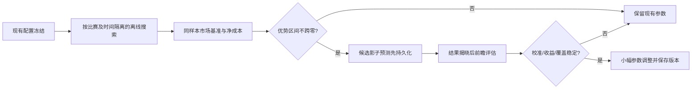
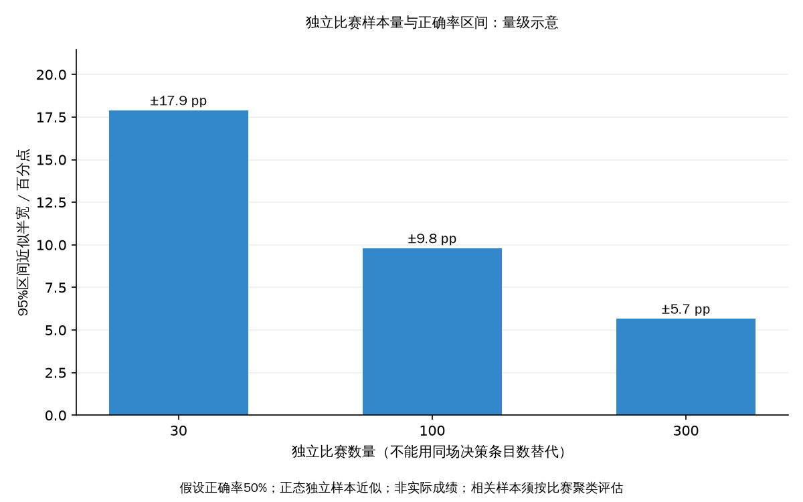
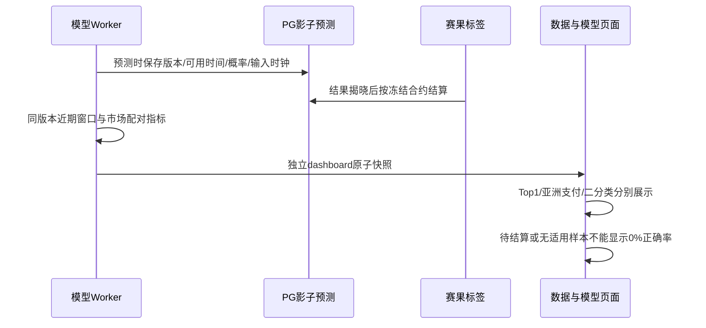

# 运行参数优化：论文依据、当前证据与保守配置

核验日期：2026-10-12。本报告针对当前 Python 算法融合、独立 Logistic 校准模型、按比赛时间隔离验证与 PG/S3 持久化路线。推荐范围是待验证的工程搜索空间，**不是论文给出的通用最优值**。本次没有保存线上设置、改变投注金额、开启模型/混合模式或放宽提交门槛。

## 当前证据与可执行结论

生产只读 `/api/v1/data-model` 响应显示：已有候选版本 `20261012T060805554349Z`，其晋级为 `approved=false`；独立测试为 132 场，配对按场 Brier 差值 -0.000136896，95% bootstrap 区间 [-0.000737113, 0.000569694] 跨过 0。3 个未校准滚动时间折的 Brier 差值分别约 +0.000153、+0.000204、+0.000048，均未稳定优于同样本市场。证据来源为真实响应，A级；这些数值不是新影子模型的前瞻正确率。只读响应留在忽略目录 `output/playwright/data-model-production-before.json`。

因此具体建议是：**保持纯算法模式；保留现有最低概率、净EV、真实提交优势、训练周期；不因候选已训练而提高仓位或降低门槛。** 新增影子候选观察，在结果揭晓前持久化真实预测，再根据按比赛独立的前瞻证据调整。现有 30 场证据门槛只能作为运行最低值，不是统计可靠性保证；先在报告和 UI 明示误差，后续至少积累 100~300 场独立前瞻比赛复核。

正确率与收益率必须分开：赔率 1.50 时，即便 60% 全赢率也有 `EV=0.60×1.50−1=−10%`；赔率 2.20 时，48% 全赢率的毛EV为 `+5.6%`。这只是理想二元例子，不代表已实现收益；真实净收益还受走盘/半注、报价变化、成本、重复合约相关性和成交影响。单纯提高 `min_probability` 可能提高正确率却减少净收益。

## 学术依据及适用边界

| 来源 | 已核验证据 | 本项目适用结论 | 不能推出的结论 | 分级 |
| --- | --- | --- | --- | --- |
| Dixon & Coles (1997), [DOI 10.1111/1467-9876.00065](https://doi.org/10.1111/1467-9876.00065) | Crossref 标题、作者和出版记录 | 足球进球强度及低比分依赖修正值得作为下一阶段候选；当前盘口反推 Poisson 不是已实现 Dixon-Coles 球队模型 | 该论文不能证明本项目的5400秒缩放、100场周期或即时盘口参数最优 | A 元数据；未在本次取得全文，模型效果属待验证 |
| Gneiting & Raftery (2007), [Strictly Proper Scoring Rules](https://doi.org/10.1198/016214506000001437) | Crossref 出版记录与研究主题 | 采用 Brier/Log loss 比只看阈值准确率更适合选择概率模型 | 更低离线 Brier 不自动等于可交易盈利 | A 元数据；理论结论 B |
| Clarke, Kovalchik & Ingram (2017), [Adjusting Bookmaker’s Odds](https://www.sciencepublishinggroup.com/article/10.11648/j.ajss.20170506.12) | 期刊页摘要：Power 处理 favorite-longshot bias，并在三个数据集优于比例法或与 Shin 相当 | 离线比较比例/Power/现有去水共识，同比分组公平概率、校准及收益 | 三个其他数据集的结果不能直接推广为乐鱼滚球最优去水法 | A 原始摘要 |
| Baker & McHale (2013), [Optimal Betting Under Parameter Uncertainty](https://doi.org/10.1287/deca.2013.0271) | Crossref 精确题名、作者、DOI | 参数估计不确定性需要进入仓位风险评估，避免按点估计提高 Kelly | 未取得全文，不能声称论文指定0.1或0.25系数 | A 元数据；具体系数为工程建议 |
| Busseti, Ryu & Boyd (2016), [Risk-Constrained Kelly Gambling](https://arxiv.org/abs/1603.06183) | arXiv 原始摘要与 HTML 全文；回撤约束、凸近似和数值实验 | 不把半 Kelly/四分之一 Kelly 当作已证明回撤保证；本项目还需组合回撤约束 | 不应照搬模拟收益，也不能把同场仓位缩放当作论文的完整凸优化 | A 预印本全文 |
| Walsh & Joshi (2023), [Accuracy or Calibration?](https://arxiv.org/abs/2303.06021) | 原始摘要明确研究 NBA、单赛季赔率实验，强调校准选择 | 校准、Brier、可靠性应与方向正确率同时展示 | 文中的 ROI 数值不适用于足球滚球，也不是本项目测量值 | A 原始预印本摘要；外推 B |

已抓取的7个来源 HTTP 均为200，记录见 [source_fetches.json](data/source_fetches.json)。自动 Crossref 题名查询还返回两个无关投资/信号论文；本报告明确排除，仅引用 Baker & McHale 的精确题名匹配，不把搜索结果都当作证据。Dixon-Coles 和 proper-scoring 本次只核验出版元数据，未伪称逐页阅读全文。

## 三种成熟路线比较

此表为架构比较，不是主观数值评分；没有延迟实测的项目标为需测量。

| 路线 | 输入与数据要求 | 概率表达 | 选择指标 | 风险表达 | 在线开销 | 维护成本 | 本项目现状 |
| --- | --- | --- | --- | --- | --- | --- | --- |
| 市场去水 + Poisson 算法 | 实时完整盘口、比分/时钟 | 强度/分布与市场公平概率 | 时间验证、按场Brier、净EV | 现有仓位与同场缩放 | 已有本地CPU路径，延迟需持续监测 | 较低 | 当前生产路线 |
| Offset Logistic 校准 | 决策前冻结特征、多盘口标签 | 市场logit偏置加残差校正 | Brier/Log loss/校准、独立测试 | 需另接执行和仓位风控 | 数十参数，推理开销低但需测量 | 中等 | 候选未稳定优于市场，先影子 |
| Dixon-Coles/动态球队强度 | 跨赛季球队、对手、主场、时间和低比分依赖 | 结构化比分联合分布 | 时间外比分概率、市场对照 | 仍需参数不确定性/组合约束 | 推理较低，训练和冷启动需测量 | 较高 | 当前盘口反推不能冒称此路线 |

## 参数清单：保持、候选范围与调整条件

以下“初值”是 `service/runtime_settings.py` 的代码默认值，**不是未经读取就宣称线上配置相同**；不改已有持久化配置。数值范围是工程先验，必须离线冻结搜索，再用新时间段/影子评估确认，禁止在同一测试集反复挑最优后报告。

| 参数 | 当前代码初值 | 本次动作 | 离线候选范围 | 必须观测的条件 |
| --- | --- | --- | --- | --- |
| `decision_mode` | algorithm | 保持现有纯算法，不启用model/hybrid | 仅影子候选 | 晋级门槛未通过；前瞻净成本优势需另证 |
| `devig_method` | proportional | 保持；增加问号研究建议 | proportional / power；AUTO共识为独立算法对照 | 同场完整组、赔率极端段Brier/校准、三向归一化 |
| `fractional_kelly` | 0.25 | 不提高；固定金额模式另有金额风险 | 0.10 / 0.15 / 0.25 | 回撤与错估敏感性；不改变预测正确率 |
| `min_probability` | 0.52 | 保持，不为追求命中率上调 | 0.50~0.60 | 各盘口覆盖/赔率、净收益区间及正确率一起看 |
| `min_ev` | 0.02 | 保持，不放宽真实门控 | 0.02~0.05 | 执行成本、成交概率/改价偏差；冻结输入 |
| `betting_min_edge` | 0.05 | 保持真实提交阈值 | 0.03~0.08仅离线 | 没有成本与前瞻收益证据不下调 |
| `betting_min_evidence_matches` | 30 | 不降低；UI明确证据薄弱 | 100~300用于复核/小步提高候选 | 按独立比赛cluster而不是同场重复条目 |
| `model_training_matches` | 100 | 保持更新周期 | 100 / 200 / 300新增有效已结场次 | 无数据泄漏、更新次数/资源/漂移与时间外校准 |
| `weight_prior_matches` | 20 | 保持；小样本时加收缩候选 | 20 / 50 / 100 | 按场Brier技能权重、极端权重稳定性 |
| `max_algorithm_weight` | 0.60 | 保持，不让单成员支配 | 0.40 / 0.50 / 0.60 | 多成员有效数、相关性、最弱时间折；注意cap≥1/N |
| `execution_cost` | 0.001 | 保持，先测量后校准 | 根据真实请求报价/成交日志估计分层成本 | 当前参数是估算，不能当准确已知0.1%成本 |
| `betting_min_hit_count` | 代码3，线上1（用户要求首次计数） | **保留线上1，不调回3** | 不进行改变用户次数偏好的搜索 | 这是决策出现次数，不是独立结果样本；赔率变化不新增注单身份 |
| `max_total_exposure` | 0.25 | 保持现状；不扩大同场敞口 | 0.10 / 0.15 / 0.25仅研究仓位敏感性 | 同场多盘口实际相关性；这是研究Kelly仓位缩放，不替代真实固定金额限额 |
| `risk_correlation` | 0.40 | 保留；不得称已测量相关系数 | 0.20~0.60仅离线 | 联合损益/算法分歧与按场回撤；不是提高预测正确率的万能系数 |
| `quote_max_age_s` | 15秒 | 保留当前新鲜度策略 | 5~30秒仅历史推送时钟覆盖研究 | 测量接收年龄分布、暂停/改价和请求行为，避免误删有效信号 |
| `state_max_age_s` | 90秒 | 保留比分时钟校验 | 30~120秒仅研究 | 实测赛况推送间隔与过期状态下的估值风险 |
| `anchor_max_age_s` | 120秒 | 保留衰减锚点，比分变化必须重置 | 60 / 120 / 180秒 | 同比分时间窗与强度漂移，分开评估全场/半场 |

这里的报价/赛况/锚点新鲜度针对输入本身是否可用；**盘口接收至提交不超过2秒是性能目标，不是业务拒单阈值**，不得因为流程超过2秒就拒绝自动下单。保留用户现有真实投注金额、启停和纯算法模式；本次不进行真实下注验证。

### 方程与样本敏感性

市场基准 `q_i=1/o_i`；比例去水 `p_i=q_i/Σq`；Power 找到 `k` 使 `Σq_i^k=1`，再归一化。二元无走盘 Kelly `f*=max(0,(op−1)/(o−1))`、折扣后 `f=λf*`；因此胜率误差对仓位的导数为 `λo/(o−1)`，低赔率下误差更敏感。含走盘/半注应使用项目支付质量，不能把该简化方程替代实际结算。

样本独立近似下，50%正确率的95%误差半宽为 `1.96√(0.25/n)`：30场约17.9pp、100场9.8pp、300场5.7pp。这是解释量级的正态近似，不能用于同场上千条决策；实际评估应按比赛cluster重采样并给出区间。可复现结果见 [sensitivity.csv](data/sensitivity.csv)，脚本为 [parameter_sensitivity.py](scripts/parameter_sensitivity.py)。参数从30改100/300时区间缩小，决策频次增加却不增加独立比赛数；0.10~0.25 Kelly均不能使负EV成为正EV。

图由 [make_figures.py](scripts/make_figures.py)读取上述CSV绘制，强制挂载文泉驿中文字体；没有模型盈利或实际战绩预测。

## 执行与验收

1. 本次先修复观察链路和统计展示：候选可影子观察但不冒充生产；必须使用已持久化预测概率，而非事后按新权重重算。全库未审查标为null且有说明，抽样/估计数量标明口径。
2. 冻结一段新时间期，运行上述离散候选参数；市场组、盘口/半场、模型版本、标签可见时间保持一致。记录正确率、Brier、Log loss、ECE、覆盖、净收益/回撤和资源开销。
3. 在另一个未来时间段前瞻确认；每场多个盘口保留，但统计按比赛等权。对成本/概率误差5%与50%的情景作敏感性检查，方向不稳时保持参数。
4. 当前证据只支持保守“保持”清单，不支持保证收益提升或启用候选模型。下次调整建议应附可核验差值区间和版本，最多小步提高证据/收缩，不放宽业务门控。
